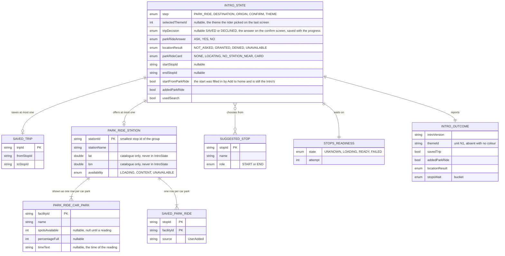
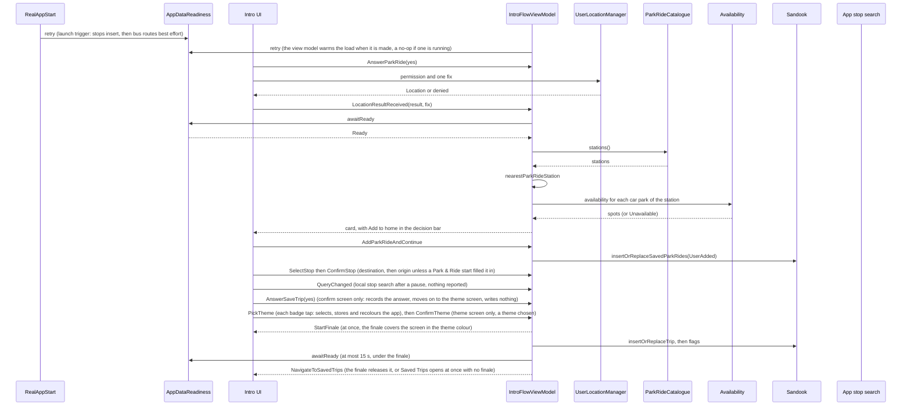
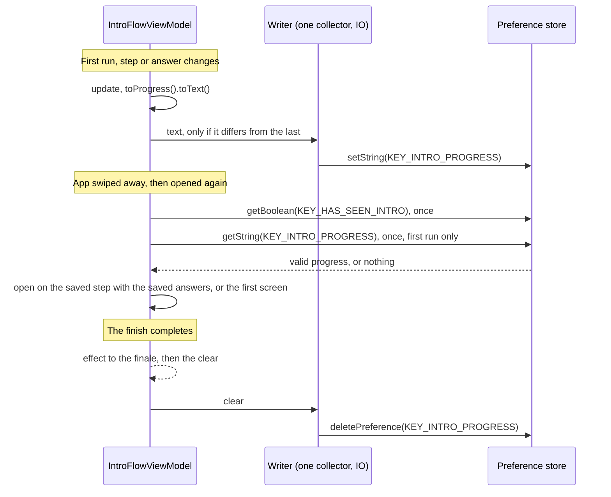
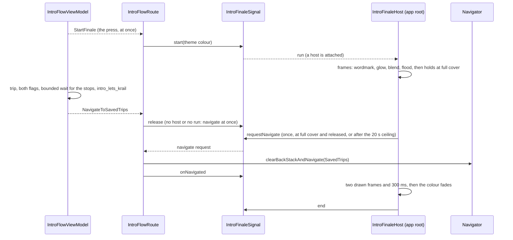

# Feature ERD: Intro redesign (Park & Ride question and first trip)

Status: Agreed for build (rows IA1 to IA13 of "Assumptions for approval" in section 9 approved by ksharma-xyz on 2026-11-21; the measurement targets and review points in section 11 are still owner decisions)
Owner: ksharma-xyz
Touches: `feature/trip-planner/ui` (`intro/`), `feature/trip-planner/state` (`intro/`), `core/analytics`, `io/gtfs` (stops readiness, first PR), `sandook` (one preference key; the progress key of unit U10 is a constant in the Intro package), `.maestro/` (one shared flow, only if the tag changes)
Rebuild: the Intro is being rebuilt as five screens, one question each (theme, Park & Ride, destination, origin, confirm), in four units. Unit R1 holds the step model, the decision bar, the headline and the Park & Ride screen, unit R2 the theme screen and the flip that makes it the first, unit R3 the other three screens, and unit R4 the finale after the last one (section 3, "Unit R4, as built", and section 5, "The finale"). Where sections 1, 2, 6, 9 and 11 still name two steps, Next, Skip for now or one bottom button, sections 3, 5, 7, 8 and 10 are the current text.

The design behind this document was settled in review on 2026-11-21 against an interactive prototype that is not part of
this repository. Everything a builder needs from it is restated here, so this file stands alone.

---

## 1. Problem and scope

- **Who has the problem.** A rider who has just installed KRAIL taps through a tour of features and lands on a home screen
  that shows nothing of theirs. Nothing they did in the tour is kept.
- **What this does.** Replaces the seven-page carousel with a two-step first run that ends with something saved.
  - Step 1 asks "Show parking spots at your nearest station?". Yes asks for location, shows the nearest Park & Ride car park with its live
    spots and an Add to home button. No, or a denied location, goes straight to step 2.
  - Step 2 saves a first trip. The rider picks a start and an end from suggested stops (or searches for another stop), sees
    the pair as one tile, and taps one button: Save and start, or Skip for now.
  - No button ever waits for the stops data. The last one starts the finale at once, and any wait for the stops runs under
    the finale's solid colour, for at most 15 s. The data layer reports readiness, failure and retry
    (`DATA_READINESS` in section 3).
- **What it deliberately does not do.**
  - No alerts, no departures and no trip planner call in the Intro. A trip is saved from two stop ids with no network.
  - No horizontal pager, no card or gradient border, no map, no transport mode picker, no invite page.
  - No hard gate. A rider can always finish with nothing saved.
  - No change for riders who already have the app. They never see the Intro and keep the one-time Park & Ride suggestion
    planned for the map-first home stack.
  - Does not build the home screen changes. It supplies two things the home stack reuses: `nearestParkRideStation` and the
    "suggestion shown" flag.

## 2. Entities and relationships



| Entity | Layer | Source of truth | Identity key | Lifetime |
|---|---|---|---|---|
| `IntroState` | ui | `IntroFlowViewModel` | none, one per Intro | Process, survives rotation (view model plus saved state). Its progress also survives the app being swiped away or force stopped (`IntroProgress`, below) |
| `IntroProgress` (unit U10) | ui | The preference store, one string under `KEY_INTRO_PROGRESS` | none, one per install | From the first change on a first run until the finish completes, or the Intro is replayed from Settings |
| `SuggestedStop` | domain | Bundled default, optionally Remote Config key `intro_suggested_stops` | `stopId` | Until the list is next refreshed |
| `ParkRideStationPickerItem` (existing) | domain | `ParkRideCatalogue.stations()` | `stationId` (smallest stop id of the group) | Per call |
| `ParkRideCardStation` and `ParkRideCarPark` (new) | ui state | `IntroParkRideStep`, from the catalogue item and the stored readings | `stationId`, `facilityId` | The Intro, in memory. Only `stationId` is saved |
| `SavedParkRide` (existing) | db | `NswParkRideSandook` | (`stopId`, `facilityId`) | Until the rider removes it |
| `SavedTrip` (existing) | db | `Sandook` | `tripId` | Until the rider deletes it |
| `KEY_HAS_SEEN_INTRO` (existing) | prefs | `SandookPreferences` | key | Install |
| `KEY_PARK_RIDE_SUGGESTION_SHOWN` (new) | prefs | `SandookPreferences` | key | Install |
| `StopsReadiness` (new) | domain | `AppDataReadiness` in `:io:gtfs` | none | Process |
| `IntroOutcome` | analytics | built once, at finish | none | One event |

**Collision check, answered from real data** (the Remote Config default catalogue, the stops table and real trip events):

- One station name maps to several stop ids in the stops table (the station and its platforms or street-side stops). The suggested stops carry the station-level (parent) id, to be confirmed against the table for each stop.
- A Park & Ride "station" is not always a station. In the default catalogue (42 rows, 37 facilities) seven rows point at bus
  stops named like "Warriewood B-Line, Pittwater Rd". A start label built as "<name> Station" would be wrong for them. The
  label must be the stop's own name.
- Three catalogue rows point at stop ids that are absent from the stops table (a second Hornsby id, a second Mona Vale id and
  West Ryde). Such a station has no coordinates, so it can never be the nearest, and it can never pre-fill a trip start.
- One station maps to many car parks and one car park can serve several stop ids. `groupIntoStations` already resolves this
  with a union find. The Intro reuses it and does not group again.

## 3. Interfaces

```kotlin
// module: :io:gtfs (first PR), callers: IntroFlowViewModel, later SearchStop and the map-first home
sealed interface StopsReadiness {
    data object Unknown : StopsReadiness
    data object Loading : StopsReadiness
    data class Ready(val stopCount: Int) : StopsReadiness
    data class Failed(val attempt: Int, val reason: String) : StopsReadiness
}

interface AppDataReadiness {
    val state: StateFlow<StopsReadiness>
    /** Suspends until the stops are Ready or Failed, or until [timeoutMs]. Never throws. Starts the first run if none has started. */
    suspend fun awaitReady(timeoutMs: Long): StopsReadiness
    /** A no-op while Loading or Ready. From Failed one more attempt. From Unknown the launch trigger. */
    fun retry()
}

// StopsManager.insertStops() changes from Unit to Result<Unit>, and the table clear moves inside the insert transaction.
```

How the first PR behaves, where it adds to the signatures above:

- `RealAppStart` calls `retry()` once at launch and no longer waits for the inserts, so remote config set up starts earlier.
  `retry()` is a no-op while Loading and while Ready, so calling it again in a live process never demotes good data. From
  Unknown it gets up to three automatic retries with a growing backoff. From Failed it is one more attempt.
- The automatic retries show as Loading, never as Failed. `Failed.attempt` counts every attempt in the process. A run that
  is cancelled or breaks unexpectedly ends in Failed, never stuck in Loading.
- Ready is about the stops only. It means all of: the stops insert returned success, the stored stops version is at or above
  the bundled one, the stop count is at or above the existing floor, and a read of one known stop (Central, the parent stop
  `200060`) returns a row. The decision is one pure function, `reduceReadiness`, so a table test holds every combination.
  A test reads the bundled data file and fails if that stop is ever dropped by a data refresh.
- The bus routes insert follows in the same run once the stops are Ready, best effort. A failure there is logged, does not
  change the state, and is not retried until the next launch. `awaitReady` returns as soon as the stops are Ready and never
  waits for the bus routes. The Intro needs only the stops table.
- WAL and the clear inside the transaction: proven on the JDBC test driver. The app sets WAL explicitly on iOS
  (`JournalMode.WAL`) and on Android (`enableWriteAheadLogging()` in `SandookCallback.onOpen`), and the `-wal` and `-shm`
  files have been seen on a real Android phone. The Android and iOS drivers themselves are not run in a test.

```kotlin
// module: :feature:trip-planner:ui, intro/, pure, no I/O, runs under a fixture suite
internal data class SuggestedStop(val stopId: String, val name: String)
internal data class SuggestedStops(val start: List<SuggestedStop>, val end: List<SuggestedStop>)

/**
 * Parses the Remote Config value, `{"start":[{"stopId":"..","name":".."}],"end":[..]}`, ignoring unknown fields. Returns
 * [fallback] as a whole, never a repaired half, for: text that is not that shape, an empty list, a stop id repeated
 * within a list, a blank id or name, or a start that equals the only end (or an end that equals the only start), where
 * picking that stop would leave the other list with nothing different to pick. The same stop on both lists is normal.
 * `name` is the stop's own name in the stops table (for example "Central Station").
 */
internal fun parseSuggestedStops(json: String, fallback: SuggestedStops): SuggestedStops

/**
 * The single nearest station within [radiusKm] of [location], or null. Stations with no coordinates are skipped.
 * Shared with the map-first home stack, which reuses it.
 */
internal fun nearestParkRideStation(
    location: LatLng,
    stations: List<ParkRideStationPickerItem>,
    radiusKm: Double,
): ParkRideStationPickerItem? // distance is GeoUtils.haversineDistance, the edge is inclusive, INTRO_PARK_RIDE_RADIUS_KM = 5.0

/** The start to pre-fill after Add to home (IA6), or null. Smallest stop id of the station that resolves, the stop's own name. */
internal fun parkRideStartPrefill(station: ParkRideStationPickerItem, stopNameLookup: (String) -> String?): SuggestedStop?

/**
 * What the decision bar says and does, or null when the screen shows no bar. A table over the step, so a new step is a
 * compile error and not a screen with the wrong bar. Two buttons, never three: the negative answer on the
 * left (an outlined button) and the primary on the right (filled in the theme colour, test tag `intro.action.primary`).
 * No button is ever disabled (unit X1). A button is shown and live, or it is not shown at all: a hidden button keeps its room
 * and takes no touch, and is never drawn greyed. The one exception to two buttons is the THEME screen (owner's ruling,
 * 2026-11-22), whose bar is the primary alone and whose `left` is null: `IntroBarTest` pins that no other step can lose its
 * left button.
 *   THEME (the last screen, unit U9): "Let's KRAIL" alone, a full width taj button, the same height as the two button
 *                 bar so nothing moves when it appears. It confirms the theme on show and ENDS THE INTRO. It is NOT SHOWN
 *                 (not disabled) until a badge is tapped, when it fades in where the room for it was kept (`IntroBar.shown`).
 *                 There is no no, and no way to cycle: a theme is chosen only by tapping its badge. It says "Let's KRAIL" at every
 *                 text size, and a screen reader hears "Let's KRAIL, use this colour" (the visible label is the start of the
 *                 spoken one, so voice control works). It is live whatever the stops data says: the press starts the finale
 *                 at once and the finish waits for the stops, if it must, under the finale (section 5, finish order).
 *   PARK_RIDE:    asking is "No thanks" and "Yes please" at every text size (unit X3), the second said as "Yes please, show me
 *                 parking spots" to a screen reader. A card, or a station still being looked for, is
 *                 "Not now" and "Add to home". While the station is looked for the bar keeps both buttons' room, with "Not now"
 *                 live and "Add to home" not shown (`rightShown` false, never disabled), so the bar never changes size or jumps.
 *                 No station near, within 5 km and then 10 km (unit X2), shows the message and one OK, and moves on only
 *                 with it. A denied or missing location and stops that are not usable show no bar, because the flow has
 *                 already moved on.
 *   DESTINATION, ORIGIN: "Yes, this one" alone (unchanged by unit X1), a full width taj button, like the theme screen. It is NOT SHOWN until the
 *                 rider has tapped a stop (`IntroState.selectedStop`), keeps its room, and then confirms that stop and moves on.
 *                 There is no "No, search": the field opens the keyboard itself when it is tapped.
 *   CONFIRM:      "Not now" and "Yes, save it". Both only RECORD the answer (`IntroUiEvent.AnswerSaveTrip`, kept as the
 *                 transient `IntroState.tripDecision`) and move on to the theme screen. Neither waits for anything,
 *                 and nothing is written here. Not now is the only way to leave without saving.
 */
internal fun introBar(state: IntroState): IntroBar?
internal data class IntroBar(val left: IntroBarAction?, val right: IntroBarAction, val shown: Boolean = true, val rightShown: Boolean = true) // left is null on the screens that ask for a pick; shown and rightShown are false while there is nothing to answer, and the room is kept. There is no disabled state
/** [label] is what shows, at every text size. [spokenLabel] is the screen reader description and what voice control matches, [label] unless the button shows a shorter word than it says. */
internal data class IntroBarAction(val label: String, val event: IntroUiEvent, val spokenLabel: String = label)

/**
 * How the two buttons sit, from the width each needs for its whole label on one line. One row when the longer label fits
 * in half the room (even halves), or when both fit side by side (natural widths plus the spare shared). Otherwise stacked,
 * the negative on top and the positive under it (unit X3), each button the full width. Nothing is squeezed, shortened or wrapped
 * to make a row fit. The natural widths are the widest label each button can have on the screen (`IntroBar.labelPairs`).
 */
internal fun introBarPlan(leftNatural: Int, rightNatural: Int, gap: Int, available: Int): IntroBarPlan
internal sealed interface IntroBarPlan {
    data class OneRow(val leftWidth: Int, val rightWidth: Int) : IntroBarPlan
    data object Stacked : IntroBarPlan
}

/** savedTrip = state.saved, skipped = no saved trip and no complete pair. Param names and values as section 11.2. */
internal fun IntroState.toOutcome(stopsWait: StopsWait): IntroOutcome
internal fun IntroOutcome.toParams(): Map<String, Any>
/** Failed is failed. None is no wait, under 2 s, 2 s to 5 s inclusive, over 5 s. Takes a Duration, never reads a clock. */
internal fun stopsWaitBucket(waited: Duration, readiness: StopsReadiness): StopsWait
```

```kotlin
// module: :feature:trip-planner:state, intro/
// Every field has a default, so IntroState() is the first screen. hasTrip is true only when both stop ids are set.
data class IntroState(
    val step: IntroStep,
    val parkRideAnswer: ParkRideAnswer,
    val locationResult: LocationResult,
    val parkRideCard: ParkRideCardPhase,
    val startStopId: String?, val startName: String?,
    val endStopId: String?, val endName: String?,
    val startFromParkRide: Boolean,
    val addedParkRide: Boolean, val usedSearch: Boolean,
    val saved: Boolean,
)

/** What the question step shows below the question. Added is a Card while addedParkRide is true, not a fifth phase. */
sealed interface ParkRideCardPhase {
    data object None : ParkRideCardPhase                         // unanswered, or no usable location
    data class Locating(val stationId: String? = null) : ParkRideCardPhase // skeleton. stationId only while a saved card is worked out again
    data object NoStationNear : ParkRideCardPhase                // no station within 5 km or 10 km: a message and OK (unit X2)
    data class Card(val station: ParkRideCardStation) : ParkRideCardPhase
}

/** No coordinate of the rider and none of the station: the station position stays in the catalogue item. */
data class ParkRideCardStation(
    val stationId: String, val stationName: String,
    val carParks: ImmutableList<ParkRideCarPark>,                // names first, readings once the one call is back
    val availability: ParkRideAvailabilityState,                 // Loading, Content, Unavailable
)
data class ParkRideCarPark(
    val facilityId: String, val name: String,
    val spotsAvailable: Int?, val percentageFull: Int?, val timeText: String?, // null until a reading exists
)

// module: :feature:trip-planner:state, intro/
enum class IntroStep { PARK_RIDE, DESTINATION, ORIGIN, CONFIRM, THEME }
/** The first screen of the flow, Park & Ride. One constant, so a screen can be put before it or taken off the front. */
val IntroFirstStep: IntroStep = IntroStep.PARK_RIDE
/** The answer on the confirm screen. Transient: it carries no stop and no name, and it is not saved with the screen (a later unit decides that). */
enum class TripDecision { SAVED, DECLINED }

// module: :feature:trip-planner:ui, intro/ (internal, because SuggestedStop is).
sealed interface IntroUiEvent {
    data class AnswerParkRide(val yes: Boolean) : IntroUiEvent
    data class LocationResultReceived(val result: LocationResult, val location: LatLng?) : IntroUiEvent
    data object AddParkRideAndContinue : IntroUiEvent  // "Add to home": saves the station and moves on in one event
    data object DeclineParkRide : IntroUiEvent         // "Not now" on the card: moves on, and removes a station already added
    data class SelectStop(val stop: IntroStop) : IntroUiEvent   // a tap on a row or a typed result: selects it, shows the button, moves nothing on
    data object ConfirmStop : IntroUiEvent             // "Yes, this one": the selected stop is the end on the destination screen, the start on the origin screen, and the Intro moves on
    data class QueryChanged(val text: String) : IntroUiEvent // the typed text, searched locally after a pause, never reported or saved
    data class AnswerSaveTrip(val yes: Boolean) : IntroUiEvent // the confirm screen's "Yes, save it" or "Not now": records the answer (TripDecision) and moves on to THEME, writes nothing
    data class PickTheme(val themeId: Int) : IntroUiEvent // a badge was tapped: selects the theme, does not move on
    data object ConfirmTheme : IntroUiEvent            // "Let's KRAIL", the only button on THEME, the last screen: reports the choice once and FINISHES the Intro
}

/** One shot, delivered once through a Channel and never replayed after rotation. */
sealed interface IntroEffect { data object NavigateToSavedTrips : IntroEffect }
```

`IntroFlowViewModel` exposes `state: StateFlow<IntroState>`, `suggestedStops: SuggestedStops` (read once from the
`intro_suggested_stops` flag, empty default so the bundled lists apply) and `effects: Flow<IntroEffect>`. It takes a
`SavedStateHandle` and saves the step, answer, permission result, picks, the answer on the confirm screen and flags on every change as one JSON string, so
they survive rotation and the system saving the screen's state. It also saves which station the card was for (the station id, or a
flag when there was none near) and nothing else about the card: no car park, no reading, and never a coordinate. After
the system restores it the card is worked out again from that id (see section 5). Its writes and tracking live in `IntroCompletion`, which holds `Sandook`, `SandookPreferences`, `Analytics` and the IO
dispatcher, to keep the constructor under the detekt parameter limit.

**Resume after the app is killed (unit U10).** What the handle keeps does not survive a swipe away from recents or a force stop,
so the same progress is also kept in the app's own preference store, the one that holds `KEY_HAS_SEEN_INTRO` and
`KEY_PARK_RIDE_SUGGESTION_SHOWN`. There is no new storage library and no new file format: one string under one key,
`KEY_INTRO_PROGRESS`, defined in the Intro package (the `sandook` module is not touched).

```kotlin
@Serializable
internal data class IntroProgress(
    val version: Int,               // INTRO_PROGRESS_VERSION, 1. Any other value is ignored
    val step: IntroStep,
    val themeId: Int? = null,
    val parkRide: ParkRideAnswer = ASK,       // yes, no or none
    val locationResult: LocationResult = NOT_ASKED,
    val added: Boolean = false,
    val station: ProgressStop? = null,        // the station added to home, id and name
    val start: ProgressStop? = null,          // id and name only
    val end: ProgressStop? = null,            // id and name only
    val startFromParkRide: Boolean = false,
    val decision: TripDecision? = null,       // SAVED or DECLINED
    val usedSearch: Boolean = false,
    val saved: Boolean = false,
)
```

- `IntroState.toProgress()` and `IntroProgress.toState()` are the two mappings, `IntroProgress.toText()` and `introProgressFromText()` the
  serialiser. A text that is empty, cannot be read, has an unknown key or enum value, or has any version but the current one is
  `null`, and the Intro starts at the first screen. Nothing of it is half used.
- It never holds a coordinate, what was typed into search, the nearest stations, a car park, a reading or the selected row. A test
  holds that on the serialised text.
- While the rider is still on the Park & Ride screen and has not added a station, the question is saved as unanswered (answer none,
  permission not asked), whatever was tapped or looked up on it, so a rider who is back on it is asked again.
- `IntroProgressStore` (`read`, `write`, `clear`) is the one reader and writer of the key. `IntroCompletion` carries it as `progress`
  and adds `hasSeenIntro()`, so the view model's constructor stays at six parameters. The read is synchronous and happens once, when
  the view model is made, because the first frame must already be on the saved screen. The writes run on the IO dispatcher.
- `IntroProgressSaver` owns one conflated `Channel` and one collector in the view model's scope for the writes, so a save, a later save and
  the clear never pass each other and a save that is still waiting when a newer one arrives is dropped. `update` hands it the new state, and it
  writes only when the text differs from the last one handed over, so typing, a selection and a list that loads write nothing.
  `SavedStateHandle.openingIntroState` is the one place that decides what the Intro opens with.
- On opening: the state is the handle's when the system saved one, otherwise the progress when the Intro has not been seen (`KEY_HAS_SEEN_INTRO`
  is not set) and there is a valid one, otherwise the first screen. When the Intro has been seen the screen is a replay from Settings: it
  starts at the first screen, clears whatever is stored, and never writes progress. A saved progress never survives a completed Intro.
- The clear is sent after the effect that hands the finish to the finale, and `update` writes nothing once the finish has completed.

The Park & Ride step is two more classes, so the view model stays small. `IntroParkRideGateway` is the injected one, like
`IntroCompletion`: the catalogue, the availability loader (`ParkRideAvailabilityLoader`, the same one the Saved Trips card
and the picker use), `NswParkRideSandook`, the IO dispatcher, the stops table's name lookup and `Analytics`, and it does the
reads and the writes of Add to home. `IntroParkRideStep` is built by the view
model in its own scope and holds the order of things: the answer, the one location result, the wait for the stops, the
nearest station and the one availability call. It never asks for the permission: the screen does, and sends
`LocationResultReceived`.

- Every interface has a fake in `:core:testing`: `FakeAppDataReadiness` (controllable state), the existing location, catalogue,
  sandook and park ride fakes, and a fake clock. No `Clock.System` (the `ClockSystemBan` rule).
- The Intro never calls the trip planner. `IntroFlowViewModel` keeps `StopsManager` out of its constructor and depends on
  `AppDataReadiness` instead.
- The Add to home action calls `NswParkRideSandook.insertOrReplaceSavedParkRides` with `UserAdded` and does **not** call
  `AppReviewManager.onDelightMoment(PARK_RIDE_ADDED)` (see IA11). The Intro has no review manager to call, and
  `IntroNeverReviewsTest` fails if any Intro source names one.
- Save trip calls `Sandook.insertOrReplaceTrip` with the two stop ids and names.
- The screen is `IntroFlowScreen`, stateless, and `IntroFlowRoute` is the thin stateful wrapper around it. The route collects
  `state`, `stopsReadiness` (the view model passes `AppDataReadiness.state` through, so the last button reads the data layer
  and nothing polls) and the one shot effects with the lifecycle, calls `IntroFlowScreen`, and owns the platform glue:
  `IntroLocationEffect` for the location permission and the one fix, and a call to `IntroFlowViewModel.onStepShown(step)` each
  time the step on screen changes. `onNavigateToSavedTrips` and `onNavigateToSearchStop` are parameters. The route builds step 2
  (`introFirstTripStep`) itself and receives the pick back with `IntroSearchResultEffect`.
- `IntroEntry` shows `IntroFlowRoute` with `koinViewModel<IntroFlowViewModel>(key = ...)`. The registration is
  `viewModel { params -> IntroFlowViewModel(savedStateHandle = params.get(), ...) }`. Koin 4.2.0 answers `params.get()` for a
  `SavedStateHandle` by calling `createSavedStateHandle` on the view model's creation extras, in common code, so Android and
  iOS take the same path. The Intro's owner on Android is the Activity, which supplies those extras, and on iOS it is Compose
  Multiplatform's default owner, which sets the same two keys. `IntroFlowKoinTest` creates the real registration, with fakes at
  its edges, on an Android host and holds that the handle is real and that what the view model saves lands in it. The iOS path is
  not run, because no simulator is used in this work, so it is a device case.
- The navigation entries carry no view model store, so a view model made in an entry belongs to the Activity and would outlive
  the Intro. The entry keys it on a value made once for each visit and saved with the entry, which gives Settings, which can open
  the Intro again, a new view model each time, and gives a turn of the screen and the search on screen the same one.
  `IntroEntryTest` holds all three.

Unit R3, the stop lists as pure functions (the destination, origin and confirm screens use them), where this document was
silent. Every rule here is a function of its inputs with a table test, in `IntroStopNames.kt`, `IntroStopLists.kt` and
`IntroStopRows.kt`:

```kotlin
// module: :feature:trip-planner:state. Ids and names only: a stop never carries a position.
data class IntroStop(val stopId: String, val name: String)
sealed interface IntroSearchPhase { data object Idle; data class Results(val stops: ImmutableList<IntroStop>); data object NoMatch }
// IntroState gained four fields, none of them saved: nearbyStops, stopModes (id to modes, for the row badges), query, search.
// Unit U8 added a fifth, selectedStop (IntroStop?, null on open), not saved either.

// module: :feature:trip-planner:ui, intro/, internal and pure
fun fromSuggestions(nearby: List<IntroStop>, curatedStarts: List<SuggestedStop>, size: Int = 5): List<IntroStop>
fun destinationSuggestions(curatedEnds: List<SuggestedStop>, size: Int = 5): List<IntroStop>
fun IntroState.stopRows(suggested: SuggestedStops): List<IntroStop>      // what the screen lists, in order, with none selected
fun IntroState.withStopSelected(stop: IntroStop): IntroState             // the tap: the selected stop, nothing chosen, nothing moves on
fun IntroState.withStopChosen(stop: IntroStop): IntroState               // the confirm: the pick, and on to the next screen
fun IntroState.toOutcome(stopsWait: StopsWait, declined: Boolean = false): IntroOutcome
```

- **The origin list.** `fromSuggestions` takes the stops near the rider, nearest first, collapses them by station name (a stop's
  name up to its first comma, so `Chatswood Station, Stand A` and `Chatswood Station` are one station, and never by the stops
  table's parent flag, which is an operator ruling), keeps the nearest three, and fills to five from the curated starts. A station
  that is nearby and curated shows once, at its nearby place, de duplicated by id and by name. With no fix it is the curated list
  alone, and with fewer than three nearby it is made up from the curated list. The row of a collapsed station is the stop named
  exactly as the station, else the nearest stop of it, and it keeps its own id and name.
- **The destination list** is the curated ends alone: where a rider goes is not where they stand, so a fix never changes it.
- **The order of the rows, with none selected (changed in unit U8).** The first row is the nearest station when there is a fix and
  the first curated stop when there is none, and it is a row like any other: no row is selected or highlighted when a screen
  opens, because a pre-selection reads as already chosen. `highlightedStop`, `defaultDestination` and `defaultStart` are deleted, and
  `stopRows` is the order and nothing more. With a Park & Ride station added the origin screen is passed over and that station is
  the start. Coming back to a screen, the rider's earlier choice leads the list even when it was found by search and is not a
  suggestion, and the fifth suggestion makes way, and it is still not selected. Results from a typed search are listed in order and
  none is selected, and with no match there are no rows.
- **Never the same place twice.** The stop chosen for the other end is left out of the list, by id and by station name, so a trip
  never starts and ends at one place. Picking the Park & Ride station as the destination clears the start it filled in, and the
  origin screen comes back.
- **Selecting, then choosing (unit U8).** A tap on a row or a typed result is `SelectStop`, which is `withStopSelected`: that stop is
  the selected one, highlighted with the activated row treatment and announced as selected, and the single button appears. A tap on
  another row moves the selection, and a tap on the selected row keeps it. Typing text that differs from what was there, and
  clearing the field, drop the selection, because the list under it is a different one and a button for a stop the rider can no
  longer see would be misleading. The right button, `ConfirmStop`, ends in `withStopChosen`, which also drops the selection: it sets the end on the destination screen and
  the start on the origin screen, drops the typed text and results, sets `usedSearch` when the stop is one of the typed results,
  and moves on in the flow as it stands after the pick. With a Park & Ride start the flow goes from the destination to the confirm
  screen (`IntroStepFlow`, table tests). Any two chosen stops reach the
  confirm screen with a complete trip, which a test holds for every pair of the real curated lists.
- **The events.** `SelectStop(stop)` is a tap on a row, `ConfirmStop` is the right button and takes the selected stop (and does
  nothing with none selected), and `QueryChanged(text)` is the field. `ChooseStop`, `UseHighlightedStop` and `FocusSearch` (the old
  left button, `No, search`) are deleted. `PickStart`, `PickEnd` and `StopPickedFromSearch` belonged to the earlier first trip screen
  and are deleted.
- **The destination and origin screens, as built.** `IntroStopStepContent` draws both: `IntroHeadline` (destination "Where", "to?" with the pin, origin "Where", "from?" with the emoji `introEmojiFor` gives it, since unit U8), a taj `TextField` with
  `introStopFieldColors()` (taj's default colours in unit W1, which had no fill on the page, so the shared `softFieldColors()` since unit X1), and the stops below it as `IntroStopRow`, which is
  `StopLabelAssignRow`, the row Search Stop draws, with a new `showLabelAssign` parameter (default on, so Search Stop is unchanged)
  turned off so there is no chevron. The selected row takes the app's activated row treatment (`themeBackgroundColor()` with a
  rounded shape, as `ManageStopLabelRow` does) and is announced as selected. In the Intro that tint is the screen's own colour and
  not the app theme (unit X4, row X4-1). The field's placeholder is Search Stop's own
  (`barPlaceholderFor` with the To or From bar, which the To and From form uses too), its filter is Search Stop's
  (`stopSearchInputFilter`, extracted from the old `SearchTopBar` and now the filter of the form's bars as well) and its
  cap is `SearchQueryAnalyticsRedaction.MAX_QUERY_LENGTH`. `IntroStepFrame` gained `centreMiddle` (default true): the stop screens
  passed false, so the field and rows started straight under the headline and never moved when the list changed length. Since unit W1 the stop screens
  have a frame of their own (`IntroStickyStopFrame`, below) and no screen passes false.
- **The keyboard.** Only the screen can close it, so `IntroKeyboardAction` (a pure table over the event, now `Close` and `None`) says
  what an event does to it: `SelectStop` and `ConfirmStop` hide it and clear the focus, everything else leaves it alone.
  `IntroFlowScreen` sends every event through that table and then to the view model. Nothing opens it: the field takes the focus
  and the keyboard when the rider taps it, and never by itself, so a screen opens with the list in view.
- **Removed.** The earlier first trip body (`IntroFirstTripStepContent`, `IntroFirstTripLayout` with the `FIRST_TRIP_*` strings and
  `Search another stop`, their previews) and the old search hand-off (`IntroSearchResult`, `IntroSearchResultEffect`, the
  `onNavigateToSearchStop` parameter of `IntroFlowRoute` and `IntroEntry`) are gone: nothing opens Search Stop from the Intro now, so
  the result bus is not used by it.
- **The confirm screen, as built.** `IntroConfirmStepContent`: `IntroHeadline` ("Save", "this trip?" since unit X3, with the star
  from `introEmojiFor`) and the real `SavedTripCard` with `editing = true`, so it keeps its shape, its tint (the screen's own pink since unit X4,
  not the app theme) and the two names
  stacked and has no click and no ripple. It is given only ids and names and never a label, so it has no badges. It sits in the
  centred middle zone, so the screen is empty space around it. A screen reader reads the tile once, as `From <start> to <end>`
  (`confirmTileDescription`). A state without both stops shows no tile, which no flow reaches.
- **The star's celebration.** `IntroHeadline` gained `celebrate` (default off, so no other headline changes). On the confirm
  screen the star has the pop and one wobble every headline emoji has, and draws a burst behind it with `drawBehind`
  (`introBurst`, `drawBurst`): twelve circles and squares in the theme colour (`themeDecorColor`, the colour as decoration) that fly
  out and fade over 800 ms and leave nothing. Every shape, frame and the choice of celebration are pure functions held by table tests
  (`IntroBurst.kt`). With reduced motion (`isReduceMotionEnabled()`) the star is at rest and fades in over 200 ms with no burst; in a
  preview, a screenshot, and after a turn of the screen (the played flag is saved) it is simply there. The burst is clipped by the
  scrolling screen, so the part that flies past the left edge or the top is cut, which is the intent of a burst at the screen's edge.
- **Finishing, as built (moved to the theme screen in unit U9).** `IntroState.canFinish()` is true on the theme screen with a theme
  chosen, so a `ConfirmTheme` from any other screen, or with no theme, does nothing. The confirm screen's `AnswerSaveTrip` only
  records the answer and moves on. The finish is `ConfirmTheme` (the wait of up to 15 s for the stops, the trip write when the answer
  was yes and both stops are set, both flags, `intro_lets_krail`, then the effect), in the same order as before. `IntroFlowRoute` hands the effect to one function,
  `onIntroFinished(navigateToSavedTrips)`, which unit R3 left calling straight through to Saved Trips as the one place a finale
  wraps, and unit R4 wraps (see "Unit R4, as built").
- **The outcome.** `skipped` in `intro_lets_krail` is true only when the rider answered Not now on the confirm screen, and a saved
  trip is never skipped. It is no longer inferred from the picks. No event name and no param was added, and the other params keep
  their meaning.

Unit R2, as built (the theme screen), where this document was silent. The theme screen is `IntroThemeStepContent` in the
three zone frame, and everything it decides is in pure functions with table tests:

- **The choices.** `introThemeChoices()` is Train, Metro, Bus and Ferry, each with its `TransportMode`, its accessible
  name and its test tag (`intro.theme.train`, `intro.theme.metro`, `intro.theme.bus`, `intro.theme.ferry`). The letter is not kept:
  the badge is the app's icon and draws it. The theme colour is never kept: it is read from `KrailThemeStyle`, and
  `IntroThemeChoicesTest` holds that it is the mode's own fill (`NswTransportConfig.colorFor`), which it is for all four
  (#F6891F, #009B77, #00B5EF, #5AB031), so the badge and the recolour cannot disagree. The two fun themes stay in Settings, and Light rail and Coach have a colour in the app
  but no theme (no id and no tagline), so they are not offered. There is no cycle: the left button and `nextThemeChoice` are
  gone, and the badges are the only way to choose.
- **The headline.** Before a choice it is `Your favourite`, `transport mode`, `in Sydney?` (unit X2, three lines drawn, and the whole question `What's your favourite transport mode in Sydney?` spoken),
  with no exclamation mark and no colon. After a choice it is that theme's `KrailThemeStyle.tagLine`, shown exactly as the app wrote it,
  split by `taglineLines` after its first comma (one line when there is none, and the lines joined with a space are the
  tagline again). When the selection changes after the first entrance, the old headline fades out while the new one fades in and
  rises 16 dp in one 350 ms move with no overshoot (unit U8, `headlineChangeSpec`), and nothing enters line by line again. The emoji is `introEmojiFor(THEME, selectedThemeId)`: the scooter before a choice, then the train, metro, bus or ferry of the chosen badge. `IntroHeadline` has `reservedLinesHeight` (unit X3, it was `minLines`): the headline keeps the height of the
  emoji and that much room for its lines at the rider's text size, so the badges do not move when the words change. The theme screen no
  longer holds a fixed three: it plans every version it can show (the question as a hero with whispers, and the four taglines, in
  capitals, as drawn, at the width and text size it has) with a `TextMeasurer` and keeps the height of the tallest
  (`rememberThemeHeadlineHeight`, in whole pixels as the drawing is), because at the larger capitals a tagline takes up to three lines on its own.
- **The badge.** The app's own `TransportModeIcon` for the choice's mode, used unchanged: the circle in the mode's colour, the
  mode's first letter in white (the component fixes the text colour, so the letter is white on every badge, in light and dark), and
  its white ring (`displayBorder = true` on all four, like the website). Nothing is passed to it that picks a colour. It is drawn at
  the component's extra large size, `TransportModeIconSize.XLarge` (64 dp, twice the 32 dp of Large, added in unit U8. Since unit U11 it is a fixed
  64 dp at every text size, where it had followed the text as the other sizes do and was about 102 dp at 200 percent, with the letter
  at a fixed size in the heaviest weight and the white ring twice as thick, 6 dp inside the circle). A box the size of the icon carries it,
  with the app's own `klickable` on a circle laid over it: that is the touch target (at least 48 dp each way), and the tag and the
  semantics are on the box, and the float and the dance move it through `graphicsLayer`. The selected badge is shown by the dance and, with
  no motion, by sitting lifted 4 dp. The hand-built circle, its fill, its ring, its thicker ring, the 64 to 96 dp growth and the
  `getForegroundColor` letter are deleted. For a screen reader a badge is one button named for its theme with its selected state,
  and the letter is hidden from it.
- **The layout.** A `Column` centred, one badge to a row, with `spacingXXXL` (24 dp) between rows, so nothing is squeezed: four rows
  on a phone and at 320 dp with text at 200 percent. The middle zone scrolls with the headline when the room runs out (unit U8).
- **Motion, with two operator approved continuous exceptions on this screen only.** One clock in seconds
  (`rememberThemeClock`) drives both. Float: every badge that is not selected drifts on an ellipse, at most 6 dp up and down and
  4 dp sideways, on a loop of 8, 10, 12 or 13 seconds with its own phase (`floatOffsetAt`). Replaced by unit X5, row X5-5: a slow float of up to
  8 dp each way on a loop of 9, 11, 13 or 15 seconds, less where the room is smaller. Dance: the selected badge loops the
  website's pill-dance (`danceAt`): it turns from minus 10 to plus 10 degrees, rises 2 to 8 dp and grows 1.05 to 1.10, 0.65
  seconds each way with ease in and out, going back the way it came. `badgeFrame` blends the two over 250 ms when the selection
  changes, so a badge never jumps. Both are `graphicsLayer` transforms read inside the layer lambda, so a tick redraws four layers
  and recomposes and lays out nothing. The clock runs only while the screen is RESUMED (its driver is composed only then, the
  same lifecycle gate the rest of the app uses) and ends when the screen leaves. With reduced motion, in a preview and in a
  screenshot nothing moves: the selected badge sits lifted 4 dp (`settledFrame`), and that
  settled frame is also what every preview and snapshot draws.
- **Selecting and the live recolour.** A tap on a badge selects a theme and does not move on. The selection is a
  state, and `IntroFlowRoute` applies it to the whole app through `onApplyTheme`, which the entry wires to the same
  `TripPlannerNavigator.updateTheme` the Settings theme screen calls, so the Intro's buttons and every screen after it take the
  colour through the normal `KrailTheme`. It applies again each time the Intro is composed with a theme selected, such as after
  a turn of the screen. The colour does not jump: `IntroThemeBlend`
  wraps the Intro in `IntroFlowRoute` and re-provides `LocalThemeColor` as one `animateColorAsState` over 280 ms (`THEME_BLEND_MS`),
  so the single `Let's KRAIL` button, and anything else the Intro draws in the theme colour, blends to the tapped theme, carries on
  from where it is when the next badge is tapped, and settles on exactly the theme's own hex. With reduced motion it is the new
  colour at once (`snap`). The taj theme transition animates light and dark only, so this is the one animated colour and no new
  component. Measured on the Pixel 6 Pro before it, the colour changed in a single frame.
- **Storing it.** A pick also stores the theme with one small local write (`ThemeChoice.save`, a clear and an insert in the
  one row table, on the IO dispatcher, the last pick wins). It is per pick and not on confirm because the app reloads its theme
  from that table whenever it is recreated, so a theme held only until confirm would turn back to the default on a rotation.
  `ThemeChoice` is the write and the report that `ThemeSelectionViewModel` and the Intro both use, so the two cannot differ, and
  the Settings screen's behaviour and tests are unchanged. The Intro reaches it through `IntroCompletion`, which already holds
  Sandook, Analytics and the IO dispatcher, because the view model is at the constructor limit.
- **Confirming.** `Let's KRAIL` is not shown until a theme is selected. It reports the choice once with the existing
  `analytics.trackThemeSelectionEvent(themeId)` (event `theme_selected`, param `themeId` only, no new name and no new param,
  and the ledger has no Pending row for it), and, since unit U9, finishes the Intro (it used to move on to Park & Ride). Tapping
  a badge reports nothing. The choice is reported once.
- **The flow.** Since unit U9 `IntroFirstStep` is PARK_RIDE and THEME is the last screen. The flow only moves forward (see "No back
  anywhere"), and a Park & Ride screen with nothing to decide is passed over. The selected
  theme id is part of the saved state, so it survives rotation and a killed process, and a snapshot saved before it existed reads
  as no theme.
- **One screen view.** The theme and Park & Ride screens are both `view_screen` `Intro`. `shouldTrackScreenView(previous, next)`
  sends it on entering the Intro and when the screen name changes. No event name was added. **Superseded by unit N1 (section 9):**
  each of the five screens has its own name and is sent once, the first time it is on screen in a run.
- **The wording guard.** `IntroCopyTest` exempts exactly the themes' taglines, which are the app's own copy and carry an
  exclamation mark, and nothing else: a line of the Intro's own with the same fault, or a tagline with a word added, still fails.
- **What R3 wires.** The chosen theme is `IntroState.selectedThemeId`, saved with the screen, and the app is already in its colour
  (applied and stored), so the finale reads it with `themeChoiceFor(id)?.style`, and an unset id means the default theme. R3 replaced
  `tripBar` with the bars of its three screens, replaced `IntroPendingStepBody` for the origin and confirm screens and deleted it,
  kept `IntroFlowRoute`'s `onApplyTheme` as it is, and sends no `view_screen` of its own (the two names covered its screens then, and unit N1 gave each screen its own name).

Unit U9, part 1, as built (a new step order, the finish on the theme screen, the headlines, the buttons and the badges), where
this document was silent. Earlier text in this section that says the theme screen is first, that the confirm screen finishes, or
that Park & Ride asks one pair of short words is superseded by this block, and by unit X3 for the words and the headlines.

- **The order.** `IntroStep` is PARK_RIDE, DESTINATION, ORIGIN (skipped when a Park & Ride station was added), CONFIRM, THEME, then the
  finale. `IntroFirstStep` is PARK_RIDE and system back on it leaves the app as before. The Intro runs in the app's colour until the
  last screen, where each badge tap still recolours the whole app (the same per tap write). A Settings replay is a new view model
  and so starts at PARK_RIDE with nothing selected. The origin screen's emoji is the entry at place 8 of the list, a number of its
  own, because it was the screen's position in the order (3 plus 5) and the order changed.
- **The finish.** `AnswerSaveTrip(yes)` on the confirm screen only records `IntroState.tripDecision` (SAVED or DECLINED, transient, ids
  and names are never part of it) and moves on to the theme screen. `ConfirmTheme` on the theme screen reports the theme choice once and
  then runs the finish exactly as it ran before: wait for the stops up to 15 s, write the trip when the decision is SAVED and both stops are
  set, write the suggestion flag and `KEY_HAS_SEEN_INTRO`, report `intro_lets_krail`, then send the effect that `onIntroFinished`
  hands to the finale. `IntroState.canFinish()` is the theme screen with a theme chosen. `skipped` is true only when the decision is
  DECLINED (and nothing was saved). Since unit U10 the decision is saved with the screen and with the progress on the device, so a rider
  who is killed on the theme screen finishes with the answer they gave. A finish with no decision recorded (a progress that has none) still
  writes no trip and is not skipped.
- **The headlines.** Five complete plain questions, all drawn in capitals as before, since unit X3 each as a hero line and whisper lines: Park & Ride `Show` / `parking spots` (hero) / `at your` / `nearest station?`,
  destination `Where are you` / `going?` (hero), origin `Where are you` / `leaving from?` (hero), confirm `Save` (hero) / `this trip?`, and the theme
  screen before a pick `Your favourite` / `transport mode` (hero) / `in Sydney?` (unit X2, spoken as the whole question, after a pick the chosen theme's tagline replaces
  it, as before). Each is spoken as its own whole sentence, `Show parking spots at your nearest station?`, `Where are you going?`, `Where are you leaving from?` and `Save this trip?`. The question mark is allowed on the last line of these five and nowhere else, and the apostrophe is allowed. Since
  unit X3 a hero too wide for its room at 0.75 of the normal size stacks word by word, so `transport mode` is `TRANSPORT` over `MODE` in the
  narrowest rooms and one line otherwise, and the theme headline's reserved height is the tallest of its plans as drawn
  (`rememberThemeHeadlineHeight`), so nothing under it moves. The five line alternative
  (`transport` / `mode in` / `Sydney?`) was not used, because it does not change the one thing that matters: the word TRANSPORT.
  **TRANSPORT is 278 dp wide for each 1.0 of scale on the test font (CONCRETE is 242, FAVOURITE 247), so at the existing ceiling of
  1.05 it is 292 dp and does not fit the 288 dp room of a 320 dp window, with or without the twelfth to spare.** The ceiling alone
  cannot fix it without drawing every headline smaller than its style on every phone, so `headlineFontScale(systemScale, room)`
  also holds the scale at `room / (WIDEST_HEADLINE_WORD_DP * 1.08)` where the room is that narrow: 0.94 in 288 dp, and no effect
  from about 330 dp (a 360 dp phone) up, where the ceiling alone is used. The room comes from `IntroStepFrame` through
  `LocalHeadlineRoom`. `IntroHeadlineLayoutTest` reads the real layouts at 288 dp (200 percent), a phone and a wide window, and fails
  if any word is wider than `WIDEST_HEADLINE_WORD_DP`.
- **The badge grid.** Replaced by unit X5, rows X5-3 to X5-5 (the wave row, the zigzag and the column, and the float they allow). What follows is the
  loose grid of units U8 to U11, of which only the single column remains, as the last fallback. The four 64 dp badges (the existing `TransportModeIcon` at `XLarge`, white letters, drawn by that component) sit in a
  loose, slightly lopsided grid instead of a column: `IntroThemeBadgeGrid` is a `Layout` over the pure function `themeBadgeGrid(count, badge,
  gapX, gapY, shiftX, available)` in pixels. Two columns in reading order (Train, Metro, then Bus, Ferry): the right column is lowered by
  half a badge and sits 16 dp further out (`spacingXL`), and the second row of the left column is moved in by the same 16 dp, so no row
  lines up with the next. 24 dp (`spacingXXXL`) between any two badges across and down, the drift and the dance of a badge reach at most 19 dp
  with a dancer next to a drifter (a table test), so they never touch. The grid is centred across the room. When two badges, the gap and the
  shift do not fit the width (a badge much larger than 64 dp, which it is at every text size since unit U11, so at 200 percent on a 320 dp
  window two columns still fit in 288 dp, as they do on a phone), whole badges wrap to a single staggered column, every second one moved in, never two to a row and never squeezed. At
  64 dp the grid is 168 dp wide and 184 dp tall. The middle zone is the scrolling frame, so when the headline and the grid are taller
  than the room above the bar it scrolls and every badge can be brought whole into view above the bar (a layout test at 320 by 568 dp at
  200 percent scrolls to each). The float, the dance, the tags `intro.theme.*`, the 48 dp targets and the spoken names are unchanged.
- **`finishedOn`.** The finish is now on the theme screen, after the trip screens, so `IntroStep.THEME` maps to `first_trip`, the value the
  finish always had. `park_ride` is left for a finish from the Park & Ride screen, which no flow reaches.
- **Analytics screen names.** `view_screen` keeps the two existing names and the theme screen keeps `Intro`, so no screen name is added.
  The order of a run is now `Intro` (Park & Ride), `IntroFirstTrip` (destination, origin and confirm, once), `Intro` (theme). A run
  therefore sends `Intro` twice, once at each end, with `IntroFirstTrip` between. The dedupe is unchanged: one view for each run of
  screens that share a name. A resume reports the screen it opens on once, as a new run, and not once for each screen before it. For the analytics side (the owner tells them): a funnel that counted
  `Intro` once for each run must now count a run by its first `Intro` view, or by the `IntroFirstTrip` view for riders who got past
  Park & Ride, and the second `Intro` marks arrival on the colour screen. **Superseded by unit N1 (section 9, N1-2):** the five screens have
  five names and a run sends neither `Intro` nor `IntroFirstTrip`.

Unit R4, as built (the finale), where this document was silent. The finale is the last thing the Intro does: after the trip
is written and both flags are set, the gradient wordmark `#LET'S KRAIL` glows, settles into the rider's theme colour, that colour
floods the screen, the app navigates to Saved Trips underneath it, and the colour fades out on an app that is already there. Its
files are in `intro/finale/`, and everything it decides is a pure function with a table test:

- **The timeline.** `finaleFrameAt(elapsedMs, reduceMotion, fadeMs)` returns one immutable `FinaleFrame`: the phase, how long the
  wordmark has been entering (which fixes every letter through `letterProgress(index)`), the wordmark's opacity, the glow, the colour
  blend from the brand gradient to the theme colour, how far the flood has grown, the backdrop's opacity and the whole overlay's
  opacity. It takes no clock. The phases are ENTER, HOLD, BLEND, FLOOD, NAVIGATE, FADE and DONE, and the table is in section 5.
- **The run.** `finaleStep(state, tick, reduceMotion)` is one frame of the run, also pure: it moves the clock, says when the app
  is to be asked to navigate (once), counts the frames the destination has been drawn, and decides when the colour may lift
  (`isSettled`). The overlay host only feeds it the frame time, the Intro's "navigated" and a tap, so the whole behaviour is
  tested with a simulated clock and no real time.
- **The wordmark.** `FinaleWordmark` is taj `Text` and nothing else: the tagline token (the app's heaviest display style) times 3, italic
  through `fontStyle`, so there is no new font and no size written in code. It is two rows, `#LET'S` and `KRAIL`, so a word is never
  split and never beside a sibling. Each letter is its own `Text`, a unit that rises, grows and fades in through `graphicsLayer`
  read inside the layer lambda from the frame, so a frame recomposes and lays out nothing. The size is scaled down, never squeezed:
  `rememberTextMeasurer` measures every letter once for the width it was given, and one scale (`wordmarkFitScale`, the smallest any line
  needs) is applied to the whole mark, so at 320 dp with text at 200 percent the two lines stay whole and in step. Since unit U10 the gradient is
  built from the colour the rider chose and that theme's `KrailThemeStyle.aiGradientPartner` (`FinaleGradient.kt`, below), and not from the
  app's four AI gradient stops (`AiGradientTokens.stops`), which stay in the code behind one constant. It is drawn over the letters with `BlendMode.SrcIn` inside an offscreen
  layer that holds only the wordmark, so it never touches the app behind it. taj `Text` replaces a brush on the style with its own
  colour, so the brush cannot go on the style. The glow is the text style's own coloured `Shadow`, with its blur and opacity in 12 steps
  (`glowStep`), so the style changes at most 12 times in the whole finale and not on every frame. There is no `Modifier.blur`. The mark
  leaves room round the letters for the glow so the offscreen layer never cuts it.
- **The overlay.** `FinaleOverlay` is one full screen layer that draws a frame: the backdrop (`drawBehind`, from `backdropPlan`, which is a
  table-tested plan of plain numbers: the ground, then a circle that grows from the middle of the wordmark to the farthest corner, and the
  whole screen as a rectangle once it has covered it), and the wordmark inside the system bars and the page's side padding. It swallows
  every touch, and a tap anywhere is its `onTap`, a gesture and not a control. It sets one phrase, `Let's KRAIL`, as a polite live region
  and hides the letters from a screen reader. It is a layer above the app and never wraps it, so nothing is composited offscreen that holds
  the app or a map.
- **The signal and the host.** `IntroFinaleSignal` is an app level singleton registered in `tripPlannerNavigationModule`, in memory only
  (an `internal` surface behind a public class, so the app root can inject it and nothing else can reach it). `IntroFinaleHost` is
  a public composable that `KrailApp` puts around `KrailNavHost`: one box that draws the app and, only while a run is being played, the
  finale layer as a **sibling above it**, never a layer that holds the app, so a map under it is never composited offscreen (the iOS rule
  in `docs/MAPLIBRE_IOS_PITFALLS.md`). Idle it is one box and one state read and draws nothing. The run is `playFinale`, a finite loop
  of `withFrameNanos` that feeds each drawn frame to `finaleStep` and writes the one frame the layer reads, inside
  `repeatOnLifecycle(STARTED)`, so it ends when the host leaves the composition and is cancelled when the app stops. While the layer is up
  the app is hidden from a screen reader (`clearAndSetSemantics` on the box that holds it, applied only then) and the layer swallows every
  touch.
- **The hand-off.** `onIntroFinished(finale, themeHexColorCode, navigateToSavedTrips)` is still the one place the end of the Intro is
  handed on from, and is called from the same effect, which since unit X1 is `NavigateToSavedTrips` after the writes (the trip, both
  flags and `intro_lets_krail`), while `StartFinale` is sent at the press, before any of them. It starts the finale in the colour of `finaleThemeHex(state.selectedThemeId)` (the chosen theme, and
  the default theme when there is none). It navigates straight away only when no host is attached or a run is already playing, so a screen
  with no host (a test, a preview) never waits for a finale that is not there. Otherwise Saved Trips is opened when the finale asks, at full
  cover: the route collects `IntroFinaleSignal.navigateRequests` while it is started, calls the callback it has **now**, and says so with
  `onNavigated()`. The signal never holds the Intro's callback, so a turn of the screen cannot leave one for a screen that is gone. The
  entry injects the signal with `koinInject` at the entry, as `JourneyMapEntry` injects `Analytics`, and passes it to `IntroFlowRoute`; the Intro
  opened again from Settings takes the same path.
- **A turn of the screen, or a stopped app, in the middle of the finale.** A run is claimed by the host that plays it
  (`IntroFinaleSignal.claim`). A host that finds a run it did not start does not play it again: `recoverFinale` asks the Intro to navigate
  if it has not, waits for it for at most 1 s, and the run ends, so the finale jumps to its end and the layer is gone. Nothing replays and
  nothing is left over the app. Because the host leaves the composition on a turn of the screen and its coroutine is cancelled on stop, both
  look the same to the next host. A killed process has no signal and no layer at all, and the Intro was already marked seen.
- **Previews.** `FinalePreviews.kt` draws one still frame at each moment (entering at 300 ms, the hold at 1050, blended to the theme colour
  at 2000, part way through the flood at 2250, fading at 2850), and the blended frame in Metro, Bus and Ferry as well as Train. Each is
  `@PreviewScreen`, so it is shown in light and dark, at 100 and 200 percent text and on a tablet, and two are on a 320 dp canvas in
  `narrow/`, the entering frame and the hold. They are stills, so reduced motion has no preview of its own: it is the plain colour.
- **The wordmark's numbers.** `FinaleWordmarkSpec.kt`: the two lines `#LET'S` and `KRAIL`, the label read once for a screen reader,
  the fit (`fitScale`, `wordmarkFitScale`), the gradient's stops moved toward the theme colour (`finaleGradientColors`), the glow in twelve
  steps (`glowStep`, `glowBlurPx`, `glowAlpha`), where the gradient sits as it slides (`gradientRangePx`) and the circle that floods
  the screen (`floodRadiusPx`).
- **The wordmark's colours (unit U10, the switch replaced in unit V1).** `FinaleGradient.kt`. Unit U10 had a Boolean constant, `FINALE_GRADIENT_FROM_THEME`,
  that chose between two gradients so the owner could compare them on a device: true was `themeGradientStops(themeColour)`, false the app's four AI
  gradient stops. Unit V1 replaced it with `FINALE_WORDMARK_FILL`, an enum of three values (see below, the website's mode colours are now the default),
  and `themeGradientStops` is the `ThemePartner` value. `finaleBrandStops(themeColour, fill)` is the one function that reads it. Nothing else differs between the two: four stops, the slide (`gradientRangePx`), the blend to
  the theme colour (`finaleGradientColors`), the glow, the timeline and the reduced motion path.
  - The four stops are the theme colour, the point halfway to its partner round the colour wheel (taken from `AiThemeGradientTokens.stopsFor`, the
    app's own AI gradient for that theme, not new colour maths), the partner, and the halfway point again, so the colour travels out to the
    partner and back.
  - Bright stops only. A stop darker than the theme colour is mixed with white by the least share that makes it as light as the theme colour
    (`liftToLuma`, with `lumaOf`, the Rec. 709 weights on the colour's own channels, which a mix with white raises in a straight line). So no
    stop is darker than the colour the rider chose, and because the blend only moves stops towards the theme colour, none is at any moment of it.
  - Train and Ferry have partners (Purple Drip and Barbie Pink) that are darker than their own colour, so the third stop is a lighter
    version of the partner. Metro and Bus have a brighter partner (Magic Yellow), used as it is.

Unit U8, design fixes after trying the build on a phone, as built, where this document was silent. Each is a design decision, and
where it changes something an earlier unit said, the earlier text is edited to match:
- **No back anywhere.** The back arrow (taj `NavActionButton`) and its top bar (`IntroTopBar`, `IntroFlowChrome.kt`) are deleted, so
  no screen has a way back on screen. System back and the back swipe are consumed on every screen after the first
  (`BackHandler(enabled = state.step != IntroFirstStep) {}`, which sends nothing), and on the first screen they are not handled and
  the platform leaves the app as it always did. Deleted with them: the `Back` event and its handling in the view model,
  `stepBefore` and `movedBack` in `IntroStepFlow`, `withoutSearch`, and the tests that only reached a state by going back (listed
  in the commit and in section 8). `stepAfter`, `movedOn` and `stepsInFlow` stay: the flow still moves forward.
- **The headline, bigger and heavier.** `HEADLINE_SIZE_FACTOR` is 1.7 (47.6 sp, on a line of 1.12 of its own size since unit X3, which was 61.2 sp) and every line, the key word and the
  lead lines alike, is at `HEADLINE_WEIGHT` = `FontWeight.Black`, the heaviest weight the display style's family has: the style is the system
  font, and the only bundled font, Antonio, has Regular and SemiBold and belongs to the alternative typeface, which the Intro does not use.
  `leadLineWeight` (the lead lines one step lighter) is deleted, so the key word is marked by landing last (`EMPHASIS_BEAT_MS`) and by
  being the last line, no longer by weight. `HEADLINE_FONT_SCALE_CEILING` is 1.05, re-derived from the widest word (see section 3,
  Headline). The room kept for a headline whose words change (`reservedHeadlineHeight`) is now worked out in the density the
  headline is drawn in, the one held at the ceiling: it was worked out in the system's and kept too much room above the ceiling.
- **Room under the emoji.** The emoji sits `introEmojiTitleGap` above the first line: `spacingXXL` (20 dp) at 100 percent text and
  growing with the system font scale to twice that at 200 percent (a pure function, table tested). The lines keep `spacingS` (6 dp)
  between them. The reserved headline height includes this gap, so nothing below the theme headline moves.
- **The tagline change.** `IntroHeadline` is an `AnimatedContent` over a `HeadlineContent` (the lines, the key word's index and the
  emoji), so a headline already on screen is replaced by `headlineChangeTransition(headlineChangeSpec(reduceMotion), risePx)`: the new one
  fades in over 350 ms (`FastOutSlowInEasing`) while it rises 16 dp from below, and the old one fades out over 175 ms at the same time. No
  spring, no overshoot, no per-line start, and no size animation, because both are as tall as the room the screen keeps for its longest
  headline, so nothing below moves. With reduced motion it is a plain swap. The headline the screen opened with still plays the
  kinetic entrance (the saved `entered` flag keeps a turn of the screen from playing it again), and the emoji, which changes with the
  theme, joins the fade and rise and no longer pops again. The spec is a pure function with a table test, and a compose test holds
  that both are on screen part way and only the new one after the change.
- **The bar that is not there yet.** `IntroBar.shown` is false while a single button has nothing to answer. `IntroDecisionBar` then draws
  the real button inside `Revealed`: transparent (`graphicsLayer` alpha 0), with the semantics cleared (a screen reader and Maestro find
  nothing, and `intro.action.primary` is absent), the click off, and still measured, so it keeps exactly the height the button takes at the
  rider's text size and nothing moves when it appears. When `shown` turns true it fades in over `BAR_REVEAL_MS` (250 ms, `introBarRevealMs`),
  and with reduced motion it appears at once (`snap`). In a preview or a screenshot the state it starts in is the state it is drawn in. On
  the theme screen it is shown after the first pick. It is not a disabled button, and no button is (unit X1). `introBar` stays null for
  a screen with no bar at all.
- **Bigger badges, in a column.** `TransportModeIconSize` gains `XLarge` at 64 dp, twice `Large`, with `headlineLarge` as its letter style
  (the same share of the circle as the small title in the 32 dp one), chosen in a private `letterStyle()` whose `else` branch is the
  small title every other size keeps, so the existing sizes draw exactly as before. The letter colour is not touched: the component
  still provides white. The four badges were a centred `Column`, one to a row, 24 dp between rows (since unit U9 they are a loose grid, see that unit). A badge is a box the size of the icon, at
  least 48 dp each way, with the app's `klickable` on a circle over it, because the taj `RoundIconButton` is a fixed 48 dp circle that
  clips its content. The float, the dance, the tags, the spoken names and the selected state are as they were. The column is taller than the row was, so on a
  short phone or at 200 percent text the middle zone scrolls with the headline.
- **The destination and origin screens, as changed.** The headlines are the questions `Where` / `to?` (the pin) and `Where` / `from?`.
  The left button `No, search`, the `FocusSearch` event and its handling and `IntroKeyboardAction.Open` are deleted: the taj field takes the
  focus and the keyboard when it is tapped. The bar is one button, `Yes, this one`, from `stopBar` with `left = null` and
  `shown = state.selectedStop != null`. No row is selected on open. `IntroState.selectedStop` (state module, not saved) holds the
  tapped stop, `SelectStop` sets it, `ConfirmStop` chooses it and moves on, and a different typed text drops it. `IntroStopRow` takes
  `selected` (it was `highlighted`) and the first row of the list carries `intro.stop.first`, a tag that does not depend on the stop,
  for a flow that only needs to select one. The wording guard allowed a question mark in exactly the two question headlines (unit U9 makes it the five).
  Alternative wordings, for the record and not used: for the destination `Going where?`, `Where are you headed?`, `Where to today?`
  and `Pick a place`; for the origin `Starting where?`, `Where are you now?`, `Where do you start?` and `Pick where you begin`. The
  two chosen are the shortest, which is what fits one word to a line at the big headline size at 320 dp.
- **One vertical rhythm.** `introRhythm(KrailDimensions)` is `IntroRhythm`, and every Intro screen takes its vertical gaps from it, with no number of
  its own: `top` 16 dp (`spacingXL`) above the headline, below the status bar (24 dp until unit U11), which took the place of the 48 dp the back arrow's bar used
  to give; `titleToMiddle` 24 dp under the headline, before whatever the screen asks (the search field, the badges, the card or the tile);
  `middleBottom` 16 dp (`spacingXL`) under the middle zone, above the bar; and `fieldToList` 16 dp (`spacingXL`) between the search field and
  the first row of a list. The room under the emoji is the headline's own (`introEmojiTitleGap`, 20 dp growing with the text to 40 dp) and
  the room between two lines of a headline is `spacingS` (6 dp). The rows keep what `StopLabelAssignRow` gives them, 8 dp above, 8 dp
  below and 8 dp under the tint, so two names are 24 dp apart and the selected tint never meets the field or the next row. `IntroStepFrame`
  applies the first, second and third, and the stop screens' field the fourth. The screens scroll under the bar, which is laid over the bottom of the
  screen and sits on the keyboard's top edge through `safeDrawingPadding`, so with the keyboard up the middle zone is what scrolls.
  Checked in tests at 320 dp and 200 percent text (the field is 24 dp under the title and the first row 16 dp under the field, the badges
  are 24 dp under the title). The keyboard itself is not driven in a test, so the bar staying above it is the shell's existing behaviour and
  is a device case.

Unit R1, as built, where this document was silent:

- **Flow order, one place.** `IntroStepFlow.kt` holds the order as pure functions of the state: `stepsInFlow`, `stepAfter`
  and `movedOn`. The Park & Ride screen is passed over when it has nothing to decide (the answer is Yes with no card, which is
  no usable location or stops that were not ready, and since unit X2 not no station near, which is a message the rider answers with OK),
  the origin screen is passed over when the start came from a Park & Ride station,
  and the screens before `IntroFirstStep` are not in the flow. There is no way back (unit U8). The step is saved with the
  rest of the state, so a restore lands on the same screen.
- **Temporary bodies, now gone.** Until the theme, origin and confirm screens existed they showed an empty body
  (`IntroPendingStepBody`, tag `intro.pending.<step>`), and the destination step showed the earlier first trip content. Unit R3
  built every screen and deleted both.
- **Headline.** `IntroHeadline(lines, emphasisIndex, emoji)` is the one headline of every screen, in `typography.introTagline`.
  Since 2026-11-22 (owner: too small, and all upper case) every line is drawn ALL UPPER CASE by the pure
  `introHeadlineDisplay` (`uppercase()`, the invariant rules, applied only when drawing) and at `HEADLINE_SIZE_FACTOR` = 1.7 times
  the style (28 sp becomes 47.6 sp, and since unit X3 the line is 1.12 of its size and not 61.2 sp, `asHeadlineStyle`, no new font and no hard coded size) and at
  `HEADLINE_WEIGHT`, the heaviest weight (see unit U8). The strings in source, the one heading a screen reader reads (the phrase in its written case) and every
  test and guard that reads the copy keep the case the words are written in. The headline follows the system text size only up to
  `HEADLINE_FONT_SCALE_CEILING` = 1.05 (`headlineFontScale`, drawn in a density with the font scale held there): the widest word of
  any headline, CONCRETE, is about 243 dp for each 1.0 of scale at 1.7 times the style, so about 255 dp at 1.05 and about 486 dp at
  2.0 in a 288 dp room (a 320 dp window), so above the ceiling a word would be split or cut. The rest of the screen still follows the system scale in full. `IntroHeadlineLayoutTest` reads the
  real text layouts (no word split, cut or overflowing, in capitals, at 320 dp, a phone and a wide window) and holds the ceiling
  against the measured width with a twelfth to spare.
  The timeline, the frame of a line and the emoji wobble are pure functions in
  `IntroHeadlineMotion.kt`, and the slide direction by step order and the transition specs are pure functions in
  `IntroMotion.kt`, each with a table test.
- **Frame.** (Unit U8 gave it one vertical rhythm, `IntroRhythm`, see below.) `IntroStepFrame(headline, middle)` is the three zones: the headline on top, the thing to decide in the middle
  (centred in the room under the headline by `introMiddleTop`, and scrolling with the headline when the room runs out), and the
  decision bar, which the shell (`IntroBarLayer`) lays over the bottom of the screen (unit U11). The scrolling column is full
  height, edge to edge down to the bottom of the shell's room, and is never shortened to the bar's top, so nothing is clipped by
  the bar's slot. The bar is measured first and its height reaches the frame in the same pass through `LocalIntroBarInset`
  (`reservedPx`, and `shown`). The slot is always kept out of the room the middle is centred in, so the headline and a centred
  middle (Park & Ride, confirm, theme) do not move when the bar appears. The column gets that height as room at its end
  (`scrollEndPx`) only while the bar is shown, so the last row can scroll fully clear of it and, with no bar, scrolls to the
  bottom. It changes only how far the column scrolls, never where a row on screen is, and the scroll position is not touched. The destination and origin screens do not use this frame since unit W1: they scroll as one list under a sticky search bar (see "Unit W1, as built").
- **Emoji.** `introEmojiFor(step, selectedThemeId)` is pure and is a table. The destination screen has the pin, the confirm
  screen the star, the Park & Ride screen a car, and the theme screen the transport emoji of the theme chosen: train, metro, bus
  or ferry, and before a choice (or for an id the Intro does not offer) the scooter, entry 0 of `FestivalManager.commonEmojiList`,
  a neutral ride and never the alarm clock. The origin screen has the rocket, entry 2 of the list since unit X3 (it was entry 8, which wraps to the scooter). Seven are operator approved exceptions
  declared once in `IntroApprovedEmoji.kt` (amended 2026-11-22): the pin U+1F4CD, the star U+2B50, and the five transport emoji
  train U+1F686, metro U+1F687, bus U+1F68C, ferry U+26F4 followed by U+FE0F, and car U+1F697 (code points looked up from the
  Unicode names TRAIN, METRO, BUS, FERRY, AUTOMOBILE). The list is read from `FestivalManager.commonEmojiList` and never typed. No
  festival emoji is used, so the Intro does not change with the date. `IntroEmojiGuardTest` reads the Intro sources and fails on any
  other emoji, and on any of the seven outside their one file. The headline's emoji pops with the existing bounce and one
  wobble when the screen opens, and when the choice changes it changes with the words in the same fade and rise (unit U8), and is
  settled under reduced motion. The confirm screen's star is the star emoji, not the save star icon, and may be swapped for the icon when that
  screen is built. `:feature:trip-planner:ui` already depends on `core:festival`, so no new module edge was needed.
- **Analytics.** No new event name and no new param. `intro_lets_krail` keeps its params and their meaning. `skipped` is
  completed with the confirm screen, where it will mean the rider answered No there. Until then it still means no complete trip
  was picked. `view_screen` maps the Park & Ride and theme screens to `Intro` and the other three to `IntroFirstTrip`, and it is
  sent once when the Intro is entered and again only when the name changes (unit R2, `shouldTrackScreenView`, and see unit U9 for
  the order now that the theme screen is last). Superseded by unit N1: one name for each of the five screens, each sent once.

### Unit V1, as built (the colour screen and the finale)

Three changes to the colour screen and the finale, each its own commit. Everything not named here is as the earlier units left it.

- **The badges sit on the middle of the window.** `IntroStepFrame` has a third placement for its middle zone, `MiddlePlacement.CentredOnWindow`
  (`centreOnWindow = true`, which only the theme screen passes), next to the old two. The pure function
  `windowCentredMiddleTop(windowMiddle, middle, headlineBottom, barTop, bottomGap)` in `IntroMiddlePlacement.kt` puts the badge grid so its
  centre is the vertical middle of the window, `windowMiddleInZone(zone, topInset, bottomInset)`, which counts the system bars and the bar overlay
  as part of the window, and moves it only as far as it takes to keep it under the headline zone, which already holds its 24 dp gap
  (`titleToMiddle`), and one 16 dp gap (`middleBottom`) above the bar's slot. When it cannot fit between the two it starts under the headline and
  the column scrolls, with room at its end for the bar, so the last badge can always be scrolled clear of the bar. It reads only the headline's
  height, which the screen keeps at the longest headline's, so the grid does not move when the question becomes a tagline. Before, the grid was
  centred in the room under the headline, which put it at about two thirds of the screen height. A measured fact: the
  four line question (the Park & Ride question was four lines of one size when this was measured) and its emoji take 422 dp at 100 percent text (the headline zone ends at 462 dp), so on a 411 by 915 dp phone the headline
  zone ends past the middle of the window, and the grid starts a gap under it, with its centre at about 554 dp of 915, 60 percent and not 50, and
  never overlapping. The grid is on the exact middle of the window only from about 1110 dp of height, which the layout tests show at 411 by
  1280 dp. Getting nearer 50 percent on a phone means a shorter headline zone, which is a decision for the owner and not made here.
- **A tap on a badge plays one sequence on one clock.** Before, a tap changed the headline's words, the emoji and the button's colour in one frame.
  Now it is one choreographed run of about 700 ms, a pure timeline (`IntroThemeChangeTimeline.kt`, with the lines in `IntroThemeChangeLines.kt` and the emoji in `IntroThemeChangeEmoji.kt`, like `finaleFrameAt`: `themeChangeFrameAt(timeMs,
  reduceMotion)` gives each element's progress, and the per element functions it is made of are what the drawing reads). In milliseconds from the tap:

  | From | To | Element | What it does |
  |---|---|---|---|
  | 0 | 90, then back by about 540 | The tapped badge | Presses softly: scale down 8 percent over 90 ms, then a critically damped return, no overshoot (`themePress`). Its dance and drift are untouched and the press multiplies them |
  | 0 | 520 | The ground | A circle of the new ground colour grows from the middle of the tapped badge to the farthest corner of the window, cosine in and out, drawn behind the content with `drawBehind`, no blur, no allocation (`themeWash`) |
  | 0 | 600 | The colours | One blend, 0 to 1, cosine in and out (`themeColour`), which the theme colour, the headline's text colour and the ink all read, so nothing is out of step. The button is the taj button reading the blended theme colour |
  | 0 | 233 | The old headline | Eases up 8 dp and fades out, all its lines together (`themeOutgoing`), while its text colour moves to the new ink on the colour blend |
  | 0 | 120, then to 620 | The emoji | Shrinks to 0.6 over 120 ms, becomes the new emoji at its smallest, and springs back to exactly 1 with about 5 percent of overshoot (a short underdamped spring, `themeEmojiScale`) |
  | 233 | 573 | The new tagline | Comes in line by line, 60 ms apart, each line rising 8 dp over 280 ms and fading in on its own opacity (`themeIncomingLine`). It starts when the old one is gone, so the two are never on screen together |
  | 450 | 700 | The button | On the first pick only, `Yes, this one` shows at 450 ms and fades in over the 250 ms it always takes, so it is last. On a later pick it is already there and stays |

  Every alpha is on one opaque layer: each line is one text with its own opacity, and there is no second copy of any text. The sequence is state
  in `IntroThemeChange`, held by `IntroThemeBlend` and provided as `LocalIntroThemeChange` to everything under the Intro's shell. It reuses the existing
  live theme write and the existing `IntroThemeBlend`: the blend now takes the colour from the one clock (`ThemeChangeSpec.colourAt`) instead of a
  280 ms `animateColorAsState` of its own, and re-provides `LocalThemeColor` with the blended hex each frame, as it did, and exactly the theme's own
  hex once the run is over. `IntroThemeBlend(selectedThemeId)` takes the theme from the selection and falls back to the app's colour, so it
  starts on the pick and not a frame after the app has been switched. Nothing plays when it is first composed (a turn of the screen, a resume).
  The clock is one `Animatable<Float>` of milliseconds, linear, read inside `graphicsLayer` and `drawBehind` lambdas.
  The wash is drawn by the shell's outer box (`IntroFlowScreen`), because the box that holds the screens is clipped, and covers the window
  including the system bars. Once a theme is chosen that box's ground stays the theme's tint (`themeSolidBackgroundColor()`, read live, so light and dark
  still reach it), and `introGroundColour` is the same arithmetic as a pure function so the wash can be made for a theme that is not the app's yet,
  with a test that holds the two equal to within one 8 bit step of a channel (taj's tint is a colour with an alpha, which keeps 8 bits).
  **A second tap is carried on, not restarted.** `themeChangeSpecAfter(previous, timeMs, request)` builds the next run so that its state at 0 is the
  state the previous had at `timeMs`: the colours begin at the blend that had been reached, the circle that was growing is left where it was
  under the new one (at most four are kept, and one that had covered the window leaves none), the headline that was most to be seen leaves from the
  opacity and the place it had, the emoji starts at the scale and the glyph it had, the badge pressed before carries on from how far its press had
  got, and the button stays if it had shown. A table test holds it for every pair and for eleven times of interruption.
  **Reduced motion** (the existing `isReduceMotionEnabled()`) is a plain 200 ms cross-fade of the text and the colours (the ground is a whole window
  layer crossing from the old ground to the new): no press, no wash, no pop, no rise, no stagger. It runs at normal animation speed even where the
  system's animation scale is 0, which is how Android says reduce motion, because a scale of 0 would turn the cross-fade into a snap.
  Outside the shell (a preview, a screenshot, a test of the screen alone) there is no sequence and the headline changes by the plain fade and rise of
  the other screens (unit U8), which is unchanged. `THEME_BLEND_MS` and `themeBlendSpec` are gone.
- **The wordmark takes the website's colours, and is one layer.** `FinaleWordmarkFill` (`FinaleGradient.kt`) has three values and one constant,
  `FINALE_WORDMARK_FILL`, picks one: `Original` (the four AI gradient stops the wordmark first had), `ThemePartner` (the chosen colour and its
  partner, unit U10) and `WebsiteModes`, the **default**. `WebsiteModes` is the website's `.lets-krail-big`: one solid, fully opaque horizontal
  gradient across the whole word, train, metro, bus, ferry and train again (`websiteSweepStops`, from `websiteModeColours`), still, with no hue
  animation. The four colours are the taj theme colours `train_theme`, `metro_theme`, `bus_theme` and `ferry_theme` by name
  (`WEBSITE_TRAIN`, `WEBSITE_METRO`, `WEBSITE_BUS`, `WEBSITE_FERRY`), so no hex is written twice and none is darker than the colours themselves.
  The settle into the chosen theme colour (`finaleGradientColors`, every stop moves to the theme colour from 1500 to 2000 ms), the timeline,
  the flood, a tap to finish and reduced motion are exactly as they were.
  What is drawn is `finaleWordmarkLook(fill)`, plain values a table holds. For the website fill there is **no coloured glow** (the glow code is
  kept for the other two fills), **one static drop shadow**, black at 16 percent, 14 px of blur and 4 px down at the website's largest size
  (130 px letters, `WORDMARK_SHADOW_DESIGN_FONT_PX`), scaled with the letter size on a phone and set once on the text style and never changed, and
  **one layer for the word's opacity**: the whole word is a single `graphicsLayer` with `CompositingStrategy.Offscreen` whose alpha is
  `wordmarkAlpha` times a 250 ms fade in (`wordmarkFadeInAt`), so the word fades in as one opaque picture and no two glyphs are translucent layers
  over each other. No letter has an opacity or a scale of its own any more: the letters still rise one after another, 35 ms apart, by
  translation only. The shadow is a second set of the same letters under the first, in the shadow's own black, covered exactly by the fill, and
  hidden from a screen reader and a test, because the sweep is blended into the letters with `SrcIn`, which would have coloured a shadow that
  was part of the same layer. The fill's own layer holds only the letters, as before. The wordmark's room for a glow becomes the room for the
  shadow's blur and drop.
### Unit W1, as built (the sticky search bar)

One change to the destination and origin screens, and the field's colours. Everything not named here is as the earlier units left it: the decision bar overlay
and its end room (`IntroBarLayer`, `LocalIntroBarInset`), the page padding on both sides of the field, `IntroStopRow` over `StopLabelAssignRow`, the selection,
the half pick rules, the analytics, and every other screen's frame, including the theme screen's window centred grid and its change sequence.

- **One list, the bar sticks.** `IntroStickyStopFrame(headline, bar, ground, content)` is a `LazyColumn` of keyed items: the emoji and the headline (`intro-headline`),
  the search bar as a `stickyHeader` (`intro-bar`), the rows `IntroStopStepContent` adds (one item for each stop, keyed by the stop id, or the one `No match found` line), and a
  last item (`intro-end`) that is only room. When the rider scrolls the emoji and the headline go off the top and the bar stays at the top of the screen, just under the top
  system inset (the list is inside the shell's `safeDrawingPadding`), and the rows slide under it. The headline is ordinary content here: it keeps the 16 dp above the
  emoji and the 24 dp under the headline (`introRhythm`), and no height is held for it (the held height is for the theme screen's changing headline, which is unchanged).
  The frame provides `LocalHeadlineRoom` as `IntroStepFrame` does, so the headline still keeps its widest word whole at 320 dp.
- **Opaque.** The bar slot has `Modifier.background(ground)` over the full width, and its room under the field (`fieldToList`, 16 dp) is inside it, so a row never shows beside
  or under the field. `ground` is what the window's ground is: `IntroFlowScreen` passes the settled theme tint (`themeSolidBackgroundColor()`) once the shell draws one, and the
  surface otherwise (a preview or a screen with no theme change). It is a parameter, not a new composition local.
- **Focus.** The bar slot reads `onFocusChanged { hasFocus }`. When it gains the focus the list runs `animateScrollToItem` to the bar once, so the headline goes and the
  rows get the room, unless the bar is already pinned (the list is scrolled past the headline). Typing never scrolls: the effect is keyed on the focus and nothing else.
  While the bar has the focus the last item is one window's height taller (`BoxWithConstraints.maxHeight`), so the bar can always reach the top, however few rows there are
  and whether or not the keyboard has taken its room yet, and a search that finds one or two rows cannot bring the headline back and move the bar. The room goes with the focus.
- **The end.** The last item is the rhythm's `middleBottom` (16 dp) and, only while the decision bar is shown, its height (`scrollEndPx`), as the old column's end was, so the last
  row clears the bar when it is shown and, with it hidden, reaches the bottom of the window.
- **The field's colours.** `introStopFieldColors()` is the one place, and returns taj's `TextFieldDefaults.colors()`: the page surface with the page's text, so a white field with
  dark text in light mode and a dark field with light text in dark mode. It is not `invertedColors()`, which was solid black in light mode. Add Park & Ride, Home and the To and From
  form keep their own colours.
- **A lazy list.** A row off the window has no node until the list is scrolled to it, so a test reads a row only after scrolling to it (`performScrollToNode`) or by whether it is drawn.
  The rows are listed once by stop id (`distinctBy`), because a lazy list refuses a key it has seen and the search could, in principle, return one stop twice.

## 4. External contracts

| Call | Method and path | Key params | Auth | Response format | Measured wire size | Measured latency |
|---|---|---|---|---|---|---|
| Park & Ride availability (existing) | `GET https://api.transport.nsw.gov.au/v1/carpark` | `facility=<id>` | `Authorization: apikey` through `ApiCredential` | JSON | about 350 B gzip, about 665 B decoded | 0.09 to 0.31 s |
| Park & Ride catalogue | Remote Config `nsw_park_ride_facilities` | none | none | JSON array of (`stopId`, `parkRideFacilityId`, `parkRideName`) | bundled default, 42 rows | none, bundled |
| Suggested stops (proposed) | Remote Config `intro_suggested_stops` | none | none | JSON of start and end lists | bundled default | none, bundled |
| Device location | `UserLocationManager.getCurrentLocation()` | one fix, no updates | OS permission | `Location` | none | **not measured** |

- The availability numbers are a one-moment snapshot of nine real calls on 2026-11-21. They show the shape and order of
  magnitude, not a rate, and not behaviour at other times of day.
- Fields read from availability: free spots, percent full, the time of the reading. Fields ignored: everything else. The
  existing mapper stores a missing latitude as 0.0 and a missing longitude as 0.0. The Intro never reads those two.
- Not called by the Intro: trip planner, alerts, departures, add_info, the BFF (not live in the app).
- Parity: no BFF route is involved, so there is no parity gap.

## 5. Data flow



Readiness is published when the stops are usable. The bus routes insert runs after that in the same run and does not
hold the Intro back.

Order at finish (unit X1): the press sends `StartFinale` at once, so the rider sees an answer in the same instant. Then the
trip is written, then `KEY_PARK_RIDE_SUGGESTION_SHOWN` then `KEY_HAS_SEEN_INTRO`, then the finish waits for readiness
(`awaitReady(15 s)`, nothing when already Ready), then the outcome is tracked, then `NavigateToSavedTrips` is sent. The
finale holds at full cover until that effect releases it (20 s ceiling), so Saved Trips never opens before the writes are done
and no rider sees the app half ready. The suggestion flag goes first, so a process killed between the two writes shows the
Intro again, rather than showing home with the suggestion still to ask. A second press does nothing: from the finish press
on, every event is dropped.

Decisions the view model branch made where this document was silent:

- **Waiting.** The finish calls `awaitReady(15 s)` after the writes, under the finale, so the button is live whatever the stops
  data says and a press is answered at once (unit X1). The wait ends on Ready, on Failed, or at 15 s, and the finish
  goes ahead whichever it was: tracking, then the effect. When the stops are not Ready
  by then, `retry()` is called once so the load goes on in the background (a no-op from Loading). The tracked wait is
  `failed` for Failed and `over_5s` for a timeout. The wait is none when the stops were already Ready, because a real clock
  never reads exactly zero. A finish whose screen is no longer the theme screen is abandoned.
- **Once.** The suggestion flag is written at the first of the question being answered or passed, and the finish. A
  second press while a finish runs, or after it has finished, does nothing. A trip already written (`saved`) is not
  written again by Let's KRAIL.
- **Same stop.** Picking the stop already chosen for the other end keeps the new pick and clears the other end. Two
  different stops that sit on both suggestion lists are fine.
- **Tracking.** A saved trip also tracks `save_trip_click` with `source = intro`, stop ids only, before the outcome event.

Decisions the Park & Ride step made where this document was silent. The step is built over several branches and the
list grows with each:

- **Added is not a phase.** The rider's Added state is a Card while `addedParkRide` is true, which is what the section 7
  table says ("the same card"), so the two cannot disagree.
- **Who asks.** The screen asks for the permission and takes the one fix, then sends `LocationResultReceived`. The view
  model never asks. `AnswerParkRide(yes = true)` records Yes and moves the card to Locating, the skeleton.
- **A result nobody asked for is ignored.** Only a result that arrives while the card is Locating counts, so a repeat or a
  late one changes nothing. A second Yes while Locating or while a card shows does nothing, so it can never start a second
  look or a second call. Yes after No station near, or after a denial, looks again.
- **No usable location.** Denied, unavailable and the 10 s timeout inside the location manager (mapped to `UNAVAILABLE`
  by the screen) record the result, move on to the next screen in the flow, write the suggestion flag once and leave the
  card at None. Nothing blocks, there is no bar and no message. A granted result that carries no fix is recorded as `UNAVAILABLE`, because there
  is nothing to find a station from. A fix that arrives behind a result that is not granted is dropped unused.
- **Stops.** With a fix, the step calls `awaitReady(10 s)`. Anything but Ready (Unknown or Loading at 10 s, or Failed at
  once) is the same answer as no station near, with no error. The rider is not held on the wait: Not now and the
  finish all work while it runs.
- **The fix.** It is used inside one coroutine to pick the station by `nearestParkRideStation` (5 km, the edge inclusive)
  and then goes out of scope. It is never stored in the state, never saved and never logged or tracked. The state holds
  the station's id, name and car parks only.
- **The card.** It shows at once with the car park names and no numbers (availability Loading), then settles after one
  `refreshIfNeeded` for every mapping of the station: Content when at least one car park has a reading, otherwise
  Unavailable, which keeps the names so the screen can show the name and Add with no numbers. A car park with no stored
  reading is a name. A loader that throws is the same as one that found nothing. There is no timer, no retry and no
  second call, and a view model that is cleared cancels all of it.
- **No.** `AnswerParkRide(false)` is as before, and also cancels a look still waiting and clears the card.
- **What Add does.** It saves one `UserAdded` row for every mapping of the station, the rows and the source the picker's
  Add writes, with the stop name the picker uses (the stop's own name, or the station name when the stops table has none).
  The Intro moves on as soon as the rows are written and never waits for the network. A second event while the add is
  running does nothing, so a double tap adds once and tracks once. It is ignored with no card on screen, and before a card
  that is being worked out again after a killed process has its station back.
- **Tracking.** One `park_ride_user_facility` with `action` add, `source` intro, `stopId` the station id and `facilityId`
  the car park ids joined the way the picker joins them. No name and no coordinate.
- **No review.** Nothing in the Intro arms the app review delight moment. `IntroNeverReviewsTest` reads the Intro sources
  and fails if one names the review manager or the moment.
- **The stop name.** The loader files a car park that is not saved under its stop id, because it takes the name from the
  saved row. So the reading the Intro fetched before Add would show that id as the title of the Saved Trips card until the
  next refresh. After Add the step waits for the availability call if it is still running, then rewrites the stored
  readings of the station's car parks with the station's name and keeps everything else, including the time of the reading,
  so the cooldown is untouched. The wait never holds the Added state back, only this correction.
- **Pre-fill, from IA6.** After Add the start is filled in with the smallest stop id of the station that resolves in the
  stops table, labelled with that stop's own name, and only when the rider has not picked a start. It is not filled in when
  that stop is already the end, because the trip would run from a stop to itself and the end is the rider's pick. When no
  stop resolves there is no pre-fill and the station is still added. IA6 says "the added Park & Ride station", so a rider who
  reaches step 2 with a station found but did not add it has no pre-fill.
- **Removing.** Not now on a card that was added, which the rider can no longer reach now that there is no way back (the code
  is kept and its tests were removed in unit U8), removes only the `UserAdded`
  rows of the station, so a row a saved trip holds stays, and the Intro moves on. A removal tracks `remove` the same way as an add. It clears the start only while `startFromParkRide`
  is true. Any pick of the start by the rider ends that claim, even a pick of the very stop Add chose, and so does an end
  pick that clears the start. The stop names corrected after Add stay as they are.
- **Outcome.** `parkRideAnswer`, `locationResult` and `addedParkRide` come from the state at the finish, and a test holds all
  five paths: granted and added, granted and not added, no station near, denied, and a fix that timed out (`unavailable`).
  The never answered row is gone, because no later screen can be reached without answering the question.
- **What is saved.** The step, answer, permission result, picks and flags as before, plus the card's station id (or a
  flag for no station near). A card is saved as the id alone, with no car park and no reading, and comes back as a
  Locating skeleton that carries the id. The step then works it out again from the catalogue and asks the loader once
  more, which spends no call while the readings are inside the cooldown. A station that is no longer in the catalogue, or
  stops that are not Ready, come back as No station near. A location still being awaited is not saved, so a process killed
  there asks the question again. Nothing about the rider's position is ever saved.

Decisions the UI branch made where this document was silent:

- **How one result per Yes is guaranteed.** `UserLocationManager.getCurrentLocation()` already checks the permission, asks for it
  when it is not decided, and takes the one fix (10 s inside the manager), so the screen needs nothing more. The state does not say
  whether the result for the current Yes has gone, because the card stays Locating after a granted result while the station is
  found, so the screen keeps one saved flag, `sent`, and a pure rule, `locateStep(awaiting, sent)`. The card awaits a location
  when it is `Locating` with no station id. Awaiting and not sent: ask, take the fix, send it and set the flag in the same step.
  Awaiting and sent: do nothing, so a turn of the screen after the result asks for nothing. Not awaiting: clear the flag, so the
  next Yes sends its own. A turn of the screen before the fix lands finds the flag clear and asks again, because nothing was sent.
  A No while the fix is awaited cancels the ask and sends nothing for that Yes. A second tap on Yes while the card awaits
  changes no state, so it starts nothing. A process killed while awaiting saves no Locating card, so nothing is awaited after it.
- **The card is never left Locating for good.** Every ending is a result: a dismissed dialog, a refusal and the platform's
  restriction are denied, and every other failure, the manager's 10 s timeout and an exception are unavailable. A wait with
  no answer at all, the one thing the manager does not bound because it is a rider reading a dialog, is unavailable after
  120 s (`LOCATE_BOUND_MS`, a guess at a wait nobody doing that reaches).
- **The fix is never held.** It goes from the manager into `LocationResultReceived` in the same call and is not in a remembered
  or saved value, the state, or a log. `IntroLocationNeverHeldTest` holds that for the three files that touch it.
- **Screen views.** `view_screen` is sent from the view model (`onStepShown`), the way every other screen sends it. It is not by
  route: `RouteAnalyticsScreen` maps routes to names for the window events and is not where `view_screen` is sent, and it is not
  changed. It is sent once each time the step on screen changes to a different name, `Intro` for the Park & Ride and theme screens and
  `IntroFirstTrip` for the destination, origin and confirm screens, so a turn of the screen sends nothing. After a killed process the restored step is sent once more.
  Superseded by unit N1: it is sent the first time each step is on screen in a run, under that step's own name (`IntroParkRide`,
  `IntroDestination`, `IntroOrigin`, `IntroConfirm`, `IntroTheme`). It is still sent from the view model and still not by route.

Decisions unit R3 made for the stations near the rider, where this document was silent:

- **One fix, two readers.** The Park & Ride question takes the one fix when the rider says Yes and grants location. The view model
  hands the same fix to the nearest Park & Ride station and to `IntroStopsStep.onFix`, in the same call, and neither keeps it. There
  is no second location request and no second permission prompt. A result nobody asked for, a second result for the same Yes, a
  denial, an unavailable fix, a granted result with no fix, and No all ask the stops table nothing, and the origin list is the
  curated one.
- **Whether or not a car park is near.** The stations are found for every granted fix. A rider with no Park & Ride station within
  5 km still gets their nearest stations, because the two answers are independent.
- **The query.** `IntroStopsGateway.nearbyStations` calls the stops table's own `selectStopsNearby` (the query the nearby stops
  repository wraps) with a bounding box from `GeoUtils`, train, metro and light rail only (read from `TransportMode.productClass`),
  3 km, at most 10 rows. It does not go through `NearbyStopsRepository`, because that repository logs the centre it is given in
  every build, and the fix is never logged. The rows are reduced to the id, the name and the modes before they leave the gateway,
  so no position of a stop reaches the state either. `IntroLocationNeverHeldTest` holds both (see section 8).
- **Waiting for the stops.** Like the nearest car park, the step waits up to 10 s for the stops to be Ready and gives up with no
  error: stops that are Loading at 10 s, or Failed, or a query that throws, give the curated list. Nothing the rider sees waits on
  it, and the Park & Ride question moves on without it.
- **Late results.** The stations that arrive after the rider is on the origin screen, or past it, are dropped, so the rows never
  change under a finger. A rider who gets there first sees the curated list for that visit.
- **The badges.** The stops table is also asked once for the modes of the curated stops (one batched query for at most ten ids),
  after the stops are Ready, so a curated row draws the same badges as a nearby row and a search row. It waits on a collector of the
  readiness, with no timer, and until then those rows are drawn without badges.
- **What is kept.** `IntroState.nearbyStops` (ids and names) and `stopModes` (id to modes) live in the state and are never saved:
  after the process is killed they are empty and the curated list shows. Nothing about the position is in either.

Decisions unit R3 made for the typed search and choosing, where this document was silent:

- **The same search.** Typing runs `StopResultsManager.fetchStopResults`, the local stop search the Search Stop screen runs, with
  routes left out (only a stop can end a trip here) and addresses never asked for, after the same pause in the typing as Search Stop
  (`SearchStopViewModel.SEARCH_DEBOUNCE_MS`, 100 ms, shared and not copied). It shows at most 20 results, best first. A new keystroke
  cancels the search that was waiting or running, and an answer for text the rider has typed past is dropped.
- **The text.** The view model keeps the text in the state only so the answer can be matched to it. It is never saved, never reported and never
  logged: there is no search event, and `usedSearch` is the one flag, true only when the stop chosen is one of the typed results.
  Leaving the screen by a choice drops the text and the results.
- **A stops table that is not ready.** The field stays usable and finds nothing. The search waits for the stops to be Ready, which
  is a collector on the readiness and not a poll, and the suggestions keep showing, so the results fill in as soon as the stops are
  ready. Stops that Failed, and a search that throws, leave the suggestions showing, with no error state and no Try again.
- **Choosing.** A tap on a row and the right button both choose and move on in the one flow function, so there is one path to test.
  The right button takes the first listed row: the nearest station on the origin screen when there is a fix, the first curated stop
  when there is none, the first result when results show, and the rider's earlier choice when they come back.

Decisions unit R3 made for the destination and origin screens, where this document was silent:

- **No match.** The stops table answered and nothing matched: the list is replaced by one line, `No match found` (the app's own wording
  from Search Stop, without its exclamation mark, because the Intro's strings carry none), read out politely when it appears. Nothing
  is selected and there is no button, so the rider cannot confirm a list with nothing in it. The field is still there to type in
  again, so the rider is never stuck.
- **Stops not ready.** The suggestions are bundled, so the screen looks the same. The field takes text and finds nothing until the
  stops are Ready, then fills in on its own; stops that Failed leave the suggestions showing for good, with no error and no Try again.
  This is the exact behaviour and it is held by `IntroFlowViewModelStopsTest`.
- **The field's text.** It starts from the view model's text, not from a saved copy. A turn of the screen keeps what was typed, and
  a restart of the app does not, which is also what the saved state holds. The initial empty text the field reports is not sent.
- **Badges.** Rows show the modes the stops table gives (suggested and nearby stops through one batched read, typed results from the
  search), as the Search Stop row does, and none until they are known.

Decisions unit R3 made for the confirm screen, where this document was silent:

- **Not now leaves with nothing saved, and it is the only way to.** A rider who wants no trip still chooses two stops first. The
  screens before it have no way out, so the cost of a rider who wants none is two taps of a row and two of the button. `skipped` is true for
  Not now and false for a saved trip.
- **Reduced motion.** The star fades in at rest and there is no burst. A burst has no settled frame that shows anything, because its
  last frame is empty, so for reduced motion it is the star that is settled.
- **A pick of the same stop for both ends** is not offered by the lists. If it ever arrives, the pick keeps and the other end is
  cleared (`withPick`), and the flow goes back to the screen of the stop that is missing instead of on to a trip with one end.

Operator decisions of 2026-11-22: (1) exactly one of start or end picked disables the bottom button until both or neither
are picked (superseded in unit R3: both stops are always chosen before the confirm screen, whose right button saves them and whose
left button, Not now, leaves without saving), (2) there is no Try again and no error state, a Failed readiness behaves like Ready for the button and a trip
can be saved while the stops failed, (3) the finish never blocks on the stops, it waits at most 15 s and then proceeds.

### Resume after the app is killed (unit U10)



The rules, in the order they apply:

1. A first run saves after every step change and every answer (the step, the picked theme, the Park & Ride answer and added station, the two
   stops, the confirm answer). It does not save for typing, a selected row, a list that loads or anything else that is not part of the
   progress, because the view model compares the new text with the one it last handed to the writer.
2. A relaunch reads the progress once. It is used when the Intro has not been seen and the text is valid. Otherwise the Intro starts at the first screen.
3. A replay (the Intro has been seen) never reads the progress, clears what is stored, and never writes: its relaunch goes to Saved Trips.
4. The state the system saved with the screen wins over the progress, because it also carries the card's station id to work out again.
5. The finish clears the progress after the hand-off to the finale. Nothing writes it again after the finish, and a finished Intro is never
   resumed even if the clear did not run, because the seen flag is written first.
6. The saved theme is applied again by the route on opening, as it is on a turn of the screen. The theme write itself is unchanged.
7. Back is unchanged: system back on the first screen leaves the app, and it is consumed on every other screen, a resumed one too.

### The finale (unit R4)



The timeline, in milliseconds from the first frame, with every number a named constant (`FinaleTimeline.kt`) so a table holds it.
They are starting points to tune on a phone.

| From | To | Phase | The wordmark | Glow | Colour | Overlay |
|---|---|---|---|---|---|---|
| 0 | 600 | ENTER | Eleven letters spring up one after another, 35 ms apart, 250 ms each, with a small overshoot. The backdrop fades in over the first 250 ms | Rises from 0 to 0.6 | The gradient of the chosen theme and its partner (four stops) slides across | 1 |
| 600 | 1500 | HOLD | In place | Swells to 1 and back to 0.6, once | The gradient keeps sliding | 1 |
| 1500 | 2000 | BLEND | In place | 0.6 | Every gradient stop moves to the theme colour | 1 |
| 2000 | 2500 | FLOOD | Fades out as the circle grows over it | 0.6 to 0 | A circle of the theme colour grows from the middle of the wordmark to the farthest corner | 1 |
| 2500 | 2500 | NAVIGATE | Gone | 0 | The theme colour covers the whole screen. The app is asked to navigate, once, and the clock waits here | 1 |
| 2500 | 3200 | FADE | Gone | 0 | The theme colour | 1 down to 0, eased |
| 3200 | | DONE | Nothing is drawn | | | 0 |

Since unit V1 the default wordmark is the website's (section 3, unit V1): the timeline above is unchanged, but the Glow column is not drawn for the
default fill (the finale frame still carries it, for the other two fills), the gradient column is one still sweep of the four mode colours that
settles into the theme colour in BLEND as before, and the letters rise by translation while the whole word fades in over the first 250 ms.

The real run differs from that table in three ways, all in `finaleStep`:

- **The clock waits at NAVIGATE.** Until the colour covers the screen the clock is the real time. At 2500 ms it stops there and
  waits, with no frame callbacks, until the Intro has released the run (`NavigateToSavedTrips`, or the 20 s ceiling), then the
  Intro is asked to navigate (once), and it carries on, from 2500, only when the destination has settled. So the fade is not a fixed
  700 ms after the cover: it is after the settle.
- **Settling.** The fade starts when the destination has been drawn for at least two frames since the Intro said it navigated and
  at least 300 ms have passed since then, or 1500 ms after the app was asked, whichever is first, so the colour can never hang
  over the app. The overlay counts its own frames. Nothing is called back from Saved Trips, so that screen is not touched.
- **A tap.** A tap anywhere moves the clock to the covered moment at once (the wordmark is gone and the screen is the solid colour),
  asks the app to navigate if it has not been asked, drops the 300 ms hold and fades in 300 ms. It is a gesture, never a button. It
  changes nothing once the fade has started.

Reduced motion (`isReduceMotionEnabled()`) has no wordmark, no glow, no letters and no flood. The theme colour is there on the
first frame, the app is asked to navigate on it, and it cross-fades away over 200 ms once the destination has settled, by the same
rule. The whole run with an instant navigation takes about 3.5 s (2.5 s to the cover, about 0.3 s settling, 0.7 s fading).

## 6. Cost budget (mandatory, never "N/A")

| # | Question | Answer |
|---|---|---|
| 1 | **API calls.** | None at open. Step 1 Yes path only: one `refreshIfNeeded` for the one nearest station, once per run, and a network call only for a car park whose last reading is older than the cooldown (a new install has none stored, so none are warm). The app runs with the BFF override off, so the loader asks NSW once per car park, one after another. In the default catalogue (32 stations, 37 car parks) that is 1 call for 28 stations, 2 for three (Penrith, Kellyville, Campbelltown) and 3 for Tallawong. A station that several stop ids share (Sutherland, Mona Vale, Hornsby) is still one call, because the second stop finds the car park inside its cooldown. No polling, no timer and no retry in the Intro. A process killed on step 1 asks the loader once more on restart, and the cooldown decides whether that is a call. Rotation makes none. Step 2: none. A rider who answers No makes none. The Intro makes no trip planner, alerts or departures call. |
| 2 | **Payload.** | About 350 B gzip and 665 B decoded per availability call, from the snapshot of 2026-11-21. **Not re-measured here**: the endpoint needs the shared NSW key, so nothing was sent. The stops files (about 2.3 MB and 2.6 MB) are bundled and are not downloaded. The Intro reads the 42-row catalogue and groups it once per look (and once after a kill), on the IO dispatcher, plus one batched coordinates query, and reads the facility table (at most 37 rows) once. All of it is small and local. |
| 3 | **Timing.** | The Intro opens with no network and no wait. The car park card needs a location fix (up to 10 s inside the location manager, **not measured**), then stops readiness (`awaitReady` up to 10 s, nothing when already Ready, and **assumed 3 to 5 seconds** on a fresh install, measured privately and not recorded here), then the station is picked in memory and the card shows at once with the car park names. The numbers follow after the calls. They run one after another at 0.09 to 0.31 s each in the snapshot, so about 0.1 to 0.3 s for most stations and about 0.3 to 0.9 s for Tallawong (arithmetic on the snapshot, a guess for a real phone). Nothing blocks: Not now and the last button work throughout, and the only wait is the finish's, under the finale and bounded at 15 s, and only if the rider finishes before readiness. The `stopsWait` bucket in section 11 measures it in the field. |
| 4 | **UX.** | Loading: skeleton in the card's space. Slow stops data: no button waits or changes (unit X1), and a finish waits for them under the finale for at most 15 s. Failed stops data: no message and no error state, the button behaves as when ready and the load is retried in the background. Failed or offline availability: the station name and Add stay, the numbers are omitted. No station near, within 5 km and then 10 km: the message `No Park & Ride stations near you` in the card's slot and one live OK (unit X2). Denied location: step 2. No layout shift between states (same slot). |
| 5 | **Network efficiency.** | Availability goes through the existing `ParkRideAvailabilityLoader`, the one the Saved Trips card and the picker use, so its cooldown and cache apply. **Verified in the code and held by a test** (`a second intro inside the cooldown makes no second call`): the loader reads the cooldown from the `NSWParkRideFacilityDetail` table and writes the reading into the same table the Saved Trips card reads, so home finds the car park inside its cooldown (120 s from 05:00 to 10:00 and 600 s otherwise, the Remote Config defaults) and does not refetch. One thing it writes wrongly for a car park that is not saved yet is the stop name, which is the stop id until the station is saved. Add corrects it (section 5), keeping the time of the reading, and a test holds it. |
| 6 | **Battery.** | One location fix, taken by the screen, not updates. No timer, no polling and no background work: the view model test lets an hour of virtual time pass and still finds one call. Everything the step starts runs in the view model's scope and is cancelled when it is cleared (two tests). Foreground only, so nothing needs lifecycle gating beyond collecting state with `collectAsStateWithLifecycle()`. |
| 7 | **Shared limits.** | At most one to three availability calls (28, 3 and 1 stations of 32) per rider who answers Yes and has a station near, once, on the shared NSW key, and the same again only after a killed process that is off cooldown. Small next to the existing polling on home (a guess, label it as one). The BFF is not live, so nothing collapses. |

| Flow | Calls before | Calls after | Bytes before | Bytes after | Time to results before | after |
|---|---|---|---|---|---|---|
| First launch to home, rider says No | 0 | 0 | 0 | 0 | seven pages | two steps, last button waits only if stops are not ready |
| First launch to home, rider says Yes | 0 | 1 to 3 | 0 | under 1 KB | seven pages | two steps plus the card |

| UI branch | Network calls | Location | Timers and polling | Battery | Payload |
|---|---|---|---|---|---|
| `IntroFlowScreen`, step 1 and the route | 0 of its own. The one availability call of the Park & Ride step is unchanged. | One fix per Yes, taken by `getCurrentLocation()` (10 s inside the manager, 120 s outside it for the permission dialog, a guess). A turn of the screen before the fix lands may ask again, still one result. | None. Animations only, each once: heading rise 400 ms, cross-fade 120 ms out and 180 ms in, dot width 200 ms. The screen reads `AppDataReadiness.state`, a state flow, and does not poll. | None beyond the fix. Foreground only. | None. The preview and layout tests are test code. |
| `IntroFirstTripStepContent`, step 2 | 0. It shows names only. The suggestions are the two lists read once from Remote Config (or the bundled default) when the view model is made, and a stop the rider searches for comes from the existing stop search, which the rider opens and which keeps its own cost. The stops table is not read by this step, so it can show before the stops are ready. | None. | None. No timer, no polling and no animation of its own beyond the heading rise, once. | None. Foreground only, and no radio is woken by this step. | None on the wire. About ten short strings in memory. |

The theme screen (unit R2), the seven questions, with numbers where there are any:

| # | Question | Answer |
|---|---|---|
| 1 | **API calls.** | None. No network call on open, on a pick or on confirm. One small local write per pick (a clear and an insert in the one row theme table, on the IO dispatcher), so as many as the rider makes picks, usually one to four, and none on confirm. |
| 2 | **Payload.** | None on the wire. The write is one integer. The four choices are an in-code table and the taglines are read from the theme enum, so nothing is parsed. |
| 3 | **Timing.** | Time to first content is unchanged: the screen needs no data and shows at once. Applying a theme is a local state change on the navigator, one recomposition of the app, and the existing colour transition then plays. |
| 4 | **UX.** | Nothing loads, so there is no loading, slow or offline state, and the screen works with no network. A theme write that fails is logged and ignored: the colour stays for this run and the app starts in the stored one next time. Nothing shifts when the headline changes, because it keeps the room of its longest version. |
| 5 | **Network efficiency.** | Not applicable, since there is no call. The one row table means a repeat pick of the same theme writes nothing. |
| 6 | **Battery.** | Two continuous animations, each an operator approved exception on this screen only: the drift of every badge and the dance of the selected one, both from one clock. They are `graphicsLayer` transforms read inside the layer lambda, so a frame redraws four small layers and recomposes and lays out nothing. The clock runs only while the screen is resumed, ends when the screen leaves, and is off with reduced motion and in a preview or screenshot. No timer, no wake-up of the radio, no background work. The screen is up for the seconds a rider takes to choose. The cost of a frame, with a shadow on each moving badge, is a guess until it is measured on a phone: it is the item to check first in the device QA. |
| 7 | **Shared limits.** | None. No NSW call and nothing for a BFF to collapse. |

The stations near the rider (unit R3), the seven questions, with numbers where there are any:

| # | Question | Answer |
|---|---|---|
| 1 | **API calls.** | No network call, on any path. Local queries only. A rider who says Yes and grants location makes one nearby query on the stops table, once per Yes (a second result for the same Yes makes none). Every rider makes one batched `selectStopsByIds` for at most 10 ids, once, when the stops are Ready, for the row badges. Nothing is polled. |
| 2 | **Payload.** | None on the wire. Decoded, the nearby query returns at most 10 rows and the modes query at most 10, so about 1 KB of strings in memory. The curated lists are bundled with the app (the same `intro_suggested_stops` default as before). |
| 3 | **Timing.** | Time to first content is unchanged: no screen waits on either query. The nearby query starts when the fix arrives, after the stops are Ready (assumed 3 to 5 seconds on a fresh install, as in section 6 above, and nothing when already Ready), and is a bounding box over an indexed table of about 37,000 rows, which is **a guess of tens of milliseconds on a mid-range phone, not measured**. It has the rider's reading time on the destination screen to finish. At worst the origin list is the curated one. |
| 4 | **UX.** | There is no loading, slow, failed or offline state to show, because nothing is waited for and nothing needs the network. A late, failed or empty answer is the curated list, with no message and no Try again. The rows never move once the rider is on the origin screen. |
| 5 | **Network efficiency.** | Not applicable, since there is no call. The curated list is bundled, the stations are worked out once per Yes, and nothing is cached across runs (a stale nearby list would be wrong the next time the rider stands somewhere else). |
| 6 | **Battery.** | One fix, already taken for Park & Ride. No timer, no polling and no background work: the two jobs run in the view model's scope and end with it, and the wait for the stops is a collector on the readiness state. |
| 7 | **Shared limits.** | None. No NSW call, nothing for a BFF to collapse. |

The typed search and choosing (unit R3), the seven questions, with numbers where there are any:

| # | Question | Answer |
|---|---|---|
| 1 | **API calls.** | None. Each pause in the typing makes at most one local search on the stops table (the query the Search Stop screen already makes, with routes left out). A rider who types makes as many as their pauses, and a rider who taps a row makes none. Nothing is sent to analytics or to any service. |
| 2 | **Payload.** | None on the wire. At most 20 result rows are kept in memory, ids names and modes, a few hundred bytes. |
| 3 | **Timing.** | The screen shows at once with the curated list and needs no data to be used. A result arrives 100 ms after the last keystroke plus the local search, which Search Stop already runs on every keystroke pause, so this adds no new cost that screen does not have. It runs on the IO dispatcher. **Not measured** for this screen. The list is at most 20 rows composed at once, not a lazy list, which is inside the screen's own scroll, so a result costs a few small composables and no more. |
| 4 | **UX.** | Loading: the suggestions stay and the results replace them when they arrive. Not ready: the suggestions stay and the results fill in when the stops are ready. Failed: the suggestions stay, no message. No match is its own state. Offline is not a state, because the search is local. The list is capped at 20 rows. |
| 5 | **Network efficiency.** | Not applicable, no call. Each keystroke cancels the search before it, so a burst of typing is one search. |
| 6 | **Battery.** | The keyboard and the field exist only while the destination or origin screen is in front. No timer and no polling: a search is a coroutine that runs once for each pause and ends. The focus is taken only when the rider taps the left button or the field. |
| 7 | **Shared limits.** | None. |

The confirm screen and the celebration (unit R3), the seven questions:

| # | Question | Answer |
|---|---|---|
| 1 | **API calls.** | None added. Yes, save it makes the same writes it made before (the trip, two flags, one analytics event) and no network call. |
| 2 | **Payload.** | None. The tile is two names already in memory. |
| 3 | **Timing.** | No data is needed to draw the screen. The burst is twelve small shapes drawn in the draw phase from one animated float, so a frame costs one draw and no recomposition or layout. It runs 800 ms, once. **Not measured on a device**; a guess is a few tenths of a millisecond a frame on a mid-range phone. |
| 4 | **UX.** | Loading: Yes, save it is off until the stops are Ready or Failed, and the wait is at most 15 s then goes ahead. Slow and failed stops: as before, no message. Offline is not a state. Reduced motion: a 200 ms fade, no burst. |
| 5 | **Network efficiency.** | Not applicable. |
| 6 | **Battery.** | One finite animation, started when the screen first shows and ended 800 ms later, with no timer after it. |
| 7 | **Shared limits.** | None. |

The finale (unit R4), the seven questions, with numbers where there are any. Nothing here was measured on a device; every figure that is not
arithmetic on the timeline is a guess and is labelled one.

| # | Question | Answer |
|---|---|---|
| 1 | **API calls.** | None, on any path. No network, no storage and no analytics event are added. The trip write, both flags and `intro_lets_krail` happen before the finale starts and are unchanged. |
| 2 | **Payload.** | None. Everything is in code. The gradient is the chosen theme's colour and its existing partner colour (and the point halfway between them, from the app's own AI gradient for the theme), and the size is the existing tagline token. |
| 3 | **Timing.** | Saved Trips now opens about 2.5 s after the finish instead of at once, when the colour covers the screen, and the rider sees it about 3.5 s after the finish with an instant navigation (2.5 s to the cover, about 0.3 s settling, 0.7 s fading; arithmetic on the timeline). A tap anywhere brings that to about 0.4 s (two drawn frames, then a 300 ms fade). Reduced motion is about 0.5 s (300 ms hold and a 200 ms fade). It never waits longer than 1.5 s after the cover for Saved Trips, so the worst case is about 5 s. The first composition of Saved Trips is the heavy one, and it happens under the solid colour, so its cost is not seen. The finish itself still never blocks (the 15 s rule is unchanged). |
| 4 | **UX.** | There is no loading, slow, failed or offline state, because nothing is waited for from outside. A slow device draws fewer frames of the same timeline, since the clock is the real one, and the colour is solid when Saved Trips is composed. The layer swallows touches, and a tap anywhere skips it. With reduced motion there is no movement. A turn of the screen, or an app that is stopped, in the middle of the finale ends it at once and still navigates. A killed process has no finale and the next launch shows Saved Trips. |
| 5 | **Network efficiency.** | Not applicable. |
| 6 | **Battery.** | One finite frame loop of about 3.5 s, about 210 frames at 60 Hz and 420 at 120 Hz (arithmetic), run only after a finish and only while the app is started: it is cancelled with the host's composition and when the app stops. Idle there is no loop and nothing is drawn, only one box and one state read. Per frame: eleven small `graphicsLayer` transforms, one offscreen layer holding the wordmark (a guess: a few MB for about 3.5 s, freed when it goes), one gradient rect over it and one `drawBehind` circle or rect. Nothing is laid out or recomposed per frame. The one blur-like cost is the stepped text `Shadow`: at most 12 style changes in the whole run, each recomposing eleven letters (132 letter recompositions in all, arithmetic), and a blur on each letter's text while it shows. It is the one thing to measure first on a device (`dumpsys gfxinfo` before and after on the Pixel 6 Pro, janky frames during the finale, and a second look on the slowest device), and if it is the cost, the fallback is a smaller blur or a flatter glow. |
| 7 | **Shared limits.** | None. No NSW call and nothing for a BFF to collapse. |

Decision rule met: the added calls buy a live car park card and a one tap add for riders who park and ride. They are
optional, non-blocking, once only and silent on failure.

Unit U8, the design fixes, the seven questions, with numbers where there are any:

| # | Question | Answer |
|---|---|---|
| 1 | **API calls.** | None added. Nothing in this unit touches the network: the badges, the bar, the headline and the lists are all local. |
| 2 | **Payload.** | None on the wire. The two stop screens read the same bundled lists. |
| 3 | **Timing.** | Time to first content is unchanged and nothing blocks. The bigger headline and badges lay out in the same pass. The headline height is reserved at the density it is drawn in, so the zone is stable. |
| 4 | **UX.** | Loading and failed stops: as before, no message. Offline is not a state. The single button is not there until there is a pick, and then it fades in over 250 ms in room that was kept, so nothing moves. Reduced motion: the tagline swap and the button appear at once. The screens scroll when the bigger headline or the column of badges does not fit, at 320 dp and 200 percent text. |
| 5 | **Caching, dedupe, retries.** | Not applicable, no call. |
| 6 | **Battery.** | The tagline change is one finite 350 ms fade and rise per pick, and the button one 250 ms fade, both alpha and transforms and nothing laid out per frame. The badges are twice the size, so the four layers the clock redraws each frame are bigger (a guess: about four times the pixels each, still four small layers), the cost to check first on a phone with the float and the dance. No timer and no background work. |
| 7 | **Shared limits.** | None. |

Unit U10, resume after the app is killed, the seven questions, with numbers where there are any. Nothing here was measured on a device, and every
figure that is not arithmetic on the flow is a guess and is labelled one:

| # | Question | Answer |
|---|---|---|
| 1 | **API calls.** | None. Nothing is sent anywhere and no analytics event name is added. |
| 2 | **Payload.** | Local only. One string, **about 150 to 400 bytes** on the longest names (a guess; a test holds it under 500 characters). Nothing on the wire. |
| 3 | **Timing.** | Time to first content: one key read for the seen flag and, on a first run only, one for the progress, both a primary key lookup in the preference table on the main thread when the view model is made (a guess: about a millisecond each, not measured). The first frame is already on the saved screen, so there is no flash of the first screen. Writes are off the main thread and never block a button. |
| 4 | **UX.** | A rider who comes back after a kill lands on the screen they left with their answers, without a message. Corrupt, newer or unknown saved text starts again at the first screen. Offline is not a state. Loading is not a state. |
| 5 | **Caching, dedupe, retries.** | One writer through a conflated channel, so writes are ordered and a stale one is dropped. A write only when the text differs from the last, so typing and selecting write nothing. No retry: a failed write loses one step's progress at worst. |
| 6 | **Battery.** | **About 6 writes of one small value per Intro run** (the first answer, two stops, the confirm answer, one or more theme picks, and one clear at the finish; a guess at the count, it is one per change of the progress), no timer, no background work and no wake-up of its own. Foreground only. A replay writes one clear and nothing else. |
| 7 | **Shared limits.** | None. Nothing for a BFF to collapse. |

The wordmark's colours (unit U10), the same questions: **API calls** none. **Payload** none, four colours computed once for a theme (`remember`, a few
float operations, a guess at well under a millisecond). **Timing** unchanged, the timeline and the glow are not touched. **UX** the same layers and
the same frames with different colours, and reduced motion is unchanged. **Caching** the stops are remembered for the theme colour, so they are not
worked out on a frame. **Battery** unchanged: one gradient rect over the one offscreen layer, as before. **Shared limits** none.

Unit V1, the badges on the middle of the window, the same questions: **API calls** none. **Payload** none. **Timing** unchanged: the placement is
one more `when` in the frame's existing layout pass, two integer adds and a `max` and `min`, and the system bar insets it reads are the ones the screen
already applies with `safeDrawingPadding`, so nothing is laid out twice and nothing waits. **UX** the grid is nearer the middle of the screen, and it
scrolls with the headline in the windows that cannot hold both, as before. **Caching** none. **Battery** none, no animation and no timer. **Shared
limits** none.

Unit V1, the wordmark's colours, the same questions: **API calls** none. **Payload** none: the five stops are the taj colours, built once per run
(`remember`, a list of five), and the shadow is set once on the text style when the size is known. **Timing** unchanged, the timeline is not touched.
The first 250 ms of the word's opacity now follow a 250 ms fade over all the letters, and the letters' own fades are gone. **UX** one solid sweep of
the four mode colours instead of the theme and its partner, a soft shadow and no halo, and the word fades in as one picture. Reduced motion has no
wordmark and is unchanged. **Caching** the stops and the shadow style are remembered. **Battery** one offscreen layer for the word and one inside it for
the letters (two, where it was one, a guess at a small cost for the 2.5 s of the finale, to check on a phone), a gradient rect on a frame, no per-frame
text style and no glow steps, so the text is no longer re-laid out as the glow changes (12 style changes before, none now). **Shared limits** none.

Unit V1, the theme change sequence, the same questions: **API calls** none: nothing here touches the network, and the theme write is the one
`updateTheme` call per tap it already was. **Payload** none. **Timing** unchanged for first content, nothing blocks. A tap starts the run on the next
frame (the effect that starts it) and it is over in 700 ms, 200 ms with reduced motion. **UX** the loading, slow, failed and offline states do not
exist on this screen. A tap is never ignored: a second one carries on from the first. Reduced motion is the 200 ms cross-fade. **Caching** none. **Battery**
a tap costs 700 ms of frames, once, on a screen the rider is looking at, with no timer, no wake-up and nothing in the background, and it ends on its
own. The wash is up to two to six opaque fills or circles over the window a frame (a guess at the overdraw, to check on a phone), `drawBehind` and
`graphicsLayer`, so no composition and no layout per frame for them, and **no allocation per frame in the draw path** (the press, the lines, the emoji and
the wash read floats; the ground layers are walked with an index loop). The colours do allocate: the blend goes through Compose's `lerp` (a colour
space change with a few small float arrays) and one hex string a frame, which `animateColorAsState` also did, over 600 ms now and not 280, so about
twice the frames, and the readers of the theme colour (the taj button, the headline text) recompose on each of them. It is one `Animatable` and no new
frame loop, and 120 Hz is the same work twice as often (a guess until it is measured on a phone). **Shared limits** none.

Unit W1, the sticky search bar, the same questions: **API calls** none, the search is the same one the view model already makes, at the same debounce. **Payload** none.
**Timing** unchanged for first content: the list composes only the items on screen (the headline, the bar and the rows in view, a guess of five to seven at a phone's height,
where the old column composed the headline, the bar and every row, at most 20), so it is the same or less work, and nothing waits. A focus starts one animated scroll of at most a
headline's height (the list's own default animation, a guess of a few hundred milliseconds). **UX** loading, slow, failed and offline are as before (the suggestions are bundled and a
failed search leaves them). With the keyboard up the bar is at the top and the rows have the rest of the room, and with large text the bar stays in reach while the rows scroll.
**Caching** none. **Battery** one animated scroll per focus and nothing else: no timer, no wake-up, no background work, and the sticky header is one more opaque fill drawn over the
rows (a guess at a cost too small to measure). **Shared limits** none.

Unit N1, the Intro events (`view_screen` for each of the five screens, and `themeId` on `intro_lets_krail`), the same questions: **API calls** none of ours. Each event is one
`Analytics.track`, one Firebase log call that the SDK batches into its own upload, so there is no extra request (the analytics owner's estimate, a GUESS, not measured), and no timer.
A run sends five `view_screen` events where it sent three before, and `intro_lets_krail` still once. **Payload** under 1 kB per event (a GUESS). Counted from the code and not
measured on the wire, a `view_screen` is about 35 characters of name and param and `themeId` is 8 characters of name and value. There is no parsing. **Timing** unchanged for first
content: the send is one set lookup when a step comes on screen, and nothing waits for it. **UX** none, there is no screen for it, and offline the SDK queues the events (SDK
behaviour, not measured here). **Caching and dedupe** a set of the steps already reported in the run, held in the view model, so a rotation, a recomposition and the slide between
screens send nothing; a killed process starts a new run and reports the step it resumes on once. **Battery** no wake-up of ours, no timer, no background work. **Shared limits** none
touched, nothing for a BFF to collapse. No new event name, so the 500 name budget is not spent, and one new param name (`themeId`, which `theme_selected` already uses).

## 7. States and UX

The reference is an interactive review page (private). The states it shows are restated here.

**The five screens (rebuild)**

The Intro is five screens in this order, each asking one question: 1 Park & Ride, 2 destination, 3 origin, 4 confirm, 5 theme
(the last, since unit U9, which also moved the finish to it: `IntroFirstStep` is PARK_RIDE). The origin screen is passed over when a
Park & Ride station was added, because it filled in the start. Unit R1 builds the Park & Ride screen and the shared parts, unit R2
the theme screen, and unit R3 the other three.

Every screen has three zones:

- **Top, the headline.** Two to four short lines, left aligned, each a complete plain question ending in one question mark (unit U9), in `typography.introTagline`, with the key
  word on its own line, every line at the heaviest weight, drawn in capitals at 1.7 times the style (see section 3, Headline). The Park & Ride
  headline is "Show", "parking spots", "at your", "nearest station?" (unit X3), drawn in capitals, the hero line in the screen's own accent colour and the rest in the ink. A hero is
  as large as the room allows and never above the normal size, and a hero too wide stacks word by word, so no line is wider than its room.
- **Middle, the thing to decide.** Centred in the room under the headline. When the text is large or the screen is short it
  scrolls with the headline, so nothing is clipped or out of reach.
- **Bottom, the decision bar,** laid over the bottom of the screen and never scrolling. The middle zone scrolls under it and ends clear of it while it is shown.

**The destination and origin screens (unit R3).**

| State | What the rider sees |
|---|---|
| Opening | The headline `Where are you` and `going?` (destination) or `Where are you` and `leaving from?` (origin), an empty field showing "Choose destination" or "Choose starting point", then five rows with none selected. No button, and its room is kept. The keyboard is not up. |
| Rider taps the field | The field takes the focus and the keyboard opens, and the list scrolls once, with an animation, so the field is at the top of the screen and the emoji and the headline are gone (unit W1). Nothing is chosen. Typing does not scroll it again. |
| Rider scrolls | The emoji and the headline scroll away as part of the list, and the field stays at the top, on the window's ground, with the rows sliding under it. The last row clears the button when it is shown and reaches the bottom when it is not. |
| Rider taps a row | That row is selected (the activated tint, announced as selected) and the one button `Yes, this one` fades in, in its kept room. The keyboard, if up, goes. The screen stays. |
| Rider taps another row | The selection moves to it. |
| Rider taps `Yes, this one` | The selected stop is chosen and the next screen slides in. |
| Typing | The selection is dropped and the button goes. After 100 ms without a keystroke the rows are replaced by the stops found, best first, up to 20, none selected. Clearing the field brings the suggestions back at once. |
| No match | The line `No match found`, no rows and no button. |
| Stops loading | As opening. Typing shows the text and nothing is found until the stops are ready. |
| Stops failed | As opening. Typing shows the text and the suggestions stay. No message. |

**The confirm screen (unit R3).**

| State | What the rider sees |
|---|---|
| Opening | The headline "Save" and "this trip?" with the star, then the trip as the real saved trip tile in the middle, the two names stacked on the screen's own pink tint (unit X4, row X4-1, it was the app theme tint before). The star pops, wobbles once and throws a burst of shapes in the theme colour, 800 ms in all, then rests. Bar: `Not now`, `Yes, save it` |
| Reduced motion | The star fades in and rests. No burst |
| Stops loading | Both buttons are live. The answer is only recorded, and the finish writes the trip from the two stops the rider picked |
| `Yes, save it` | The trip is written and the Intro ends at Saved Trips, as before |
| `Not now` | Nothing is written and the Intro ends at Saved Trips |

**Resume (unit U10).**

| State | What the rider sees |
|---|---|
| Opened again after the app was swiped away or force stopped, mid Intro | The screen they were on, with the answers they gave. No message, no animation of its own. The headline and the bar are the screen's usual ones |
| Resumed on the destination screen after Add to home | The origin screen is still passed over, because the start is that station |
| Resumed on the theme screen | The theme they had tapped is selected and the app is in its colour, and `Let's KRAIL` finishes with the answer they gave on the confirm screen |
| Nothing saved, or the saved text cannot be read | The first screen, as on a first run |
| The Intro was finished before (a replay from Settings) | The first screen. Nothing left over from before, and a kill during a replay opens Saved Trips |

**The finale (unit R4).**

| State | What the rider sees |
|---|---|
| Opening | After `Yes, save it` or `Not now` the screen fades to the app's ground and `#LET'S` over `KRAIL` springs up letter by letter in a gradient of the theme they chose and its partner colour, with a soft glow. No bar, no button and no text but the wordmark |
| Hold | The wordmark sits, the glow swells once |
| Blend | The gradient and the glow take the colour of the theme the rider chose |
| Flood | That colour grows from the middle of the wordmark until nothing else shows. Saved Trips opens underneath at full cover |
| Fade | The colour fades out and Saved Trips is there, drawn already |
| Tap anywhere | The screen is the solid colour at once, Saved Trips opens, and the colour fades in about 0.3 s once Saved Trips has been drawn |
| Reduced motion | No wordmark, no glow, no flood. The theme colour covers the screen and fades away in 200 ms once Saved Trips has been drawn |
| A turn of the screen, or the app stopped, part way | The finale ends and Saved Trips is open, with no replay and no layer left |
| 320 dp at 200 percent text | The two lines are scaled down together to fit, whole, inside the system bars and the side padding. Nothing is squeezed or cut |
| Screen reader | Hears `Let's KRAIL` once. The app behind it is not read while the layer is up |

At a large text size or a narrow window nothing is squeezed. The headline, field and rows are in one scrolling column under the
bar, which the column's end clears while the bar is shown, a stop's name wraps inside its row, and the bar stacks its two whole buttons when they do not fit in a row. The keyboard resizes
the window (`adjustResize`) and the bar rides above it. `IntroStopStepNarrowTest` checks 320 dp at 200 percent text; the keyboard and
the focus are on the device list in section 8.


**The decision bar** (`introBar`, drawn by `IntroDecisionBar`). Always exactly two taj buttons, never three: `OutlinedButton`
on the left for the negative answer and `Button` on the right for the primary, filled in the theme colour, which stays the one
place the colour is used. The right one keeps the tag `intro.action.primary` and the left has `intro.action.secondary`. When
two whole buttons cannot fit side by side at the font size, the bar stacks with the negative on top and the positive under it and each button the full
width (unit X3, `introBarPlan`, a pure function of the widths, so a table test holds it). Nothing is squeezed, wrapped or shortened to
make a row fit, except the one rule below. A screen with nothing to decide has no bar.

- **Wording.** No button or string in the Intro uses Skip, Skip for now, Later, Maybe later, Next, Continue or Done, and none
  uses a question mark, an exclamation mark, a colon, an em dash, an arrow or a middle dot, with one exception: the last lines of the
  five headlines are questions, so they end in a question mark, and nothing else does (unit U9; the apostrophe is allowed)
  (`IntroBannedWordsTest` and `IntroCopyTest`, unit U8). Every button is an answer to the
  question on the screen. `IntroBannedWordsTest` reads every string literal in the Intro sources and every string resource they
  name, and `IntroCopyTest` checks every label the bar can show.
- **The answers (unit U9, words changed in unit X3).** The Park & Ride answers show "No thanks" and "Yes please" at every text size, and their content descriptions (`spokenLabel`)
  are "No thanks" and "Yes please, show me parking spots". The visible words are the start of the spoken phrase, so voice control that says the words
  finds the button. The earlier rule that swapped in a compact label above 130 percent text, `compactLabel` and `visibleLabel`, is
  deleted because nothing else used it. The two button rule and the stacking rule stay, and the card bar ("Not now", "Add to home") is
  unchanged. No other string is shortened.
- **No back anywhere (unit U8).** No screen has a back arrow, and the top bar that held it is gone. System back and the back
  swipe are consumed on every screen after the first (`BackHandler(enabled = step != IntroFirstStep) {}`), so they do nothing,
  and on the first screen they follow the platform and leave the app. The `Back` event, its handling, `stepBefore`,
  `movedBack` and `withoutSearch` are deleted: the flow only moves forward. There are no progress dots.
- **Motion.** Screens change with a spring slide and a fade (`introScreenTransition`): forward goes in from the right and the
  old screen leaves to the left, back is the mirror image, and the old screen always leaves faster than the new one settles.
  The first time a screen shows its headline each line enters as its own unit, one after another 70 ms apart, rising with a small
  spring overshoot while it grows and fades in, and the emoji above pops with a bounce and one wobble, then rests, so nothing loops.
  A headline that changes on screen, the theme screen's, is swapped by one fade and rise (unit U8). All of it is `graphicsLayer`
  transforms. With reduced motion (`isReduceMotionEnabled()`) the screens use a plain short cross-fade and the headline is in
  place. In a preview and after a turn of the screen the headline is also in place.
- **Screen reader.** The whole headline is one heading whose text is the full phrase, with no pauses between lines, and the
  emoji is hidden from the reader.
- **Emoji.** Only entries of `FestivalManager.commonEmojiList`, plus the seven declared exceptions: the pin on the destination
  screen, the star on the confirm screen, the car on Park & Ride and the train, metro, bus and ferry on the theme screen
  (section 3). Never a festival emoji, and never the alarm clock.

**Step 5, theme (the last screen, first in the order until unit U9)**

| State | The rider sees |
|---|---|
| None chosen | The headline `Your favourite`, `transport mode`, `in Sydney?` (unit X2, three lines at the largest size that fits) and the four badges, drifting. Bar: nothing, and its room is kept, so the button is neither visible nor disabled |
| A theme selected | The whole app in that theme's colour, the headline now that theme's tagline, the selected badge dancing and the others drifting. Bar: the one button `Let's KRAIL` fades in over 250 ms in the kept room, in that theme's colour, and it ends the Intro. With reduced motion it appears at once. The button is live whatever the stops data says (unit X1): the press starts the finale, and a wait for the stops, at most 15 s, happens under it |
| Reduced motion, preview or screenshot | The same, with nothing moving: the selected badge lifted 4 dp |
| 320 dp at 200 percent text | The four badges in the zigzag of two rows (unit X5, row X5-3, it was the loose grid of two columns), each the same 64 dp as at 100 percent and a full touch target, centred across the window. The bar, once there is a pick, is the one button across the window, whole. The middle zone scrolls with the headline |

- The one button is the only button besides the badges, and each badge is a button. A tap on a badge is the only way to choose:
  the owner ruled that the rider just picks a colour, with no option to say no (2026-11-22), so there is no left button and no
  cycle. This is the one screen with a single button, an explicit exception to the two button bar.
- Nothing is written under the headline or the badges: no caption, no count and no hint.
- The badges are centred on the vertical middle of the window (unit V1), clamped so they never touch the headline zone or the bar, and they do not
  move when the headline changes. Where the headline zone reaches past the middle, which it does on a phone at 100 percent text, they start a gap
  under it.
- A tap on a badge plays the sequence of unit V1 (section 3): the press, the wash from the badge, the colours on one blend, the old headline out, the
  emoji pop, the tagline in line by line, and on the first pick the button last. A second tap during it carries on from where it is, and the
  same badge again does nothing. With reduced motion it is a 200 ms cross-fade. The screen is tinted with the theme once one is chosen.
- A turn of the screen keeps the selection, applies the theme again and keeps the headline in place.
- The Intro before this screen runs in the app's current colour, the default on a first run, and each badge tap recolours the whole app live.

**Step 1, Park & Ride**

| State | The rider sees |
|---|---|
| Ask | The headline and no card. Bar: "No thanks" and "Yes please", in one row when both fit one line each and otherwise "No thanks" on top and "Yes please" under it (unit X3), the second said as "Yes please, show me parking spots" to a screen reader |
| Asking location | The system permission dialog |
| Locating, or waiting for stops | A skeleton card in the final card's space. Bar: "Not now" live, and "Add to home" not shown, in its kept room |
| Card, numbers loading | The car park names and no numbers. "Not now" and "Add to home", both live |
| Card with numbers | The nearest station with spots, percent full and the age of the reading, which fade in one after another when they arrive (unit X6, row X6-1, replacing the one frame in which they used to appear). Bar: "Not now" and "Add to home" |
| Added | Add to home saves the station and moves on in one event, so the screen has no Added state |
| No station near, within 5 km and then 10 km | The message `No Park & Ride stations near you` in the card's room and one live button, `OK`, which moves on (unit X2). Nothing moves on by itself |
| Denied or no fix | Moves straight on. No bar, no message |
| Availability failed or offline | The station name and no numbers. Bar: "Not now" and "Add to home" |

**Step 2, First trip (superseded in unit R3 by the destination, origin and confirm screens below)**

| State | The rider sees |
|---|---|
| Start not chosen | A list of start suggestions plus Search another stop |
| Start pre-filled | The Park & Ride station as a collapsed row, with the end list below |
| Both chosen | One tile with the two stop names stacked on the screen's own tint (the shape of `SavedTripCard`, unit X4), tap to change |
| Searching | The app's own stop search, then back with the pick |
| Stops not ready | Both buttons are live. Nothing on this screen waits for the stops |
| Stops failed | No error state. The button behaves as when the stops are ready, and a trip is saved from the picks |
| Only one of start and end picked | Not reachable since unit R3: any two chosen stops reach the confirm screen |

The step 2 table above is the first rebuild's body, which unit R3 replaced with the destination, origin and confirm screens
(section 7, below). The bars are in section 3, tag `intro.action.primary` on the right.

- Wording, in rider words: trip, saved trip, car park. No colon, em dash or arrow in any string.
- Layout rules: items stay whole and wrap to the next line at 320 dp and 200% text, and the screen scrolls. Pills are one
  line. Touch targets 48 dp. The theme colour appears on the one bottom button only.
- Motion: as in the five screens above.
- Rotation, theme and font changes: all Intro state lives in the view model with saved state, including the answer, the
  picks and the permission result. No new navigation route, so `SerializationConfig.kt` is untouched.
- Tablets and foldables: the Intro is a `detailPane()` route. Content is capped to a phone width and centred. To be drawn at
  600 dp and at dual-pane before the UI branch.
- Screen reader: the headline is one heading. Each row names its stop and role ("Change start stop, now Tallawong").

The shell, as built (`IntroFlowScreen`, stateless, in `intro`):

- The screen and the decision bar. There is no top bar and no back arrow (unit U8).
- Every screen sits in a column capped at 480 dp (`DUAL_PANE_LIST_WIDTH`) and centred. The decision bar sits outside the
  scrolling part, so it is always on screen. The theme colour is drawn on the primary button and nowhere else on the screen.
- System back does nothing after the first screen, and on the first screen the platform decides.
- The screen is an `AnimatedContent` over the step, clipped so a slide never draws past the column.
- Step 2's content was a slot, `firstTripStep`, which the first trip branch filled (removed in unit R3). It is given the state, the suggested stops
  and the event callback.

Step 1, as built (`IntroParkRideStepContent`), where this document was silent:

- The headline is `IntroHeadline` with the lines "Show", "parking spots", "at your", "nearest station?" (unit X3, the hero is the second), and a car emoji above it.
  A heading stands alone, so nothing is written under it.
- The two answers are the decision bar and nothing else on the screen is a button. The theme colour is on the right button
  only.
- The card is the shared `ParkRideCard`, opened, with `onClick = null`, so it is a plain card and not a tap target. The old Add
  row (`ParkRideFacilityRow`) and its Added state are gone, because "Add to home" in the bar is the one action.
- Locating is the same card with no text. No station near was no card at all (unit R1) and since unit X2 is the message `No Park & Ride
  stations near you` in the same room, over the card drawn clear, with the one OK. Loading and Unavailable are the car park names with the lines the numbers will take held empty.
  The held lines are invisible and hidden from a screen reader, so the card has one height from the skeleton to the numbers, and
  a test holds it at 411 dp and at 320 dp with text at 200%. Replaced in part by unit X6, rows X6-1 and X6-3: the numbers no longer replace the
  held lines in one frame, they fade in as three staggered beats, and the held lines are the widest reading (`0000`, `100%`, `00:00 AM`) and
  stay under the reading, so the height is the same at every width and text size and not only at the two the test held.
- The bar keeps both buttons' room while the station is looked for, with the right one not shown until there is a card (it keeps its room and takes no touch, and is never drawn disabled), so
  neither the bar nor the card moves. The left one stays live, so a rider can always say no while they wait.
- `ParkRideCard` gained one parameter, `keepReadingSpace`, off by default, so the home card is drawn exactly as before. On, an
  open card lists every car park by name and holds the lines for any car park that has no reading yet. Its `onClick` may now
  be null, meaning not clickable.

Step 2, as the first rebuild built it (`IntroFirstTripStepContent` and `introTripSections`, deleted in unit R3 and kept here
as a record), where this document was silent:

- The headline is "Save your" and "first trip" with the pin, the same headline as the other screens, until the destination
  screen replaces this body. Under it, each section
  is named by a heading, From and To, because a collapsed row shows only a stop name and would not say which end it is.
- Nothing chosen shows From with the start suggestions and Search another stop. The To section waits for a start, so the rider
  is asked one thing at a time.
- A start with no end, which includes the start Add to home filled in, shows From as one collapsed row and To with the end
  suggestions and Search another stop. The collapsed row is `SavedTripCard`'s container (shape, theme tint, padding and text)
  drawn for one stop, because `SavedTripCard` itself has no one stop form.
- Both chosen shows the real `SavedTripCard`, unchanged, with the two names stacked. One tap on it, or on a collapsed row,
  opens both lists with the current picks marked, so either end is changed from one place. A pick from a list or from the
  search closes them. The open flag is saved with the screen, so a turn of the screen keeps the lists open, and it is keyed on
  the picks, so a new pick shows the tile again at once.
- A list leaves out the stop chosen for the other end, so the rider cannot make a trip from a stop to itself. The suggestions
  are the shared answer buttons from step 1, the chosen one filled in neutral ink. The theme tint appears on the tile and the
  collapsed row, as it does on the saved trip card, and on the bottom button.
- Stops loading shows the suggestions as usual and the button is shown and live once a stop is selected, as with any stops data. Stops that failed show no error and the
  button works. There is no Try again anywhere in the step.
- A screen reader hears each row's stop and role: "Change start stop, now Tallawong Station", "Change stops, now Tallawong
  Station to Central Station" for the tile, "Pick Central Station as the end stop" for a suggestion, and "Search another stop
  for the start" for the search row. Each contains the words on screen.
- Every row is a whole item that wraps inside its own width and is at least 48 dp tall. The step scrolls. A test holds this at
  320 dp with text at 200%, with a stop name long enough to wrap.

The search hand-off, as the first rebuild built it (deleted in unit R3: nothing opens Search Stop from the Intro now), with nothing
in `searchstop/` touched:

- Search another stop calls `onNavigateToSearchStop(FROM)` for the start or `(TO)` for the end, which the entry sends to
  `TripPlannerNavigator.navigateToSearchStop`, the same route (`SearchStopRoute`) Saved Trips opens. The search needs no change.
- The pick comes back as `StopSelectedResult` on the shared `ResultEventBus`, received by `IntroSearchResultEffect` with
  `ResultEffect`, and mapped by the pure `toIntroEvent` to one `IntroUiEvent.StopPickedFromSearch`. The channel holds a result
  sent while the Intro is not composed, which is the whole time the search is on screen, so the Intro receives it once when it
  is back. A turn of the screen does not receive it again. A pick for a stop label is ignored.
- Assumptions, to check on a device. The search sends `StopSelectedResult` for a trip end whichever screen opened it, and does
  not use the dedicated `TimetableStopChangedResult` channel unless `editTripLeg` is set, which the Intro never sets. On a
  phone Saved Trips is not composed while the Intro is, so nothing else collects the same channel. An address pick (the search
  can offer one when that flag is on) is kept as a stop, by id and name, because the saved trip stores only those two and the
  analytics event carries neither.

## 8. Test plan

- **Pure logic, fixtures first.**
  - `nearestParkRideStation` against the real default catalogue. Named cases from section 9 (a CBD station, an outer Metro
    station with a car park at the platform, a regional centre, a station with a missing coordinate).
  - `parseSuggestedStops`: valid, empty, malformed, duplicate ids, a start equal to an end.
  - `introBar`: one row per step and state, so a new state cannot be missed, with `introBarPlan`, `introEmojiFor`,
    the step flow functions, the slide direction, the transition specs and the headline timeline as table tests.
  - `toOutcome`: every flag and bucket.
- **View model**, with fakes at the edges and `krailRunTest`.
  - Yes then granted then Add then pick then finish writes one trip, one park ride and both flags, once.
  - The card: the nearest station inside 5 km and none outside it, no usable location (denied, unavailable, a granted
    result with no fix) moving to step 2 with the flag written once, stops that are not Ready or Failed giving no station
    near without holding the rider, a failed or empty availability call giving the name with no numbers, one availability
    call and no more however long the card stays, a second Intro inside the cooldown making no call, the answer and the
    chosen station surviving a new view model, no coordinate in the saved state or the state, and a cleared view model
    cancelling a look that is still waiting or a call that is in flight.
  - No, denied and no fix each reach step 2 and set the suggestion flag.
  - Finish before readiness waits, then writes, in the order readiness, trip, flags, tracking, effect. Finish while
    Failed saves the trip from the picks, tracks `failed` and retries the load in the background. A wait past 15 s
    proceeds and tracks `over_5s`. One pick disables the button and a press on it does nothing.
  - Moving on from the Park & Ride screen, by an answer or because it had nothing to decide, sets the flag.
  - Rotation mid step keeps the answer, the picks and the pending permission.
  - Add to home never triggers the review delight moment (a guard test over the Intro sources).
  - Add: every car park saved as `UserAdded`, the tracked event with source intro and stop ids only, and the stop name
    corrected with the time of the reading kept (also when Add comes before the call lands).
  - The start: filled in only when none is picked and never over the rider's pick or onto the end, no pre-fill when the
    station was found but not added, and removal clearing only the start the Intro filled in.
  - Discriminating cases only: each test must fail if the behaviour it names is removed.
- **Database.** The real driver, via the existing test seam: the clear and the insert in one transaction leaves the old rows
  readable until the commit (this belongs to the readiness PR).
- **Screenshot tests.** Step 1 and step 2 in every state above, light and dark, 320 dp at 200%, using `@PreviewScreen` and
  `@PreviewComponent`. The old `IntroContent*` previews and screenshots are deleted with their code.
  Built so far: step 1 in six states on a phone (Ask, Locating, Card loading, Card with numbers, Card
  unavailable, Added; the No station near preview and its goldens are deleted with its screen state) and the tallest card (three car parks) on a 320 dp canvas and on a tablet canvas, and step 2 in four states
  on a phone (Getting ready, start list, pre-filled start with the end list, tile), the last two on a 320 dp canvas and the tile
  on a tablet canvas. Each preview is recorded light, dark and light at 200% text. The 320 dp and tablet previews live in
  `intro/narrow` and `intro/wide`, each recorded by its own snapshot class, and are skipped by the phone class by name.
  The step 2 previews are recorded once, at the end of the Intro work. Unit R1 changed what step 1 draws, and added previews
  of the decision bar (ask, add to home, add to home waiting) and of the headline. They compile and are not recorded in R1, so
  the recorded step 1 goldens are stale until the lead records them.
- **UI tests, built.** The shell (the bar's words and disabled states, exactly two clickable buttons, the back button, system
  back on the screens that have one), step 1 (every card state, the answers, the Add row, one card height from the skeleton to the
  numbers and to Added at 411 dp and at 320 dp with text at 200%, nothing outside the window), the location effect (one result for
  each Yes through a turn of the screen before and after the fix, a No in flight, a dismissed dialog, a failure), the route with
  the real view model, the view model's one `view_screen` for each step visit, and the guard that the fix is never held. Step 2
  (every state of `introTripSections` as a pure test, then on a phone the heading, the lists, the collapsed row, the tile,
  changing a trip, a turn of the screen with the lists open, a stop that came back from the search closing them, and Getting
  ready and failed stops, then at 320 dp with text at 200% every row whole, stacked and at least 48 dp tall).
- **Theme screen, built (unit R2).** Pure tables: `IntroThemeChoicesTest` (the four choices, their modes, names and tags, that the mode fills equal the theme colours, that
  every one is a theme of the app and the fun themes are not offered, `taglineLines` over a table, that
  the lines joined are the tagline again, and the headline before and after a choice), `IntroThemeMotionTest` (the drift
  bounds and loops over many moments, the dance at its two ends and middle, the blend and the settled frame), `IntroThemeBadgeTest` (a white letter on every badge in light and dark, the 48 dp
  touch target, tag, name and selected state), `IntroThemeClockTest` (the clock advancing across the transition's wrap) and `IntroScreenViewTest`
  (one screen view on entering and when the name changes). The view model with the fakes at the edges: `IntroFlowViewModelThemeTest`
  (a tap selects and stores, a repeat tap writes nothing, a theme not offered is ignored, taps in turn, one report on confirm with only
  the id, nothing on another screen, survival of a new view model) and `IntroFlowViewModelThemeStartTest` (the default first
  screen, going back with the choice kept, and one report for the same theme again). `ThemeChoiceTest` holds the shared write and
  report, and `ThemeSelectionViewModelTest` is unchanged and green. Compose: `IntroThemeStepTest` on a phone (the badges, their
  tags, names and sizes, what each tap sends, the selected state, the headline before and after, the bar and its disabled right
  button, no back button, the order of the zones), `IntroThemeStepNarrowTest` at 320 dp and 200 percent (every badge whole inside
  the window and a full 48 dp, wrapping whole if the row is full, at least 16 dp between any two, and the bar whole), `IntroFlowRouteThemeTest` (a badge applies the theme
  to the app and stores it, badges tapped in turn, a turn of the screen applies it again, yes moves on, reports once and views the
  Intro once) and the entry test (choosing recolours through the navigator). The running clock is not driven in a test: its
  infinite transition is cancelled by the test's own policy, so a test is never held up by it, and what the clock feeds is the pure
  functions above. Previews, compile only here: none chosen and each of the four themes chosen, and none, Metro and Bus at 320 dp,
  each drawn light and dark at 100 and 200 percent text by `PreviewScreen`, and recorded when the goldens next are. Every one is the settled frame, which is also the reduced motion frame, so
  there is no separate reduced motion preview.
- **Stop lists, built (unit R3, pure).** `IntroStopNamesTest` (the station of a stop over real names, the same place by id or by
  station name both ways, collapsing a station with stands wherever the stop named as the station arrives, a station with no such
  stop keeping its nearest, order kept, leaving a stop out), `IntroStopListsTest` (no fix, three nearby, fewer than three, more
  than three, a station both nearby and curated, the same name under another id, stands collapsed before the fill, the size, the
  destination list, `defaultDestination` and `defaultStart` with and without a fix and a car park) and `IntroStopRowsTest` (the rows
  of each screen, the other end left out by id and by station name, an earlier choice leading even from search, typed results,
  no match, choosing on each screen, the Park & Ride skip of the origin screen, picking the car park station as the destination,
  `usedSearch` only for a typed result, and every pair of the real curated lists reaching the confirm screen). The stops are real
  stops from the bundled data, with their real ids and names. `IntroOutcomeTest` holds `skipped` as the answer Not now and nothing
  else, `IntroStepFlowTest` the origin skip, and `IntroStateTest` the new defaults and that a stop
  is an id and a name and nothing else.
- **Nearby stations, built (unit R3).** `IntroStopsGatewayTest` (the query's arguments: one call, train, metro and light rail from
  `TransportMode`, the radius and limit, a box that surrounds the fix, an unusable position making no query, an unknown mode left
  out, the modes of listed stops, the typed search with routes off and stops only, and its limit), `IntroStopsOpsTest` (the pure state
  changes: stations kept as ids and names before the origin screen and dropped on it and after, modes added not replaced, and the
  typed text and results rules) and `IntroFlowViewModelNearbyTest` (a granted fix finds the stations and asks once, from the one fix,
  with or without a car park near, and a No, a denial, no fix, a result nobody asked for and a second result ask nothing, stops that are
  not ready, ready inside the wait, failed, a failing query, nothing saved, and the badges read when the stops are ready).
  `IntroLocationNeverHeldTest` now allows stops as ids and names (with modes) in the state and still fails on a coordinate in any field
  of it, on a stop's position read in the gateway, and on the fix logged or held in any of the five files that touch it.
- **Choosing and the typed search, built (unit R3).** Unit U8 changed what these hold, see "Unit U8 tests, the stop screens" below. `IntroFlowViewModelStopsTest`: a tap on each screen, the right button on each
  (the first curated stop, the nearest station, the next when the destination was the nearest, the first result), No search doing
  nothing, a choice on another screen doing nothing, a Park & Ride start going from the destination to the confirm screen and back,
  Back returning with the earlier choice leading the list and dropping what was typed, the pause and only the last text being
  searched, a cleared field cancelling the search, the same text searching nothing more, a stops table that is Loading then Ready or
  Failed, a search that throws, a choice cancelling a waiting search, `usedSearch` only for a typed result, no tracked event carrying
  the typed text or a stop name, nothing typed in the saved text, the chosen stops surviving a new view model, and two chosen stops
  reaching a saved trip or a skip. `IntroSavedStateTest` holds that the stations, badges, text and results are never saved and the
  chosen stops are.
- **The destination and origin screens, built (unit R3).** Unit U8 changed what these hold, see "Unit U8 tests, the stop screens" below. `IntroStopStepTest` (real view model, fakes at the edges: the headline, field and
  five curated ends in order, only the first selected, the bar's words, no chevron on any row, a tap choosing and moving on without the
  chosen stop listed again, the right button, No search focusing the field and nothing else, typed results replacing the suggestions
  with the first selected, a typed choice setting `usedSearch`, no match with the right button off, a turn of the screen keeping the
  text, Back returning with the earlier choice first, the origin list leaving the chosen end out), `IntroStopStepNarrowTest` (320 dp at
  200 percent: headline, field and every row whole, the screen scrolling to the last row with the bar unmoved, the bar stacked or in
  one row with both whole labels, the no match line whole), `IntroBarTest` (the stop bar over every readiness and search phase, its
  exact words) and `IntroKeyboardActionTest` (the table of events and the keyboard). Previews: destination suggestions, typed results
  and no match, origin nearby and curated, at 100 and 200 percent text, light and dark and a tablet frame from `@PreviewScreen`, and
  the destination (three) and origin (nearby) at 320 dp.
- **Deleted in R3 with the first trip body.** `IntroFirstTripLayoutTest`, `IntroFirstTripStepTest`, `IntroFirstTripStepNarrowTest`,
  `IntroSearchResultTest` and `IntroSearchResultEffectTest` tested code that no longer exists. In `IntroEntryTest` and
  `IntroFlowRouteTest` the three tests of the old Search another stop hand-off are gone and the finish tests now choose two stops and
  save from the confirm screen. In `IntroFlowScreenTest` and `IntroBarTest` the shared trip bar is now the confirm screen's alone.
- **The confirm screen, built (unit R3).** `IntroConfirmStepTest` (headline and tile, the tile read as one trip, the tile not a button,
  the bar's words and events, Yes off while stops load, and the burst drawn in its colour part way through and not at the start or
  the end), `IntroConfirmStepNarrowTest` (320 dp at 200 percent with short and long names: headline and tile whole, order down the
  screen, the bar stacked or in one row), `IntroBurstTest` (every shape, every frame, the celebration for all eight ways the screen can
  be shown, and `onIntroFinished`), and the view model tests for finishing only from the confirm screen.
- **Moved to the confirm screen in R3.** In `IntroFlowViewModelFinishTest`, `IntroFlowViewModelTest`,
  `IntroFlowViewModelParkRideStartTest`, `IntroFlowViewModelParkRideAddTest`, `IntroStepFlowTest` and `IntroUiEventTest` the finish
  now comes from the confirm screen with both stops chosen through `ChooseStop`, and the events `PickStart`, `PickEnd` and
  `StopPickedFromSearch` are gone. Deleted because the state no longer exists: the finish tests of a yes with nothing picked on the
  destination screen as a path (kept only as a guard on the confirm screen), "a pair completed while the finish waits is the pair
  that is saved", and the view model tests of picking a start and an end in one screen, of the search marking `usedSearch` by an
  event, and of a pick clearing the other end by event (held by `IntroStopRowsTest` and `IntroStopsOpsTest` now).
- **Existing tests changed in R2.** `IntroBarTest` (the theme row is now a bar), `IntroFlowScreenTest` (the theme screen is no longer
  one with no bar, Park & Ride now has a back button and the theme screen has none), `IntroParkRideStepTest` and
  `IntroParkRideStepNarrowTest` (the back button is not one of the two answers), `IntroStateTest` (the first screen is the theme
  screen), `IntroStepFlowTest` (the default order starts at the theme screen), `IntroFlowViewModelTest`,
  `IntroFlowViewModelParkRideLocateTest` and `IntroFlowViewModelParkRideStartTest` (back goes to the theme screen and the order
  starts with it), `IntroSavedStateTest` (the selected theme is saved), `IntroFlowRouteTest` (the route takes `onApplyTheme`),
  `IntroEntryTest` (the entry opens on the theme screen and chooses one to reach Park & Ride) and `IntroCopyTest` (the tagline
  exemption). `IntroRig` opens on Park & Ride by default so the tests about the later screens still start there, and the
  Park & Ride preview states name that screen. Nothing was deleted.
- **The finale, pure (unit R4).** `FinaleTimelineTest` (the phases and where they change, every number inside its range at
  every millisecond from 0 to 4000, flood and colour blend only growing and the wordmark and overlay only fading, the glow swelling
  once, the app asked to navigate at exactly the covered moment and nowhere else, the letters' spring starting at 0, overshooting by
  under 15 percent and settling at exactly 1, the reduced motion table, the tap target frame), `FinaleRunTest` (a simulated clock
  and screen: the app asked once and only at full cover, a long frame that jumps past the cover, the clock waiting at the cover
  until the settle, the settle table, a navigation that never reports back still revealed at 1500 ms, a slow navigation waited
  for, a tap during the entrance and after the lift, reduced motion, the run's length) and `FinaleWordmarkSpecTest` (the lines, the
  label, the fit at a narrow width and at 200 percent text, the gradient at blend 0, halfway and 1, the glow's steps, the flood
  radius from the middle and from a centre that is not).
- **The finale, drawn (unit R4).** `FinaleBackdropTest` (the plan the backdrop draws at each moment, the rectangle from the covered
  moment on, the ground and the colour lifting together, reduced motion), `FinaleOverlayTest` (a screen reader hears the one phrase and
  none of the letters, a tap anywhere is one skip each time) and `FinaleWordmarkNarrowTest` (320 dp with text at 100 and 200 percent
  in one screen: two whole lines of 6 and 5 letters, no row as wide as its room, no letter cut by the window, no two letters of a line
  overlapping, and the letters at 200 percent the size of those at 100 percent where an unscaled mark would be twice as large). The
  colour at each pixel is not tested, because a host test cannot take a screenshot of a layer (`captureToImage` times out in the host
  runner), so what the layer draws is held as the plan of numbers and by the snapshots the lead records.
- **The finale, wired (unit R4).** `IntroFinaleSignalTest` (a run only with a host attached, one run at a time, each with its own number, claimed
  once, ending leaves nothing, the ask to navigate one shot and a stale ask dropped when the next run starts), `IntroFinaleHostTest`
  (the host with a frame clock the test drives by hand and the Intro's part played by the test: idle draws nothing, a run covers the app and hides it from
  a screen reader, the ask to navigate once and only at full cover, the colour held until the Intro says it navigated and then lifted with the
  app back, a Intro that never answers still revealed, a tap skipping, reduced motion, a turn of the screen before the cover and after the
  navigation both ending at once without a replay, a second run playing from the start), a test in `IntroFlowRouteTest` and one in
  `IntroEntryTest` that with a host attached the finish does not open Saved Trips until the finale asks, then opens it once with the back stack
  cleared and says so, and `finaleThemeHex` in `IntroThemeChoicesTest`.
- **Existing tests changed in R4, on purpose.** `IntroBurstTest`'s one test of `onIntroFinished` now has three: with no host it goes straight on
  once, with a host it starts the finale in the theme colour and does not navigate, and a second finish during a finale goes straight on and starts no
  second. `IntroKoinFakes` registers a real `IntroFinaleSignal` (it has no host, so every existing entry test still finishes straight to Saved
  Trips, unchanged). `TripPlannerUiSnapshotTest` excludes the two narrow finale previews, as it does the other narrow Intro previews. Nothing was
  deleted.
- **Guards added in R1.** `IntroBannedWordsTest` (banned words and characters in every Intro string and string resource,
  with a self check that catches each one), `IntroCopyTest` (every label the bar can show and every headline) and
  `IntroEmojiGuardTest` (any emoji outside the shared list and the seven declared exceptions, and those seven outside their one file).
- **Guards that already exist and must stay green.** `ThemeColorRoleRule`, `ClockSystemBan`, `CollectAsStateBan`,
  `SnackbarBan`, `PollingLifecycleGuardTest` (the Intro must not poll), `ViewModelStateDurabilityTest`,
  `NavKeySerializationConfigTest`, `verifyTestWiring`.
- **Maestro.** (Changed in unit U8, see the last paragraph of this bullet.) `.maestro/shared/dismiss-intro.yaml` loops on the tag `intro.action.primary`, which the Intro keeps on the
  right button, so the six flows that call it are untouched. It starts with a wait for the first screen to be drawn, the
  Train badge `intro.theme.train` (optional, 30 s), and no longer waits for the animation to end, which the drifting badges keep
  running for the full 30 s every time. Each pass of the loop then does one of two things. When the trip tile `intro.confirm.tile`
  is on screen, which is the confirm screen, it taps `intro.action.secondary`, Not now, and waits for the animation. Otherwise
  it taps `intro.theme.train` when that is on screen, waits for the primary to be enabled and taps it, as before. So the theme
  screen is answered with a badge and the primary, Park & Ride with Yes (a phone not near a Park & Ride station finds none and moves
  on, and one near a station adds it), the destination and origin screens with `Yes, this one`, and the confirm screen with Not now, so
  a cold run ends with two stops chosen and nothing saved, as it did before. Typing is never needed. The follow-on flows do not
  rely on a saved trip: `01-launch-home` asserts the list container and never its contents, and `02-plan-trip` plans from the home
  bar. `maestro check-syntax` accepts the file and every flow. A device case, because nothing is run on a device here. CI and
  workflow files are not touched.
  Unit U8: three screens show no button until the rider has picked something, so `intro.action.primary` is not on screen at the start of
  the theme, destination and origin screens and the loop can no longer run on it. It now runs while `intro.screen` is on screen, which is the
  whole Intro and not the finale. Each pass answers the screen it finds, in this order: a screen that already shows the primary and has no trip
  tile (Park & Ride) is answered with it; the confirm screen, found by its tile, with `intro.action.secondary`, Not now; the theme screen, found
  by `intro.theme.train`, with that badge and then the primary once it has appeared; and the destination and origin screens, found by the new
  tag `intro.stop.first` on the first listed row, with that row and then the primary. A cold run still ends with two stops chosen and
  nothing saved. `maestro check-syntax` accepts the file. Nothing was run on a device.
  In unit R4 the file ends with one more wait, `extendedWaitUntil` on `savedtrips.screen` (15 s, optional), because Not now now hands over to the
  finale, which takes about 3.5 s before Saved Trips can be used. While the finale is up the app behind it is hidden from the accessibility
  tree, so none of the Intro's tags is visible, the loop ends, and the wait is what lets the finale finish instead of racing it. The six flows that
  call it already wait for `savedtrips.screen` (60 s) straight after, so they hold unchanged, and `maestro check-syntax` accepts the file and all
  six flows. Nothing was run on a device.
  Unit U9, the new order: the loop starts on `intro.screen` (the first screen is now Park & Ride, so the Train badge is not there), and each
  pass answers the screen it finds. Park & Ride, the only screen with a secondary button and no trip tile, is answered with
  `intro.action.secondary`, No (the tag is unchanged, and No needs no wait, no location and no car park). The destination and origin screens
  are answered by tapping `intro.stop.first` and then the primary once it is enabled. The confirm screen, found by its tile, is answered with
  the secondary, Not now, which only records the answer and moves on. The theme screen, now last, is answered with `intro.theme.train` and then
  the primary, which ends the Intro. A cold run therefore ends with two stops chosen and nothing saved, as before, and the finale wait
  at the end of the flow is unchanged. `maestro check-syntax` accepts the file. A device case, because nothing is run on a device here.
- **Coverage.** Every PR passes `scripts/patch_coverage.py` at 80 percent or more. The result goes in the PR's Testing section.
- **Manual cases** (nothing automated reaches them): a real permission dialog on both platforms, a real fix indoors, airplane
  mode on the Yes path, a fresh install on a slow device.
- **Unit U8 tests, no back.** Deleted on purpose, because the way into the state they hold was only Back: in
  `IntroFlowViewModelTest` "back returns from the trip step...", "back never returns to a Park and Ride screen that had nothing to
  decide" and "answering no and then going back..."; in `IntroFlowViewModelParkRideAddTest` "add pressed again on a card that is already
  added", "not now after adding takes the station off home again" and "a removal that fails still lets the rider move on"; in
  `IntroFlowViewModelParkRideStartTest` "coming back and saying not now removes the user added rows only", the two "removal keeps a
  start" tests and "adding again after removing"; in `IntroFlowViewModelFinishTest` "going back while the finish waits abandons it";
  in `IntroFlowViewModelStopsTest` the four back tests; `IntroStopStepTest` "back from the origin screen returns to the destination";
  `IntroStopsOpsTest` "leaving a stop screen drops the text" (`withoutSearch` is deleted). Changed: `IntroStepFlowTest` (no
  `stepBefore` or `movedBack`), `IntroKeyboardActionTest` and `IntroUiEventTest` (no `Back`),
  `IntroFlowViewModelThemeBackTest` renamed `IntroFlowViewModelThemeStartTest` (the back test removed), `IntroCopyTest` (no back
  description), `IntroFlowScreenTest` (no back button on any screen, system back consumed after the first screen and left to the
  platform on the first), `IntroThemeStepTest`, `IntroParkRideStepTest` and `IntroParkRideStepNarrowTest` (no back button to
  exclude from the clickable count).
- **Unit U8 tests, headline.** `IntroHeadlineDisplayTest` (1.7 times the size and line height, the weight forced to Black from any
  weight, the emoji gap table from 85 to 300 percent text with the 16 dp floor, the follow-the-scale table against the new ceiling),
  `IntroHeadlineLayoutTest` (the drawn size and weight on every line, and the ceiling against the measured width of the widest word at
  320 dp, which fails above 1.09). Deleted on purpose in `IntroHeadlineMotionTest`: the two tests of `leadLineWeight`, which is gone.
- **Unit U8 tests, tagline change.** `IntroHeadlineMotionTest` (the change spec table, instant under reduced motion; headline equality), and
  `IntroHeadlineLayoutTest` (the old and the new headline overlap part way through the change and only the new one is left after it).
- **Unit U8 tests, the bar.** `IntroBarTest` (the theme screen is not shown until a theme is selected and is never a disabled button, a bar that is not
  shown keeps its button, every bar is shown except the unselected theme screen, the 250 ms reveal and its reduced motion value),
  `IntroDecisionBarTest` (a bar that is not shown keeps the height of its button at 100 and 200 percent text and the button then
  appears in that room, has no click and no description to find, and a two button bar that is not shown keeps its room),
  `IntroThemeStepTest`, `IntroThemeStepNarrowTest` and `IntroFlowRouteThemeTest` (no button before a pick, then the one button, and the
  badges do not move when it appears). Deleted: "a disabled right button sends nothing when it is tapped", which is the behaviour that was replaced.
- **Unit U8 tests, the badges.** `TransportModeIconSizeTest` (the four sizes as they were and the extra large one twice the large one, the large
  letter still the 14 sp white title, every mode's extra large letter white at 28 sp in a 64 dp circle), `IntroThemeBadgeTest` (as before at the
  new size), `IntroThemeStepTest` (64 dp, in the loose grid, centred within the drift; replaced in unit U9) and `IntroThemeStepNarrowTest` (320 dp at 200 percent:
  whole, a full 48 dp, alone in its row and centred, 102 dp at 200 percent until unit U11 and 64 dp since, at least 16 dp apart). The old wrap whole test is replaced by the column test.
- **Unit U8 tests, the stop screens.** `IntroFlowViewModelStopsTest` (nothing selected on open, a tap selects and nothing else moves, another row
  moves the selection, confirming sets the end or the start and moves on and drops the selection, the button with nothing selected does
  nothing, the nearest station leads the origin list and is not selected, different typed text drops the selection and the same text keeps it, the
  selection is not saved), `IntroStopRowsTest` (selecting on a stop screen only, moving it, other screens ignoring it, typing, choosing drops it),
  `IntroBarTest` (the stop bar is one button, not shown until a stop is selected, never disabled, whatever the search or the stops data),
  `IntroKeyboardActionTest` (nothing opens the keyboard, a selection and a confirmation close it), `IntroCopyTest` and `IntroBannedWordsTest`
  (the question mark is allowed in exactly the two question lines and caught everywhere else, including in the same words with more), `IntroStopStepTest`,
  `IntroStopStepNarrowTest`, `IntroFlowScreenTest`, `IntroEntryTest` and `IntroFlowRouteTest` (a tap selects, the one button appears and confirms, the
  tag of the first row, 320 dp at 200 percent with the one whole button), `IntroSavedStateTest` and `IntroStateTest` (the selected stop is not
  saved and is null on open). Deleted on purpose: the `defaultDestination` and `defaultStart` tests and the `highlightedStop` assertions, the
  tests of the `No, search` button, the focus it gave the field, and the right button being off for no match.
- **Unit U8 tests, the rhythm.** `IntroRhythmTest` (the numbers are the tokens, at least 16 dp each, the emoji gap above the line gap at every text size),
  `IntroFlowScreenTest` (every screen's headline, the emoji first, starts 16 dp below the top since unit U11, at least 24 dp before it), `IntroStopStepNarrowTest` (320 dp at 200 percent: the field
  is 24 dp under the title, the first row 16 dp under the field, rows do not overlap selected or not) and `IntroThemeStepNarrowTest` (the badges are 24 dp under the headline).

- **Unit U9 part 1 tests, the order and the finish.** Pure tables: `IntroStepFlowTest` (the order for each state and each first screen, the
  theme screen last and never skipped, `canFinish` for the theme screen with a theme chosen and no other), `IntroScreenViewTest` and
  `IntroFlowViewModelStepShownTest` (the order of screen names was `Intro`, `IntroFirstTrip`, `Intro`, one view each, and no step mapped
  outside the two existing names; unit N1 made it five names, one view each, in step order), `IntroOutcomeTest` (`skipped` only from a DECLINED decision, `finishedOn` for every step),
  `IntroBarTest` (the confirm bar never waits, the theme bar waits only for a yes with loading stops and a trip not yet written),
  `IntroEmojiTest` (the origin entry is place 8, and the theme screen differs from the confirm screen before it) and `IntroStateTest`
  (the first and last steps, the decision). The view model with the fakes at the edges: `IntroFlowViewModelFinishTest` (the confirm
  answers only record and write nothing, the finish from the theme screen in the same order as before with the theme reported first, a
  finish with no answer recorded writes no trip, nothing finishes from another screen or with no theme),
  `IntroFlowViewModelThemeTest` (the confirm finishes the Intro), `IntroFlowViewModelFirstStepTest` (the default is Park & Ride with
  nothing selected) and `IntroSavedStateTest` (the decision is not saved). Compose: `IntroFlowScreenTest` (the confirm screen's bar never
  waits, the theme screen's button waits for loading stops only after a yes, system back leaves the app on Park & Ride only),
  `IntroFlowRouteTest` (the finish and the finale colour come from the theme screen, a confirm answer does not finish, the screen views),
  `IntroFlowRouteThemeTest` and `IntroEntryTest` (the entry opens on Park & Ride, the app keeps its colour until the last screen).
- **Existing tests changed in U9 part 1, on purpose.** `IntroFlowViewModelThemeStartTest` is renamed `IntroFlowViewModelFirstStepTest`.
  Every test that finished from the confirm screen now finishes by answering, choosing a theme and pressing the theme button
  (`IntroRig.answerAndFinish`). Deleted on purpose: the test that the confirm screen's yes waits for loading stops, and the test that the
  theme screen's button is never disabled, because the wait moved to the theme screen and only applies after a yes to saving.
- **U9 tests, the badge grid.** Replaced by unit X5, row X5-8 (`IntroThemeBadgeGridTest` is rewritten for the wave, the zigzag and the column, `IntroThemeStepTest` and `IntroThemeStepNarrowTest` read the new layouts, and `IntroThemeBadgeGridShortTest` stays with `IntroThemeBadgeLandscapeTest` beside it). `IntroThemeBadgeGridTest` (a table of the positions for a phone, an exact fit, one pixel short, 200 percent text at
  320 dp and a room of one badge, the right column half a badge lower and the grid not symmetrical, no two badges closer than the gap for every
  size, room and count, every badge inside the grid, two columns exactly when they fit, and the drift and dance reach under the gap),
  `IntroThemeStepNarrowTest` (real bounds at 320 dp at 200 percent: every badge whole inside the window, two columns, centred, the loose
  offsets, at least 24 dp between any two), `IntroThemeStepTest` (the same at 411 dp, allowing for the drift) and `IntroThemeBadgeGridShortTest`
  (320 by 568 dp at 200 percent: every badge scrolls fully into view above the bar). Replaced on purpose: the two tests of one badge to a row.
- **U9 tests, the headlines.** `IntroCopyTest` and `IntroBannedWordsTest` (a question mark only at the end of the last line of the five headlines, the
  apostrophe allowed, every other banned glyph and word still caught, a lead line with a question mark caught), `IntroHeadlineDisplayTest` (the new lines
  in capitals, and `headlineFontScale` in a room: held lower in 288 dp, the ceiling alone from 328 dp up), `IntroHeadlineMotionTest` and
  `IntroThemeChoicesTest` (the exact lines and phrases), and `IntroHeadlineLayoutTest` (real layouts: the widest word is TRANSPORT, wider than 288 dp at
  the ceiling alone and whole with a twelfth to spare at the held scale, no word split, cut or wider than `WIDEST_HEADLINE_WORD_DP`).
- **U9 tests, the Park & Ride buttons.** `IntroBarTest` (Yes and No shown, the phrases spoken, the visible word starts the phrase, every other button says what it
  shows), `IntroDecisionBarTest` (the answers are the one words at every text size and stay in one row at 288 dp and 200 percent, the phrase is the
  description, the stacking rule is held on the card bar) and `IntroParkRideStepNarrowTest`. Deleted on purpose: the tests of the compact label
  (`visibleLabel` at each font scale, the 130 percent boundary, and the whole phrase shown at or below it), because that rule is gone.
- **U10 tests, resume after the app is killed.** `IntroProgressTest` (pure: every kept field and every screen round trips, the confirm answer, the
  Park & Ride answer as yes, no or none, the question still open saved as unanswered, an added station kept as id and name and none for one that was not
  added, half a stop not kept, **no coordinate, typed text, nearby station, car park, reading or selected row in the serialised text** (asserted on the
  text), the version carried, another version newer or older ignored, a newer shape with an extra key ignored, unreadable text and wrong enum
  values and types ignored, the text under 500 characters) and `IntroFlowViewModelResumeTest` (the view model: a first run with nothing saved opens the
  first screen and writes nothing, an open at each of the four later screens with its answers, the origin screen passed over after Add to home,
  carrying on to the finish writes the trip, killed on the theme screen after Yes writes the trip, after Not now none and with no answer none and not
  skipped, the outcome event reports the answer, permission, station and search as before, the first screen view is reported once for the resumed
  screen and the theme screen after it reports the Intro, a replay uses nothing and clears, a replay writes nothing, unreadable or other
  version text opens the first screen, the system's saved state wins, each answer and change of screen saves, an added station is saved with id
  and name, the open question saves nothing, typing and a selection write nothing, one write for each change of progress, the finish clears after
  the effect and nothing writes after it, a finished Intro is never resumed). `IntroRig` keeps the progress in a store of its own (a parameter), so
  the order held by the finish tests is not about a write that is not part of it. Changed on purpose: `IntroSavedStateTest` no longer says the
  confirm answer is not saved (it is now saved with the screen, with a test of its own and a snapshot from before it reads as none).
  `IntroEntryTest` (the real Koin registration, so the real `IntroProgressStore` on the one preference store): "a new visit to the Intro starts on
  the first question again" now sets the seen flag first and is named for a replay from Settings, because a new visit before the Intro is
  finished is a resume, and a new test holds that a new visit before the Intro is finished opens on the screen the rider left.
- **U10 tests, the wordmark's gradient.** `FinaleGradientTest`: for every theme there are four stops and the first is the theme colour, **no stop is darker
  than the theme colour and, for the four themes the Intro offers, none is below a stated luma floor of 0.45** (the darkest offered theme, Metro, is
  about 0.47), the blend to the theme colour never takes a stop below that at 0, a quarter, a half, three quarters and 1, a partner as light as the theme
  is used as it is and a darker one is lightened as far as it needs and no further, the halfway point is the app's own AI gradient for the theme,
  an unknown colour does not fail, the old four stops are still there behind the switch, and the lift is exact to the colour's half precision. The
  existing `FinaleWordmarkSpecTest` cases for `finaleGradientColors` are unchanged because its default stops are still the old ones.

- **V1 tests, the badges on the middle of the window.** `IntroMiddlePlacementTest` (pure, a table of the placement function: centred when it fits, the
  headline's limit, the bar's limit, no room for both, a frame with no bar slot, a window middle moved by the insets, never overlapping the headline
  and clear of the bar by the gap whenever both can be kept over a sweep of window middles, the headline's height being the only thing read, the
  window middle from the insets, the flags and their order). `IntroThemeCentreChecks`, run at 411 dp by 915 dp at 100 and 150 percent text
  (`IntroThemeCentrePhoneTest`, `IntroThemeCentrePhoneLargeTextTest`), at 320 dp by 800 dp at 200 percent (`IntroThemeCentreNarrowTest`) and at 411 dp by
  1280 dp (`IntroThemeCentreTallTest`, which also holds that the window can hold the grid on its middle): the grid is where the placement puts it, its
  centre is the window middle to 2 dp when it fits and it starts under the headline's gap when it does not, no nearer the headline than one gap, not
  moved by any of the four taglines (the picked badge's own 4 dp lift aside), and scrolled to the end one gap above the bar, never behind it, with no
  two badges overlapping. Nothing was deleted or loosened.
- **V1 tests, the wordmark's colours.** `FinaleGradientTest` (changed: the Boolean switch is now the three fills, and "the old stops are still there" holds for
  all three; new: the four website colours are in order and each equals its theme colour and is opaque, the sweep is the four and train again with the first
  stop equal to the last, every stop opaque and none darker than the darkest mode, and the sweep settles to the theme colour at a blend of 1 and is itself
  at 0). `FinaleWordmarkLookTest` (the default fill is the website's, the default path has no animated glow, no slide, no opacity on a letter and one layer for the
  word's opacity, one static shadow of 16 percent, 14 px blur and 4 px down at 130 px letters, scaling with the letter and never changing, the other two fills as they
  were, the gradient still across the word for the website fill and sliding for the others, and the 250 ms fade in of the whole word). `FinaleWordmarkNarrowTest` and the rest of
  the finale tests are unchanged and pass: the lines are still 6 and 5 letters, nothing is cut at 320 dp at 200 percent and the letters keep their size.
- **W1 tests, the sticky search bar.** `IntroStickyStopBarTest`, at 411 dp at 100 and 150 percent text and at 320 dp at 200 percent, on real bounds: the bar starts under the
  headline and, after a large scroll, is at the top of the list with the emoji and headline gone; it stays there through a mix of scrolls, with the same page padding at the
  start and the end; rows pass under it (a row's top is above the bar's bottom while the row is partly under it) and are never drawn over it (the strip under the field is read
  off the drawn window, pixel by pixel, and is the window's own ground while a row is behind it, a test that fails when the bar's fill is removed); focusing the bar scrolls it to
  the top, on a list too short to have scrolled before; typing does not move it, with the same rows or with far fewer; a rider who scrolled back to the headline is not scrolled
  away again by typing (the scroll is once); and without the focus the list keeps no room at its end. `IntroStopFieldColorsTest`: in light and in dark mode the field's container,
  text and placeholder are taj's default colours (the surface, the on-surface and the soft label), equal to `TextFieldDefaults.colors()` and not the inverted container, and the
  text and the placeholder clear 4.5 to 1 (about 20.9 and 4.54 in light mode, 16.0 and 7.9 in dark, by taj's `contrastRatio`).
  **Changed on purpose:** `IntroBarOverlayTest` (three checks that read a row below the window now ask whether it is drawn first, because a lazy list has no node for a row
  that is off the window: "with no bar shown the last row scrolls whole to the bottom", "with the bar shown the last row scrolls fully above the bar", and "the bar appearing
  does not move the rows of a list that is already scrolled", which compares the rows that are drawn); `IntroStopStepNarrowTest` (a row is reached with `performScrollToNode`,
  which a lazy list needs, where it was `performScrollTo`). The properties they hold are the same: the scrolling zone reaches the bottom of the window, the end room is the bar's
  height only while it is shown, and no row moves when the bar appears. **Nothing was deleted.** `IntroFlowScreenTest` (the headline starts 16 dp below the top on all five) and
  `IntroStopStepTest` are unchanged and pass.
- **V1 tests, the theme change sequence.** `IntroThemeChangeTimelineTest` (pure, a table: the 700 ms and 200 ms clocks, the press by time with its dip and no
  overshoot, the wash, the one colour blend, the old headline out over 233 ms with its alpha and rise, the new lines 60 ms apart and none before 233 ms, the emoji's
  shrink, swap, short spring and exact 1, one cut short while small, the button at 450 ms ending with the sequence, the frame at 0 and at the end, a time before the
  tap, reduced motion with no press, wash, rise, stagger or pop, and the looks a second tap carries on from). `IntroThemeChangeSpecTest` (pure: a run that follows another starts in
  the state the other had reached at eleven times of interruption, for the theme colour, the text colour and the ground at 30 points of the window, the circle left
  under the new one and none when it had covered the window, at most four kept, the headline that is most to be seen, the emoji's scale and glyph, the press of the
  badge before, the button, settling on exactly the theme's colour, the first wash over the old ground, and reduced motion with no circle and a carried on blend).
  `IntroThemeChangeComposeTest` (the sequence under `IntroThemeBlend` with a hand stepped clock and real clicks on the badges: settled on the question with nothing
  playing, a tap plays from the badge and ends settled on the tagline with the button, a second tap in the middle of the first with no jump in the colours, the emoji,
  the headline or the first badge's press, the same badge again starts nothing, and reduced motion with no circle, no pop, no press and both headlines part way).
  `IntroThemeGroundTest` holds `introGroundColour` equal, to within one 8 bit step, to taj's `themeSolidBackgroundColor()` for the four themes in the scheme the test runs in (light), and that a tinted ground is between the surface and the theme colour. `IntroThemeBlendTest`
  (changed on purpose: the blend is on the 600 ms colour window of the one clock and no longer 280 ms; reduced motion is a 200 ms cross-fade and no longer a snap).
  **Deleted on purpose:** "the blend is the spec that says 280 milliseconds, and an instant change under reduced motion" (the constants and the `snap` spec are
  gone, replaced by a test of the new windows) and "with reduced motion the colour is the new one at once" (replaced by the cross-fade test).
## 9. Open gaps and decisions

| Gap or decision | Owner | Needed by |
|---|---|---|
| Measure the stops insert and the location fix on a mid-range phone and a fresh install | ksharma-xyz | Before the UI branch is called done |
| ~~Verify the Intro availability read seeds the Saved Trips card cooldown~~ Done, see section 6 row 5 | ksharma-xyz | Before the view model branch |
| Draw step 2 at 600 dp and at dual-pane, and step 1 at 320 dp and 200% | ksharma-xyz | Before the UI branch |
| ~~Reuse audit: which existing stop search component "Search another stop" opens, and how it returns a pick~~ Done, see section 7, the search hand-off | ksharma-xyz | Before the UI branch |
| Delete the old `IntroContent*` files, previews and screenshots in the UI branch | ksharma-xyz | UI branch |
| Add the ledger rows and ping the analytics side before the release that carries the new params | ksharma-xyz | Before the release is published |
| Read `docs/STORE_DATA_DECLARATIONS.md` again at the UI branch. Location stays on the device here, so nothing should change, but its "revisit when" test applies | ksharma-xyz | UI branch |
| Map-first home ERD: its first-run and suggestion rows now depend on this document | ksharma-xyz | Before the home stack starts |

### Unit R2, decisions where the spec was silent

Each is a default taken to keep moving. None has been seen by the owner.

| # | Decision | Why, and what changes if it is wrong | Decision |
|---|---|---|---|
| R2-1 | A pick stores the theme at once, one small local write per pick, and confirming writes nothing | The app reloads its theme from that table when it is recreated, so a theme held only until confirm would go back to the default on a rotation. A write that is only on confirm would need the Intro to survive that another way | Default, not yet seen by owner |
| R2-2 | The badge is the app's `TransportModeIcon`, so its letter is always white | The owner's rule: the text inside a transport mode icon is always white, and the component already fixes it. Replaces the earlier choice of a light or dark letter by contrast | Decided by the owner, 2026-11-22 |
| R2-3 | The ring is the component's own fixed white ring on every badge, with no thicker ring for the chosen one | The owner asked for the existing component unchanged. The chosen badge shows with the dance, and with no motion with the 4 dp lift | Decided by the owner, 2026-11-22 |
| R2-4 | One dance leg is 0.65 s and the full swing out and back is 1.3 s | The website alternates, so one leg is 0.65 s. If 0.65 s is the whole swing, halve `DANCE_LEG_SECONDS` | Default, not yet seen by owner |
| R2-5 | Replaced by X5-5 (loops of 9, 11, 13 and 15 s, up to 8 dp). The drift loops are 8, 10, 12 and 13 s, and the amplitudes are under the 6 dp and 4 dp limits | The spec gave the ranges and not the values. Four periods with no common short multiple keep the badges from lining up | Default, not yet seen by owner |
| R2-6 | A badge eases between drifting and dancing over 250 ms | Without it the chosen badge jumps from its drift to the first pose of the dance | Default, not yet seen by owner |
| R2-7 | A badge is the component's largest size and grows only as the component does. Since unit U8 that size is a new `TransportModeIconSize.XLarge` of 64 dp, with the large headline as its letter style | No invented size outside the component and no scaled letter. A larger size on the component is approved for the badges, with the letter staying white and the other sizes as they were | Approved for the badges in unit U8. The 64 dp size and the letter style are defaults |
| R2-8 | Replaced by X5-3 and X5-5 for the wave and the zigzag, which keep the room a float and a dance need by their own arithmetic, and 24 dp stays the gap of the single column. The badges are 24 dp apart, over the 16 dp the spec asked for, and since unit U8 that is the gap between rows of a column | The drift and the dance can bring neighbours about 17 dp closer at the larger size (6 dp of float, 8 dp of rise and 3 dp of growth on the chosen one), so 16 dp could touch at the worst moment | Default, not yet seen by owner |
| R2-9 | The theme bar is the one button, with no left button, no cycle and no compact label. It said `Yes, this one` until unit X1 and says `Let's KRAIL` now | The owner asked for it: "just let the user pick a colour, that's it, no option button to say no". The whole phrase is kept at every text size, and it is the one screen with a single button | Decided by the owner, 2026-11-22 |
| R2-10 | The headline keeps the room of its longest version, measured as drawn (the emoji and the most lines any of its five versions takes at this width and text size) | Without it the badges move each time the words change. In capitals at 1.7 times the size a tagline takes up to three lines on its own, so a fixed three was replaced by a measurement. The cost is some empty room under a shorter version | Default, not yet seen by owner |
| R2-12 | The headline is in capitals, at 1.7 times the display style since unit U8 (1.4 before), and stops growing with the text size above 1.05 (1.3 before) | The headline is meant to be big, bold and all upper case. At 1.7 CONCRETE fits 320 dp only up to 1.09 with a twelfth to spare, so the ceiling is 1.05. The cost is that a rider at 200 percent text sees the headline at 105 percent, while everything else follows 200 percent | Decided by the owner, 2026-11-22 (size and case); the factor and the ceiling are mine, to tune on the phone |
| R2-11 | A tap on the badge already selected does nothing, and an id the Intro does not offer is ignored | Nothing to store or report again | Default, not yet seen by owner |
| R2-12 | `theme_selected` is reported once on confirm, and again only when the confirmed theme differs from the last one reported in this Intro. No param is added | The ledger has no Pending row for a source param. Settings and the Intro cannot be told apart in the data | Default, not yet seen by owner |
| R2-13 | No Settings entry since unit X5 (row X5-7), so this replay has no way in, and the code for it stays. The Intro opened again from Settings shows the theme screen with nothing selected, so a theme has to be chosen again | The spec says the rider must choose a colour to go on. The cost is one extra tap for a rider who keeps their theme | Default, not yet seen by owner |
| R2-14 | A failed theme write is logged and ignored | The colour holds for this run, and the next start uses the stored theme. An error message would be noise for a one row write | Default, not yet seen by owner |
| R2-15 | Light rail and Coach are not offered, so the screen has four badges and not the website's six | They have a colour in the app and no theme: no id, tagline, gradient partner or analytics value. Adding them is a design and data change of its own | Open question for the owner |
| R2-16 | The previews and snapshots show the settled frame, which is also the reduced motion frame | A running animation under inspection would make a golden unstable. So there is no separate reduced motion preview | Default, not yet seen by owner |

### Unit R3, decisions where the spec was silent

Each is a default taken to keep moving. None has been seen by the owner. The list grows with the unit.

| # | Decision | Why, and what changes if it is wrong | Decision |
|---|---|---|---|
| R3-1 | Stops are one station when their names match up to the first comma, and they are collapsed to the stop named as the station, else the nearest stop of it | The data names a stand as `Station, Stand A`, and the parent flag is not reliable (operator ruling). A light rail stop with a different name next to a station is its own row | Default, not yet seen by owner |
| R3-2 | The same station name counts as the same place for the de duplication and for leaving the other end out, not only the same id | A list that showed `Central Station` twice under two ids, or a trip from one platform of a station to another, would be a worse result than hiding the second | Default, not yet seen by owner |
| R3-3 | The rider's earlier choice leads the list when they come back. Replaced in unit U8: there is no highlighted first row, and a tap selects (see U8-12) | A tap used to advance, so a highlight the rider could move would never be seen. Now a tap selects and the selection is stored | Superseded by unit U8 |
| R3-4 | `skipped` is true only for Not now on the confirm screen, and false for a saved trip | It is the rule set for the confirm screen. The old meaning, no complete pair, cannot happen now because the confirm screen needs both stops | Default, not yet seen by owner |
| R3-5 | Nearby means train, metro and light rail stops within 3 km, at most 10 rows, then the nearest three stations | No radius was given. 3 km is a guess at a short bus ride in the suburbs. Too small leaves a suburban rider with the curated list, too large leads with a station they would not walk to | Default, not yet seen by owner |
| R3-6 | The stations that arrive after the rider is on the origin screen are dropped | The rows must not move under a finger. The cost is the curated list for that visit when the stops were slow | Default, not yet seen by owner |
| R3-7 | The curated stops' badges are read from the stops table once it is Ready, and drawn without badges until then | The curated lists carry only an id and a name. The cost is rows that gain a badge a moment later on a slow first run | Default, not yet seen by owner |
| R3-8 | The nearby query goes to the stops table directly and not through `NearbyStopsRepository` | That repository logs the centre it is given in every build, and the Intro never logs the fix | Default, not yet seen by owner |
| R3-9 | No match shows the line `No match found`, selects nothing and shows no button | The button has nothing to confirm. The line is Search Stop's wording without its exclamation mark and its dog, because the Intro's strings carry no exclamation mark and its emoji are fixed | Default, not yet seen by owner |
| R3-10 | The typed search shows at most 20 stops and leaves routes and addresses out | Only a stop can end a trip here. Search Stop shows up to 50, which is more than a rider scrolls in an Intro | Default, not yet seen by owner |
| R3-11 | The field's placeholder is Search Stop's own words for each end, `Choose destination` and `Choose starting point` | They already say what the field is for. If the owner wants another wording it is two constants | Default, not yet seen by owner |
| R3-12 | The confirm button chooses and moves on in one function (`withStopChosen`). A tap on a row no longer does, since unit U8 | There is no Next. One path means one set of tests | Default, not yet seen by owner |
| R3-13 | The origin headline is two lines, `Where` and `from?` since unit U8 (it was `Where do` and `you start`), with the key word on the second | The key word lands last in the entrance | Default, not yet seen by owner |
| R3-14 | The field does not take the focus on its own, only from a tap on it (there is no `No, search` since unit U8) | The list is the main thing to read and a keyboard on open would cover half of it | Default, not yet seen by owner |
| R3-15 | A rider who wants no trip still chooses two stops before Not now | There is no way out of the destination and origin screens in the brief, and Not now is the only way out of the confirm screen without saving | Default, not yet seen by owner |
| R3-16 | With reduced motion the star fades in over 200 ms at rest, with no burst | A burst's last frame is empty, so there is no settled frame of it to show. A plain fade is the one motion left | Default, not yet seen by owner |
| R3-17 | The celebration is the headline's own pop and wobble plus an 800 ms burst, and the star is not given an animation of its own | One bounce for every emoji keeps the screens alike. Its length is the burst's, not a measured total of the pop and wobble, which add to a little under a second by their specs | Default, not yet seen by owner |
| R3-18 | A pick that leaves one end missing, which the lists never offer, goes back to the screen of the missing stop | The confirm screen needs both stops, and a trip with one end is worse than one more screen | Default, not yet seen by owner |
| R3-19 | The tile is read to a screen reader as `From <start> to <end>`, and the tile is not a button | The two names stacked read as one run of words without it, and a tile that looks like a card on Saved Trips must not look pressable | Default, not yet seen by owner |

### Unit R4, decisions where the spec was silent

Each is a default taken to keep moving. None has been seen by the owner. The timings in section 5 are the proposed ones, to be tuned on a phone.

| # | Decision | Why, and what changes if it is wrong | Decision |
|---|---|---|---|
| R4-1 | The Intro route navigates when the finale asks, with the callback it has then, and says so. The signal never holds a callback | A callback held by the signal would belong to a screen that a turn of the screen replaces, and would navigate a stale navigator. The cost is one more small effect in the route | Default, not yet seen by owner |
| R4-2 | A turn of the screen, or the app stopped, part way through the finale jumps to its end: it asks the Intro to navigate if it has not, waits at most 1 s, and ends. It never replays | A replay on rotation would be a second 3 s wait and a stuck overlay is the worse bug. The cost is that a turn of the screen part way skips the animation. If a replay is wanted, the run would need its own saved clock | Default, not yet seen by owner |
| R4-3 | With no finale host attached, or a run already playing, the finish goes straight to Saved Trips | The host is at the app root and always attached in the app, so this is only tests and previews. It means the finish can never wait for a finale that is not there | Default, not yet seen by owner |
| R4-4 | The fade starts after two drawn frames and 300 ms since the Intro navigated, and at most 1500 ms after the app was asked, counted by the overlay itself. Nothing is called back from Saved Trips | The brief set these numbers. If the navigation library's own screen change is longer than 300 ms, which is not verified here, it would show under the fading colour. Raise `SETTLE_MIN_HOLD_MS` | Default, not yet seen by owner |
| R4-5 | The wordmark and the flood are the raw theme colour (the decoration role, `AiGradientTokens` for the brand stops), so the letters vanish into the flood | The wordmark is a logotype, not text read off a surface, and the same colour makes the flood look as if it grew out of the letters. If the letters must clear a contrast ratio against the ground, the ink role would be used and the wordmark would fade out instead | Default, not yet seen by owner |
| R4-6 | The ground behind the wordmark is the app's `surface` colour, fading in over 250 ms, and gone once the colour covers the screen | The confirm screen would otherwise show through the letters. The cost is a short fade to the ground before the wordmark is read | Default, not yet seen by owner |
| R4-7 | One scale for the whole wordmark, the smallest any line needs, so the two lines stay the same size | "Scales down by line" could mean each line separately, which would make `KRAIL` larger than `#LET'S`. The pair looks like one mark. One line of `wordmarkFitScale` changes it | Default, not yet seen by owner |
| R4-8 | The wordmark is 3 times the tagline token, italic, with the letters 35 ms apart and the glow in 12 steps | "Huge" had no number and no larger token exists. 3 times keeps it inside the type scale. The glow is stepped so the text style changes at most 12 times | Default, not yet seen by owner |
| R4-9 | A tap moves the clock straight to the covered frame, so the screen jumps to the solid colour, and the fade is 300 ms | The brief said to skip to the navigate frame. A quicker fast forward through the same frames would be gentler but longer | Default, not yet seen by owner |
| R4-10 | Reduced motion shows the solid colour on the first frame and cross-fades it away in 200 ms after Saved Trips is drawn | The brief said a plain cross-fade, navigating at the start. There is no fade in, so the screen cuts to the colour. Colour with no movement is not the motion that reduced motion is about | Default, not yet seen by owner |
| R4-11 | A screen reader hears `Let's KRAIL` once as a polite live region, and the app behind is hidden from it while the layer is up | The letters read one by one would be noise. Hiding the app also hides its test tags, which is what makes the Maestro wait work | Default, not yet seen by owner |
| R4-12 | The layer has no click action of its own, only a tap gesture, so a screen reader user cannot skip it | It is not a control, and it ends by itself in a few seconds. If it should be skippable by a screen reader, one semantic action is added | Default, not yet seen by owner |
| R4-13 | System Back during the finale is not handled by the finale. Since unit U8 the Intro consumes it on every screen after the first, so it does nothing there either | The finale is a layer over the confirm screen, which consumes Back. If Back should be swallowed on the layer itself, the host would add a back handler | Default, not yet seen by owner |
| R4-14 | The signal is registered in `tripPlannerNavigationModule` and injected at the Intro entry with `koinInject`, as `JourneyMapEntry` does | There is no entry level view model to inject it through, and the view model is at its constructor limit | Default, not yet seen by owner |
| R4-15 | The navigation library's own transition is not changed | It is the app root's one shared component, and the finale works above it. The settle hold covers it | Default, not yet seen by owner |
| R4-16 | No taj component is added | The overlay and the wordmark are feature level composables of taj `Text` and modifiers. A reusable finale in taj would need the owner's yes | Default, not yet seen by owner |

### Unit U8, decisions where the spec was silent

Each is a default taken to keep moving. None has been seen by the owner.

| # | Decision | Why, and what changes if it is wrong | Decision |
|---|---|---|---|
| U8-1 | System back is consumed on every screen after the first with an empty handler, and the first screen is left to the platform | Back does nothing on a screen after the first and leaves the app as usual on the first. A rider who swipes back by habit is not thrown out of the Intro halfway. If back should leave the app everywhere, delete the handler | Default, not yet seen by owner |
| U8-2 | `IntroStep` order can still step backward in one corner (`backToMissingStop`, a pick that cleared the other end, which the lists never offer), and the Park & Ride decline that removes an added station stays in the code | The spec deleted back, not these. The decline-after-add path can no longer be reached by a rider, so its tests were deleted. Prune the code if it is not wanted | Default, not yet seen by owner |
| U8-3 | Every headline line is Black, and the lead lines no longer step down to Bold | Bold lead lines under a Black key word read as a lighter title. With every line the same weight the key word is the last line and lands last, and no longer the heaviest. If the key word should stand out again, restore a lighter lead line | Default, not yet seen by owner |
| U8-4 | The ceiling is 1.05, not the 1.09 the arithmetic allows | A twelfth to spare is measured on the test font. The system font on iOS is wider, which is a guess, so there is another 4 percent. Raise to 1.09 if a phone shows room | Default, not yet seen by owner |
| U8-5 | The gap under the emoji is `spacingXXL` at 100 percent text and up to twice that at 200 percent | The spec said at least 16 dp and more on larger text. 20 dp is the nearest token above 16 dp. The headline zone is taller as a result, and it scrolls when it does not fit | Default, not yet seen by owner |
| U8-6 | The emoji of the theme headline changes with the words in the same fade and rise, and no longer pops again with each pick | The spec asked for the tagline to change smoothly with no restart mid-way. A pop on every pick would be the restart. The first pop when the screen opens stays | Default, not yet seen by owner |
| U8-7 | The old headline fades out in 175 ms, half the 350 ms the new one takes | Two full-length fades leave both readable on top of each other for most of the move. The spec gave only about 350 ms for the new one | Default, not yet seen by owner |
| U8-8 | The hidden single button is composed and measured, not a spacer of a guessed height | The button's height follows the text size, and a spacer would have to copy it. The cost is a transparent, inert button in the tree, hidden from a screen reader with cleared semantics | Default, not yet seen by owner |
| U8-9 | The button fades in over 250 ms | The spec said fading in and gave no time. It is under the 350 ms of the tagline change so the two do not finish together | Default, not yet seen by owner |
| U8-10 | The extra large icon is 64 dp, its letter is `headlineLarge` (28 sp), and the column gap is 24 dp | The spec said about 64 dp and a letter style from the existing tokens. 28 sp in 64 dp is the share 14 sp has in 32 dp. 24 dp is the existing gap, which keeps the drift and the dance from touching a neighbour | Default, not yet seen by owner |
| U8-11 | A badge's click is a `klickable` circle over the icon in a plain box, not `RoundIconButton` | `RoundIconButton` is a fixed 48 dp circle that clips what it holds, so a 64 dp icon would be cut. The spec allowed no other component change | Default, not yet seen by owner |
| U8-12 | A tap on a row selects and a button confirms. The selection is held in `IntroState.selectedStop`, which is not saved, and is dropped when the typed text changes | The spec said a row tap no longer advances. A selection saved across a killed process would put the button back on a row the rider may have forgotten, and a typed change makes the list a new one. After a killed process the rider taps again | Default, not yet seen by owner |
| U8-13 | Tapping the selected row again keeps it selected, and the button does not go | The spec said tapping another row moves the selection and said nothing about the same row. A toggle would hide the button on an accidental second tap | Default, not yet seen by owner |
| U8-14 | `highlightedStop`, `defaultDestination` and `defaultStart` are deleted, and `stopRows` stays as the order | The spec said the default logic stays as ordering only. Nothing reads a default row now, so the three functions and their tests went | Default, not yet seen by owner |
| U8-15 | The headlines split as `Where` / `to?` and `Where` / `from?` | The spec said split as it fits. At the headline size one word to a line is the only split that fits 320 dp at the font scale ceiling | Default, not yet seen by owner |
| U8-16 | A tap on a row or a result, and the button, hide the keyboard | The button sits above the keyboard, but the list is easier to see and the selection reads clearly with it down. The field brings it back when tapped | Default, not yet seen by owner |
| U8-17 | The first row has the tag `intro.stop.first` on the row's container, not on its tap area | A node holds one tag and the tap area already has the stop's own tag, which the tests use. A tap in the middle of the container reaches the row | Default, not yet seen by owner |
| U8-18 | The top room is 24 dp, not the 48 dp the back arrow's bar used to give | The arrow and its bar are gone, so the headline would sit under the status bar. 24 dp is the token that matches the gap under it. If the screen looks too high, `introRhythm.top` is the one number | Default, not yet seen by owner |
| U8-19 | The gaps are 24 dp between the title and the middle and 16 dp between the field and the list, with the rows left as `StopLabelAssignRow` draws them | The spec said clear gaps from existing tokens. The rows are the Search Stop row, and changing their padding would change Search Stop | Default, not yet seen by owner |

### Unit U9, decisions where the spec was silent

Each is a default taken to keep moving. None has been seen by the owner.

| # | Decision | Why, and what changes if it is wrong | Decision |
|---|---|---|---|
| U9-1 | The wait for loading stops moved with the finish: the theme screen's button is off while the stops are Unknown or Loading, but only when the rider said yes to saving and the trip is not written. The confirm screen's two buttons never wait | The confirm screen no longer writes, and the old rule held the save back, never Not now. Holding the theme button for a rider who declined would be a new wait. If the button should never be off, drop `rightEnabled` from `themeBar` and let the 15 s finish wait carry it | Superseded by X1-2: no button is ever off, and the wait runs under the finale |
| U9-2 | `tripDecision` is transient and not saved with the screen. A finish with none recorded (the process was killed on the theme screen) writes no trip and is not skipped | The spec called it transient and left saving to a later unit. Saving it is a one field change in `IntroSnapshot`. Until then a rider killed on the last screen gets no trip they said yes to. Superseded by U10: it is saved now, with the screen and with the progress on the device | Default, not yet seen by owner |
| U9-3 | `finishedOn` is `first_trip` for the theme screen | The finish is after the trip screens, and `first_trip` is the value every finish has always had. Mapping it to `park_ride` would split the funnel at the change | Default, not yet seen by owner |
| U9-4 | The theme screen keeps the analytics name `Intro`, so a run now sends `Intro`, `IntroFirstTrip`, `Intro`. **Superseded by N1-2: each screen has its own name** | The spec said keep the existing name. The cost is a second `Intro` view in a run, and the analytics side must read a run by its first view | Default, not yet seen by owner |
| U9-5 | The confirm answers are one event, `AnswerSaveTrip(yes)`, and `FinishPressed` and `FinishWithoutTrip` are gone | The old names say the Intro finishes there and it no longer does. One event with a flag mirrors `AnswerParkRide(yes)` | Default, not yet seen by owner |
| U9-6 | The origin screen's emoji is place 8 of the list, a number of its own | It was the screen's position plus 5, and the new order moves that position. Place 8 keeps the same emoji it had | Default, not yet seen by owner |
| U9-7 | No Settings entry since unit X5 (row X5-7), the code stays. A Settings replay shows the Intro in the rider's current colour until the last screen, and not the default theme | The spec said default until the last screen, which is true of a first run. Forcing the default on a replay would recolour the whole app for the length of the Intro and back | Default, not yet seen by owner |
| U9-8 | The Park & Ride answers show `Yes` and `No` (words changed to `No thanks` and `Yes please` by X3-4), and `IntroBarAction` gets a `spokenLabel`. `compactLabel`, `visibleLabel` and the two compact constants are deleted | A button now shows one word and says a longer phrase at every size, which the old compact rule could not express, and nothing else used the compact form | Default, not yet seen by owner |
| U9-9 | The five headlines are complete plain questions, and the longest word, TRANSPORT, is kept whole in a 320 dp window by holding the headline scale lower there only (0.94 in 288 dp, none from about 330 dp) | TRANSPORT does not fit 288 dp at the 1.05 ceiling (292 dp). The five line variant does not help, because it is the word that is wide. Lowering the ceiling would shrink every headline on every phone. If a 320 dp window is not worth a smaller headline, the alternative is to let that window scroll sideways, which the Intro never does, or to reword | OWNER APPROVED |
| U9-10 | The headline room is given by the screen frame to its headline through `LocalHeadlineRoom`, and the headline reads it | The room is only known at layout, and the frame already measures it. A headline outside a frame, such as in a preview, has the ceiling alone | Default, not yet seen by owner |
| U9-11 | Replaced by X5-3. The badges are two columns in reading order, the right column lowered by half a badge and 16 dp further out, the second left row moved in 16 dp, with 24 dp between any two | The spec gave an example of the stagger and left the numbers. 24 dp is the old gap and clears the drift and dance, and 16 dp is the token for a small offset. If the grid should read tighter or looser, change `spacingXL` and `spacingXXXL` at the one call | Default, not yet seen by owner |
| U9-12 | The Maestro flow waits for `intro.screen` first, not a badge, and finds the Park & Ride screen as the one with a secondary button and no trip tile | The Train badge is no longer on the first screen. `intro.screen` is drawn at once on every screen and keeps the wait cheap. The Park & Ride screen has no tag of its own and no other screen has a secondary button without the tile. If a screen gains a tag, use it | Default, not yet seen by owner |

### Unit U10, decisions where the spec was silent

Each is a default taken to keep moving. None has been seen by the owner.

| # | Decision | Why, and what changes if it is wrong | Decision |
|---|---|---|---|
| U10-1 | The progress is one string under `KEY_INTRO_PROGRESS`, a constant in the Intro package, and `SandookPreferences` is not changed | The spec asked for the existing preference store and one clearly named key. A constant is only a name, and keeping it in the Intro keeps this unit out of the `sandook` module. If the key should sit with the other first-run keys, move the constant | Default, not yet seen by owner |
| U10-2 | The Park & Ride question still open is saved as unanswered (none, location not asked), whatever was tapped or looked up on it | A card, a wait for a location and a permission result are all things the screen works out again, and a saved Yes with no card would be passed over as having nothing to decide. The cost is one more tap on Yes for a rider killed on the first screen | Default, not yet seen by owner |
| U10-3 | The progress also keeps `locationResult`, `usedSearch`, `saved` and `startFromParkRide`, none of which says where the rider is | The finish reports them in `intro_lets_krail` and the spec said that reporting is unchanged, `saved` stops a trip written just before the kill from being written twice, and `startFromParkRide` is how the flow knows the origin screen is skipped. Drop any of them and the finish reports a default for it | Default, not yet seen by owner |
| U10-4 | No Settings entry since unit X5 (row X5-7), the code stays. A replay from Settings reads no progress, clears what is stored and writes none, so a kill during a replay opens Saved Trips | The spec said a replay always starts clean at the first screen and a saved progress never survives a completed Intro. A replay that wrote progress would leave a value that the seen flag then ignores for good | Default, not yet seen by owner |
| U10-5 | The progress is read on the main thread, once, when the view model is made | The first frame has to be on the saved screen, and a read after it would show the first screen and jump. It is one primary key lookup (a guess: about a millisecond, not measured). If it is ever slow, load it before the Intro route is shown | Default, not yet seen by owner |
| U10-6 | What the system saved with the screen wins over the progress on the device when both exist | It also carries the station id the card is worked out from, and it is the more recent of the two. They are written on the same changes, so they agree otherwise | Default, not yet seen by owner |
| U10-7 | An added station comes back as a card with its name, no car parks and no readings, and is not worked out again | The question is behind the rider, and working it out again would make an availability call on a later screen for a card nobody sees. A rider resumed on the Park & Ride screen after an add, which no flow reaches, would see the name and no numbers | Default, not yet seen by owner |
| U10-8 | The clear is sent after the effect that hands the finish to the finale, and not before | The spec said after the hand-off. The seen flag is written first, so a kill between the two never resumes a finished Intro | Default, not yet seen by owner |
| U10-9 | Any version other than the current one, older or newer, is ignored and the Intro starts again | There is only version 1. Reading an older shape needs a migration, which nothing needs yet | Default, not yet seen by owner |
| U10-10 | The wordmark's four stops are the theme colour, the halfway point to its partner, the partner and the halfway point again | The spec kept the four stop structure and gave two colours. Going out to the partner and back keeps the theme colour at the start and gives the partner the middle of the slide. A straight ramp from theme to partner is the alternative, one list in `themeGradientStops` | Default, not yet seen by owner |
| U10-11 | A stop darker than the chosen colour is mixed with white until it is as light as the chosen colour, by Rec. 709 luma on the colour's own channels | The spec said no stop darker than the chosen colour. Train's partner is Purple Drip and Ferry's is Barbie Pink, both darker than their theme, so they come out lighter and softer than the partner on its own. If that is too pale, the floor is the one number to lower, or the partner can be left as it is for those two | Default, not yet seen by owner |
| U10-12 | The switch is the constant `FINALE_GRADIENT_FROM_THEME`, `true`, in `FinaleGradient.kt` | The spec asked for one named constant to compare on a device. It is a build time constant and not a Remote Config flag, so no flag default is touched | Default, not yet seen by owner |
| U10-13 | The glow is left as it is: the theme colour at the existing opacity, in the existing twelve steps | The spec said colours only for the gradient. The four old stops hold no dark colour (the darkest, Metro, is about 0.47), so if the dark areas on a phone are the translucent glow over the dark ground rather than the gradient, this switch will not remove them, and the glow's opacity is the next thing to look at | Default, not yet seen by owner |

### Unit U11, decisions where the spec was silent

Each is a default taken to keep moving. None has been seen by the owner. The scroll position is never touched by any of them.

| # | Decision | Why, and what changes if it is wrong | Decision |
|---|---|---|---|
| U11-1 | The decision bar is laid over the bottom of the screen (`IntroBarLayer`) and the scrolling content is full height under it. The column's end gets the bar's height only while the bar is shown | The bar's slot used to be a row of the shell's column, and the list was clipped at the slot's top even when no button showed, so the last row was cut in half above empty space. Now nothing is clipped by an invisible region, and a shown bar never covers the last row. If the owner wants the old pinned slot back, put the bar back in a `Column` under a `weight(1f)` zone | Default, not yet seen by owner |
| U11-2 | The bar's slot stays out of the room the middle is centred in, shown or not | The reserved height exists so the headline and the middle do not jump when the button appears. Centring in the whole screen would move the middle of Park & Ride, confirm and theme by half a bar when it appears. Only the end of the scroll depends on `shown` | Default, not yet seen by owner |
| U11-3 | The bar is measured first, in a `SubcomposeLayout`, and its height reaches each frame as `LocalIntroBarInset`. A frame outside the shell, such as a preview, sees no bar | A height read after layout would draw one frame with the wrong room and then move. The cost is one subcomposition of the bar per pass, which is two taj buttons | Default, not yet seen by owner |
| U11-4 | If the bar goes while the list is scrolled to its very end, the scroll clamps and the rows slide down by up to the bar's height, once | The room for the bar is only there while it is, and the rider cannot un-pick a stop, so this happens only when typing drops the selection, and the list is replaced by the search at the same moment. Keeping the room with no bar would put a hole under the list | Default, not yet seen by owner |
| U11-5 | The room above the emoji, `introRhythm.top`, is `spacingXL` (16 dp), down from `spacingXXXL` (24 dp), the same on all five screens | The emoji and headline started too low. 16 dp is one third less, and the nearest step below 24 dp, `spacingXXL` (20 dp), would be a sixth. Every other gap is unchanged, so the headline zone, the bar and the rhythm between the zones stay as they were. If it is still too low, `introRhythm.top` is the one number | Default, not yet seen by owner |
| U11-6 | The extra large badge is a plain 64 dp at every text size. The circle skips `toAdaptiveDecorativeIconSize()`, which multiplied it by the font scale (and by 0.8 of it above 1.5), and the letter is drawn at font scale 1. Only `XLarge` does this, so the other four sizes still grow with the text | The badge was about 102 dp at 200 percent text and too big. The spec said a fixed size and a letter that never overflows, and a letter that does not scale cannot outgrow a circle that does not scale. The cost is that the letter does not follow a rider's larger text, but it is a single capital on a button with a spoken name. `themeBadgeGrid` is unchanged, because it reads the measured badge, which is now 64 dp at every scale | Default, not yet seen by owner |
| U11-7 | The extra large ring is twice the medium stroke, 6 dp (`strokeMedium * 2`, in `TransportModeIconSize.ringWidth`), white, drawn inside the circle | The spec said twice as thick as it was, which was `strokeMedium` (3 dp). There is no 6 dp stroke token, so it is the token twice. The ring is inside the 64 dp, so the badge is no bigger. The other sizes keep 3 dp | Default, not yet seen by owner |
| U11-8 | The extra large letter is `headlineLarge` at `FontWeight.Black` (`XLARGE_LETTER_WEIGHT`), still white | The spec said the heaviest the family has. The system family has Black. With the alternative typeface switched on, which has only Regular and SemiBold, Black resolves to the SemiBold it has. The other sizes keep the small title in its own weight | Default, not yet seen by owner |
| U11-9 | The search field's page padding, the same at the start and the end, is on a plain `Box` around it, the field fills that box, and the column it sits in fills the width | The field's end inset was seen as 0 on a phone. A layout test on the old modifier chain (the padding on the field itself) read 16 dp at both ends in a Robolectric window, so the cause was not reproduced there. Moving the padding off the text field's own modifier chain removes it from the question. `IntroBarOverlayTest` pins 16 dp at both ends at 411 dp and 320 dp, idle, focused and holding a long query. If a phone still shows it, the cause is in the taj text field's own sizing, which this unit does not touch | Default, not yet seen by owner |


### Unit V1, decisions where the spec was silent

Each is a default taken to keep moving. None has been seen by the owner.

| # | Decision | Why, and what changes if it is wrong | Decision |
|---|---|---|---|
| V1-1 | The grid is clamped under the headline zone with the zone's own 24 dp gap (`titleToMiddle`) and above the bar's slot with a 16 dp gap (`middleBottom`), the two gaps the frame already had, and not two equal gaps | The spec said one spacing step each. Reusing the frame's two keeps every other screen's rhythm. If both should be 24 dp, `middleBottom` is the one number, and it moves the other screens too | Default, not yet seen by owner |
| V1-2 | The window middle is worked out from `WindowInsets.safeDrawing`, the insets `IntroFlowScreen` already pads by, and not from the position of the frame on screen | A position read after layout would draw a frame in the wrong place and then move. The two give the same number while the screen pads by those insets. If the keyboard were up it would count in the window, but this screen has none | Default, not yet seen by owner |
| V1-3 | On a phone the grid centre is not 50 percent of the screen height, because the headline zone ends past the middle (about 60 percent at 411 by 915 dp at 100 percent text) | The spec asked for 50 percent clamped so it never overlaps the headline. Both cannot hold. The clamp wins, as the spec said. A shorter headline zone or a smaller question would bring it nearer 50 | Default, not yet seen by owner |

### Unit V1, decisions where the spec was silent: the wordmark

| # | Decision | Why, and what changes if it is wrong | Decision |
|---|---|---|---|
| V1-4 | The sweep is five stops, train, metro, bus, ferry and train again, evenly spaced across the word | The website spaces six modes and its own `krail-sweep` slides, and the spec said four colours then back to train, still. If the word should show only part of the sweep, the range is `wordmarkGradientRangePx` | Default, not yet seen by owner |
| V1-5 | The drop shadow is black at 16 percent, 14 px blur and 4 px down at 130 px letters, and scales with the letter | The spec said about 14 px at the design size. The website sets 130 px letters at its widest, so that is the design size, and a phone's letters are larger, so the shadow is about 24 px of blur there. If it is too soft or too hard, `WORDMARK_SHADOW_*` are the numbers | Default, not yet seen by owner |
| V1-6 | The shadow is a second set of the same letters under the first, and not a shadow on the first set | The fill is blended in with `SrcIn`, which turns everything in its layer, a shadow included, into the fill colour at the shadow's opacity, a tinted halo, which is what was to go. A second set keeps the shadow black. It is not a different look from one text with a shadow | Default, not yet seen by owner |
| V1-7 | The word fades in over 250 ms as one layer, and the letters rise by translation only, with no scale | The spec said no opacity on a letter and translation only. The 250 ms matches the backdrop's own fade in. If the word should appear faster, `WORDMARK_FADE_IN_MS` | Default, not yet seen by owner |
| V1-8 | `FINALE_GRADIENT_FROM_THEME` is gone and `FINALE_WORDMARK_FILL` takes its place, a build time `val`, not a Remote Config flag | The spec asked for three values, which a Boolean cannot hold. No flag default was touched | Default, not yet seen by owner |

### Unit V1, decisions where the spec was silent: the theme change

| # | Decision | Why, and what changes if it is wrong | Decision |
|---|---|---|---|
| V1-9 | The ground the wash grows into is the theme colour at taj's light tint over the surface (15 percent in light, 45 percent in dark, `themeSolidBackgroundColor`), and it stays after the run, so the colour screen is tinted once a theme is chosen | The spec said a soft wash ending at the settled theme ground. The raw colour as a whole screen would put the headline and the badge rings on orange or blue. The tint keeps them legible. If the owner wants the raw colour, `introGroundColour` is the one function | Default, not yet seen by owner |
| V1-10 | The headline's text takes the theme ink (`themeInkColor`, the adapted theme colour) once a theme is chosen, and the surface text before | The spec said the old text colour cross-fades to the new ink. It needed a settled colour to end on. The ink is measured against the app's own grounds and may be a little lower on the tint than on the plain surface, so it is a thing to read on a phone in light and dark | Default, not yet seen by owner |
| V1-11 | The timings are the table in section 3: press 90 ms down by 8 percent and a critically damped return, wash 520 ms, colours 600 ms, old headline 233 ms and 8 dp, new lines from 233 ms, 60 ms apart, 280 ms each and 8 dp, emoji 120 ms to 0.6 and a spring (24 rad/s, damping 0.55) that is 1 by 620 ms, button at 450 ms | They are starting points to tune on a phone, each a named constant. The wash and the colours end before the sequence does on purpose, so the last 100 ms only has the tagline and the button | Default, not yet seen by owner |
| V1-12 | The button's colour moves on the same colour window as the text and the ground (600 ms), and only its appearing is last (450 to 700 ms, first pick only) | The spec said the colours move from the same progress value and the button fades in last. Both hold: one blend for colour, and the reveal is when the button is there. On a later pick the button stays and only its colour moves | Default, not yet seen by owner |
| V1-13 | The tap's place is the middle of the badge, read from its layout coordinates at the click, and the run starts on the frame after the pick, when the selection reaches `IntroThemeBlend` | The click gives no position. The badge's own drift and dance move it a few dp from where it was laid out, which is not seen in a wash that covers the window. One frame later is not seen either, because the headline reads the run and not the selection | Default, not yet seen by owner |
| V1-14 | An interrupted run leaves its circle where it was under the new one, at most four, instead of finishing it or dropping it | Finishing it would jump, and dropping it would too. A circle that has covered the window leaves nothing under the new one | Default, not yet seen by owner |
| V1-15 | The headline that leaves after a second tap is whichever of the leaving and the arriving one is more to be seen, from its own opacity and place | Two leaving headlines at once would be two translucent layers. A headline that was barely visible is dropped, which is not seen | Default, not yet seen by owner |
| V1-16 | Reduced motion runs its 200 ms cross-fade at normal speed even when the system's animation scale is 0 | Android's remove animations sets the scale to 0, which would make the cross-fade a snap, and the spec asked for 200 ms. A rider who wants no change at all would need the plain swap, which is `reduceMotion` with a zero window | Default, not yet seen by owner |
| V1-17 | The sequence exists only under the Intro's shell (`IntroThemeBlend`); a screen alone, a preview or a screenshot keeps the plain headline change of unit U8 | Previews and screenshots must be one still frame and never a running animation. The old path is small and was already tested | Default, not yet seen by owner |

### Unit W1, decisions where the spec was silent

Each is a default taken to keep moving. None has been seen by the owner.

| # | Decision | Why, and what changes if it is wrong | Decision |
|---|---|---|---|
| W1-1 | The pinned bar has no room above it: the field's top is the top system inset | The brief says the bar pins just under the top inset. A pill touching the inset can read as tight. If it does, add top padding to the bar slot in `IntroStickyStopFrame`, inside the opaque fill | Default, not yet seen by owner |
| W1-2 | The bar's opaque ground is the settled theme tint when the shell draws one, and the surface otherwise, passed down as a parameter | The window is tinted once a theme is chosen, so an opaque surface fill would be a lighter or darker band. A parameter keeps the screen free of a new composition local. A preview has no tint and uses the surface | Default, not yet seen by owner |
| W1-3 | On focus the list scrolls at once, with no wait for the keyboard, and while the bar has the focus the list keeps one window's height of room at its end | The keyboard takes its room over a few hundred milliseconds and a list of five rows is shorter than a headline plus a window, so a scroll that waited would be cut short, and one that did not would end short of the top. The room means it always ends at the top, and typing a search that finds one row cannot bring the headline back. The cost is blank room under the last row while the field has the focus. If it is unwanted, drop the room and wait for the keyboard instead | Default, not yet seen by owner |
| W1-4 | When the focus goes, the room goes with it, and the list clamps once | A tap on a row hides the keyboard, which gives the window its room back, and the list is short again. The headline and the field come back to where the list rests, once, as in U11-4. Keeping the room with no focus would put a hole under the list | Default, not yet seen by owner |
| W1-5 | A bar that is already pinned is not scrolled on focus | A rider who scrolled to a row far down and taps the field would otherwise be taken back up to the first row. The bar is already where the scroll would put it | Default, not yet seen by owner |
| W1-6 | The field's colours are taj's default, so it is the page's own surface, white in light mode and dark in dark mode, and the placeholder is the soft label. Superseded by X1-8, which gives the field a fill | The brief asked for the default. The stop screens sit on the theme tint, so the field reads against it. With no theme chosen (a preview) the ground and the field are the same colour and the field has no edge. The light placeholder is 4.54 to 1, a hair over the 4.5 line | Default, not yet seen by owner |
| W1-7 | The stop screens no longer use `IntroStepFrame`, and `centreMiddle = false` has no caller | The frame is for a headline over a middle zone with a held height. The stop screens are now one list. The parameter and the `Under` placement are left, with their tests, so the other frames are not touched | Default, not yet seen by owner |
| W1-8 | The rows are listed once by stop id | A lazy list throws on a key it has seen. The suggestions already never repeat a stop, and the search should not, so this is a guard and changes nothing on screen | Default, not yet seen by owner |

### Unit X1, decisions where the spec was silent: liveness, tap safety, the finish, the soft fill and the copy

Added after a rider reached the last screen with the stops data still Unknown or Loading and the one button disabled. The only
thing that started the stops load at the finish was the press that button handled, so nothing could ever end it. Rows X1-1 to X1-5
are the rules that make a dead end impossible, X1-6 and X1-7 make a quick second tap harmless, X1-8 and X1-9 are the soft field and
the copy. Each is a default taken to keep moving unless it says the owner decided it.

| # | Decision | Why, and what changes if it is wrong | Decision |
|---|---|---|---|
| X1-1 | Liveness invariant. In every place the Intro can be in, with the stops Unknown, Loading, Failed or Ready and, for the first three, never answering, and including a killed and reopened process: the screen has a bar with a live button, every shown button does something when pressed, and some path of presses, time and answers from the data ends in a finished Intro | A single place with no way out strands a rider for good. `IntroLivenessTest` searches every place breadth first through the real view model and holds all three, with each mutation (restore fix off, finish wait unbounded, confirm answer not advancing) checked to fail it. `IntroFinishNeverStuckTest` is the exact walk the rider took. `IntroNoDisabledButtonTest` finds no Intro button node with `enabled = false` on any screen | Default, not yet seen by owner |
| X1-2 | No Intro button is ever disabled. A button is shown and live, or not shown: a hidden one keeps its room, takes no touch (`consumeTouches`), has no semantics and is never drawn greyed. `IntroBar.rightEnabled` and the `readiness` argument of `introBar` are gone | A disabled button waits on something, and if that thing never comes it is a dead end. The theme button was the case, and the same shape could come back on any screen. If a screen must wait, the wait goes under a response the rider can see (X1-4) | Default, not yet seen by owner |
| X1-3 | A saved `Yes` to Park & Ride whose awaited location was not saved is restored as `Ask`, with the card not asked | The location result is not saved, so the restored screen had no bar and no event could arrive. Found by the search in X1-1 | Default, not yet seen by owner |
| X1-4 | Finish order: the press sends `StartFinale` at once, then the trip and both flags are written, then the finish waits for the stops (`awaitReady(15 s)`, none when Ready), then the outcome is tracked, then `NavigateToSavedTrips` releases the finale. A second press does nothing. `stopsWait` and `intro_lets_krail` keep their names, params and buckets | The rider sees an answer in the same instant (a test holds it at 100 ms of virtual time, and the real cost is the frame after the tap), the writes never depend on the stops, and a wait for the stops that never come is bounded and hidden under the solid colour. The finale holds at full cover until released, with a 20 s ceiling, so home never opens before the writes are done. The alternative, waiting first and then starting the finale, is the silent 15 s this fixes. If 15 s under the colour is too long, shorten `FINISH_WAIT_TIMEOUT_MS` | Default, not yet seen by owner |
| X1-5 | The stops load is warmed when the view model is made (`retry()`, which does nothing while one runs or when Ready, runs once from Unknown, and is one more attempt from Failed). The finish also calls it once when the stops are not Ready at the end of its wait | The stops are normally Ready by the last screen, so the bounded wait is the rare path. Cost: no new network call and no new payload (the app launch already makes this one), one state read when the view model is made, no timer, no extra radio wake-up beyond the load that was already due. Time to first response at the finish is the press frame, where it was up to 15 s of nothing, or for ever | Default, not yet seen by owner |
| X1-6 | Every advancing event is valid on one step only (`IntroUiEvent.validSteps`) and the view model drops it anywhere else. Each event carries the step it was pressed on and a stale one is dropped. A selected stop is cleared whenever the step changes. From the finish press on every event is dropped | A quick double tap on `No` on Park & Ride skipped the destination screen, and a tap on a row of the screen that was leaving could select a stop on the next. `IntroTapSafetyTest` holds the table written out in the test, a stale event, and that no run of events without an answer leaves a screen | Default, not yet seen by owner |
| X1-7 | While the slide between two screens runs, the decision bar and the screens take no touch, the leaving screen is hidden from a screen reader, and the buttons are drawn live. Presses are accepted again the moment the transition is at rest | The bar is one overlay whose buttons change in place, so a second tap landed on the next screen's button before the rider had seen it. A tap during the slide is dropped, never answered wrongly, and the rider taps again. `IntroTapSafetyUiTest` double taps `No`, taps rows and the bar during the slide, and taps after it | Default, not yet seen by owner |
| X1-8 | The stop field has a soft fill from `softFieldColors()`, shared with other soft pill fields: container `pastDepartureRowSurface`, text and cursor `onSurface`, placeholder `labelPlaceholder`, set only through taj's `TextField` `colors` parameter (not `invertedColors()`). On the fill the text is 18.0 to 1 in light and 13.2 in dark, the placeholder 6.0 and 5.8, and the fill against the page 1.16 and 1.22 | Taj's default container is the page surface, so the field had no fill. `softLabel` as the placeholder is 3.9 to 1 on the fill in light mode, so the placeholder is taj's own `labelPlaceholder` token. `IntroStopFieldColorsTest` and `SoftFieldColorsTest` hold the tokens and 4.5 to 1 in both modes | Default, not yet seen by owner |
| X1-9 | Copy. The theme button says `Let's KRAIL` and a screen reader hears `Let's KRAIL, use this colour`. The destination and origin buttons stay `Yes, this one`. The Park & Ride question was a four line question of one size, and is now `Show parking spots at your nearest station?` as a hero and whispers (X3-1), with the buttons and spoken phrases as before until X3-4 | The words of the buttons and the headline were set by the owner. The question says what Yes does. It is four lines at a phone width, and five at 320 dp at 200 percent text, where one line wraps at a word, no word is split, and the narrowest room still holds the headline at the 0.94 rule it already had | Decided by the owner, 2026-11-23 |

### Unit X2, decisions where the spec was silent: the three line question, the tip, the wider look and the no station message

Added after the owner asked for a shorter last screen, no tip on home, a wider Park & Ride look and a word to the rider when there is
none. Each is a default taken to keep moving unless it says the owner decided it.

| # | Decision | Why, and what changes if it is wrong | Decision |
|---|---|---|---|
| X2-1 | The colour screen's question is drawn as `Your favourite`, `transport mode` and `in Sydney?`, three lines in capitals, each at most 16 characters. What is spoken, and what a screen reader reads as the heading, is the whole question `What's your favourite transport mode in Sydney?`, a constant of its own (`PICK_THEME_HEADING`), not the drawn lines joined. The tagline shown after a pick is unchanged | The owner asked for it in three lines, "your favourite transport mode in Sydney". The drawn lines are a short form of the question, so the spoken text is separate and complete. The copy guards read both | Decided by the owner, 2026-11-23 |
| X2-2 | Size (superseded by X3-1, which replaces the fit and the floor with the hero and whisper plan). The question is drawn at the largest font scale at which its widest line fits the room (the window less 16 dp each side), measured from the real text in `fittedHeadlineDensity` (a first linear guess, then a hundredth at a time until the measured line fits). It is never larger than the scale the other Intro headlines use (`headlineFontScale`) and never below the floor `headlineFitFloor`, which is 0.65 of the rider's text setting and at most 0.75: 0.65 at 100 percent, 0.715 at 110 percent, 0.75 from about 115 percent. Below the floor a line wraps at a word, so the question takes four lines and never gets smaller, and a word is never split | On the test font the widest line, TRANSPORT MODE, is 421 dp at the normal size, YOUR FAVOURITE 383 dp and IN SYDNEY? 262 dp. At 411 dp (room 379) the scale is 0.89 in three lines, at 360 dp 0.77 in three, and at 320 dp (room 288) 0.68 in three at 100 percent text. At 320 dp with 110 percent text or more the floor (0.715 and up) is above the 0.68 that fits, so TRANSPORT MODE wraps at its space and the question is four lines at 0.715 to 0.75. Text size does not change how wide a headline is while it is held at its ceiling, so the floor rising with the text setting is what makes a larger setting take a fourth line and not a smaller headline. If the owner wants three lines at every size, lower `HEADLINE_FIT_FLOOR_SHARE` (0.65). If the headline should stay larger, raise it | Default, not yet seen by owner |
| X2-3 | The room kept for the headline is read per headline: the question is measured at its own size and each tagline at the ordinary one, and the room is read in the screen's density, so it is the same whichever shows and nothing below moves when a pick changes the words. A headline's width is the width of its widest line, so a change of words may change its right edge, and no test holds that | The badges must not move when a theme is picked. `IntroBarOverlayTest` holds the headline's left edge, top and height, no longer its right edge, which is now the widest of three lines that all fit and was the window's width when a line wrapped | Default, not yet seen by owner |
| X2-4 | The one time tip on home, `Long press any trip to reorder or remove it`, is removed: its list item (`onboarding_reorder_tip`), the state field `hasSeenReorderTip`, the event `MarkReorderTipSeen`, the view model's read and write and the stored key's constant `KEY_HAS_SEEN_SAVED_TRIP_CARD_REORDER_TIP`, and its preference test. The hint shown while the rider is reordering (`Long press and drag cards to reorder. Tap Done when finished.`) stays, with its words | The owner asked for it gone: "no need to show that text, looks bad". A value already stored on a phone is never read and does no harm. `SavedTripsReorderHintTest` holds that home has no such line and the hint shows while reordering. The map home ERD already lists these as removed with its own list, which stays true | Decided by the owner, 2026-11-23 |
| X2-5 | The Park & Ride look is two passes over the same list. The first is `INTRO_PARK_RIDE_RADIUS_KM` (5 km, the home suggestion's). Only when it finds nothing, a second pass at `INTRO_PARK_RIDE_WIDER_RADIUS_KM` (10 km, a constant of its own). With a first radius already 10 or more there is no second pass. The catalogue is read once and both passes walk that list. A station found in either pass shows the card exactly as before, with no line about the distance | The owner asked for 5 km, then 10 km, then to say there is none. The result is the same station as one look at 10 km would give, and it is written as two passes because the rule is two steps, and a test holds the equality. It is 42 catalogue rows twice at most, no query, no call. As IA2 recorded, Central, Town Hall and Parramatta now find Ashfield (about 7.5 km) and Seven Hills (about 8 km), which IA2 weighed as an offer that may not be theirs, and the owner chose to widen | Decided by the owner, 2026-11-23 |
| X2-6 | Nothing within 10 km. The card's room says `No Park & Ride stations near you` (the whole content of the room, a taj `Text` in the stop screens' no match type and colour, centred, a polite live region, over the card's own room drawn clear so the height is the card's and nothing moves). The bar is one live button, `OK` (`PARK_RIDE_NO_STATION_OK`), spoken as `OK`, with the event `AcknowledgeNoStation`, which is valid on the Park & Ride step only and carries its step like every other. Nothing moves on by itself, a second tap is dropped because the Intro has left the step, and a stray Yes on the message starts no new look. `OK` is not in the banned list (Skip, Later, Next, Continue, Done), so `Got it` was not needed. The suggestion flag is written when OK is pressed. After the process is killed the message and its OK come back (`IntroSnapshot.noStationNear`), and after the app is swiped away the question is open again, as U10-2 says | The owner asked for the message and for the screen to move on to the next, and the Intro's rule is that no screen moves on without the rider's answer. The message needs an answer, and `OK` is the answer to being told. `parkRideHasNothingToDecide` is now only an answer of Yes with no card | Decided by the owner, 2026-11-23 |
| X2-7 | A denied location, no fix, stops that were not Ready in 10 seconds, a look that failed and a saved station that is gone after a restart still pass the screen over, quietly and with no message. The last three were recorded as `NoStationNear` and are now `None` | The owner decided that a denied or unusable location moves on quietly. The others say nothing was learned about what is near, so telling the rider there is none would be untrue | Decided by the owner for the location, default for the rest, 2026-11-23 |
| X2-8 | Reporting. No event and no parameter is added or renamed. `parkRideAnswer`, `locationResult`, `addedParkRide`, `finishedOn`, `skipped` and `stopsWait` keep their meaning. Three things read differently. Riders between 5 km and 10 km from a station now see the card instead of the screen being passed over, so some who were recorded as yes, granted and not added now add the station or decline it, and `addedParkRide` can be true for them. Riders with none within 10 km stay on the first screen until they press OK, where they were passed over at once, and no time on a screen is reported. The suggestion flag is written when OK is pressed and not when the look ended, and still once | Nothing new is sent, and the only values that move are shares. The analytics side may want to note the 10 km change in its own notes when it reads the first run after release | Default, not yet seen by owner |
| X2-9 | Liveness and tests. `IntroLivenessTest` explores the message as a place and holds that every place has a live button, the OK moves on, and neither time nor a second Yes does. `IntroTapSafetyTest` has the event in its table for the Park & Ride step only, a `no station near` shape, and the OK as that screen's answer. `IntroNoDisabledButtonTest` has the state, with one live button. New and changed tests cover 4 km on the first pass, 7 km on the second, the 10 km edge, 12 km the message, the OK once and a double tap once, nothing by time, restore after process death, and the catalogue read once with no availability call. The headline has `IntroHeadlineFitTest` for the rule and `IntroThemeQuestionFitTest` for three lines at 411 dp and at 320 dp, four at 320 dp with 200 percent text, no split word, never above the ordinary size, and the spoken question | The rules in X1 are held by search and not by examples, so the new state is searched like the rest | Default, not yet seen by owner |
| X2-10 | Cost. API calls: none added, on open or per minute. Payload: none. Parse: none. Time to first content: unchanged, the question draws on its first frame and the message takes the skeleton's room. Layout: the three lines are measured with the text measurer in composition, a few short strings, remembered by window width, density and text, so nothing is measured per frame. Compute: when none is within 5 km, one more walk over the 42 in memory rows of the catalogue. Caching and retries: none needed. Battery: no timer, no background work, no radio wake up, nothing outside the screen being resumed. Rate limits: none touched. UX: loading is the skeleton, slow and failed stops pass the screen over as before, offline is unchanged because the stations are local | The rule that every feature answers the cost questions | Default, not yet seen by owner |

### Unit X3, decisions where the spec was silent: the hero and whisper headlines, their colours and spacing, the Yes buttons, the rocket and the tagline

Built from the approved mockups (the hero and whisper layout, the five accent colours, line spacing V2, the white label buttons and the
word set with `No thanks` and `Yes please`). The numbers below are the mockups' own, and each is held by a test.

| # | Decision | Why, and what changes if it is wrong | Decision |
|---|---|---|---|
| X3-1 | Layout and the fit rule. Each of the five questions is fixed lines with one hero: Park & Ride `Show` / `parking spots` (hero) / `at your` / `nearest station?`, destination `Where are you` / `going?`, origin `Where are you` / `leaving from?`, confirm `Save` / `this trip?`, colour `Your favourite` / `transport mode` / `in Sydney?`. The hero is drawn at the largest scale at which it fits the room, never above the ordinary headline size (`headlineFontScale`, so the window and system text rules are as they were), and every other line is a whisper at 0.70 of the hero. A whisper that does not fit at 0.70 takes the largest size that does, never below 0.55 of the hero (it wraps at a word there, which no window the app runs in reaches: `NEAREST STATION?` fits 288 dp at 0.62). A hero under 0.75 of the ordinary size stacks word by word at the largest size that fits its widest word, so no word is split. A line is a whole phrase and is never merged with another, so a headline has the lines it was written with at every width. `planHeroHeadline` is a pure function of the room and a width function, and `rememberHeadlinePlan` measures once per window, text size and words. Each line, and a stacked hero as one unit, is its own animated unit, so the entrance is line by line as before. The plan replaces the fit and the floor of X2-2 (`IntroHeadlineFit.kt` is gone). The room kept for the colour headline is the height of the tallest plan (the question and the four taglines, in whole pixels as drawn), so a pick moves nothing, which `IntroThemeHeadlineRoomTest` holds at the three frames. Each question is spoken as its own whole sentence and the lines are at most 16 characters. Sizes, hero then whisper: at 411 dp with 100 percent text 47.6 and 33.3 sp (colour question 42.6 and 29.8); at 411 dp with 150 percent text the headline is held at 1.05, and Park & Ride and origin heroes are fitted by a hair (about 49.3 and 49.5 sp); at 320 dp with 200 percent text the ordinary size is 44.5 sp, Park & Ride is 37.6 sp (0.85 of it), origin 37.8, destination and confirm 44.5, and the colour hero is 0.73 on one line so it stacks `TRANSPORT` over `MODE` at 44.5 with whispers of 31.2 | The mock chose the hero and whisper layout for all five screens, and its arithmetic (`planS2`, `packUnits`, `fitSize`) is the reference. If a hero should stack earlier, raise `HERO_FLOOR_SHARE`. If whispers should be larger, raise `WHISPER_SHARE` | Decided by the owner (approved mockups), 2026-11-23 |
| X3-2 | Accents. One fixed colour for the hero of each screen, none random, read from `KrailThemeStyle` and never typed: Park & Ride Ferry green, destination Bus blue, origin Metro teal, confirm Barbie Pink, colour question Purple Drip. `introAccentInk` is one small pure function: a theme colour with at least 3.2 to 1 on the page is used as it is, in light mode any other is the same hue and saturation made darker a hundredth of HSL lightness at a time only as far as it needs (blue becomes about 009ACB, green about 52A02D), and in dark mode any other takes taj's `asThemeInk(darkMode = true, 3.0)` (Purple Drip, 2.95 raw, becomes about B73FD0). Contrast on the page, light then dark: blue 3.24 and 7.25, green 3.27 and 6.30, teal 3.53 and 4.88, pink 4.42 and 3.89, purple 5.84 and 3.80. The question mark of a hero is the hero's colour, one that ends a whisper stays the ink, every other word is the ink. The headline is still one heading, spans are not read, and the words carry the meaning. `IntroNoHexColoursTest` fails on any hex colour in an Intro source | The mock fixed the five colours. A colour that carries no meaning alone keeps the screens apart for riders who see colour, and the words do the rest | Decided by the owner (approved mockups), 2026-11-23 |
| X3-3 | Spacing V2. A line is 1.12 of its own font size tall (was 1.286), 2 dp between lines (was 6, `spacingXXS`), and only the hero has 6 dp more above and below (`spacingS`). Park & Ride at 411 dp with 100 percent text is 183.3 dp tall, against 207.7 before, 24.4 dp shorter with the hero room included (confirm and destination 104.6 against 110.0, the colour question 130.5 against 143.5). The text of a line measures to the height its font has by nature, which is above 1.12 of its size and is not shortened by `lineHeight`, so each row and the emoji take a box of exactly one line height (`headlineLineBox`) with the text centred in it, as a line box does on the web, and glyphs are not clipped. The room kept is worked out in whole pixels the same way. A wrapped tagline line is `lines` boxes, and its lines are spaced by the font's own height inside them | Without the box a headline measured about 1.04 times taller than the mock and the room kept for it was a few pixels short, so a pick moved the badges. If the lines look too tight, change `HEADLINE_LINE_HEIGHT_FACTOR` | Decided by the owner (approved mockups), 2026-11-23 |
| X3-4 | The Yes buttons and the words. The primary button of the Park & Ride question and card (and its `OK`), the destination and origin choose buttons and the confirm save button is filled in the screen's accent family made deeper by taj's ladder, `asThemeInk(darkMode = false, 4.5)` in both modes (green about 3C7522, blue 107297, teal 0A785C, pink C71F7A), with a white label (`Color.White`, as the letter in the transport mode icon), through the taj `Button`'s one `colors` parameter. The white label has 5.59, 5.42, 5.45 and 5.38 to 1, and each fill is at least 3 to 1 on both pages. The outlined negative button and the colour screen's button (the theme the rider picked, with taj's own label) are unchanged. The Park & Ride question is `No thanks` and `Yes please`, spoken `No thanks` and `Yes please, show me parking spots`, constants `PARK_RIDE_NO`, `PARK_RIDE_YES` and their spoken twins. The other words are unchanged. A label is always on one line. When the two labels do not both fit one row, the bar is vertical, the negative button on top and the positive under it, both the full width with the usual 12 dp between them, and the reading order is negative first in both. One decision is made for the whole bar from the real width of every label the screen's bar can show (`IntroBar.labelPairs`, measured with the button's own text style and padding), so the question and the card of Park & Ride and a screen's states are always the same shape and the room the bar takes never changes. Measured on the test device: at 411 dp with 100 percent text it is one row, and at 320 dp with 200 percent text it is stacked, and no label wraps at any of 288 to 480 dp at 100 to 200 percent. Each button is at least 48 dp tall (`IntroMinButtonHeight`, the taj large button is 41 dp at 100 percent) | The words and colours were set in the mockups. The longer words do not fit one row at large text, and a squeezed button with a wrapped label was the failure to prevent. If the deep fills are too dark, the ladder minimum is `BUTTON_LABEL_MIN_CONTRAST` | Decided by the owner (approved mockups and the rule that a label is never wrapped), 2026-11-23 |
| X3-5 | The origin emoji. The origin screen read entry 8 of the 8 entry common list, which wraps to entry 0, the scooter the colour screen starts on, so it read entry 2, the rocket, and no emoji is typed into Intro code. A test holds that the emoji of the five screens (colour with no choice, Park & Ride, destination, origin, confirm) are five different strings against the real list, and that the origin's place is inside the list and not another screen's | The same scooter on two screens read as a mistake | Default, not yet seen by owner |
| X3-6 | Replaced by X4-6 for the minimums (6 to 1 in dark mode, 7 to 1 in light mode). The tagline's ink. After a pick the tagline was taj's ink for the theme, derived against the app's plain surfaces, but it is drawn on the page tinted with the theme colour, which in dark mode is lighter than they are. It measured 2.87, 2.83, 2.98 and 2.75 to 1 for Train, Metro, Bus and Ferry in dark mode. It is now taj's blend ladder (`ensureContrastWith`) against the real tinted ground (`introTaglineInk`, `introGroundColour`) at 4.5, read the same way once the change has settled. Dark mode becomes 4.60, 4.72, 4.65 and 4.69 to 1. Light mode already had 4.85, 4.57, 4.72 and 4.86 and is unchanged. Purple Drip, which is not offered, goes from 4.05 to 4.79 in dark mode | A tagline of at least 3 to 1 is the floor for large text, and 4.5 is reached for all four | Default, not yet seen by owner |
| X3-7 | Liveness, tap safety and reporting. No button is disabled, none is a dead end, no screen moves without an answer, and every event carries its step as before. The bar is laid out differently and the words and colours differ, and nothing else. `IntroLivenessTest`, `IntroTapSafetyTest`, `IntroTapSafetyUiTest` and `IntroNoDisabledButtonTest` pass unchanged. No event, parameter or bucket is added, renamed or changed in meaning, so analytics reads the same | The rules of X1 are held by search, so a new layout is searched like the rest | Default, not yet seen by owner |
| X3-8 | Cost. API calls: none, on open or per minute. Payload: none, the copy is already bundled. Parse: none. Time to first content: unchanged, every headline draws on its first frame. Layout: the headline is planned once for the window, the text size and the words, from a few short measured strings, remembered and not measured per frame, and the bar measures its two to four labels once per width and text size. One colour computation per headline at composition (a handful of contrast steps, remembered for the theme colour, the page and the mode). Caching and retries: none needed. Battery: no timer, no background work, no radio wake up, nothing outside the screen being resumed. Rate limits: none touched. UX: no loading, slow, failed or offline state is added | The rule that every feature answers the cost questions | Default, not yet seen by owner |

### Unit X4, decisions where the spec was silent: the colour of the Intro's surfaces, the splash, the card text and the tagline

Built from the approved v13 mockups (plan P1, selected row style 1, splash B, Medium weight and the darker tagline), the plan the owner chose.
Each of the three changes is its own commit, so any can be dropped. The numbers are the mockups' own and each is held by a test.

| # | Decision | Why and what to change | Status |
|---|---|---|---|
| X4-1 | Every surface on an Intro screen is that screen's own colour family, never the app theme. taj's tints (`cardBackground`, `themeBackgroundColor`, `themeDecorColor`) all read one local, `LocalThemeColor`, which on a first run is the default Train orange, so the Park & Ride card, the selected stop rows, the confirm trip card and the confirm burst sat in orange beside a green, blue or pink hero. `IntroScreenColours(step)` wraps the content of one screen (inside `IntroFlowScreen`'s `AnimatedContent`, so a screen that is sliding out keeps its colours) and provides that screen's accent theme from `introAccentStyle`: Park & Ride Ferry green, destination Bus blue, origin Metro teal, confirm Barbie Pink. The existing taj functions then make the tints, so there is no new component and no typed colour, and `IntroNoHexColoursTest` still passes unchanged. The page, the decision bar and the ground are outside the wrapper and still read the app theme, as does the colour screen, which is not wrapped because its colours are the themes the rider picks between. The confirm burst became the screen's pink for the same reason, which was not asked for and keeps the screen in one hue | The Intro is the only place a screen has its own colour, so the provider is in the Intro and not in a component. Nothing outside the Intro provides it, so Saved Trips, home and Search Stop keep today's tint, which `IntroScreenColoursTest` holds by drawing the same cards outside the Intro with Train as the theme. If the burst should stay the app theme, give it `themeDecorColor` outside the wrapper | Decided by the owner (plan P1), 2026-11-23 |
| X4-2 | The `P` tile is the screen's button fill, with the white letter as it was. White on the raw green is 2.73 to 1, and on the fill (`introButtonFill`, 3C7522) it is 5.59. `ParkRideCard` and `ParkRideIcon` take a defaulted `iconColor` (null reads `themeGroundColor()`, so the home card is as it was), and the Intro passes `introPrimaryFill(PARK_RIDE)` | The letter is hard coded white, so the tile cannot read a lighter fill. A parameter and not a new component, as the mockup report said | Decided by the owner (plan P1), 2026-11-23 |
| X4-3 | The decision bar's fill crossfades between screens over 300 ms (`BAR_FILL_CROSSFADE_MS`, `FastOutSlowInEasing`, the Intro's own easing) with `animateColorAsState`, and jumps with reduced motion (`introBarFillSpec`, `snap`). The bar is one layer over every screen, so its primary button was the one accent that switched in a single frame, green to blue to pink. The hero, the card, the row and the trip card already fade with their own screen's slide (the old screen out over 150 ms, the new one in over 160 ms), so they need nothing more. The first screen starts at its own fill and does not fade from nothing, and the colour screen has no fill of its own (its button is the taj one in the picked theme, behind a button that is not shown until a pick), so that button is not animated and is reached with no fade | A fade from a neutral fill on the first screen would hold the white label over a pale button for the first frames. Not built, see the note under the table | Decided by the owner (plan P1), 2026-11-23 |
| X4-4 | The splash logo and its line are the plain text ink (`onSurface`, which `SplashScreen` already draws when it is given no colour) on the very first launch, and the rider's own colour on every later launch. First run is read from what is stored. `KEY_HAS_SEEN_INTRO` is written by `IntroCompletion.writeIntroSeen` when the rider presses the colour screen's last button, after the trip is saved. The colour is stored by `IntroThemeStep.pick`, the moment a badge is tapped on that screen, so before the flag, and it is one integer in `Sandook.getProductClass()`. The Intro's progress is a third key, `KEY_INTRO_PROGRESS`, which is neither. The earlier Intro wrote the same flag when it finished, so a rider who upgrades has it. `SplashState.isFirstRun` is `!hasSeenIntro && !hasSavedTheme`, with `hasSavedTheme` meaning that a colour is stored. So a fresh install is neutral, a rider killed anywhere before tapping a colour is neutral again, a rider who tapped a colour and was killed sees that colour (they chose it, and the Intro still opens, as the flag is not written), a rider who finished sees their colour, an upgrading rider sees what they saw (their colour, or Train orange if they never chose one), and a rider from before the Intro existed who has a colour and no flag still sees their colour, then the Intro, as today. The hand off is unchanged, `SavedTripsRoute` with the flag and `IntroRoute` without. `SplashState` starts with a returning rider's defaults (flag set, Train), so a new `loaded` is set only after the theme, the theme mode and the flag have been read, and `logoShowsTheme` is `loaded && !isFirstRun`, so no frame draws the stored or default colour before then, on a first run or not. The colour is read from the stored `themeStyle` and not from the navigator, which is updated by an effect a moment after the load and would show the default for a frame. A returning rider therefore sees the ink for the few milliseconds of the load where they used to see the default orange. The Android system splash and the iOS launch screen are already the neutral surface and are not touched | The operator asked for a neutral first launch and the saved colour after it. The one place this differs from the first wording (the flag alone) is the rider who tapped a colour and was killed before the finish, who is shown their colour. If they should see the ink until the finish, use `isFirstRun = !hasSeenIntro` | Decided by the owner (splash B, and the operator's wording), 2026-11-23 |
| X4-5 | In the Intro the lines that are Regular elsewhere are Medium, 500 (`IntroCardTextWeight`): the car park name, `spots available` and `full`, and `Last updated` on the Park & Ride card (still the `secondaryLabel` colour), and the two stop names on the confirm trip card. The figures stay Bold, and no colour or size changes. The stop rows were Medium already (`StopLabelAssignRow` draws `titleLarge` at Medium), so they are untouched, and Search Stop was not edited. `ParkRideCard` and `SavedTripCard` take a defaulted `textWeight` (null keeps today's weights, through `TextStyle.withWeight`), so the same cards on Saved Trips and home keep Regular | The card text was already the full ink at 6.6 to 1 and better, so the thin look is the weight and not the colour. The body weight is the only change that moves it | Decided by the owner (Medium weight), 2026-11-23 |
| X4-6 | The colour screen's tagline ink (`introTaglineInk`, which now takes the mode). Dark mode is the page's near white ink, `onSurface` (FCF6F1), as it is, which is 6.61, 8.15, 6.59 and 7.01 to 1 on the tinted ground for Train, Metro, Bus and Ferry (Purple Drip 11.27), at least 6 to 1 and asserted. Light mode is the theme colour made deeper by the same blend ladder towards the ink (`ensureContrastWith`) at 7 to 1 (`TAGLINE_MIN_CONTRAST_LIGHT`), keeping the hue: 7.58, 7.16, 7.37 and 7.33 for the four (Bus 0F536E), Purple Drip 7.15. It was 4.60 to 4.79 in dark mode and 4.57 to 4.87 in light mode (X3-6), which read pale. The 5.5 tint the mockup offered for dark mode (D5E9F2 on Bus, 5.64) was not used, because the owner asked for the cream ink | The numbers equal the mockup's table (dark plain ink, light at 7) to two places. If the dark tagline should keep a trace of the theme colour, mix it back in at a floor of 6 | Decided by the owner (darker tagline, then the cream ink in dark mode), 2026-11-23 |
| X4-7 | Contrast of the text on every tinted surface, light then dark, name and figures and `Last updated` (`IntroSurfaceContrastTest`, which prints them). Ferry 18.15 and 11.81, then 7.01 and 5.80. Bus 18.20 and 11.84, then 6.59 and 5.45. Metro 17.51 and 11.39, then 8.15 and 6.75. Barbie Pink 16.64 and 10.82, then 9.64 and 7.97. Purple Drip 15.98 and 10.40, then 11.27 and 9.33. Every one is at least 4.5 and each equals the mockup (v13 P1) to two places. The Train tint they replace was 6.61 and 18.26 in the card text and 5.47 and 11.88 in the last updated line. The white letter of the `P` tile is 5.59 on its fill | The 4.5 floor is text, and the lowest is 5.45, `Last updated` on the Bus tint in dark mode | Default, not yet seen by owner |
| X4-8 | Tests. The screens' surfaces are held from the drawn pixels, not from a function: `IntroScreenColoursTest` draws the real screens with Train as the saved theme, in light and dark mode, and reads the card, the `P` tile, the selected Destination and Origin rows and the trip card out of a Roborazzi capture (`IntroPixels`; the compose test's own `captureToImage` waits for a frame a Robolectric run never delivers, and Roborazzi writes only when its record switch is on, so the switch is on for the one capture and put back). It also draws the same two cards outside the Intro and holds that they are still Train, and that a screen's wrapper gives its content its colour and nothing outside it. `IntroBarFillCrossfadeTest` steps the clock by hand and reads the button's pixels, green to blue at 150 ms and 300 ms, and the jump under reduced motion. `IntroTextWeightTest` reads the weight and colour from the text layouts, inside and outside the Intro. `IntroSurfaceContrastTest` and `IntroTaglineInkTest` hold the ratios. `SplashFirstRunTest` runs the real `SplashViewModel` over the fakes for a fresh install, a kill part way through, a colour tapped then killed, a finished Intro, an upgrading rider, a rider who never chose a colour, a rider from before the Intro, the frame before the load and the hand off. Each was mutated once to see it fail | The rule that a colour or a weight is held by what is drawn | Default, not yet seen by owner |
| X4-9 | Liveness, tap safety and reporting. No event, parameter or bucket is added or changed, and no button is added, removed or disabled. The Intro tests that hold liveness, tap safety and the banned words pass unchanged | The rules of X1 | Default, not yet seen by owner |
| X4-10 | Cost. API calls: none, on open or per minute. Payload: none, nothing is fetched and no asset is added. Parse: none. Time to first content: unchanged, every screen draws on its first frame, and the splash already read the flag and the theme, so the one new thing is a boolean set after those reads. Layout: none changes. Colour: tints are computed by taj's functions as before, the per screen accent once per screen (`remember`), the tagline ink once per theme, page and mode. Battery: one colour crossfade of 300 ms on the bar's button per screen change, one animated colour, nothing running at rest and nothing in the background, snapped under reduced motion. Caching and retries: none needed. UX: no loading, slow, failed or offline state is added. A returning rider may see the ink for the milliseconds of the splash load, and a first run sees no colour at all there. State: no new stored value, and no new state beyond the splash's `loaded` flag and the `hasSavedTheme` it reads | The rule that every feature answers the cost questions | Default, not yet seen by owner |

Not built, and what the first screen does instead. The mockup has the first Intro screen's hero and button fade from the ink to the accent over
300 ms after a neutral splash. There is no dedicated animation for it. The hero is part of the headline, which already enters line by line
and fades in, the Park & Ride question has no card yet, and the button is drawn at its own fill from the first frame (it does not fade from a
neutral fill, because the white label would sit on a pale button for those frames), so the hand off is the navigation's own transition from the
ink logo to a screen that is already green. If the owner wants the button to fade in as well, `IntroBarLayer` can reveal it over 300 ms on a
first run, at the cost of a button that takes no press for that time.

### Unit X5, decisions where the spec was silent: the bar that fades, the row's tap area, the badge wave and the Settings entry

Four changes, each its own commit, so any can be dropped. The numbers of the badge layouts are the v14 mockups' own (the owner chose the Z1 wave row) and each is held by a test.

| # | Decision | Why and what to change | Status |
|---|---|---|---|
| X5-1 | A bar that is fading out keeps its own content (`IntroBarHold.kt`). `rememberLeavingIntroBar` keeps the last bar that was shown, with its step and the fill its primary button wore (`IntroHeldBar`). When the Intro is on a different step and the new step's bar is not shown (`introBarLeaving`), `IntroLeavingBar` draws the old one over the bottom of the screen: `IntroDecisionBar` with its own words, its row or stack layout (from its label pairs) and its fill, fading from 1 to 0 over the same 250 ms, with no touch, no semantics and no focus, and not part of the layout, so the room the screen reserves is the new step's bar from the first frame and nothing moves. The bar of each step is `key`ed to its step, so a hidden bar starts hidden and carries no fade from the step before. Reduced motion: the old bar is not drawn at all, it cuts out in the frame the step changes. A new bar that is shown at once (Origin to Confirm, and any step into Park & Ride) takes over in the same frame as it did, with the fill crossfade of X4-3, and nothing is held. On one step nothing is held, because a bar there fades in and out in its own clothes already | The colour screen and the two stop screens open with the button hidden, and the bar was built from the current step at once while only its opacity animated, so the old bar faded out wearing the new screen's words, layout and fill. A recording on a phone at 20 frames a second showed a full width orange `Let's KRAIL` for three frames over the pink screen's bar, and a blue `Yes, this one` over Park & Ride. It is a second layer beside the bar layer and not a hold inside the layer, because a held stacked bar would keep the reserved height of the old step for 250 ms and then shrink it, and the screen would move. If the hold should also cover a bar that goes null on one step, extend `introBarLeaving` | Default, not yet seen by owner |
| X5-2 | The tap area, the ripple and the tint of an Intro stop row are one shape (`IntroStopRow`): one node, clipped to the rounded row, draws the tint, takes the click with its ripple and carries the `introStop` tag and the selected state. The row inside has no click (`onRowClick` is null). The shape is the whole row, from the 8 dp above the name to the 16 dp under the icons (8 dp of padding and the 8 dp spacer), edge to edge, so rows follow one another with nothing between them, a finger between two rows is on one of them, and an unselected row has the same area. The tag of the first row (`INTRO_STOP_FIRST`) stays on a box around the row, with no click and no selected state, as the Maestro flow taps it. The `tapAreaModifier` parameter of `StopLabelAssignRow` is removed because only the Intro used it. Search Stop's row is not changed | The click and its ripple were on the inner column (top padding, name, badges), so the ripple stopped 16.3 dp short of the bottom of the tint on a phone and a tap in that strip did nothing. Taps are placed in the tests from the list's geometry and not from the node, so a click that sits inside the padding fails them. The rounded corners are part of the shape, so the four 12 dp corner pockets of a row are not hit, which is the visible shape. The ripple is not read from pixels, because a Robolectric run does not draw it, so the proof is that the click node has the tint's top, bottom and width, and a ripple is bounded by its node | Default, not yet seen by owner |
| X5-3 | The four theme badges are one row of four, spread across the whole room, alternately high and low (Z1, the wave): the room is the window width at most the 480 dp content column, less the 32 dp page padding, the step between centres is a third of the room less a badge, Train and Bus at the top and Metro and Ferry 48 dp lower, 112 dp tall, centred, in the order Train, Metro, Bus, Ferry (`themeBadgeGrid`, a pure function of dp, `IntroThemeBadgeGrid.kt`). The wave is used while two badges that float at their widest (8 dp, which moves a badge up to root two times that toward the other) still keep 8 dp between them, which is from a room of 309 dp, a window of 341 dp. Below that the same four are the zigzag (Z2): two rows, Train at the left and Metro at the far side 32 dp lower, then Bus and Ferry a badge and 32 dp further down (96 and 128 dp), the second pair moved in by a third of the room less a badge and at most 72 dp, so no two badges share a column, 192 dp tall. It is used from a room of 198 dp, where the nearest two badges at rest are 14 dp apart, which is the reach of a dance and the margin (X5-5). Below that, the existing single staggered column (24 dp gap, every second badge moved in by 16 dp or less). The badge is a fixed 64 dp at every text size, so the layout is the room alone, and a tablet and an open fold use the 480 dp column, centred, as 480 dp does | The two column loose grid, with the right column half a badge lower, looked like two vertical pairs on a phone. The owner asked for a zig zag row, spread out, and chose the wave. The choice is by the room because a wave on a narrow phone lets floating badges come within 2 dp. `IntroThemeBadges` takes the room from a `BoxWithConstraints`, so the layout and the float amplitude come from one call of the one function | Decided by the owner (Z1, plan v14), the fallbacks are the default |
| X5-4 | The table, for the window widths below (the room is the width at most 480 less 32). Layout, closest gap at rest, the float, and the space left between two floating badges and between a dancing badge and a floating one in the worst case, all in dp. 200 dp: column, 25.4, 8.0, 2.8, 2.9. 240 dp: zigzag, 16.0, 1.4, 12.1, 2.8. 280 dp: zigzag, 24.6, 7.5, 3.4, 2.8. 320 dp: zigzag, 38.5, 8.0, 15.8, 15.9. 352 dp: wave, 33.9, 8.0, 11.3, 11.4. 360 dp: wave, 36.2, 8.0, 13.6, 13.7. 411 dp: wave, 51.5, 8.0, 28.8, 28.9. 480, 600 and 840 dp: wave, 72.7, 8.0, 50.1, 50.2. At 280 dp the wave would leave 2 dp between floating badges, so it is the zigzag, whose nearest pair is 24.6 dp apart and floats 7.5 dp | These are held by `IntroThemeBadgeGridTest` (the pure table), `IntroThemeBadgeWaveTest` (the real positions at 100 and 200 percent text) and a walk of the whole loop | Default, not yet seen by owner |
| X5-5 | The float. Each badge has its own period (9, 11, 13 and 15 s), phase and ellipse (a share of the amplitude up and down and a share side to side, none over 1), read inside `graphicsLayer` as before, so there is no relayout and no recomposition per frame. The amplitude is `floatAmplitudeDp(closestGap, badge)`: at most 8 dp, at most the gap over twice root two less 1 dp (two floating badges each reach root two times the float toward the other), and at most what the gap leaves after the reach of the dance of the chosen badge (its 8 dp rise and the 3.2 dp its circle grows, 11.2 dp, in any direction) and the margin, so a dance never touches a neighbour that floats. The layouts are chosen so the dance has room even with no float (X5-3). The chosen badge's dance, its scale and its turn are as before and blend with the float by the same weight. Reduced motion, a preview and a screenshot show no float, as before, and the chosen badge sits lifted 4 dp | The owner asked for badges that keep moving slowly like something in space, never touching, with a small movement around themselves. A float of 8 dp at the slowest period is under 6 dp a second at its fastest. The worst case is a bound and not a guess: the test walks the whole 6435 s loop of all four badges, and every beat of the dance against every place of the float, and no pair comes within 2.7 dp, where the bound keeps 2.83 dp | Default, not yet seen by owner |
| X5-6 | Where the brief and the mockup disagreed. The brief gave the zigzag a row gap of 24 dp, but the approved mockup (v14, 192 dp tall, nearest gaps 33, 16 and 2 dp floating) puts the second row at 96 and 128 dp, which is what is built, and the numbers match it. The brief expected the float at 280 dp to be about 0, but the 2 dp in the mockup is the space between floating badges at the full 8 dp, and the gap at rest is 24.6 dp, so the rule of X5-5 gives 7.5 dp there, with 3.4 dp left between two floating badges at the worst moment. The float is near zero only where the room is a few dp wider than the zigzag's threshold (1.4 dp at 240 dp, 0 at 198 dp) | Built to the numbers the owner looked at. If a lone 3.4 dp is too tight at 280 dp, raise the margin in `floatAmplitudeDp` | Default, not yet seen by owner |
| X5-7 | The `How to KRAIL?` entry is removed from Settings: the row, its tag (`SETTINGS_ITEM_HOW_TO`), the `onIntroClick` parameter and its wiring, the view model method and its test, and `TripPlannerNavigator.navigateToIntro` with its implementation and the test double, because Settings was its only caller (the splash opens `IntroRoute` itself). Our story and the other rows are untouched. The Intro route stays. `SettingsHowToUseClickEvent` (`how_to_krail`) has no call site and its class is removed from `AnalyticsEvent.kt`: the registry reads `AnalyticsEvent.kt` at the latest release tag and nothing requires every name to be defined, and the retired names section of `ANALYTICS_EVENTS.md` is the rule, so the name stays spent against the 500 budget and is not re-used. The ledger has a row for it, and the budget line is recounted. The code that replays the Intro for a rider who has seen it stays (R2-13, U9-7, U10-4), and has no entry point | The owner: it does not make sense to have it there now. For the maintainer, in KRAIL-Analytics (not touched here): mark `how_to_krail` retired in its registry before the release that drops the class is published, so its drift check against the release tag stays green. Three entries in `feature/trip-planner/ui/baseline.xml` (`FunctionNaming`, `LongMethod` and `LongParameterList` for `SettingsScreen`) are keyed by the signature text, which no longer has `onIntroClick: () -> Unit = {}`, so detekt will report them again until that text is removed from the three IDs. The baseline is not edited here. The `ic_info` drawable, which only this row used, is left in place | Decided by the owner |
| X5-8 | Tests. `IntroBarHoldTest` draws the real `IntroFlowScreen` for every ordered pair of the five steps on a paused clock and reads the words from the semantics and the fill from the pixels at the frames of the fade, that no touch and no semantics reach the fading bar, a stack at 320 dp and 200 percent text, and reduced motion. `IntroBarLeavingTest` holds the rule as a table. `IntroStopRowTapAreaTest` draws real rows and holds the shape, the taps down every row, no overlap and no gap, and one node that announces the row. `IntroThemeBadgeGridTest` (the table of widths, the thresholds, the amplitude, and the walks of the float and the dance), `IntroThemeBadgeWaveTest` (positions at 280 to 840 dp at 100 and 200 percent text, targets of 48 dp, no overlap, the tap on each, the reading order Train, Metro, Bus, Ferry, and reduced motion), `IntroThemeBadgeLandscapeTest` (640 by 360 dp, the middle zone scrolls), `IntroThemeStepTest`, `IntroThemeStepNarrowTest` and `IntroThemeMotionTest` read the new layout and float. `SettingsScreenRowsTest` holds that the row is gone, the others are there, and nothing names what was removed. Each unit had a mutation check: drawing the new bar while fading, clicking inside the row's padding, and never falling back from the wave each fail the tests | The rules of X1 and the test plan | Default, not yet seen by owner |
| X5-9 | Liveness, tap safety and reporting. No button is disabled and none is a dead end, and no event carries a changed meaning. One event name is retired (X5-7), and no event, parameter or bucket is added. `IntroLivenessTest`, `IntroTapSafetyUiTest` and `IntroNoDisabledButtonTest` pass unchanged | The rules of X1 | Default, not yet seen by owner |
| X5-10 | Cost. API calls: none, on open or per minute. Payload: none, no asset is added. Parse: none. Time to first content: unchanged. Layout: arithmetic on four badges once per width (`remember`, not per frame), one more `BoxWithConstraints` on the theme screen, and the leaving bar is one more small composition for 250 ms. Draw: the float and the dance are `graphicsLayer` transforms read in the draw phase, as before. Battery: nothing beyond the existing animation clock, no wake-up, no timer, nothing in the background, and nothing when the screen is not resumed or with reduced motion. Caching and retries: none needed. UX: no loading, slow, failed or offline state is added. State: one remembered holder of the last shown bar, which is not snapshot state and costs no recomposition | The rule that every feature answers the cost questions | Default, not yet seen by owner |

### Unit X6, decisions where the spec was silent: the figures that fade in and the room they arrive in

Two changes, each its own commit, and one finding that is reported and not built. The figures fade in; the room held for them is the widest reading; and a station with several car parks is described below. The operator chose the figures' sequence from the v15 mockup (the card shows the `P` tile and the name, and the numbers arrive after them) and asked that the numbers arrive smoothly and never slowly.

| # | Decision | Why and what to change | Status |
|---|---|---|---|
| X6-1 | The figures fade in as three beats in reading order (`ParkRideFigureReveal.kt`, switched on by `ParkRideCard(stagedReading = true)` together with `keepReadingSpace`, which only the Intro sets). Beat 1 is `1398 spots available`, beat 2 is `13% full`, beat 3 is `Last updated at ...`. Each beat is a 250 ms ease out fade (`FastOutSlowInEasing`) with an 8 dp rise from below, and each starts 80 ms after the one before, so the card is complete 410 ms after the first beat starts. The constants are `FIGURE_BEAT_MS = 250`, `FIGURE_STAGGER_MS = 80`, `FIGURE_RISE_DP = 8`, `FIGURE_BEAT_COUNT = 3` and `FIGURE_TOTAL_MS = 410` (derived, held by a test). The name and the tile appear as before and are not animated, so the numbers are the second beat. It starts in the frame the numbers are composed in and adds no delay, gate or timer: that frame draws every line clear, and the animation clock takes its start time in the next frame, as every Compose animation does, so one frame (about 16 ms at 60 Hz) separates the numbers arriving from the first visible movement | One `Animatable` from 0 to 1 over 410 ms, linear, read by each line inside `graphicsLayer { }` through the pure `figureFrame(elapsedMs, beat, reduceMotion)`, so nothing is composed or laid out again on a frame and the card keeps one height. Every car park of a station shares the one progress, so the first beats of all of them land together and a station with three car parks is complete in 410 ms and not three times that. It plays once, on the first arrival: a later reading replaces the text with no fade. A card first drawn with its numbers already there is complete at once, which covers a turn of the screen (the card is composed again with its numbers in the state, even half way through a fade) and previews and screenshots (`LocalInspectionMode`). A process restore is not that case: the step works the card out again from the saved station id and always writes the names first and the readings after, so there the numbers arrive after the names and fade in like any first arrival, including a reading the loader finds inside its cooldown. To make that one complete at once the step would have to write a cached reading in the same write as the names, which is a change to the view model and is not made. `BAR_REVEAL_MS` is also 250 but lives in the Intro package and the shared card is in `components`, and no Intro rise is 8 dp (the headline's are 12, 16 and 24), so the constants are named in the card's own file. To change the pace, change the three constants and the table test | Default, not yet seen by owner |
| X6-2 | Reduced motion (`isReduceMotionEnabled()`, or the `reduceMotion` argument when a caller gives one) makes the three beats one plain 150 ms fade of all three lines together, with no rise and no stagger (`FIGURE_REDUCED_FADE_MS`). The screen reader hears the card as one node: when the card is staged it merges its descendants and carries a polite live region only once the numbers are in, so the name and the numbers are read together and once, when they arrive, and not line by line. Nothing in the semantics changes as the lines fade. Before the numbers it is one node with the name and no live region | On Android reduced motion is the animator duration scale at zero, and Compose then finishes every animation at once, as it does for the Intro's other fades, so there the 150 ms fade is complete in one frame and on iOS it plays. Before this unit the Intro card was plain text nodes with no merge and no live region, so a screen reader read each line as a stop of its own and never announced the numbers arriving. To drop the announcement, remove `readingSemantics` | Default, not yet seen by owner |
| X6-3 | The room held for a car park's numbers is the widest reading, drawn clear and hidden from a screen reader: `0000` spots, `100%` and `00:00 AM`, where it was `000`, `00%` and `0:00 AM`. The reading is drawn over the room from the same corner, in a `Box`, and does not replace it, so the card is as tall as the room whatever the reading, at every width and text size. The widths of the unwrapped figure line, in dp, were 249 before and are 276 after at 100% text, 294 and 324 at 130%, and 397 and 438 at 200%, and the time line was 163 and 171, 221 and 232, 309 and 324. A reading of `1398 spots available 100% full 12:59 PM` is exactly the room's width. The name is the same text with and without the numbers, so a long name wraps the same either way | This was a real jump that existed before the fade: at 130% text on a phone the old room did not wrap and a reading of `1398` and `100%` did, so the card grew by one line (about 35 dp) when the numbers arrived, and a reading with no time was a line shorter than the room (about 21 dp). Both are held by tests that fail against the old room. The room assumes the system font gives every digit one width and that AM is at least as wide as PM, and a test measures the counts 0000 to 9999 in repeated digits and four others, every share from 0% to 100% and every time of day against the room at all three widths. A count above four digits would exceed it | Default, not yet seen by owner |
| X6-4 | Reported, not built: a station with several car parks. The numbers arriving never grow the card, because the station card lists every car park by name the moment the station is found (`show` writes `carParksWithoutReadings()`, one row for each distinct facility id, and `carParks()` returns the same rows with readings), so each car park already has its room. What does grow the card is one step earlier: the skeleton (`Locating`) holds exactly one car park, and the station card holds all of them, so a station with several car parks is taller than the skeleton by one car park each. On a phone the skeleton is about 117 dp and Tallawong, the one station with three car parks, is about 309 dp, so the card grows by about 193 dp when the station is found, and the middle zone, which is centred in the room under the headline, moves with it. Three stations have two car parks (Penrith, Kellyville and Campbelltown) and 28 of the 32 stations have one, which is why the skeleton is one | To avoid it there are three choices. (a) Hold the skeleton at the tallest station, which leaves about 193 dp of empty card for the common single car park station. (b) Keep the one car park skeleton and let the slot grow smoothly with `animateContentSize` on its `Box`, which is a one line change and a test, with the centred zone gliding as it grows. (c) Leave it, as it is. Nothing is built; the operator decides. The one the code can do cheaply is (b) | Reported, awaiting the owner |
| X6-5 | Tests. `ParkRideFigureRevealTest` holds the table (the constants and the 410 ms total, the start of each beat, the order, the ease out, the rise being what the fade leaves, and reduced motion as one fade). `IntroParkRideFiguresFadeTest` draws the real Intro slot on a clock stepped by hand and reads the opacity from the drawn pixels and the rise from where each line is drawn at 0, 100, 200 and 300 ms, that the numbers are drawn clear in the frame they arrive, complete after 410 ms, the height in every frame at 411 dp and at 320 dp with text at 200%, the name and tile in place and in full, that nothing is measured again, that a refresh does not fade, a restored card, reduced motion, every car park together, the one merged live region read once, and the home card called with exactly Saved Trips' arguments, which shows its numbers as before. `IntroParkRidePlaceholderWidthTest` holds X6-3 at 411 dp, 130% and 320 dp at 200%. Making the numbers snap fails six of the fade tests | The checks that the fade is the three beats and the room is the widest reading | Default, not yet seen by owner |
| X6-6 | Cost. API calls: none added, on open or per minute. Payload: none, no asset. Parse: none. Time to first content: unchanged, nothing waits, and the card is complete one frame plus 410 ms after the numbers land, which is the fade itself and not a delay before it. Draw phase only: one animation progress and three `graphicsLayer` reads for the card, no layout and no recomposition per frame, and a card drawn with its numbers runs no animation. Battery: no wake-up beyond the existing animation clock, no timer, nothing in the background, and nothing when the card is not drawn. Caching and retries: none needed. UX: loading, slow, failed and offline are as before (the card keeps its room, and the failed and offline reading shows the name and no numbers). State: no new state in the view model, one remembered animation in the card | The rule that every feature answers the cost questions | Default, not yet seen by owner |

### Unit N1, decisions where the spec was silent: the colour and the screens in the Intro events

Two changes to what the Intro reports, so the Intro is measurable screen by screen and by colour. The analytics owner asked for them; none adds an event name. Every row is `Default, not yet seen by owner`.

| # | Decision | Why and what to change | Status |
|---|---|---|---|
| N1-1 | `intro_lets_krail` gains `themeId`, the colour the rider chose, as the string `theme_selected` sends it (`themeIdParam`, the theme's number as text, the one function both events use). It is left out when no colour was chosen, and the finish needs one, so a normal firing has it. No new enum. **The brief that asked for it said the Intro does not send `theme_selected` today. It does**: `IntroThemeStep.confirm` calls `completion.trackTheme`, once, at the finish press, and `IntroFlowViewModelFinishTest` holds `track:theme_selected` in the order of the finish. So `themeId` repeats that choice on the one event the funnel reads and adds no information the other does not carry | The funnel joins one event, not two. `IntroLetsKrailThemeIdTest` holds the two to the same string for every theme the Intro offers | Default, not yet seen by owner |
| N1-2 | Each of the five screens sends its own `view_screen` name: `IntroParkRide`, `IntroDestination`, `IntroOrigin`, `IntroConfirm`, `IntroTheme`, once, the first time the screen is on screen in a run (`IntroFlowViewModel.onStepShown`, a set of the steps reported, not saved). A recomposition, a turn of the screen and the slide between screens send nothing, because the view model holds the set. A killed process starts a new run, so the step it resumes on is sent once. The flow only moves forward, so a screen is not shown twice, and the set makes sure of it if it were. `Intro` and `IntroFirstTrip` stay defined in `AnalyticsScreen` for the builds in the field and the ledger, and no step sends either now. **For the route entry, exactly one event fires on entering the Intro: `view_screen` with `IntroParkRide`.** `RouteAnalyticsScreen` still maps `IntroRoute` to `Intro`, but only for the `screen` param of `device_window_changed`, which is not a `view_screen`, so the first screen is not counted twice. The origin screen sends none when Add to home filled the start and skipped it. Replaces U9-4 | One name for each screen answers where a rider left, which two shared names could not. A funnel that read `Intro` from builds before this reads `IntroParkRide` from builds after it for the first screen | Default, not yet seen by owner |
| N1-3 | `introVersion` is on every firing of the new build. `IntroOutcome.introVersion` is a non-null Int set from one constant, `IntroOutcome.toEvent()` is the only place the event is built (`IntroEventCallSiteTest` reads the sources and fails on a second), and a test sends each way the Intro can finish through the real view model: saved, Not now, the question never answered, no pair picked and stops that failed to load. All carry `introVersion = 2` | A param that can be dropped by a second call site would split the funnel by version without anyone seeing it | Default, not yet seen by owner |
| N1-4 | Cost. API calls: none added. `intro_lets_krail` has one more short param. `view_screen` goes from three sends in a run to five, each one Firebase log call that the SDK batches into its own upload (the analytics owner's estimate, a GUESS, not measured). Payload: under 1 kB per event (a GUESS). Counted from the code and not measured on the wire: a `view_screen` is about 35 characters (the event name, the `name` param and its value), and `themeId` adds 7 characters of name and one of value. Time to first content: unchanged, nothing waits. UX: no screen. Caching and dedupe: one send for each step in a run, by a set held in the view model, so no duplicate through a rotation. Battery: no timer, no radio of our own, no work beyond one set lookup per step change. Shared limits: none touched. Names: no new event name, five new values of an existing param, one new param name on an existing event | The brief's cost budget | Default, not yet seen by owner |

### Assumptions for approval (mandatory, no code until signed off)

Evidence that comes from private analytics is shown to the owner in the message that introduces this ERD and is kept outside this repository. This table states the rule, the options and the public facts.

| # | Assumption | Evidence (real data, named cases) | What breaks if it is wrong | Decision |
|---|---|---|---|---|
| IA1 | Step 1 is asked of every rider who sees the Intro. Location is asked only on Yes. | Private evidence, shown to the owner in the message that introduces this ERD, kept outside the repository. Public fact: nothing records whether riders grant location today. | Riders without a car answer No and lose one tap. | Approved by ksharma-xyz, 2026-11-21 |
| IA2 | "Near" means within a radius of the rider's current location. Options were (a) 3 km, (b) 5 km, (c) 10 km. Decided: 5 km, and unit X2 adds a second pass at 10 km when none is within 5 km. | Nearest car park from 14 named stations, default catalogue. Within 5 km: Penrith, Tallawong, Hornsby, Bankstown, Liverpool, Gosford, Chatswood, Campbelltown. Added at 10 km: Central, Town Hall and Parramatta, whose nearest car parks are Ashfield (about 7.5 km) and Seven Hills (about 8 km). Regional centres are far from any car park (Wollongong about 27 km, Katoomba about 34 km). | Too small: a rider whose car park is 6 km away sees "No car parks near you". Too large: a rider in the city is offered a car park 8 km away that is not theirs. The rider may also install away from home. | Approved by ksharma-xyz, 2026-11-21 (option b, 5 km). Amended by the owner on 2026-11-23: with none within 5 km, a second pass looks within 10 km (unit X2) |
| IA3 | Only the single nearest station is offered, not a list. | One station per rider is the normal Park & Ride habit. A list adds a choice the rider did not ask for. | A rider with two stations in range sees the closer one and can add the other later from the existing screen. | Approved by ksharma-xyz, 2026-11-21 |
| IA4 | No, a denied permission, a failed fix and a fix that takes longer than 10 seconds all go to step 2 with no further ask and no message. | The 10 seconds is a guess. | A slow fix on a good day skips a car park the rider wanted, and they can add it later. | Approved by ksharma-xyz, 2026-11-21 (the 10 second wait is the approved value) |
| IA5 | The suggested start and end stops are two short lists, one per role, with Search another stop always available. Proposed default start list: Tallawong, Central, Schofields, Parramatta, Town Hall. Proposed default end list: Central, Wynyard, Parramatta, Town Hall, Martin Place. Delivery: Remote Config `intro_suggested_stops` with the same bundled default (option b, taken from "approved as recommended"). | Private evidence, shown to the owner in the message that introduces this ERD, kept outside the repository. Public check: every id is the station-level (parent) stop in the stops table, to be confirmed against the table. | A rider whose stops are not listed must search. A list that goes stale costs taps until it is refreshed, and a constant only refreshes with a release. | Approved by ksharma-xyz, 2026-11-21 (delivery follows "approved as recommended", option b, Remote Config; the owner named only the radius, so correct this if a constant was meant) |
| IA6 | The start is pre-filled with the added Park & Ride station only if one of the station's stop ids resolves in the stops table (the smallest that does, since a station can span several ids and the smallest may be absent), and the label is the stop's own name. Otherwise there is no pre-fill. | 42 catalogue rows: three ids absent from the stops table, seven are bus stops. | A wrong or unresolvable id would save a trip the planner cannot use. | Approved by ksharma-xyz, 2026-11-21 |
| IA7 | The bottom button is a soft gate. Skip for now is always available once the stops are ready. Save and start saves and opens home in one tap. A hard gate is rejected. | A hard gate would stop a rider with location off or no destination from finishing. | A skipped rider reaches an empty home. The existing save prompt still reaches them. | Approved by ksharma-xyz, 2026-11-21. Amended by the owner on 2026-11-22: Skip for now is available once the stops are Ready or Failed, and exactly one pick disables the button until both or neither are picked (section 5) |
| IA8 | The Intro is shown only when `KEY_HAS_SEEN_INTRO` is false, which is a new install. Existing riders are unchanged. | The key exists and gates the current Intro. | A reinstall shows it again, as today. | Approved by ksharma-xyz, 2026-11-21 |
| IA9 | `KEY_PARK_RIDE_SUGGESTION_SHOWN` is set when step 1 is answered, or passed with Next, so no rider is asked twice on home. | Decided by the owner on 2026-11-21. | A rider who tapped Next by accident never gets the home suggestion. | Approved by ksharma-xyz, 2026-11-21 |
| IA10 | If availability fails or the phone is offline, the card shows the station name and Add with no numbers. Add never waits on the network. | The station list is local. | A card with no numbers looks incomplete. | Approved by ksharma-xyz, 2026-11-21 |
| IA11 | Add to home inside the Intro does not fire the app review delight moment. | The moment fires when the rider returns to Saved Trips, so it would fire on first launch. | A review prompt on the first minute of a new install. | Approved by ksharma-xyz, 2026-11-21 |
| IA12 | The last button waits for stops readiness and never opens home on an empty table. The wait is assumed 3 to 5 seconds. Failure shows Try again and the next launch retries. Readiness is about the stops only, bus routes follow best effort. | The insert is one transaction of about 37,000 rows. It is logged and measured privately. Before the readiness fix the clear ran outside the transaction and `insertStops()` swallowed failures. Failed stays until `retry()` or the next launch. | A rider could wait longer than expected on a slow phone. `stopsWait` measures it. | Approved by ksharma-xyz, 2026-11-21. Amended by the owner on 2026-11-22: there is no Try again and no error state, and the finish waits at most 15 s and then proceeds even when the stops failed or are still loading (section 5) |
| IA13 | The readiness fix ships first, as its own PR, because it also protects existing riders after every data refresh. | A data refresh raised the stops version on 2026-11-21, so every rider re-runs the clear and the insert. With the clear inside the insert transaction, a second connection in WAL mode keeps reading the old rows until the commit. Proven on the JDBC test driver in `NswTablesReplaceTransactionTest`. WAL is set explicitly on iOS and on Android (`SandookCallback.onOpen`) and the WAL files were seen on one real Android phone; the Android and iOS drivers are not run in a test. | Existing riders see empty search while the table refills. | Approved by ksharma-xyz, 2026-11-21 |

| Decision | Source (data field or parsed text) | Checked against | Reliable |
|---|---|---|---|
| Nearest station (IA2, IA3) | Data: the device fix and each station's stop coordinates from the stops table | 14 named stations against the 42-row default catalogue | Partly. Three catalogue rows have no coordinates and can never be nearest |
| Suggested stops (IA5) | Data: stop ids from the stops table | Private evidence, shown to the owner in the message that introduces this ERD | To confirm against the table |
| Start pre-fill (IA6) | Data: the catalogue `stopId` resolved in the stops table | All 42 default rows: three unresolved, seven bus stops | Partly. The rule falls back to no pre-fill |
| Finish button (IA7) | App state only | The state table in section 7 | Yes |

## 10. Build order

Each PR is under 500 lines with one concern, stacked with Graphite. Nothing is pushed and no PR is raised until the owner says.

0. `docs/intro-erd`: this document (done in this branch).
1. `fix/stops-readiness` (`:io:gtfs`): `AppDataReadiness`, `Result` from `insertStops`, clear and insert in one transaction,
   retries, tests. Its own PR, useful to every rider.
2. `feat/intro-pure-logic`: `nearestParkRideStation`, `parseSuggestedStops`, `introBar` (first `introFinishAction`), `toOutcome`, fakes and
   fixtures. No UI.
3. `feat/intro-analytics`: new params on `intro_lets_krail`, two new screen names, `source` values on two existing events,
   ledger rows (section 11). Ping the analytics side.
4. `feat/intro-viewmodel`: state, events, readiness wait, flags, the `Result` handling. Old page logic removed.
5. `feat/intro-step-park-ride`: step 1 UI, the slide, the headline, the decision bar, previews and screenshots.
6. `feat/intro-step-first-trip`: step 2 UI, the tile, the search hand-off, previews and screenshots. Deletes the old
   `IntroContent*` files.
7. `test/intro-maestro`: only if the tag or the cap needs a change.

As built on one branch (`feat/intro-step-park-ride-shell`), in focused commits, none pushed: the shell, step 1 and the location
glue (5), then step 2, the search hand-off, the entry wiring, the carousel deletion, the move out of `v2` and the one Maestro wait
(6 and 7). The one thing left of the old Intro is the carousel params in `IntroLetsKrailClickEvent`: their call sites are gone and
the definition stays until the analytics side records the removal.

The rebuild, in three units on the same branch, in focused commits, none pushed:

- **R1, done.** The step model with one flow order and a flip-able first screen, the shared decision bar and `introBar`, which
  replace `introFinishAction` (the Skip for now, Next, Try again, Getting ready and half pick labels are deleted), the headline,
  the three zone frame and the slide, the Park & Ride screen with its answers and card as the bar, the back arrow replacing the
  hand built one (the dots are deleted), the emoji rule and its guard, the wording guard, and this section of the document.
- **R2, done.** The theme screen and its bar, the four badges with the float and the dance, the live recolour, the stored and
  saved choice, the one screen view, `IntroFirstStep` as THEME, and the Maestro tap of the first badge. The shared write
  (`ThemeChoice`) and what R3 has to wire are in section 3.
- **R3, built.** The destination, origin and confirm screens and their own bars, as focused commits: the stop lists as pure logic, the
  nearest stations from the one fix, the view model's choosing and typed search, the destination and origin screens (which delete the
  earlier first trip body and the old search hand-off), and the confirm screen with the celebration, the confirm-only finish and the
  deletion of the temporary trip bar, `IntroPendingStepBody` and the old pick events. `skipped` in `IntroOutcome` is completed (Not now on
  the confirm screen). R3 keeps the theme the rider chose in the saved state for the finale, reading `IntroState.selectedThemeId`
  through `themeChoiceFor`, and the Maestro loop needs no change unless the last screens' bars do.
- **R4, built.** The finale, as focused commits: the timeline and the run as pure functions, the wordmark and the overlay with the previews,
  the signal, the host at the app root and the hand-off that wraps `onIntroFinished`, and the Maestro wait. It reads `IntroState.selectedThemeId`
  through `themeChoiceFor`, adds no analytics event name and no param, changes no taj file, and does not touch Saved Trips, Search Stop or any map.
- **U9 part 1, built.** A new step order (Park & Ride, destination, origin, confirm, theme), the finish moved from the confirm screen to the
  theme screen, five complete question headlines, the Park & Ride buttons `Yes please` and `No thanks` (unit X3), a loose staggered grid for the four badges, the
  analytics screen name check and the Maestro flow for the new order, as focused commits.
- **U10 (part 2), built.** Resume after the app is killed (`IntroProgress`, `IntroProgressStore`, `IntroProgressSaver`, the view model and its
  tests), the finale wordmark gradient built from the chosen theme (`FinaleGradient.kt`, behind `FINALE_GRADIENT_FROM_THEME`), and the
  documentation leftovers, as focused commits. Device checks still to do: kill and relaunch at each screen, and the gradient colours on a phone.

## 11. Measurement plan (ROI)

**Objective.** A rider who finishes the Intro should leave with something saved that brings them back. The lever is what the rider leaves with, not how many finish.

### 11.1 What is measured

| Kind | Metric | Definition | Where it comes from |
|---|---|---|---|
| Primary, leading | **Has something saved by the end of day one** | A new rider with a saved trip or an added Park & Ride station by the end of their first day, by any route | `save_trip_click` and `park_ride_user_facility` (action add) joined to first open |
| Direct | Intro value rate | Riders who finish the Intro with `savedTrip` or `addedParkRide` | `intro_lets_krail` params |
| Direct | Step 1 yes rate, location grant rate among Yes, add rate among Yes | Share answering Yes, share granting, share adding | `intro_lets_krail` params |
| Direct | Skip rate, search rate | Share finishing with Skip, share using Search another stop | `intro_lets_krail` params. The search rate tells us whether the suggestions fit |
| Lagging | Day one and day seven return, saved card opens in week one | Active again on a later day, and `saved_trip_card_click` | Existing events, by cohort |
| Guardrail | Intro completion | Riders who see the Intro and finish | `view_screen` `IntroParkRide` (the first screen) and `intro_lets_krail` |
| Guardrail | Where riders leave | The last of the five screens a rider saw before leaving | `view_screen` `IntroParkRide`, `IntroDestination`, `IntroOrigin`, `IntroConfirm`, `IntroTheme` (unit N1) |
| Direct | Colour chosen | Which colour the finishers chose | `intro_lets_krail` param `themeId` (unit N1) |
| Guardrail | Stops wait | Bucket of time the rider waited for the stops after pressing the last button, under the finale | `intro_lets_krail` param `stopsWait` |
| Guardrail | Stops failure | Finishes with a failed readiness | `stopsWait = failed` |

Targets are the owner's to set. They are `Pending owner`. Baselines are read from KRAIL-Analytics when the targets are set. No figure is kept in this repository.

### 11.2 Events and params (no new event names)

The 500 event-name budget is respected. Nothing here mints a name.

- `intro_lets_krail` (existing) gains params. Today it carries `completedOnPage` and `completedOnPageNumber`, which describe the
  old carousel. The new version stops sending them and sends:
  `introVersion` (2), `finishedOn` (park_ride or first_trip), `parkRideAnswer` (yes, no, skipped), `locationResult`
  (granted, denied, unavailable, not_asked), `addedParkRide` (bool), `savedTrip` (bool), `usedSearch` (bool), `skipped`
  (bool), `stopsWait` (none, under_2s, 2_to_5s, over_5s, failed). Nine params, well inside the 25 per event. Unit N1 adds a tenth,
  `themeId`, the colour the rider chose, as the string `theme_selected` sends it, left out when none was chosen (the finish needs one,
  so a normal firing has it). `introVersion` is on every firing, the skipped outcome included.
  In code, `IntroLetsKrailClickEvent` carries all eleven params as optional, and a null one is left out of the event, so
  the carousel sent its two and the new Intro sends its nine. The last carousel caller is now deleted, so nothing sends
  `completedOnPage` or `completedOnPageNumber` any more. Their definition and the `InteractionPage` enum stay in
  `AnalyticsEvent` until the analytics side has recorded the removal, because released versions still send them. The four
  lists are enums in the event, with the values above, and `IntroOutcomeEventTest` holds them to `IntroOutcome.toParams()`.
- `view_screen` (existing). **Unit N1 replaced the two names below with five.** A run sends `IntroParkRide`, `IntroDestination`,
  `IntroOrigin`, `IntroConfirm` and `IntroTheme`, each once, the first time that screen is on screen (the origin is skipped when Add to
  home filled the start, and then sends none). `Intro` and `IntroFirstTrip` stay defined for builds in the field and are sent by the
  rebuilt Intro never. Before N1: `IntroFirstTrip` was the one new name, `Intro` was the Park & Ride and theme screens, and a run sent
  `Intro`, `IntroFirstTrip` once for the three trip screens, and `Intro` again on the theme screen, so a funnel read a run by its first
  `Intro` view. A rider who reaches a screen and never finishes is the drop-off, and the last name a rider sent says where. `theme_selected` (existing) is sent once when the rider presses `Let's KRAIL` on the theme screen,
  with `themeId` only, as the Settings screen sends it, and that press is also the finish that sends `intro_lets_krail`.
- `park_ride_user_facility` (existing) gains `source = intro`. `save_trip_click` (existing) gains `source = intro`. These make
  Intro-created saves countable without a second event and without double counting.
- Nothing carries a coordinate, a stop name or free text. The "Search another stop" path reuses the app's existing search and
  its existing redaction rules. See `docs/SEARCH_QUERY_TELEMETRY_SPEC.md`.
- Dimension caps: BigQuery receives every param. The GA4 UI only shows registered dimensions, and the app is already over the
  event-scoped cap. A param missing in the UI means unregistered, not unsent. KRAIL-Analytics reads BigQuery.
- Gap in what we can learn: if the app is killed mid Intro no finish event fires, so outcomes describe finishers only. The
  `view_screen` pair covers the rest.

### 11.3 How the answer is read, and how long it takes

Options, with their trade-offs. The owner chooses.

| Option | What it tells us | Cost and risk |
|---|---|---|
| (a) Direct outcomes only | The Intro value rate and the step rates, from the first week | No counterfactual. It shows what riders did, not what they would have done |
| (b) Before and after cohorts, split by `introVersion` and app version | Whether day-one saves and week-one return moved | Cheap. Confounded by season, store features and campaigns. Needs several weeks of new riders on each side |
| (c) A concurrent split through a Remote Config flag | A clean answer on return | Halves the sample, and keeps the old Intro code alive. A small difference takes a long time to resolve |

Statistical honesty. A before and after on return is directional, not proof, and needs a long run of new riders on each side. The direct outcomes show up sooner. The riders who save on day one may already be the commuters, so a gap between
savers and non-savers is correlation, not the Intro's effect. State both when reporting.

### 11.4 Review points (defaults, targets still to be set by the owner)

- Four weeks after release: direct outcomes, completion, stops wait, stops failures. Fix anything that regresses a guardrail.
- Twelve weeks after release: day-one saves and week-one return, by `introVersion`. Decide keep, change or revert.
- The analytics claims behind this design, the suggestion lists and the saving-and-returning claim, are tracked with a three-month review date in private notes outside this repository.

### 11.5 Process

- Add the ledger rows to `docs/ANALYTICS_REGISTRY_HANDOFF.md` with `Status = Pending` in the analytics PR (branch 3). The
  ledger is not a gate.
- Ping the KRAIL-Analytics side before the release that carries the new params is published. Publishing creates the stable tag
  that their registry check reads.
- KRAIL-Analytics owns the dashboard: the Intro funnel from `view_screen`, outcomes by `introVersion`, and return by outcome.
  KRAIL does not keep a contract file.
- No private figure goes in this repository, a PR body or a commit message. Write qualitative results here and keep the numbers
  in private notes.
