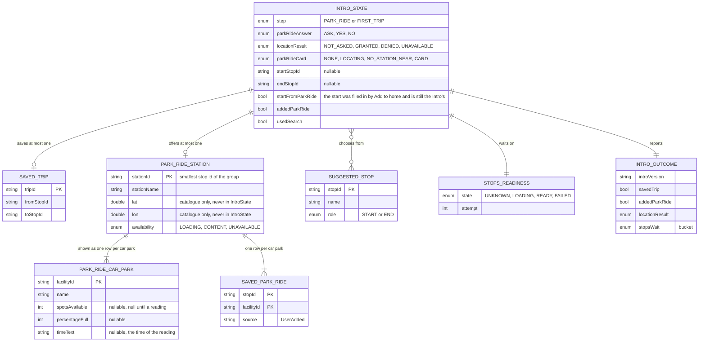
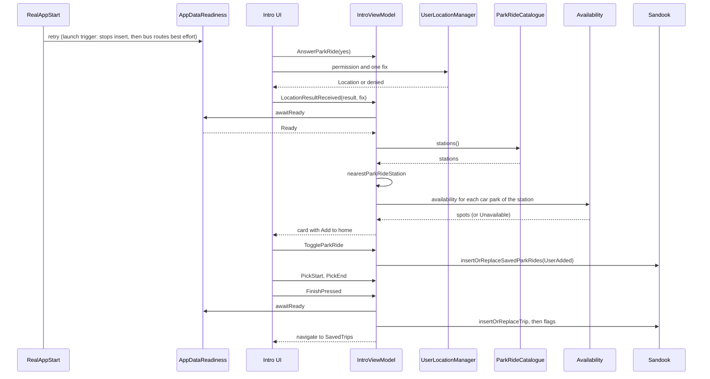

# Feature ERD: Intro redesign (Park & Ride question and first trip)

Status: Agreed for build (rows IA1 to IA13 of "Assumptions for approval" in section 9 approved by ksharma-xyz on 2026-11-21; the measurement targets and review points in section 11 are still owner decisions)
Owner: ksharma-xyz
Touches: `feature/trip-planner/ui` (`intro/`), `feature/trip-planner/state` (`intro/`), `core/analytics`, `io/gtfs` (stops readiness, first PR), `sandook` (one preference key), `.maestro/` (one shared flow, only if the tag changes)

The design behind this document was settled in review on 2026-11-21 against an interactive prototype that is not part of
this repository. Everything a builder needs from it is restated here, so this file stands alone.

---

## 1. Problem and scope

- **Who has the problem.** A rider who has just installed KRAIL taps through a tour of features and lands on a home screen
  that shows nothing of theirs. Nothing they did in the tour is kept.
- **What this does.** Replaces the seven-page carousel with a two-step first run that ends with something saved.
  - Step 1 asks "Driving to the station?". Yes asks for location, shows the nearest Park & Ride car park with its live
    spots and an Add to home button. No, or a denied location, goes straight to step 2.
  - Step 2 saves a first trip. The rider picks a start and an end from suggested stops (or searches for another stop), sees
    the pair as one tile, and taps one button: Save and start, or Skip for now.
  - The last button waits for the stops data to be ready, and the data layer reports readiness, failure and retry
    (`DATA_READINESS` in section 3).
- **What it deliberately does not do.**
  - No alerts, no departures and no trip planner call in the Intro. A trip is saved from two stop ids with no network.
  - No horizontal pager, no card or gradient border, no map, no transport mode picker, no invite page.
  - No hard gate. A rider can always finish with nothing saved.
  - No change for riders who already have the app. They never see the Intro and keep the one-time Park & Ride suggestion
    planned for the map-first home stack.
  - Does not build the home screen changes. It supplies two things the home stack reuses: `nearestParkRideStation` and the
    "suggestion shown" flag.

## 2. Entities and relationships



| Entity | Layer | Source of truth | Identity key | Lifetime |
|---|---|---|---|---|
| `IntroState` | ui | `IntroViewModel` | none, one per Intro | Process, survives rotation (view model plus saved state) |
| `SuggestedStop` | domain | Bundled default, optionally Remote Config key `intro_suggested_stops` | `stopId` | Until the list is next refreshed |
| `ParkRideStationPickerItem` (existing) | domain | `ParkRideCatalogue.stations()` | `stationId` (smallest stop id of the group) | Per call |
| `ParkRideCardStation` and `ParkRideCarPark` (new) | ui state | `IntroParkRideStep`, from the catalogue item and the stored readings | `stationId`, `facilityId` | The Intro, in memory. Only `stationId` is saved |
| `SavedParkRide` (existing) | db | `NswParkRideSandook` | (`stopId`, `facilityId`) | Until the rider removes it |
| `SavedTrip` (existing) | db | `Sandook` | `tripId` | Until the rider deletes it |
| `KEY_HAS_SEEN_INTRO` (existing) | prefs | `SandookPreferences` | key | Install |
| `KEY_PARK_RIDE_SUGGESTION_SHOWN` (new) | prefs | `SandookPreferences` | key | Install |
| `StopsReadiness` (new) | domain | `AppDataReadiness` in `:io:gtfs` | none | Process |
| `IntroOutcome` | analytics | built once, at finish | none | One event |

**Collision check, answered from real data** (the Remote Config default catalogue, the stops table and real trip events):

- One station name maps to several stop ids in the stops table (the station and its platforms or street-side stops). The suggested stops carry the station-level (parent) id, to be confirmed against the table for each stop.
- A Park & Ride "station" is not always a station. In the default catalogue (42 rows, 37 facilities) seven rows point at bus
  stops named like "Warriewood B-Line, Pittwater Rd". A start label built as "<name> Station" would be wrong for them. The
  label must be the stop's own name.
- Three catalogue rows point at stop ids that are absent from the stops table (a second Hornsby id, a second Mona Vale id and
  West Ryde). Such a station has no coordinates, so it can never be the nearest, and it can never pre-fill a trip start.
- One station maps to many car parks and one car park can serve several stop ids. `groupIntoStations` already resolves this
  with a union find. The Intro reuses it and does not group again.

## 3. Interfaces

```kotlin
// module: :io:gtfs (first PR), callers: IntroViewModel, later SearchStop and the map-first home
sealed interface StopsReadiness {
    data object Unknown : StopsReadiness
    data object Loading : StopsReadiness
    data class Ready(val stopCount: Int) : StopsReadiness
    data class Failed(val attempt: Int, val reason: String) : StopsReadiness
}

interface AppDataReadiness {
    val state: StateFlow<StopsReadiness>
    /** Suspends until the stops are Ready or Failed, or until [timeoutMs]. Never throws. Starts the first run if none has started. */
    suspend fun awaitReady(timeoutMs: Long): StopsReadiness
    /** A no-op while Loading or Ready. From Failed one more attempt. From Unknown the launch trigger. */
    fun retry()
}

// StopsManager.insertStops() changes from Unit to Result<Unit>, and the table clear moves inside the insert transaction.
```

How the first PR behaves, where it adds to the signatures above:

- `RealAppStart` calls `retry()` once at launch and no longer waits for the inserts, so remote config set up starts earlier.
  `retry()` is a no-op while Loading and while Ready, so calling it again in a live process never demotes good data. From
  Unknown it gets up to three automatic retries with a growing backoff. From Failed it is one more attempt.
- The automatic retries show as Loading, never as Failed. `Failed.attempt` counts every attempt in the process. A run that
  is cancelled or breaks unexpectedly ends in Failed, never stuck in Loading.
- Ready is about the stops only. It means all of: the stops insert returned success, the stored stops version is at or above
  the bundled one, the stop count is at or above the existing floor, and a read of one known stop (Central, the parent stop
  `200060`) returns a row. The decision is one pure function, `reduceReadiness`, so a table test holds every combination.
  A test reads the bundled data file and fails if that stop is ever dropped by a data refresh.
- The bus routes insert follows in the same run once the stops are Ready, best effort. A failure there is logged, does not
  change the state, and is not retried until the next launch. `awaitReady` returns as soon as the stops are Ready and never
  waits for the bus routes. The Intro needs only the stops table.
- WAL and the clear inside the transaction: proven on the JDBC test driver. The app sets WAL explicitly on iOS
  (`JournalMode.WAL`) and on Android (`enableWriteAheadLogging()` in `SandookCallback.onOpen`), and the `-wal` and `-shm`
  files have been seen on a real Android phone. The Android and iOS drivers themselves are not run in a test.

```kotlin
// module: :feature:trip-planner:ui, intro/, pure, no I/O, runs under a fixture suite
internal data class SuggestedStop(val stopId: String, val name: String)
internal data class SuggestedStops(val start: List<SuggestedStop>, val end: List<SuggestedStop>)

/**
 * Parses the Remote Config value, `{"start":[{"stopId":"..","name":".."}],"end":[..]}`, ignoring unknown fields. Returns
 * [fallback] as a whole, never a repaired half, for: text that is not that shape, an empty list, a stop id repeated
 * within a list, a blank id or name, or a start that equals the only end (or an end that equals the only start), where
 * picking that stop would leave the other list with nothing different to pick. The same stop on both lists is normal.
 * `name` is the stop's own name in the stops table (for example "Central Station").
 */
internal fun parseSuggestedStops(json: String, fallback: SuggestedStops): SuggestedStops

/**
 * The single nearest station within [radiusKm] of [location], or null. Stations with no coordinates are skipped.
 * Shared with the map-first home stack, which reuses it.
 */
internal fun nearestParkRideStation(
    location: LatLng,
    stations: List<ParkRideStationPickerItem>,
    radiusKm: Double,
): ParkRideStationPickerItem? // distance is GeoUtils.haversineDistance, the edge is inclusive, INTRO_PARK_RIDE_RADIUS_KM = 5.0

/** The start to pre-fill after Add to home (IA6), or null. Smallest stop id of the station that resolves, the stop's own name. */
internal fun parkRideStartPrefill(station: ParkRideStationPickerItem, stopNameLookup: (String) -> String?): SuggestedStop?

/**
 * What the bottom button says and does. A table, so every state has exactly one answer. Only Unknown and Loading hold the
 * button back (GettingReady, disabled). Failed is treated as Ready, because the picks carry their own id and name. Exactly one
 * pick gives PickBothStops, disabled, labelled Save and start on screen, until both or neither are picked.
 */
internal fun introFinishAction(state: IntroState, readiness: StopsReadiness): IntroFinishAction
/** The same table once the stops no longer matter, used by a finish that has waited as long as it will. */
internal fun introFinishActionIgnoringStops(state: IntroState): IntroFinishAction
internal enum class IntroFinishAction { Next, GettingReady, PickBothStops, SaveAndStart, SkipForNow, LetsKrail }

/** savedTrip = state.saved, skipped = no saved trip and no complete pair. Param names and values as section 11.2. */
internal fun IntroState.toOutcome(stopsWait: StopsWait): IntroOutcome
internal fun IntroOutcome.toParams(): Map<String, Any>
/** Failed is failed. None is no wait, under 2 s, 2 s to 5 s inclusive, over 5 s. Takes a Duration, never reads a clock. */
internal fun stopsWaitBucket(waited: Duration, readiness: StopsReadiness): StopsWait
```

```kotlin
// module: :feature:trip-planner:state, intro/ (package intro.v2 until the carousel IntroState is deleted, then moved up)
// Every field has a default, so IntroState() is the first screen. hasTrip is true only when both stop ids are set.
data class IntroState(
    val step: IntroStep,
    val parkRideAnswer: ParkRideAnswer,
    val locationResult: LocationResult,
    val parkRideCard: ParkRideCardPhase,
    val startStopId: String?, val startName: String?,
    val endStopId: String?, val endName: String?,
    val startFromParkRide: Boolean,
    val addedParkRide: Boolean, val usedSearch: Boolean,
    val saved: Boolean,
)

/** What the question step shows below the question. Added is a Card while addedParkRide is true, not a fifth phase. */
sealed interface ParkRideCardPhase {
    data object None : ParkRideCardPhase                         // unanswered, or no usable location
    data class Locating(val stationId: String? = null) : ParkRideCardPhase // skeleton. stationId only while a saved card is worked out again
    data object NoStationNear : ParkRideCardPhase                // no station within the radius, or the stops were not ready in time
    data class Card(val station: ParkRideCardStation) : ParkRideCardPhase
}

/** No coordinate of the rider and none of the station: the station position stays in the catalogue item. */
data class ParkRideCardStation(
    val stationId: String, val stationName: String,
    val carParks: ImmutableList<ParkRideCarPark>,                // names first, readings once the one call is back
    val availability: ParkRideAvailabilityState,                 // Loading, Content, Unavailable
)
data class ParkRideCarPark(
    val facilityId: String, val name: String,
    val spotsAvailable: Int?, val percentageFull: Int?, val timeText: String?, // null until a reading exists
)

// module: :feature:trip-planner:ui, intro/v2 (internal, because SuggestedStop is). Moves up with the carousel's deletion.
sealed interface IntroUiEvent {
    data object Back : IntroUiEvent
    data object Next : IntroUiEvent                    // the question step only
    data class AnswerParkRide(val yes: Boolean) : IntroUiEvent
    data class LocationResultReceived(val result: LocationResult, val location: LatLng?) : IntroUiEvent
    data object ToggleParkRide : IntroUiEvent          // Add to home / Added
    data class PickStart(val stop: SuggestedStop) : IntroUiEvent
    data class PickEnd(val stop: SuggestedStop) : IntroUiEvent
    data class StopPickedFromSearch(val isStart: Boolean, val stopId: String, val stopName: String) : IntroUiEvent
    data object FinishPressed : IntroUiEvent           // Save and start, Skip for now, Let's KRAIL
}

/** One shot, delivered once through a Channel and never replayed after rotation. */
sealed interface IntroEffect { data object NavigateToSavedTrips : IntroEffect }
```

`IntroFlowViewModel` (named apart from the carousel `IntroViewModel` until that is deleted) exposes `state: StateFlow<IntroState>`, `suggestedStops: SuggestedStops` (read once from the
`intro_suggested_stops` flag, empty default so the bundled lists apply) and `effects: Flow<IntroEffect>`. It takes a
`SavedStateHandle` and saves the step, answer, permission result, picks and flags on every change as one JSON string, so
they survive rotation and the process being killed. It also saves which station the card was for (the station id, or a
flag when there was none near) and nothing else about the card: no car park, no reading, and never a coordinate. After
the process is killed the card is worked out again from that id (see section 5). Its writes and tracking live in `IntroCompletion`, which holds `Sandook`, `SandookPreferences`, `Analytics` and the IO
dispatcher, to keep the constructor under the detekt parameter limit.

The Park & Ride step is two more classes, so the view model stays small. `IntroParkRideGateway` is the injected one, like
`IntroCompletion`: the catalogue, the availability loader (`ParkRideAvailabilityLoader`, the same one the Saved Trips card
and the picker use), `NswParkRideSandook`, the IO dispatcher, the stops table's name lookup and `Analytics`, and it does the
reads and the writes of Add to home. `IntroParkRideStep` is built by the view
model in its own scope and holds the order of things: the answer, the one location result, the wait for the stops, the
nearest station and the one availability call. It never asks for the permission: the screen does, and sends
`LocationResultReceived`.

- Every interface has a fake in `:core:testing`: `FakeAppDataReadiness` (controllable state), the existing location, catalogue,
  sandook and park ride fakes, and a fake clock. No `Clock.System` (the `ClockSystemBan` rule).
- The Intro never calls the trip planner. `IntroViewModel` keeps `StopsManager` out of its constructor and depends on
  `AppDataReadiness` instead.
- The Add to home action calls `NswParkRideSandook.insertOrReplaceSavedParkRides` with `UserAdded` and does **not** call
  `AppReviewManager.onDelightMoment(PARK_RIDE_ADDED)` (see IA11). The Intro has no review manager to call, and
  `IntroNeverReviewsTest` fails if any Intro source names one.
- Save trip calls `Sandook.insertOrReplaceTrip` with the two stop ids and names.
- The screen is `IntroFlowScreen`, stateless, and `IntroFlowRoute` is the thin stateful wrapper around it. The route collects
  `state`, `stopsReadiness` (the view model passes `AppDataReadiness.state` through, so the last button reads the data layer
  and nothing polls) and the one shot effects with the lifecycle, calls `IntroFlowScreen`, and owns the platform glue:
  `IntroLocationEffect` for the location permission and the one fix, and a call to `IntroFlowViewModel.onStepShown(step)` each
  time the step on screen changes. `onNavigateToSavedTrips` and `onNavigateToSearchStop` are parameters. The route builds step 2
  (`introFirstTripStep`) itself and receives the pick back with `IntroSearchResultEffect`.
- `IntroEntry` shows `IntroFlowRoute` with `koinViewModel<IntroFlowViewModel>(key = ...)`. The registration is
  `viewModel { params -> IntroFlowViewModel(savedStateHandle = params.get(), ...) }`. Koin 4.2.0 answers `params.get()` for a
  `SavedStateHandle` by calling `createSavedStateHandle` on the view model's creation extras, in common code, so Android and
  iOS take the same path. The Intro's owner on Android is the Activity, which supplies those extras, and on iOS it is Compose
  Multiplatform's default owner, which sets the same two keys. `IntroFlowKoinTest` creates the real registration, with fakes at
  its edges, on an Android host and holds that the handle is real and that what the view model saves lands in it. The iOS path is
  not run, because no simulator is used in this work, so it is a device case.
- The navigation entries carry no view model store, so a view model made in an entry belongs to the Activity and would outlive
  the Intro. The entry keys it on a value made once for each visit and saved with the entry, which gives Settings, which can open
  the Intro again, a new view model each time, and gives a turn of the screen and the search on screen the same one.
  `IntroEntryTest` holds all three.

## 4. External contracts

| Call | Method and path | Key params | Auth | Response format | Measured wire size | Measured latency |
|---|---|---|---|---|---|---|
| Park & Ride availability (existing) | `GET https://api.transport.nsw.gov.au/v1/carpark` | `facility=<id>` | `Authorization: apikey` through `ApiCredential` | JSON | about 350 B gzip, about 665 B decoded | 0.09 to 0.31 s |
| Park & Ride catalogue | Remote Config `nsw_park_ride_facilities` | none | none | JSON array of (`stopId`, `parkRideFacilityId`, `parkRideName`) | bundled default, 42 rows | none, bundled |
| Suggested stops (proposed) | Remote Config `intro_suggested_stops` | none | none | JSON of start and end lists | bundled default | none, bundled |
| Device location | `UserLocationManager.getCurrentLocation()` | one fix, no updates | OS permission | `Location` | none | **not measured** |

- The availability numbers are a one-moment snapshot of nine real calls on 2026-11-21. They show the shape and order of
  magnitude, not a rate, and not behaviour at other times of day.
- Fields read from availability: free spots, percent full, the time of the reading. Fields ignored: everything else. The
  existing mapper stores a missing latitude as 0.0 and a missing longitude as 0.0. The Intro never reads those two.
- Not called by the Intro: trip planner, alerts, departures, add_info, the BFF (not live in the app).
- Parity: no BFF route is involved, so there is no parity gap.

## 5. Data flow



Readiness is published when the stops are usable. The bus routes insert runs after that in the same run and does not
hold the Intro back.

Order at finish, which differs from today: wait for readiness, write the trip, write `KEY_PARK_RIDE_SUGGESTION_SHOWN` then
`KEY_HAS_SEEN_INTRO`, track the outcome, then navigate. Today the screen navigates without waiting for the insert, so a
fast rider can reach home before the stops are committed. The suggestion flag goes first, so a process killed between the
two writes shows the Intro again, rather than showing home with the suggestion still to ask.

Decisions the view model branch made where this document was silent:

- **Waiting.** The finish calls `awaitReady(15 s)`. A press while the button reads Getting ready is not dropped by the
  view model, it waits for the stops and then finishes (the button itself is disabled, so the screen never sends it).
  Without that the `stopsWait` buckets could not be reached. The wait ends on Ready, on Failed, or at 15 s, and the finish
  goes ahead whichever it was: the trip if there is one, both flags, tracking, then the effect. When the stops are not Ready
  by then, `retry()` is called once so the load goes on in the background (a no-op from Loading). The tracked wait is
  `failed` for Failed and `over_5s` for a timeout. The wait is none when the stops were already Ready, because a real clock
  never reads exactly zero. Going back, or half picking a pair, while it waits abandons the finish.
- **Once.** The suggestion flag is written at the first of the question being answered or passed, and the finish. A
  second press while a finish runs, or after it has finished, does nothing. A trip already written (`saved`) is not
  written again by Let's KRAIL.
- **Same stop.** Picking the stop already chosen for the other end keeps the new pick and clears the other end. Two
  different stops that sit on both suggestion lists are fine.
- **Tracking.** A saved trip also tracks `save_trip_click` with `source = intro`, stop ids only, before the outcome event.

Decisions the Park & Ride step made where this document was silent. The step is built over several branches and the
list grows with each:

- **Added is not a phase.** The rider's Added state is a Card while `addedParkRide` is true, which is what the section 7
  table says ("the same card"), so the two cannot disagree.
- **Who asks.** The screen asks for the permission and takes the one fix, then sends `LocationResultReceived`. The view
  model never asks. `AnswerParkRide(yes = true)` records Yes and moves the card to Locating, the skeleton.
- **A result nobody asked for is ignored.** Only a result that arrives while the card is Locating counts, so a repeat or a
  late one changes nothing. A second Yes while Locating or while a card shows does nothing, so it can never start a second
  look or a second call. Yes after No station near, or after a denial, looks again.
- **No usable location.** Denied, unavailable and the 10 s timeout inside the location manager (mapped to `UNAVAILABLE`
  by the screen) record the result, move to step 2, write the suggestion flag once and leave the card at None. Nothing
  blocks and there is no error state. A granted result that carries no fix is recorded as `UNAVAILABLE`, because there
  is nothing to find a station from. A fix that arrives behind a result that is not granted is dropped unused.
- **Stops.** With a fix, the step calls `awaitReady(10 s)`. Anything but Ready (Unknown or Loading at 10 s, or Failed at
  once) is the same answer as no station near, with no error. The rider is not held on the wait: Next, Back and the
  finish all work while it runs.
- **The fix.** It is used inside one coroutine to pick the station by `nearestParkRideStation` (5 km, the edge inclusive)
  and then goes out of scope. It is never stored in the state, never saved and never logged or tracked. The state holds
  the station's id, name and car parks only.
- **The card.** It shows at once with the car park names and no numbers (availability Loading), then settles after one
  `refreshIfNeeded` for every mapping of the station: Content when at least one car park has a reading, otherwise
  Unavailable, which keeps the names so the screen can show the name and Add with no numbers. A car park with no stored
  reading is a name. A loader that throws is the same as one that found nothing. There is no timer, no retry and no
  second call, and a view model that is cleared cancels all of it.
- **No.** `AnswerParkRide(false)` is as before, and also cancels a look still waiting and clears the card.
- **What Add does.** It saves one `UserAdded` row for every mapping of the station, the rows and the source the picker's
  Add writes, with the stop name the picker uses (the stop's own name, or the station name when the stops table has none).
  The card turns to Added as soon as the rows are written and never waits for the network. A second tap while a toggle is
  running does nothing, so a double tap adds once and tracks once. It is ignored with no card on screen, and before a card
  that is being worked out again after a killed process has its station back.
- **Tracking.** One `park_ride_user_facility` with `action` add, `source` intro, `stopId` the station id and `facilityId`
  the car park ids joined the way the picker joins them. No name and no coordinate.
- **No review.** Nothing in the Intro arms the app review delight moment. `IntroNeverReviewsTest` reads the Intro sources
  and fails if one names the review manager or the moment.
- **The stop name.** The loader files a car park that is not saved under its stop id, because it takes the name from the
  saved row. So the reading the Intro fetched before Add would show that id as the title of the Saved Trips card until the
  next refresh. After Add the step waits for the availability call if it is still running, then rewrites the stored
  readings of the station's car parks with the station's name and keeps everything else, including the time of the reading,
  so the cooldown is untouched. The wait never holds the Added state back, only this correction.
- **Pre-fill, from IA6.** After Add the start is filled in with the smallest stop id of the station that resolves in the
  stops table, labelled with that stop's own name, and only when the rider has not picked a start. It is not filled in when
  that stop is already the end, because the trip would run from a stop to itself and the end is the rider's pick. When no
  stop resolves there is no pre-fill and the station is still added. IA6 says "the added Park & Ride station", so a rider who
  reaches step 2 with a station found but did not add it has no pre-fill.
- **Removing.** Tapping Added again removes only the `UserAdded` rows of the station, so a row a saved trip holds stays,
  and the card stays. A removal tracks `remove` the same way as an add. It clears the start only while `startFromParkRide`
  is true. Any pick of the start by the rider ends that claim, even a pick of the very stop Add chose, and so does an end
  pick that clears the start. The stop names corrected after Add stay as they are.
- **Outcome.** `parkRideAnswer`, `locationResult` and `addedParkRide` come from the state at the finish, and a test holds all
  six paths: granted and added, granted and not added, no station near, denied, a fix that timed out (`unavailable`), and
  never answered (`skipped`, `not_asked`).
- **What is saved.** The step, answer, permission result, picks and flags as before, plus the card's station id (or a
  flag for no station near). A card is saved as the id alone, with no car park and no reading, and comes back as a
  Locating skeleton that carries the id. The step then works it out again from the catalogue and asks the loader once
  more, which spends no call while the readings are inside the cooldown. A station that is no longer in the catalogue, or
  stops that are not Ready, come back as No station near. A location still being awaited is not saved, so a process killed
  there asks the question again. Nothing about the rider's position is ever saved.

Decisions the UI branch made where this document was silent:

- **How one result per Yes is guaranteed.** `UserLocationManager.getCurrentLocation()` already checks the permission, asks for it
  when it is not decided, and takes the one fix (10 s inside the manager), so the screen needs nothing more. The state does not say
  whether the result for the current Yes has gone, because the card stays Locating after a granted result while the station is
  found, so the screen keeps one saved flag, `sent`, and a pure rule, `locateStep(awaiting, sent)`. The card awaits a location
  when it is `Locating` with no station id. Awaiting and not sent: ask, take the fix, send it and set the flag in the same step.
  Awaiting and sent: do nothing, so a turn of the screen after the result asks for nothing. Not awaiting: clear the flag, so the
  next Yes sends its own. A turn of the screen before the fix lands finds the flag clear and asks again, because nothing was sent.
  A No while the fix is awaited cancels the ask and sends nothing for that Yes. A second tap on Yes while the card awaits
  changes no state, so it starts nothing. A process killed while awaiting saves no Locating card, so nothing is awaited after it.
- **The card is never left Locating for good.** Every ending is a result: a dismissed dialog, a refusal and the platform's
  restriction are denied, and every other failure, the manager's 10 s timeout and an exception are unavailable. A wait with
  no answer at all, the one thing the manager does not bound because it is a rider reading a dialog, is unavailable after
  120 s (`LOCATE_BOUND_MS`, a guess at a wait nobody doing that reaches).
- **The fix is never held.** It goes from the manager into `LocationResultReceived` in the same call and is not in a remembered
  or saved value, the state, or a log. `IntroLocationNeverHeldTest` holds that for the three files that touch it.
- **Screen views.** `view_screen` is sent from the view model (`onStepShown`), the way every other screen sends it. It is not by
  route: `RouteAnalyticsScreen` maps routes to names for the window events and is not where `view_screen` is sent, and it is not
  changed. It is sent once each time the step on screen changes, `Intro` for step 1 and `IntroFirstTrip` for step 2, so a turn of
  the screen sends nothing and going back to step 1 is a new visit. After a killed process the restored step is sent once more.

Operator decisions of 2026-11-22: (1) exactly one of start or end picked disables the bottom button until both or neither
are picked, (2) there is no Try again and no error state, a Failed readiness behaves like Ready for the button and a trip
can be saved while the stops failed, (3) the finish never blocks on the stops, it waits at most 15 s and then proceeds.

## 6. Cost budget (mandatory, never "N/A")

| # | Question | Answer |
|---|---|---|
| 1 | **API calls.** | None at open. Step 1 Yes path only: one `refreshIfNeeded` for the one nearest station, once per run, and a network call only for a car park whose last reading is older than the cooldown (a new install has none stored, so none are warm). The app runs with the BFF override off, so the loader asks NSW once per car park, one after another. In the default catalogue (32 stations, 37 car parks) that is 1 call for 28 stations, 2 for three (Penrith, Kellyville, Campbelltown) and 3 for Tallawong. A station that several stop ids share (Sutherland, Mona Vale, Hornsby) is still one call, because the second stop finds the car park inside its cooldown. No polling, no timer and no retry in the Intro. A process killed on step 1 asks the loader once more on restart, and the cooldown decides whether that is a call. Rotation makes none. Step 2: none. A rider who answers No makes none. The Intro makes no trip planner, alerts or departures call. |
| 2 | **Payload.** | About 350 B gzip and 665 B decoded per availability call, from the snapshot of 2026-11-21. **Not re-measured here**: the endpoint needs the shared NSW key, so nothing was sent. The stops files (about 2.3 MB and 2.6 MB) are bundled and are not downloaded. The Intro reads the 42-row catalogue and groups it once per look (and once after a kill), on the IO dispatcher, plus one batched coordinates query, and reads the facility table (at most 37 rows) once. All of it is small and local. |
| 3 | **Timing.** | The Intro opens with no network and no wait. The car park card needs a location fix (up to 10 s inside the location manager, **not measured**), then stops readiness (`awaitReady` up to 10 s, nothing when already Ready, and **assumed 3 to 5 seconds** on a fresh install, measured privately and not recorded here), then the station is picked in memory and the card shows at once with the car park names. The numbers follow after the calls. They run one after another at 0.09 to 0.31 s each in the snapshot, so about 0.1 to 0.3 s for most stations and about 0.3 to 0.9 s for Tallawong (arithmetic on the snapshot, a guess for a real phone). Nothing blocks: Next, Back and the last button work throughout, and the last button is the only forced wait, and only if the rider finishes before readiness. The `stopsWait` bucket in section 11 measures it in the field. |
| 4 | **UX.** | Loading: skeleton in the card's space. Slow stops data: last button reads Getting ready, for at most 15 s. Failed stops data: no message and no error state, the button behaves as when ready and the load is retried in the background. Failed or offline availability: the station name and Add stay, the numbers are omitted. No station near: a plain line and the normal Next. Denied location: step 2. No layout shift between states (same slot). |
| 5 | **Network efficiency.** | Availability goes through the existing `ParkRideAvailabilityLoader`, the one the Saved Trips card and the picker use, so its cooldown and cache apply. **Verified in the code and held by a test** (`a second intro inside the cooldown makes no second call`): the loader reads the cooldown from the `NSWParkRideFacilityDetail` table and writes the reading into the same table the Saved Trips card reads, so home finds the car park inside its cooldown (120 s from 05:00 to 10:00 and 600 s otherwise, the Remote Config defaults) and does not refetch. One thing it writes wrongly for a car park that is not saved yet is the stop name, which is the stop id until the station is saved. Add corrects it (section 5), keeping the time of the reading, and a test holds it. |
| 6 | **Battery.** | One location fix, taken by the screen, not updates. No timer, no polling and no background work: the view model test lets an hour of virtual time pass and still finds one call. Everything the step starts runs in the view model's scope and is cancelled when it is cleared (two tests). Foreground only, so nothing needs lifecycle gating beyond collecting state with `collectAsStateWithLifecycle()`. |
| 7 | **Shared limits.** | At most one to three availability calls (28, 3 and 1 stations of 32) per rider who answers Yes and has a station near, once, on the shared NSW key, and the same again only after a killed process that is off cooldown. Small next to the existing polling on home (a guess, label it as one). The BFF is not live, so nothing collapses. |

| Flow | Calls before | Calls after | Bytes before | Bytes after | Time to results before | after |
|---|---|---|---|---|---|---|
| First launch to home, rider says No | 0 | 0 | 0 | 0 | seven pages | two steps, last button waits only if stops are not ready |
| First launch to home, rider says Yes | 0 | 1 to 3 | 0 | under 1 KB | seven pages | two steps plus the card |

| UI branch | Network calls | Location | Timers and polling | Battery | Payload |
|---|---|---|---|---|---|
| `IntroFlowScreen`, step 1 and the route | 0 of its own. The one availability call of the Park & Ride step is unchanged. | One fix per Yes, taken by `getCurrentLocation()` (10 s inside the manager, 120 s outside it for the permission dialog, a guess). A turn of the screen before the fix lands may ask again, still one result. | None. Animations only, each once: heading rise 400 ms, cross-fade 120 ms out and 180 ms in, dot width 200 ms. The screen reads `AppDataReadiness.state`, a state flow, and does not poll. | None beyond the fix. Foreground only. | None. The preview and layout tests are test code. |
| `IntroFirstTripStepContent`, step 2 | 0. It shows names only. The suggestions are the two lists read once from Remote Config (or the bundled default) when the view model is made, and a stop the rider searches for comes from the existing stop search, which the rider opens and which keeps its own cost. The stops table is not read by this step, so it can show before the stops are ready. | None. | None. No timer, no polling and no animation of its own beyond the heading rise, once. | None. Foreground only, and no radio is woken by this step. | None on the wire. About ten short strings in memory. |

Decision rule met: the added calls buy a live car park card and a one tap add for riders who park and ride. They are
optional, non-blocking, once only and silent on failure.

## 7. States and UX

The reference is an interactive review page (private). The states it shows are restated here.

**Step 1, Park & Ride question**

| State | The rider sees |
|---|---|
| Ask | The question, "Yes, show me free spots", "No thanks", Next |
| Asking location | The system permission dialog |
| Locating, or waiting for stops | A skeleton card in the final card's space |
| Card | The nearest station with spots, percent full and the age of the reading, and Add to home |
| Added | The same card with the row reading Added to home |
| No station near | One plain line, and Next |
| Denied or no fix | Moves to step 2, nothing blocks |
| Availability failed or offline | The station name and Add, no numbers |

**Step 2, First trip**

| State | The rider sees |
|---|---|
| Start not chosen | A list of start suggestions plus Search another stop |
| Start pre-filled | The Park & Ride station as a collapsed row, with the end list below |
| Both chosen | One tile with the two stop names stacked on the theme tint (the shape of `SavedTripCard`), tap to change |
| Searching | The app's own stop search, then back with the pick |
| Stops not ready | Last button reads Getting ready, disabled |
| Stops failed | No error state. The button behaves as when the stops are ready, and a trip is saved from the picks |
| Only one of start and end picked | Last button disabled, reading Save and start, until both or neither are picked |

**Bottom button** (`introFinishAction`): Next on step 1. On step 2, Getting ready (disabled, stops loading), Save and start
disabled (one stop picked), Skip for now (nothing picked), Save and start (both picked), Let's KRAIL (saved). It keeps the test tag `intro.action.primary`.

- Wording, in rider words: trip, saved trip, car park. No colon, em dash or arrow in any string.
- Layout rules: items stay whole and wrap to the next line at 320 dp and 200% text, and the screen scrolls. Pills are one
  line. Touch targets 48 dp. The theme colour appears on the one bottom button only.
- Motion: step 2 replaces step 1 with a short cross-fade, the tagline lines rise and the sticker pops. With reduced motion
  (`isReduceMotionEnabled()`) the steps swap with no fade.
- Rotation, theme and font changes: all Intro state lives in the view model with saved state, including the answer, the
  picks and the permission result. No new navigation route, so `SerializationConfig.kt` is untouched.
- Tablets and foldables: the Intro is a `detailPane()` route. Content is capped to a phone width and centred. To be drawn at
  600 dp and at dual-pane before the UI branch.
- Screen reader: the progress dots read "Step 1 of 2". Each row names its stop and role ("Change start stop, now Tallawong").

The shell, as built (`IntroFlowScreen`, stateless, in `intro/v2`):

- A top bar, the step, and the one bottom button. The bar reserves 48 dp at both ends, so the dots do not move when the back
  chevron appears on step 2. The current dot is longer as well as darker, so colour is never the only signal, and the row
  reads as one label, "Step 1 of 2" or "Step 2 of 2".
- Every step scrolls inside a column capped at 480 dp (`DUAL_PANE_LIST_WIDTH`) and centred. The bottom button sits outside
  the scroll, so it is always on screen, and it carries the test tag `intro.action.primary`. It is disabled for Getting ready
  and for the half pick, and the theme colour is drawn on it and nowhere else on the screen.
- System back on step 2 sends `Back`, and so does the chevron. On step 1 no handler is registered, so the platform decides.
- The cross-fade is 120 ms out and 180 ms in. With reduced motion the steps swap in one frame and the dots change width with
  no animation.
- Step 2's content is a slot, `firstTripStep`, which the first trip branch fills. It is given the state, the suggested stops
  and the event callback.

Step 1, as built (`IntroParkRideStepContent`), where this document was silent:

- The question is the heading, with a car sticker above it, both in ink, in the type the carousel's tagline used. The sticker
  pops and the line rises once when the step appears. A turn of the screen does not repeat it, and reduced motion has it in
  place at once. A heading stands alone, so nothing is written under it.
- The two answers are whole buttons, one under the other, always. The chosen answer is filled in neutral ink and the other is
  outlined. The theme colour is not used for them, because it belongs to the bottom button.
- The card is the shared `ParkRideCard`, opened, with the shared `ParkRideFacilityRow` under it as the Add to home row,
  reading Add to home and then Added to home. Tapping the card does what tapping the row does.
- Locating is the same card with no text, and no row, so the Add row is not offered before there is a station. No station near
  is "No car parks near you" drawn inside that same room. Loading and Unavailable are the same: the car park names, with the
  lines the numbers will take held empty. The held lines are invisible and hidden from a screen reader, so the card has one
  height from the skeleton to the numbers and to Added, and a test holds it at 411 dp and at 320 dp with text at 200%.
- `ParkRideCard` gained one parameter, `keepReadingSpace`, off by default, so the home card is drawn exactly as before (the
  existing goldens are unchanged). On, an open card lists every car park by name and holds the lines for any car park that has
  no reading yet.

Step 2, as built (`IntroFirstTripStepContent`, with the decision in the pure `introTripSections`), where this document was
silent:

- The heading is "Save your first trip" with a train sticker, in the same type and motion as step 1. Under it, each section
  is named by a heading, From and To, because a collapsed row shows only a stop name and would not say which end it is.
- Nothing chosen shows From with the start suggestions and Search another stop. The To section waits for a start, so the rider
  is asked one thing at a time.
- A start with no end, which includes the start Add to home filled in, shows From as one collapsed row and To with the end
  suggestions and Search another stop. The collapsed row is `SavedTripCard`'s container (shape, theme tint, padding and text)
  drawn for one stop, because `SavedTripCard` itself has no one stop form.
- Both chosen shows the real `SavedTripCard`, unchanged, with the two names stacked. One tap on it, or on a collapsed row,
  opens both lists with the current picks marked, so either end is changed from one place. A pick from a list or from the
  search closes them. The open flag is saved with the screen, so a turn of the screen keeps the lists open, and it is keyed on
  the picks, so a new pick shows the tile again at once.
- A list leaves out the stop chosen for the other end, so the rider cannot make a trip from a stop to itself. The suggestions
  are the shared answer buttons from step 1, the chosen one filled in neutral ink. The theme tint appears on the tile and the
  collapsed row, as it does on the saved trip card, and on the bottom button.
- Stops loading shows the suggestions as usual and the button reads Getting ready. Stops that failed show no error and the
  button works. There is no Try again anywhere in the step.
- A screen reader hears each row's stop and role: "Change start stop, now Tallawong Station", "Change stops, now Tallawong
  Station to Central Station" for the tile, "Pick Central Station as the end stop" for a suggestion, and "Search another stop
  for the start" for the search row. Each contains the words on screen.
- Every row is a whole item that wraps inside its own width and is at least 48 dp tall. The step scrolls. A test holds this at
  320 dp with text at 200%, with a stop name long enough to wrap.

The search hand-off, as built, with nothing in `searchstop/` touched:

- Search another stop calls `onNavigateToSearchStop(FROM)` for the start or `(TO)` for the end, which the entry sends to
  `TripPlannerNavigator.navigateToSearchStop`, the same route (`SearchStopRoute`) Saved Trips opens. The search needs no change.
- The pick comes back as `StopSelectedResult` on the shared `ResultEventBus`, received by `IntroSearchResultEffect` with
  `ResultEffect`, and mapped by the pure `toIntroEvent` to one `IntroUiEvent.StopPickedFromSearch`. The channel holds a result
  sent while the Intro is not composed, which is the whole time the search is on screen, so the Intro receives it once when it
  is back. A turn of the screen does not receive it again. A pick for a stop label is ignored.
- Assumptions, to check on a device. The search sends `StopSelectedResult` for a trip end whichever screen opened it, and does
  not use the dedicated `TimetableStopChangedResult` channel unless `editTripLeg` is set, which the Intro never sets. On a
  phone Saved Trips is not composed while the Intro is, so nothing else collects the same channel. An address pick (the search
  can offer one when that flag is on) is kept as a stop, by id and name, because the saved trip stores only those two and the
  analytics event carries neither.

## 8. Test plan

- **Pure logic, fixtures first.**
  - `nearestParkRideStation` against the real default catalogue. Named cases from section 9 (a CBD station, an outer Metro
    station with a car park at the platform, a regional centre, a station with a missing coordinate).
  - `parseSuggestedStops`: valid, empty, malformed, duplicate ids, a start equal to an end.
  - `introFinishAction`: one row per state, so a new state cannot be missed.
  - `toOutcome`: every flag and bucket.
- **View model**, with fakes at the edges and `krailRunTest`.
  - Yes then granted then Add then pick then finish writes one trip, one park ride and both flags, once.
  - The card: the nearest station inside 5 km and none outside it, no usable location (denied, unavailable, a granted
    result with no fix) moving to step 2 with the flag written once, stops that are not Ready or Failed giving no station
    near without holding the rider, a failed or empty availability call giving the name with no numbers, one availability
    call and no more however long the card stays, a second Intro inside the cooldown making no call, the answer and the
    chosen station surviving a new view model, no coordinate in the saved state or the state, and a cleared view model
    cancelling a look that is still waiting or a call that is in flight.
  - No, denied and no fix each reach step 2 and set the suggestion flag.
  - Finish before readiness waits, then writes, in the order readiness, trip, flags, tracking, effect. Finish while
    Failed saves the trip from the picks, tracks `failed` and retries the load in the background. A wait past 15 s
    proceeds and tracks `over_5s`. One pick disables the button and a press on it does nothing.
  - A tap on Next with step 1 unanswered sets the flag.
  - Rotation mid step keeps the answer, the picks and the pending permission.
  - Add to home never triggers the review delight moment (a guard test over the Intro sources).
  - Add: every car park saved as `UserAdded`, the tracked event with source intro and stop ids only, and the stop name
    corrected with the time of the reading kept (also when Add comes before the call lands).
  - The start: filled in only when none is picked and never over the rider's pick or onto the end, no pre-fill when the
    station was found but not added, and removal clearing only the start the Intro filled in.
  - Discriminating cases only: each test must fail if the behaviour it names is removed.
- **Database.** The real driver, via the existing test seam: the clear and the insert in one transaction leaves the old rows
  readable until the commit (this belongs to the readiness PR).
- **Screenshot tests.** Step 1 and step 2 in every state above, light and dark, 320 dp at 200%, using `@PreviewScreen` and
  `@PreviewComponent`. The old `IntroContent*` previews and screenshots are deleted with their code.
  Built so far: step 1 in seven states on a phone (Ask, Locating, No station near, Card loading, Card with numbers, Card
  unavailable, Added) and the tallest card (three car parks) on a 320 dp canvas and on a tablet canvas, and step 2 in four states
  on a phone (Getting ready, start list, pre-filled start with the end list, tile), the last two on a 320 dp canvas and the tile
  on a tablet canvas. Each preview is recorded light, dark and light at 200% text. The 320 dp and tablet previews live in
  `intro/v2/narrow` and `intro/v2/wide`, each recorded by its own snapshot class, and are skipped by the phone class by name.
  The step 2 previews are recorded once, at the end of the Intro work.
- **UI tests, built.** The shell (the button's words and disabled states, the dots reading Step 1 of 2 and Step 2 of 2, the back
  button, system back on both steps), step 1 (every card state, the answers, the Add row, one card height from the skeleton to the
  numbers and to Added at 411 dp and at 320 dp with text at 200%, nothing outside the window), the location effect (one result for
  each Yes through a turn of the screen before and after the fix, a No in flight, a dismissed dialog, a failure), the route with
  the real view model, the view model's one `view_screen` for each step visit, and the guard that the fix is never held. Step 2
  (every state of `introTripSections` as a pure test, then on a phone the heading, the lists, the collapsed row, the tile,
  changing a trip, a turn of the screen with the lists open, a stop that came back from the search closing them, and Getting
  ready and failed stops, then at 320 dp with text at 200% every row whole, stacked and at least 48 dp tall).
- **Guards that already exist and must stay green.** `ThemeColorRoleRule`, `ClockSystemBan`, `CollectAsStateBan`,
  `SnackbarBan`, `PollingLifecycleGuardTest` (the Intro must not poll), `ViewModelStateDurabilityTest`,
  `NavKeySerializationConfigTest`, `verifyTestWiring`.
- **Maestro.** `.maestro/shared/dismiss-intro.yaml` loops on the tag `intro.action.primary` and needs no page count. The new
  Intro keeps that tag, so six flows keep working. Check its `times` cap against a disabled Getting ready button on a cold
  device. Do not touch CI or workflow files.
- **Coverage.** Every PR passes `scripts/patch_coverage.py` at 80 percent or more. The result goes in the PR's Testing section.
- **Manual cases** (nothing automated reaches them): a real permission dialog on both platforms, a real fix indoors, airplane
  mode on the Yes path, a fresh install on a slow device.

## 9. Open gaps and decisions

| Gap or decision | Owner | Needed by |
|---|---|---|
| Measure the stops insert and the location fix on a mid-range phone and a fresh install | ksharma-xyz | Before the UI branch is called done |
| ~~Verify the Intro availability read seeds the Saved Trips card cooldown~~ Done, see section 6 row 5 | ksharma-xyz | Before the view model branch |
| Draw step 2 at 600 dp and at dual-pane, and step 1 at 320 dp and 200% | ksharma-xyz | Before the UI branch |
| ~~Reuse audit: which existing stop search component "Search another stop" opens, and how it returns a pick~~ Done, see section 7, the search hand-off | ksharma-xyz | Before the UI branch |
| Delete the old `IntroContent*` files, previews and screenshots in the UI branch | ksharma-xyz | UI branch |
| Add the ledger rows and ping the analytics side before the release that carries the new params | ksharma-xyz | Before the release is published |
| Read `docs/STORE_DATA_DECLARATIONS.md` again at the UI branch. Location stays on the device here, so nothing should change, but its "revisit when" test applies | ksharma-xyz | UI branch |
| Map-first home ERD: its first-run and suggestion rows now depend on this document | ksharma-xyz | Before the home stack starts |

### Assumptions for approval (mandatory, no code until signed off)

Evidence that comes from private analytics is shown to the owner in the message that introduces this ERD and is kept outside this repository. This table states the rule, the options and the public facts.

| # | Assumption | Evidence (real data, named cases) | What breaks if it is wrong | Decision |
|---|---|---|---|---|
| IA1 | Step 1 is asked of every rider who sees the Intro. Location is asked only on Yes. | Private evidence, shown to the owner in the message that introduces this ERD, kept outside the repository. Public fact: nothing records whether riders grant location today. | Riders without a car answer No and lose one tap. | Approved by ksharma-xyz, 2026-11-21 |
| IA2 | "Near" means within a radius of the rider's current location. Options were (a) 3 km, (b) 5 km, (c) 10 km. Decided: 5 km. | Nearest car park from 14 named stations, default catalogue. Within 5 km: Penrith, Tallawong, Hornsby, Bankstown, Liverpool, Gosford, Chatswood, Campbelltown. Added at 10 km: Central, Town Hall and Parramatta, whose nearest car parks are Ashfield (about 7.5 km) and Seven Hills (about 8 km). Regional centres are far from any car park (Wollongong about 27 km, Katoomba about 34 km). | Too small: a rider whose car park is 6 km away sees "No car parks near you". Too large: a rider in the city is offered a car park 8 km away that is not theirs. The rider may also install away from home. | Approved by ksharma-xyz, 2026-11-21 (option b, 5 km) |
| IA3 | Only the single nearest station is offered, not a list. | One station per rider is the normal Park & Ride habit. A list adds a choice the rider did not ask for. | A rider with two stations in range sees the closer one and can add the other later from the existing screen. | Approved by ksharma-xyz, 2026-11-21 |
| IA4 | No, a denied permission, a failed fix and a fix that takes longer than 10 seconds all go to step 2 with no further ask and no message. | The 10 seconds is a guess. | A slow fix on a good day skips a car park the rider wanted, and they can add it later. | Approved by ksharma-xyz, 2026-11-21 (the 10 second wait is the approved value) |
| IA5 | The suggested start and end stops are two short lists, one per role, with Search another stop always available. Proposed default start list: Tallawong, Central, Schofields, Parramatta, Town Hall. Proposed default end list: Central, Wynyard, Parramatta, Town Hall, Martin Place. Delivery: Remote Config `intro_suggested_stops` with the same bundled default (option b, taken from "approved as recommended"). | Private evidence, shown to the owner in the message that introduces this ERD, kept outside the repository. Public check: every id is the station-level (parent) stop in the stops table, to be confirmed against the table. | A rider whose stops are not listed must search. A list that goes stale costs taps until it is refreshed, and a constant only refreshes with a release. | Approved by ksharma-xyz, 2026-11-21 (delivery follows "approved as recommended", option b, Remote Config; the owner named only the radius, so correct this if a constant was meant) |
| IA6 | The start is pre-filled with the added Park & Ride station only if one of the station's stop ids resolves in the stops table (the smallest that does, since a station can span several ids and the smallest may be absent), and the label is the stop's own name. Otherwise there is no pre-fill. | 42 catalogue rows: three ids absent from the stops table, seven are bus stops. | A wrong or unresolvable id would save a trip the planner cannot use. | Approved by ksharma-xyz, 2026-11-21 |
| IA7 | The bottom button is a soft gate. Skip for now is always available once the stops are ready. Save and start saves and opens home in one tap. A hard gate is rejected. | A hard gate would stop a rider with location off or no destination from finishing. | A skipped rider reaches an empty home. The existing save prompt still reaches them. | Approved by ksharma-xyz, 2026-11-21. Amended by the owner on 2026-11-22: Skip for now is available once the stops are Ready or Failed, and exactly one pick disables the button until both or neither are picked (section 5) |
| IA8 | The Intro is shown only when `KEY_HAS_SEEN_INTRO` is false, which is a new install. Existing riders are unchanged. | The key exists and gates the current Intro. | A reinstall shows it again, as today. | Approved by ksharma-xyz, 2026-11-21 |
| IA9 | `KEY_PARK_RIDE_SUGGESTION_SHOWN` is set when step 1 is answered, or passed with Next, so no rider is asked twice on home. | Decided by the owner on 2026-11-21. | A rider who tapped Next by accident never gets the home suggestion. | Approved by ksharma-xyz, 2026-11-21 |
| IA10 | If availability fails or the phone is offline, the card shows the station name and Add with no numbers. Add never waits on the network. | The station list is local. | A card with no numbers looks incomplete. | Approved by ksharma-xyz, 2026-11-21 |
| IA11 | Add to home inside the Intro does not fire the app review delight moment. | The moment fires when the rider returns to Saved Trips, so it would fire on first launch. | A review prompt on the first minute of a new install. | Approved by ksharma-xyz, 2026-11-21 |
| IA12 | The last button waits for stops readiness and never opens home on an empty table. The wait is assumed 3 to 5 seconds. Failure shows Try again and the next launch retries. Readiness is about the stops only, bus routes follow best effort. | The insert is one transaction of about 37,000 rows. It is logged and measured privately. Before the readiness fix the clear ran outside the transaction and `insertStops()` swallowed failures. Failed stays until `retry()` or the next launch. | A rider could wait longer than expected on a slow phone. `stopsWait` measures it. | Approved by ksharma-xyz, 2026-11-21. Amended by the owner on 2026-11-22: there is no Try again and no error state, and the finish waits at most 15 s and then proceeds even when the stops failed or are still loading (section 5) |
| IA13 | The readiness fix ships first, as its own PR, because it also protects existing riders after every data refresh. | A data refresh raised the stops version on 2026-11-21, so every rider re-runs the clear and the insert. With the clear inside the insert transaction, a second connection in WAL mode keeps reading the old rows until the commit. Proven on the JDBC test driver in `NswTablesReplaceTransactionTest`. WAL is set explicitly on iOS and on Android (`SandookCallback.onOpen`) and the WAL files were seen on one real Android phone; the Android and iOS drivers are not run in a test. | Existing riders see empty search while the table refills. | Approved by ksharma-xyz, 2026-11-21 |

| Decision | Source (data field or parsed text) | Checked against | Reliable |
|---|---|---|---|
| Nearest station (IA2, IA3) | Data: the device fix and each station's stop coordinates from the stops table | 14 named stations against the 42-row default catalogue | Partly. Three catalogue rows have no coordinates and can never be nearest |
| Suggested stops (IA5) | Data: stop ids from the stops table | Private evidence, shown to the owner in the message that introduces this ERD | To confirm against the table |
| Start pre-fill (IA6) | Data: the catalogue `stopId` resolved in the stops table | All 42 default rows: three unresolved, seven bus stops | Partly. The rule falls back to no pre-fill |
| Finish button (IA7) | App state only | The state table in section 7 | Yes |

## 10. Build order

Each PR is under 500 lines with one concern, stacked with Graphite. Nothing is pushed and no PR is raised until the owner says.

0. `docs/intro-erd`: this document (done in this branch).
1. `fix/stops-readiness` (`:io:gtfs`): `AppDataReadiness`, `Result` from `insertStops`, clear and insert in one transaction,
   retries, tests. Its own PR, useful to every rider.
2. `feat/intro-pure-logic`: `nearestParkRideStation`, `parseSuggestedStops`, `introFinishAction`, `toOutcome`, fakes and
   fixtures. No UI.
3. `feat/intro-analytics`: new params on `intro_lets_krail`, two new screen names, `source` values on two existing events,
   ledger rows (section 11). Ping the analytics side.
4. `feat/intro-viewmodel`: state, events, readiness wait, flags, the `Result` handling. Old page logic removed.
5. `feat/intro-step-park-ride`: step 1 UI, cross-fade, dots, previews and screenshots.
6. `feat/intro-step-first-trip`: step 2 UI, the tile, the search hand-off, previews and screenshots. Deletes the old
   `IntroContent*` files.
7. `test/intro-maestro`: only if the tag or the cap needs a change.

## 11. Measurement plan (ROI)

**Objective.** A rider who finishes the Intro should leave with something saved that brings them back. The lever is what the rider leaves with, not how many finish.

### 11.1 What is measured

| Kind | Metric | Definition | Where it comes from |
|---|---|---|---|
| Primary, leading | **Has something saved by the end of day one** | A new rider with a saved trip or an added Park & Ride station by the end of their first day, by any route | `save_trip_click` and `park_ride_user_facility` (action add) joined to first open |
| Direct | Intro value rate | Riders who finish the Intro with `savedTrip` or `addedParkRide` | `intro_lets_krail` params |
| Direct | Step 1 yes rate, location grant rate among Yes, add rate among Yes | Share answering Yes, share granting, share adding | `intro_lets_krail` params |
| Direct | Skip rate, search rate | Share finishing with Skip, share using Search another stop | `intro_lets_krail` params. The search rate tells us whether the suggestions fit |
| Lagging | Day one and day seven return, saved card opens in week one | Active again on a later day, and `saved_trip_card_click` | Existing events, by cohort |
| Guardrail | Intro completion | Riders who see the Intro and finish | `view_screen` Intro and `intro_lets_krail` |
| Guardrail | Stops wait | Bucket of time the rider waited on Getting ready | `intro_lets_krail` param `stopsWait` |
| Guardrail | Stops failure | Finishes with a failed readiness | `stopsWait = failed` |

Targets are the owner's to set. They are `Pending owner`. Baselines are read from KRAIL-Analytics when the targets are set. No figure is kept in this repository.

### 11.2 Events and params (no new event names)

The 500 event-name budget is respected. Nothing here mints a name.

- `intro_lets_krail` (existing) gains params. Today it carries `completedOnPage` and `completedOnPageNumber`, which describe the
  old carousel. The new version stops sending them and sends:
  `introVersion` (2), `finishedOn` (park_ride or first_trip), `parkRideAnswer` (yes, no, skipped), `locationResult`
  (granted, denied, unavailable, not_asked), `addedParkRide` (bool), `savedTrip` (bool), `usedSearch` (bool), `skipped`
  (bool), `stopsWait` (none, under_2s, 2_to_5s, over_5s, failed). Nine params, well inside the 25 per event.
  In code, `IntroLetsKrailClickEvent` carries all eleven params as optional, and a null one is left out of the event, so
  the carousel keeps sending its two and the new Intro sends its nine until the last carousel caller is removed. That
  removal deletes `completedOnPage`, `completedOnPageNumber` and the `InteractionPage` enum. The four lists are enums in the
  event, with the values above, and `IntroOutcomeEventTest` holds them to `IntroOutcome.toParams()`.
- `view_screen` (existing) gets one new screen name, `IntroFirstTrip`. `Intro` stays as step 1. The pair gives the funnel
  with no new event, and a rider who reaches step 2 and never finishes is the drop-off.
- `park_ride_user_facility` (existing) gains `source = intro`. `save_trip_click` (existing) gains `source = intro`. These make
  Intro-created saves countable without a second event and without double counting.
- Nothing carries a coordinate, a stop name or free text. The "Search another stop" path reuses the app's existing search and
  its existing redaction rules. See `docs/SEARCH_QUERY_TELEMETRY_SPEC.md`.
- Dimension caps: BigQuery receives every param. The GA4 UI only shows registered dimensions, and the app is already over the
  event-scoped cap. A param missing in the UI means unregistered, not unsent. KRAIL-Analytics reads BigQuery.
- Gap in what we can learn: if the app is killed mid Intro no finish event fires, so outcomes describe finishers only. The
  `view_screen` pair covers the rest.

### 11.3 How the answer is read, and how long it takes

Options, with their trade-offs. The owner chooses.

| Option | What it tells us | Cost and risk |
|---|---|---|
| (a) Direct outcomes only | The Intro value rate and the step rates, from the first week | No counterfactual. It shows what riders did, not what they would have done |
| (b) Before and after cohorts, split by `introVersion` and app version | Whether day-one saves and week-one return moved | Cheap. Confounded by season, store features and campaigns. Needs several weeks of new riders on each side |
| (c) A concurrent split through a Remote Config flag | A clean answer on return | Halves the sample, and keeps the old Intro code alive. A small difference takes a long time to resolve |

Statistical honesty. A before and after on return is directional, not proof, and needs a long run of new riders on each side. The direct outcomes show up sooner. The riders who save on day one may already be the commuters, so a gap between
savers and non-savers is correlation, not the Intro's effect. State both when reporting.

### 11.4 Review points (defaults, targets still to be set by the owner)

- Four weeks after release: direct outcomes, completion, stops wait, stops failures. Fix anything that regresses a guardrail.
- Twelve weeks after release: day-one saves and week-one return, by `introVersion`. Decide keep, change or revert.
- The analytics claims behind this design, the suggestion lists and the saving-and-returning claim, are tracked with a three-month review date in private notes outside this repository.

### 11.5 Process

- Add the ledger rows to `docs/ANALYTICS_REGISTRY_HANDOFF.md` with `Status = Pending` in the analytics PR (branch 3). The
  ledger is not a gate.
- Ping the KRAIL-Analytics side before the release that carries the new params is published. Publishing creates the stable tag
  that their registry check reads.
- KRAIL-Analytics owns the dashboard: the Intro funnel from `view_screen`, outcomes by `introVersion`, and return by outcome.
  KRAIL does not keep a contract file.
- No private figure goes in this repository, a PR body or a commit message. Write qualitative results here and keep the numbers
  in private notes.
