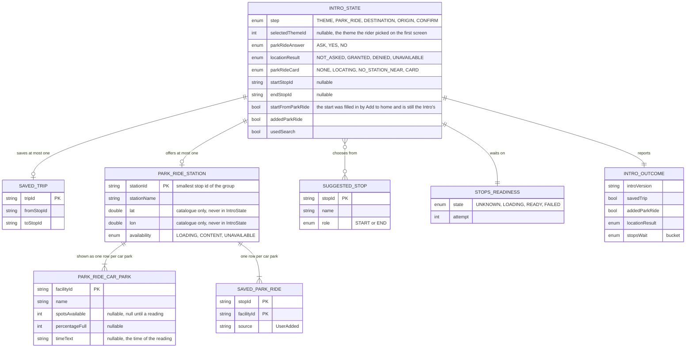
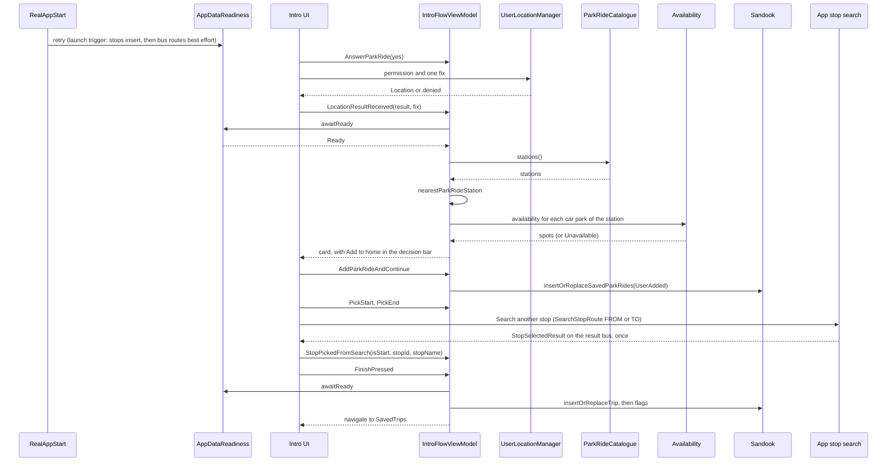

# Feature ERD: Intro redesign (Park & Ride question and first trip)

Status: Agreed for build (rows IA1 to IA13 of "Assumptions for approval" in section 9 approved by ksharma-xyz on 2026-11-21; the measurement targets and review points in section 11 are still owner decisions)
Owner: ksharma-xyz
Touches: `feature/trip-planner/ui` (`intro/`), `feature/trip-planner/state` (`intro/`), `core/analytics`, `io/gtfs` (stops readiness, first PR), `sandook` (one preference key), `.maestro/` (one shared flow, only if the tag changes)
Rebuild: the Intro is being rebuilt as five screens, one question each (theme, Park & Ride, destination, origin, confirm), in three units. Unit R1 holds the step model, the decision bar, the headline and the Park & Ride screen, and unit R2 the theme screen and the flip that makes it the first. Where sections 1, 2, 6, 9 and 11 still name two steps, Next, Skip for now or one bottom button, sections 3, 5, 7, 8 and 10 are the current text.

The design behind this document was settled in review on 2026-11-21 against an interactive prototype that is not part of
this repository. Everything a builder needs from it is restated here, so this file stands alone.

---

## 1. Problem and scope

- **Who has the problem.** A rider who has just installed KRAIL taps through a tour of features and lands on a home screen
  that shows nothing of theirs. Nothing they did in the tour is kept.
- **What this does.** Replaces the seven-page carousel with a two-step first run that ends with something saved.
  - Step 1 asks "Driving to the station?". Yes asks for location, shows the nearest Park & Ride car park with its live
    spots and an Add to home button. No, or a denied location, goes straight to step 2.
  - Step 2 saves a first trip. The rider picks a start and an end from suggested stops (or searches for another stop), sees
    the pair as one tile, and taps one button: Save and start, or Skip for now.
  - The last button waits for the stops data to be ready, and the data layer reports readiness, failure and retry
    (`DATA_READINESS` in section 3).
- **What it deliberately does not do.**
  - No alerts, no departures and no trip planner call in the Intro. A trip is saved from two stop ids with no network.
  - No horizontal pager, no card or gradient border, no map, no transport mode picker, no invite page.
  - No hard gate. A rider can always finish with nothing saved.
  - No change for riders who already have the app. They never see the Intro and keep the one-time Park & Ride suggestion
    planned for the map-first home stack.
  - Does not build the home screen changes. It supplies two things the home stack reuses: `nearestParkRideStation` and the
    "suggestion shown" flag.

## 2. Entities and relationships



| Entity | Layer | Source of truth | Identity key | Lifetime |
|---|---|---|---|---|
| `IntroState` | ui | `IntroFlowViewModel` | none, one per Intro | Process, survives rotation (view model plus saved state) |
| `SuggestedStop` | domain | Bundled default, optionally Remote Config key `intro_suggested_stops` | `stopId` | Until the list is next refreshed |
| `ParkRideStationPickerItem` (existing) | domain | `ParkRideCatalogue.stations()` | `stationId` (smallest stop id of the group) | Per call |
| `ParkRideCardStation` and `ParkRideCarPark` (new) | ui state | `IntroParkRideStep`, from the catalogue item and the stored readings | `stationId`, `facilityId` | The Intro, in memory. Only `stationId` is saved |
| `SavedParkRide` (existing) | db | `NswParkRideSandook` | (`stopId`, `facilityId`) | Until the rider removes it |
| `SavedTrip` (existing) | db | `Sandook` | `tripId` | Until the rider deletes it |
| `KEY_HAS_SEEN_INTRO` (existing) | prefs | `SandookPreferences` | key | Install |
| `KEY_PARK_RIDE_SUGGESTION_SHOWN` (new) | prefs | `SandookPreferences` | key | Install |
| `StopsReadiness` (new) | domain | `AppDataReadiness` in `:io:gtfs` | none | Process |
| `IntroOutcome` | analytics | built once, at finish | none | One event |

**Collision check, answered from real data** (the Remote Config default catalogue, the stops table and real trip events):

- One station name maps to several stop ids in the stops table (the station and its platforms or street-side stops). The suggested stops carry the station-level (parent) id, to be confirmed against the table for each stop.
- A Park & Ride "station" is not always a station. In the default catalogue (42 rows, 37 facilities) seven rows point at bus
  stops named like "Warriewood B-Line, Pittwater Rd". A start label built as "<name> Station" would be wrong for them. The
  label must be the stop's own name.
- Three catalogue rows point at stop ids that are absent from the stops table (a second Hornsby id, a second Mona Vale id and
  West Ryde). Such a station has no coordinates, so it can never be the nearest, and it can never pre-fill a trip start.
- One station maps to many car parks and one car park can serve several stop ids. `groupIntoStations` already resolves this
  with a union find. The Intro reuses it and does not group again.

## 3. Interfaces

```kotlin
// module: :io:gtfs (first PR), callers: IntroFlowViewModel, later SearchStop and the map-first home
sealed interface StopsReadiness {
    data object Unknown : StopsReadiness
    data object Loading : StopsReadiness
    data class Ready(val stopCount: Int) : StopsReadiness
    data class Failed(val attempt: Int, val reason: String) : StopsReadiness
}

interface AppDataReadiness {
    val state: StateFlow<StopsReadiness>
    /** Suspends until the stops are Ready or Failed, or until [timeoutMs]. Never throws. Starts the first run if none has started. */
    suspend fun awaitReady(timeoutMs: Long): StopsReadiness
    /** A no-op while Loading or Ready. From Failed one more attempt. From Unknown the launch trigger. */
    fun retry()
}

// StopsManager.insertStops() changes from Unit to Result<Unit>, and the table clear moves inside the insert transaction.
```

How the first PR behaves, where it adds to the signatures above:

- `RealAppStart` calls `retry()` once at launch and no longer waits for the inserts, so remote config set up starts earlier.
  `retry()` is a no-op while Loading and while Ready, so calling it again in a live process never demotes good data. From
  Unknown it gets up to three automatic retries with a growing backoff. From Failed it is one more attempt.
- The automatic retries show as Loading, never as Failed. `Failed.attempt` counts every attempt in the process. A run that
  is cancelled or breaks unexpectedly ends in Failed, never stuck in Loading.
- Ready is about the stops only. It means all of: the stops insert returned success, the stored stops version is at or above
  the bundled one, the stop count is at or above the existing floor, and a read of one known stop (Central, the parent stop
  `200060`) returns a row. The decision is one pure function, `reduceReadiness`, so a table test holds every combination.
  A test reads the bundled data file and fails if that stop is ever dropped by a data refresh.
- The bus routes insert follows in the same run once the stops are Ready, best effort. A failure there is logged, does not
  change the state, and is not retried until the next launch. `awaitReady` returns as soon as the stops are Ready and never
  waits for the bus routes. The Intro needs only the stops table.
- WAL and the clear inside the transaction: proven on the JDBC test driver. The app sets WAL explicitly on iOS
  (`JournalMode.WAL`) and on Android (`enableWriteAheadLogging()` in `SandookCallback.onOpen`), and the `-wal` and `-shm`
  files have been seen on a real Android phone. The Android and iOS drivers themselves are not run in a test.

```kotlin
// module: :feature:trip-planner:ui, intro/, pure, no I/O, runs under a fixture suite
internal data class SuggestedStop(val stopId: String, val name: String)
internal data class SuggestedStops(val start: List<SuggestedStop>, val end: List<SuggestedStop>)

/**
 * Parses the Remote Config value, `{"start":[{"stopId":"..","name":".."}],"end":[..]}`, ignoring unknown fields. Returns
 * [fallback] as a whole, never a repaired half, for: text that is not that shape, an empty list, a stop id repeated
 * within a list, a blank id or name, or a start that equals the only end (or an end that equals the only start), where
 * picking that stop would leave the other list with nothing different to pick. The same stop on both lists is normal.
 * `name` is the stop's own name in the stops table (for example "Central Station").
 */
internal fun parseSuggestedStops(json: String, fallback: SuggestedStops): SuggestedStops

/**
 * The single nearest station within [radiusKm] of [location], or null. Stations with no coordinates are skipped.
 * Shared with the map-first home stack, which reuses it.
 */
internal fun nearestParkRideStation(
    location: LatLng,
    stations: List<ParkRideStationPickerItem>,
    radiusKm: Double,
): ParkRideStationPickerItem? // distance is GeoUtils.haversineDistance, the edge is inclusive, INTRO_PARK_RIDE_RADIUS_KM = 5.0

/** The start to pre-fill after Add to home (IA6), or null. Smallest stop id of the station that resolves, the stop's own name. */
internal fun parkRideStartPrefill(station: ParkRideStationPickerItem, stopNameLookup: (String) -> String?): SuggestedStop?

/**
 * What the decision bar says and does, or null when the screen shows no bar. A table over the step, so a new step is a
 * compile error and not a screen with the wrong bar. Always exactly two buttons, never three: the negative answer on the
 * left (an outlined button) and the primary on the right (filled in the theme colour, test tag `intro.action.primary`).
 * Only the right one is ever disabled.
 *   THEME:        "No, show me another" and "Yes, this one". The left one selects the next theme in the cycle, the first
 *                 when none is selected, and the right one confirms the theme on show and is disabled until a theme is
 *                 selected. No compact forms: at a large text size, or a narrow window, the bar stacks.
 *   PARK_RIDE:    asking is "No thanks" and "Yes, show me free spots". A card, or a station still being looked for, is
 *                 "Not now" and "Add to home". While the station is looked for, or its numbers are awaited, the bar keeps
 *                 both buttons and the right one is disabled, so the bar never changes size or jumps.
 *                 No station near, a denied or missing location and stops that are not usable show no bar, because the
 *                 flow has already moved on.
 *   DESTINATION, ORIGIN, CONFIRM: one temporary bar, "Not now" and "Yes, save it", until those screens have their own.
 *                 The right button waits for the stops data to be Ready or Failed, as the confirm screen will.
 */
internal fun introBar(state: IntroState, readiness: StopsReadiness): IntroBar?
internal data class IntroBar(val left: IntroBarAction, val right: IntroBarAction, val rightEnabled: Boolean = true)
/** [label] is the whole phrase and is the screen reader description at every text size. [compactLabel] shows above 130 percent text. */
internal data class IntroBarAction(val label: String, val event: IntroUiEvent, val compactLabel: String? = null)
/** The compact label above `L_FONT_SCALE_THRESHOLD` (1.3), the whole label at or below it, and the whole label when there is no compact one. */
internal fun IntroBarAction.visibleLabel(fontScale: Float): String

/**
 * How the two buttons sit, from the width each needs for its whole label on one line. One row when the longer label fits
 * in half the room (even halves), or when both fit side by side (natural widths plus the spare shared). Otherwise stacked,
 * the primary on top, each button the full width. Nothing is squeezed, shortened or wrapped to make a row fit.
 */
internal fun introBarPlan(leftNatural: Int, rightNatural: Int, gap: Int, available: Int): IntroBarPlan
internal sealed interface IntroBarPlan {
    data class OneRow(val leftWidth: Int, val rightWidth: Int) : IntroBarPlan
    data object Stacked : IntroBarPlan
}

/** savedTrip = state.saved, skipped = no saved trip and no complete pair. Param names and values as section 11.2. */
internal fun IntroState.toOutcome(stopsWait: StopsWait): IntroOutcome
internal fun IntroOutcome.toParams(): Map<String, Any>
/** Failed is failed. None is no wait, under 2 s, 2 s to 5 s inclusive, over 5 s. Takes a Duration, never reads a clock. */
internal fun stopsWaitBucket(waited: Duration, readiness: StopsReadiness): StopsWait
```

```kotlin
// module: :feature:trip-planner:state, intro/
// Every field has a default, so IntroState() is the first screen. hasTrip is true only when both stop ids are set.
data class IntroState(
    val step: IntroStep,
    val parkRideAnswer: ParkRideAnswer,
    val locationResult: LocationResult,
    val parkRideCard: ParkRideCardPhase,
    val startStopId: String?, val startName: String?,
    val endStopId: String?, val endName: String?,
    val startFromParkRide: Boolean,
    val addedParkRide: Boolean, val usedSearch: Boolean,
    val saved: Boolean,
)

/** What the question step shows below the question. Added is a Card while addedParkRide is true, not a fifth phase. */
sealed interface ParkRideCardPhase {
    data object None : ParkRideCardPhase                         // unanswered, or no usable location
    data class Locating(val stationId: String? = null) : ParkRideCardPhase // skeleton. stationId only while a saved card is worked out again
    data object NoStationNear : ParkRideCardPhase                // no station within the radius, or the stops were not ready in time
    data class Card(val station: ParkRideCardStation) : ParkRideCardPhase
}

/** No coordinate of the rider and none of the station: the station position stays in the catalogue item. */
data class ParkRideCardStation(
    val stationId: String, val stationName: String,
    val carParks: ImmutableList<ParkRideCarPark>,                // names first, readings once the one call is back
    val availability: ParkRideAvailabilityState,                 // Loading, Content, Unavailable
)
data class ParkRideCarPark(
    val facilityId: String, val name: String,
    val spotsAvailable: Int?, val percentageFull: Int?, val timeText: String?, // null until a reading exists
)

// module: :feature:trip-planner:state, intro/
enum class IntroStep { THEME, PARK_RIDE, DESTINATION, ORIGIN, CONFIRM }
/** The first screen of the flow, the theme colour. One constant, so a screen can be put before it or taken off the front. */
val IntroFirstStep: IntroStep = IntroStep.THEME

// module: :feature:trip-planner:ui, intro/ (internal, because SuggestedStop is).
sealed interface IntroUiEvent {
    data object Back : IntroUiEvent                     // the on-screen back arrow and system back
    data class AnswerParkRide(val yes: Boolean) : IntroUiEvent
    data class LocationResultReceived(val result: LocationResult, val location: LatLng?) : IntroUiEvent
    data object AddParkRideAndContinue : IntroUiEvent  // "Add to home": saves the station and moves on in one event
    data object DeclineParkRide : IntroUiEvent         // "Not now" on the card: moves on, and removes a station already added
    data class PickStart(val stop: SuggestedStop) : IntroUiEvent
    data class PickEnd(val stop: SuggestedStop) : IntroUiEvent
    data class StopPickedFromSearch(val isStart: Boolean, val stopId: String, val stopName: String) : IntroUiEvent
    data object FinishPressed : IntroUiEvent           // "Yes, save it": saves the trip when there is a complete pair
    data object FinishWithoutTrip : IntroUiEvent       // "Not now" on the trip screens: ends the Intro with nothing saved
    data class PickTheme(val themeId: Int) : IntroUiEvent // a badge was tapped: selects the theme, does not move on
    data object ShowAnotherTheme : IntroUiEvent        // "No, show me another": selects the next theme, the first when none
    data object ConfirmTheme : IntroUiEvent            // "Yes, this one": reports the choice once and moves on
}

/** One shot, delivered once through a Channel and never replayed after rotation. */
sealed interface IntroEffect { data object NavigateToSavedTrips : IntroEffect }
```

`IntroFlowViewModel` exposes `state: StateFlow<IntroState>`, `suggestedStops: SuggestedStops` (read once from the
`intro_suggested_stops` flag, empty default so the bundled lists apply) and `effects: Flow<IntroEffect>`. It takes a
`SavedStateHandle` and saves the step, answer, permission result, picks and flags on every change as one JSON string, so
they survive rotation and the process being killed. It also saves which station the card was for (the station id, or a
flag when there was none near) and nothing else about the card: no car park, no reading, and never a coordinate. After
the process is killed the card is worked out again from that id (see section 5). Its writes and tracking live in `IntroCompletion`, which holds `Sandook`, `SandookPreferences`, `Analytics` and the IO
dispatcher, to keep the constructor under the detekt parameter limit.

The Park & Ride step is two more classes, so the view model stays small. `IntroParkRideGateway` is the injected one, like
`IntroCompletion`: the catalogue, the availability loader (`ParkRideAvailabilityLoader`, the same one the Saved Trips card
and the picker use), `NswParkRideSandook`, the IO dispatcher, the stops table's name lookup and `Analytics`, and it does the
reads and the writes of Add to home. `IntroParkRideStep` is built by the view
model in its own scope and holds the order of things: the answer, the one location result, the wait for the stops, the
nearest station and the one availability call. It never asks for the permission: the screen does, and sends
`LocationResultReceived`.

- Every interface has a fake in `:core:testing`: `FakeAppDataReadiness` (controllable state), the existing location, catalogue,
  sandook and park ride fakes, and a fake clock. No `Clock.System` (the `ClockSystemBan` rule).
- The Intro never calls the trip planner. `IntroFlowViewModel` keeps `StopsManager` out of its constructor and depends on
  `AppDataReadiness` instead.
- The Add to home action calls `NswParkRideSandook.insertOrReplaceSavedParkRides` with `UserAdded` and does **not** call
  `AppReviewManager.onDelightMoment(PARK_RIDE_ADDED)` (see IA11). The Intro has no review manager to call, and
  `IntroNeverReviewsTest` fails if any Intro source names one.
- Save trip calls `Sandook.insertOrReplaceTrip` with the two stop ids and names.
- The screen is `IntroFlowScreen`, stateless, and `IntroFlowRoute` is the thin stateful wrapper around it. The route collects
  `state`, `stopsReadiness` (the view model passes `AppDataReadiness.state` through, so the last button reads the data layer
  and nothing polls) and the one shot effects with the lifecycle, calls `IntroFlowScreen`, and owns the platform glue:
  `IntroLocationEffect` for the location permission and the one fix, and a call to `IntroFlowViewModel.onStepShown(step)` each
  time the step on screen changes. `onNavigateToSavedTrips` and `onNavigateToSearchStop` are parameters. The route builds step 2
  (`introFirstTripStep`) itself and receives the pick back with `IntroSearchResultEffect`.
- `IntroEntry` shows `IntroFlowRoute` with `koinViewModel<IntroFlowViewModel>(key = ...)`. The registration is
  `viewModel { params -> IntroFlowViewModel(savedStateHandle = params.get(), ...) }`. Koin 4.2.0 answers `params.get()` for a
  `SavedStateHandle` by calling `createSavedStateHandle` on the view model's creation extras, in common code, so Android and
  iOS take the same path. The Intro's owner on Android is the Activity, which supplies those extras, and on iOS it is Compose
  Multiplatform's default owner, which sets the same two keys. `IntroFlowKoinTest` creates the real registration, with fakes at
  its edges, on an Android host and holds that the handle is real and that what the view model saves lands in it. The iOS path is
  not run, because no simulator is used in this work, so it is a device case.
- The navigation entries carry no view model store, so a view model made in an entry belongs to the Activity and would outlive
  the Intro. The entry keys it on a value made once for each visit and saved with the entry, which gives Settings, which can open
  the Intro again, a new view model each time, and gives a turn of the screen and the search on screen the same one.
  `IntroEntryTest` holds all three.

Unit R3, the stop lists as pure functions (the destination, origin and confirm screens use them), where this document was
silent. Every rule here is a function of its inputs with a table test, in `IntroStopNames.kt`, `IntroStopLists.kt` and
`IntroStopRows.kt`:

```kotlin
// module: :feature:trip-planner:state. Ids and names only: a stop never carries a position.
data class IntroStop(val stopId: String, val name: String)
sealed interface IntroSearchPhase { data object Idle; data class Results(val stops: ImmutableList<IntroStop>); data object NoMatch }
// IntroState gained four fields, none of them saved: nearbyStops, stopModes (id to modes, for the row badges), query, search.

// module: :feature:trip-planner:ui, intro/, internal and pure
fun fromSuggestions(nearby: List<IntroStop>, curatedStarts: List<SuggestedStop>, size: Int = 5): List<IntroStop>
fun destinationSuggestions(curatedEnds: List<SuggestedStop>, size: Int = 5): List<IntroStop>
fun defaultDestination(list: List<IntroStop>): IntroStop?
fun defaultStart(nearby: List<IntroStop>, curatedStarts: List<SuggestedStop>, parkRideStart: IntroStop?): IntroStop?
fun IntroState.stopRows(suggested: SuggestedStops): List<IntroStop>      // what the screen lists
fun IntroState.highlightedStop(suggested: SuggestedStops): IntroStop?    // the first of those
fun IntroState.withStopChosen(stop: IntroStop): IntroState               // the pick, and on to the next screen
fun IntroState.toOutcome(stopsWait: StopsWait, declined: Boolean = false): IntroOutcome
```

- **The origin list.** `fromSuggestions` takes the stops near the rider, nearest first, collapses them by station name (a stop's
  name up to its first comma, so `Chatswood Station, Stand A` and `Chatswood Station` are one station, and never by the stops
  table's parent flag, which is an operator ruling), keeps the nearest three, and fills to five from the curated starts. A station
  that is nearby and curated shows once, at its nearby place, de duplicated by id and by name. With no fix it is the curated list
  alone, and with fewer than three nearby it is made up from the curated list. The row of a collapsed station is the stop named
  exactly as the station, else the nearest stop of it, and it keeps its own id and name.
- **The destination list** is the curated ends alone: where a rider goes is not where they stand, so a fix never changes it.
- **The highlighted row** is the first row of what the screen lists, and there is no separate highlight state. It is the nearest
  station when there is a fix and the first curated stop when there is none. With a Park & Ride station added the origin screen
  is passed over and that station is the start (`defaultStart`). Coming back to a screen, the rider's earlier choice leads the
  list, so it is the highlighted row even when it was found by search and is not a suggestion, and the fifth suggestion makes way.
  With results from a typed search the first result is highlighted, and with no match nothing is.
- **Never the same place twice.** The stop chosen for the other end is left out of the list, by id and by station name, so a trip
  never starts and ends at one place. Picking the Park & Ride station as the destination clears the start it filled in, and the
  origin screen comes back.
- **Choosing.** A tap on a row and the right button both end in `withStopChosen`: it sets the end on the destination screen and
  the start on the origin screen, drops the typed text and results, sets `usedSearch` when the stop is one of the typed results,
  and moves on in the flow as it stands after the pick. With a Park & Ride start the flow goes from the destination to the confirm
  screen and Back from the confirm screen returns to the destination (`IntroStepFlow`, table tests). Any two chosen stops reach the
  confirm screen with a complete trip, which a test holds for every pair of the real curated lists.
- **The events.** `ChooseStop(stop)` is a tap on a row, `UseHighlightedStop` is the right button and takes the first listed row,
  `FocusSearch` is the left button and `QueryChanged(text)` is the field. `FocusSearch` is answered by the screen, which has the
  field, and ignored by the view model: it never chooses and never leaves a screen. `PickStart`, `PickEnd` and `StopPickedFromSearch`
  belong to the earlier first trip screen and go with it.
- **The outcome.** `skipped` in `intro_lets_krail` is true only when the rider answered Not now on the confirm screen, and a saved
  trip is never skipped. It is no longer inferred from the picks. No event name and no param was added, and the other params keep
  their meaning.

Unit R2, as built (the theme screen), where this document was silent. The theme screen is `IntroThemeStepContent` in the
three zone frame, and everything it decides is in pure functions with table tests:

- **The choices.** `introThemeChoices()` is Train (T), Metro (M), Bus (B) and Ferry (F), each with its letter, its accessible
  name and its test tag (`intro.theme.train`, `intro.theme.metro`, `intro.theme.bus`, `intro.theme.ferry`). The colour is never
  kept: it is read from `KrailThemeStyle`. The two fun themes stay in Settings, and Light rail and Coach have a colour in the app
  but no theme (no id and no tagline), so they are not offered. `nextThemeChoice(currentId)` cycles and wraps, and starts at
  the first when nothing, or a theme the Intro does not offer, is selected.
- **The headline.** Before a choice it is `Pick`, `your ride`, `colour`, with the key word last, no question mark, no
  exclamation mark and no colon. After a choice it is that theme's `KrailThemeStyle.tagLine`, shown exactly as the app wrote it,
  split by `taglineLines` after its first comma (one line when there is none, and the lines joined with a space are the
  tagline again). It enters again with the kinetic headline motion each time the selection changes, because the headline is
  keyed on its phrase. The emoji is `introEmojiFor(THEME)`. `IntroHeadline` gained `minLines`: the headline keeps the height of the
  emoji and that many lines at the rider's text size, so the badges do not move when the words change.
- **The badge.** A taj `RoundIconButton` in the theme's colour with the letter in `typography.introTagline` (the app's heaviest
  display style), sized by modifier, with a white ring (`Modifier.border`, `strokeMedium`) and a soft shadow (`Modifier.shadow`).
  `RoundIconButton` has a content slot and no border, which is the one gap and is listed in section 9. It is 64 dp at the
  default text size and grows with the text to at most 96 dp (`badgeSizeDp`), so the letter always fits and a touch target is
  never under 48 dp. The letter takes whichever of the app's light and dark text colours reads clearly on the theme's colour
  (`getForegroundColor`). For a screen reader a badge is one button named for its theme with its selected state, and the letter is
  hidden from it.
- **The layout.** A `FlowRow` centred, with `spacingXXXL` (24 dp) between badges both ways, so whole badges wrap and nothing is
  squeezed: four in a row on a phone, and two and two at 320 dp with text at 200 percent. The middle zone scrolls with the
  headline when the room runs out.
- **Motion, with two operator approved continuous exceptions on this screen only.** One clock in seconds
  (`rememberThemeClock`) drives both. Float: every badge that is not selected drifts on an ellipse, at most 6 dp up and down and
  4 dp sideways, on a loop of 8, 10, 12 or 13 seconds with its own phase (`floatOffsetAt`). Dance: the selected badge loops the
  website's pill-dance (`danceAt`): it turns from minus 10 to plus 10 degrees, rises 2 to 8 dp and grows 1.05 to 1.10, 0.65
  seconds each way with ease in and out, going back the way it came. `badgeFrame` blends the two over 250 ms when the selection
  changes, so a badge never jumps. Both are `graphicsLayer` transforms read inside the layer lambda, so a tick redraws four layers
  and recomposes and lays out nothing. The clock runs only while the screen is RESUMED (its driver is composed only then, the
  same lifecycle gate the rest of the app uses) and ends when the screen leaves. With reduced motion, in a preview and in a
  screenshot nothing moves: the selected badge sits lifted 4 dp with a thicker ring (`settledFrame`, `ringWidthDp`), and that
  settled frame is also what every preview and snapshot draws.
- **Selecting and the live recolour.** A tap, or the left button, selects a theme and does not move on. The selection is a
  state, and `IntroFlowRoute` applies it to the whole app through `onApplyTheme`, which the entry wires to the same
  `TripPlannerNavigator.updateTheme` the Settings theme screen calls, so the Intro's buttons and every screen after it take the
  colour through the normal `KrailTheme`. It applies again each time the Intro is composed with a theme selected, such as after
  a turn of the screen.
- **Storing it.** A pick also stores the theme with one small local write (`ThemeChoice.save`, a clear and an insert in the
  one row table, on the IO dispatcher, the last pick wins). It is per pick and not on confirm because the app reloads its theme
  from that table whenever it is recreated, so a theme held only until confirm would turn back to the default on a rotation.
  `ThemeChoice` is the write and the report that `ThemeSelectionViewModel` and the Intro both use, so the two cannot differ, and
  the Settings screen's behaviour and tests are unchanged. The Intro reaches it through `IntroCompletion`, which already holds
  Sandook, Analytics and the IO dispatcher, because the view model is at the constructor limit.
- **Confirming.** `Yes, this one` is disabled until a theme is selected. It reports the choice once with the existing
  `analytics.trackThemeSelectionEvent(themeId)` (event `theme_selected`, param `themeId` only, no new name and no new param,
  and the ledger has no Pending row for it), and moves on to Park & Ride. Cycling and tapping report nothing. Going back and
  confirming the same theme again reports nothing more, and a different theme reports again.
- **The flow.** `IntroFirstStep` is THEME. Back from Park & Ride shows the theme screen with the choice still selected, the theme
  screen has no back button, and a Park & Ride screen with nothing to decide is passed over in both directions. The selected
  theme id is part of the saved state, so it survives rotation and a killed process, and a snapshot saved before it existed reads
  as no theme.
- **One screen view.** The theme and Park & Ride screens are both `view_screen` `Intro`. `shouldTrackScreenView(previous, next)`
  sends it on entering the Intro and when the screen name changes, so going from the theme screen to Park & Ride, or back, sends
  nothing more. No event name was added.
- **The wording guard.** `IntroCopyTest` exempts exactly the themes' taglines, which are the app's own copy and carry an
  exclamation mark, and nothing else: a line of the Intro's own with the same fault, or a tagline with a word added, still fails.
- **What R3 wires.** The chosen theme is `IntroState.selectedThemeId`, saved with the screen, and the app is already in its colour
  (applied and stored), so the finale reads it with `themeChoiceFor(id)?.style`, and an unset id means the default theme. R3 replaces
  `tripBar` with the bars of its three screens, replaces `IntroPendingStepBody` for the origin and confirm screens and deletes it,
  keeps `IntroFlowRoute`'s `onApplyTheme` as it is, and sends no `view_screen` of its own: the two names already cover its screens.

Unit R1, as built, where this document was silent:

- **Flow order, one place.** `IntroStepFlow.kt` holds the order as pure functions of the state: `stepsInFlow`, `stepAfter`,
  `stepBefore`, `movedOn` and `movedBack`. The Park & Ride screen is passed over when it has nothing to decide (no station
  near, or the answer is Yes with no card), the origin screen is passed over when the start came from a Park & Ride station,
  and the screens before `IntroFirstStep` are not in the flow. Back goes to the previous screen that is in the flow, and
  there is no back on the first screen. The step is saved with the rest of the state, so a restore lands on the same screen
  and back still works.
- **Temporary bodies.** Until the theme, origin and confirm screens exist they show an empty body (`IntroPendingStepBody`,
  tag `intro.pending.<step>`), and the destination step shows the earlier first trip content, so the app still runs end to
  end. Each is deleted by the unit that builds the screen.
- **Headline.** `IntroHeadline(lines, emphasisIndex, emoji)` is the one headline of every screen, in `typography.introTagline`.
  The timeline, the frame of a line, the weight of the lead lines and the emoji wobble are pure functions in
  `IntroHeadlineMotion.kt`, and the slide direction by step order and the transition specs are pure functions in
  `IntroMotion.kt`, each with a table test.
- **Frame.** `IntroStepFrame(headline, middle)` is the three zones: the headline on top, the thing to decide in the middle
  (centred in the room under the headline by `introMiddleTop`, and scrolling with the headline when the room runs out), and the
  decision bar pinned below by the shell.
- **Emoji.** `introEmojiFor(step)` is pure. The destination screen has the pin and the confirm screen the star, the two
  operator approved exceptions, declared once in `IntroApprovedEmoji.kt`. Every other screen takes an entry of
  `FestivalManager.commonEmojiList` (the app's non festival loading emoji), read from the list and never typed. No festival
  emoji is used, so the Intro does not change with the date. `IntroEmojiGuardTest` reads the Intro sources and fails on any
  other emoji. The confirm screen's star is the star emoji, not the save star icon, and may be swapped for the icon when that
  screen is built. `:feature:trip-planner:ui` already depends on `core:festival`, so no new module edge was needed.
- **Analytics.** No new event name and no new param. `intro_lets_krail` keeps its params and their meaning. `skipped` is
  completed with the confirm screen, where it will mean the rider answered No there. Until then it still means no complete trip
  was picked. `view_screen` maps the theme and Park & Ride screens to `Intro` and the other three to `IntroFirstTrip`, and it is
  sent once when the Intro is entered and not again between the first two (unit R2, `shouldTrackScreenView`).

## 4. External contracts

| Call | Method and path | Key params | Auth | Response format | Measured wire size | Measured latency |
|---|---|---|---|---|---|---|
| Park & Ride availability (existing) | `GET https://api.transport.nsw.gov.au/v1/carpark` | `facility=<id>` | `Authorization: apikey` through `ApiCredential` | JSON | about 350 B gzip, about 665 B decoded | 0.09 to 0.31 s |
| Park & Ride catalogue | Remote Config `nsw_park_ride_facilities` | none | none | JSON array of (`stopId`, `parkRideFacilityId`, `parkRideName`) | bundled default, 42 rows | none, bundled |
| Suggested stops (proposed) | Remote Config `intro_suggested_stops` | none | none | JSON of start and end lists | bundled default | none, bundled |
| Device location | `UserLocationManager.getCurrentLocation()` | one fix, no updates | OS permission | `Location` | none | **not measured** |

- The availability numbers are a one-moment snapshot of nine real calls on 2026-11-21. They show the shape and order of
  magnitude, not a rate, and not behaviour at other times of day.
- Fields read from availability: free spots, percent full, the time of the reading. Fields ignored: everything else. The
  existing mapper stores a missing latitude as 0.0 and a missing longitude as 0.0. The Intro never reads those two.
- Not called by the Intro: trip planner, alerts, departures, add_info, the BFF (not live in the app).
- Parity: no BFF route is involved, so there is no parity gap.

## 5. Data flow



Readiness is published when the stops are usable. The bus routes insert runs after that in the same run and does not
hold the Intro back.

Order at finish, which differs from today: wait for readiness, write the trip, write `KEY_PARK_RIDE_SUGGESTION_SHOWN` then
`KEY_HAS_SEEN_INTRO`, track the outcome, then navigate. Today the screen navigates without waiting for the insert, so a
fast rider can reach home before the stops are committed. The suggestion flag goes first, so a process killed between the
two writes shows the Intro again, rather than showing home with the suggestion still to ask.

Decisions the view model branch made where this document was silent:

- **Waiting.** The finish calls `awaitReady(15 s)`. A press while the right button is disabled for the stops is not dropped by the
  view model, it waits for the stops and then finishes (the button itself is disabled, so the screen never sends it).
  Without that the `stopsWait` buckets could not be reached. The wait ends on Ready, on Failed, or at 15 s, and the finish
  goes ahead whichever it was: the trip if there is one, both flags, tracking, then the effect. When the stops are not Ready
  by then, `retry()` is called once so the load goes on in the background (a no-op from Loading). The tracked wait is
  `failed` for Failed and `over_5s` for a timeout. The wait is none when the stops were already Ready, because a real clock
  never reads exactly zero. Going back, so that no trip screen is on show, while it waits abandons the finish.
- **Once.** The suggestion flag is written at the first of the question being answered or passed, and the finish. A
  second press while a finish runs, or after it has finished, does nothing. A trip already written (`saved`) is not
  written again by Let's KRAIL.
- **Same stop.** Picking the stop already chosen for the other end keeps the new pick and clears the other end. Two
  different stops that sit on both suggestion lists are fine.
- **Tracking.** A saved trip also tracks `save_trip_click` with `source = intro`, stop ids only, before the outcome event.

Decisions the Park & Ride step made where this document was silent. The step is built over several branches and the
list grows with each:

- **Added is not a phase.** The rider's Added state is a Card while `addedParkRide` is true, which is what the section 7
  table says ("the same card"), so the two cannot disagree.
- **Who asks.** The screen asks for the permission and takes the one fix, then sends `LocationResultReceived`. The view
  model never asks. `AnswerParkRide(yes = true)` records Yes and moves the card to Locating, the skeleton.
- **A result nobody asked for is ignored.** Only a result that arrives while the card is Locating counts, so a repeat or a
  late one changes nothing. A second Yes while Locating or while a card shows does nothing, so it can never start a second
  look or a second call. Yes after No station near, or after a denial, looks again.
- **No usable location.** Denied, unavailable and the 10 s timeout inside the location manager (mapped to `UNAVAILABLE`
  by the screen) record the result, move on to the next screen in the flow, write the suggestion flag once and leave the
  card at None. Nothing blocks, there is no bar and no message. A granted result that carries no fix is recorded as `UNAVAILABLE`, because there
  is nothing to find a station from. A fix that arrives behind a result that is not granted is dropped unused.
- **Stops.** With a fix, the step calls `awaitReady(10 s)`. Anything but Ready (Unknown or Loading at 10 s, or Failed at
  once) is the same answer as no station near, with no error. The rider is not held on the wait: Not now, Back and the
  finish all work while it runs.
- **The fix.** It is used inside one coroutine to pick the station by `nearestParkRideStation` (5 km, the edge inclusive)
  and then goes out of scope. It is never stored in the state, never saved and never logged or tracked. The state holds
  the station's id, name and car parks only.
- **The card.** It shows at once with the car park names and no numbers (availability Loading), then settles after one
  `refreshIfNeeded` for every mapping of the station: Content when at least one car park has a reading, otherwise
  Unavailable, which keeps the names so the screen can show the name and Add with no numbers. A car park with no stored
  reading is a name. A loader that throws is the same as one that found nothing. There is no timer, no retry and no
  second call, and a view model that is cleared cancels all of it.
- **No.** `AnswerParkRide(false)` is as before, and also cancels a look still waiting and clears the card.
- **What Add does.** It saves one `UserAdded` row for every mapping of the station, the rows and the source the picker's
  Add writes, with the stop name the picker uses (the stop's own name, or the station name when the stops table has none).
  The Intro moves on as soon as the rows are written and never waits for the network. A second event while the add is
  running does nothing, so a double tap adds once and tracks once. Back from the next screen returns to the card, and Add to
  home there adds nothing twice and moves on again. It is ignored with no card on screen, and before a card
  that is being worked out again after a killed process has its station back.
- **Tracking.** One `park_ride_user_facility` with `action` add, `source` intro, `stopId` the station id and `facilityId`
  the car park ids joined the way the picker joins them. No name and no coordinate.
- **No review.** Nothing in the Intro arms the app review delight moment. `IntroNeverReviewsTest` reads the Intro sources
  and fails if one names the review manager or the moment.
- **The stop name.** The loader files a car park that is not saved under its stop id, because it takes the name from the
  saved row. So the reading the Intro fetched before Add would show that id as the title of the Saved Trips card until the
  next refresh. After Add the step waits for the availability call if it is still running, then rewrites the stored
  readings of the station's car parks with the station's name and keeps everything else, including the time of the reading,
  so the cooldown is untouched. The wait never holds the Added state back, only this correction.
- **Pre-fill, from IA6.** After Add the start is filled in with the smallest stop id of the station that resolves in the
  stops table, labelled with that stop's own name, and only when the rider has not picked a start. It is not filled in when
  that stop is already the end, because the trip would run from a stop to itself and the end is the rider's pick. When no
  stop resolves there is no pre-fill and the station is still added. IA6 says "the added Park & Ride station", so a rider who
  reaches step 2 with a station found but did not add it has no pre-fill.
- **Removing.** Not now on a card that was added, which the rider reaches by going back, removes only the `UserAdded`
  rows of the station, so a row a saved trip holds stays, and the Intro moves on. A removal tracks `remove` the same way as an add. It clears the start only while `startFromParkRide`
  is true. Any pick of the start by the rider ends that claim, even a pick of the very stop Add chose, and so does an end
  pick that clears the start. The stop names corrected after Add stay as they are.
- **Outcome.** `parkRideAnswer`, `locationResult` and `addedParkRide` come from the state at the finish, and a test holds all
  five paths: granted and added, granted and not added, no station near, denied, and a fix that timed out (`unavailable`).
  The never answered row is gone, because no later screen can be reached without answering the question.
- **What is saved.** The step, answer, permission result, picks and flags as before, plus the card's station id (or a
  flag for no station near). A card is saved as the id alone, with no car park and no reading, and comes back as a
  Locating skeleton that carries the id. The step then works it out again from the catalogue and asks the loader once
  more, which spends no call while the readings are inside the cooldown. A station that is no longer in the catalogue, or
  stops that are not Ready, come back as No station near. A location still being awaited is not saved, so a process killed
  there asks the question again. Nothing about the rider's position is ever saved.

Decisions the UI branch made where this document was silent:

- **How one result per Yes is guaranteed.** `UserLocationManager.getCurrentLocation()` already checks the permission, asks for it
  when it is not decided, and takes the one fix (10 s inside the manager), so the screen needs nothing more. The state does not say
  whether the result for the current Yes has gone, because the card stays Locating after a granted result while the station is
  found, so the screen keeps one saved flag, `sent`, and a pure rule, `locateStep(awaiting, sent)`. The card awaits a location
  when it is `Locating` with no station id. Awaiting and not sent: ask, take the fix, send it and set the flag in the same step.
  Awaiting and sent: do nothing, so a turn of the screen after the result asks for nothing. Not awaiting: clear the flag, so the
  next Yes sends its own. A turn of the screen before the fix lands finds the flag clear and asks again, because nothing was sent.
  A No while the fix is awaited cancels the ask and sends nothing for that Yes. A second tap on Yes while the card awaits
  changes no state, so it starts nothing. A process killed while awaiting saves no Locating card, so nothing is awaited after it.
- **The card is never left Locating for good.** Every ending is a result: a dismissed dialog, a refusal and the platform's
  restriction are denied, and every other failure, the manager's 10 s timeout and an exception are unavailable. A wait with
  no answer at all, the one thing the manager does not bound because it is a rider reading a dialog, is unavailable after
  120 s (`LOCATE_BOUND_MS`, a guess at a wait nobody doing that reaches).
- **The fix is never held.** It goes from the manager into `LocationResultReceived` in the same call and is not in a remembered
  or saved value, the state, or a log. `IntroLocationNeverHeldTest` holds that for the three files that touch it.
- **Screen views.** `view_screen` is sent from the view model (`onStepShown`), the way every other screen sends it. It is not by
  route: `RouteAnalyticsScreen` maps routes to names for the window events and is not where `view_screen` is sent, and it is not
  changed. It is sent once each time the step on screen changes, `Intro` for the theme and Park & Ride screens and `IntroFirstTrip` for
  the destination, origin and confirm screens, so a turn of the screen sends nothing and going back to an earlier screen is a
  new visit. After a killed process the restored step is sent once more.

Decisions unit R3 made for the stations near the rider, where this document was silent:

- **One fix, two readers.** The Park & Ride question takes the one fix when the rider says Yes and grants location. The view model
  hands the same fix to the nearest Park & Ride station and to `IntroStopsStep.onFix`, in the same call, and neither keeps it. There
  is no second location request and no second permission prompt. A result nobody asked for, a second result for the same Yes, a
  denial, an unavailable fix, a granted result with no fix, and No all ask the stops table nothing, and the origin list is the
  curated one.
- **Whether or not a car park is near.** The stations are found for every granted fix. A rider with no Park & Ride station within
  5 km still gets their nearest stations, because the two answers are independent.
- **The query.** `IntroStopsGateway.nearbyStations` calls the stops table's own `selectStopsNearby` (the query the nearby stops
  repository wraps) with a bounding box from `GeoUtils`, train, metro and light rail only (read from `TransportMode.productClass`),
  3 km, at most 10 rows. It does not go through `NearbyStopsRepository`, because that repository logs the centre it is given in
  every build, and the fix is never logged. The rows are reduced to the id, the name and the modes before they leave the gateway,
  so no position of a stop reaches the state either. `IntroLocationNeverHeldTest` holds both (see section 8).
- **Waiting for the stops.** Like the nearest car park, the step waits up to 10 s for the stops to be Ready and gives up with no
  error: stops that are Loading at 10 s, or Failed, or a query that throws, give the curated list. Nothing the rider sees waits on
  it, and the Park & Ride question moves on without it.
- **Late results.** The stations that arrive after the rider is on the origin screen, or past it, are dropped, so the rows never
  change under a finger. A rider who gets there first sees the curated list for that visit.
- **The badges.** The stops table is also asked once for the modes of the curated stops (one batched query for at most ten ids),
  after the stops are Ready, so a curated row draws the same badges as a nearby row and a search row. It waits on a collector of the
  readiness, with no timer, and until then those rows are drawn without badges.
- **What is kept.** `IntroState.nearbyStops` (ids and names) and `stopModes` (id to modes) live in the state and are never saved:
  after the process is killed they are empty and the curated list shows. Nothing about the position is in either.

Decisions unit R3 made for the typed search and choosing, where this document was silent:

- **The same search.** Typing runs `StopResultsManager.fetchStopResults`, the local stop search the Search Stop screen runs, with
  routes left out (only a stop can end a trip here) and addresses never asked for, after the same pause in the typing as Search Stop
  (`SearchStopViewModel.SEARCH_DEBOUNCE_MS`, 100 ms, shared and not copied). It shows at most 20 results, best first. A new keystroke
  cancels the search that was waiting or running, and an answer for text the rider has typed past is dropped.
- **The text.** The view model keeps the text in the state only so the answer can be matched to it. It is never saved, never reported and never
  logged: there is no search event, and `usedSearch` is the one flag, true only when the stop chosen is one of the typed results.
  Leaving the screen, by a choice or by Back, drops the text and the results.
- **A stops table that is not ready.** The field stays usable and finds nothing. The search waits for the stops to be Ready, which
  is a collector on the readiness and not a poll, and the suggestions keep showing, so the results fill in as soon as the stops are
  ready. Stops that Failed, and a search that throws, leave the suggestions showing, with no error state and no Try again.
- **Choosing.** A tap on a row and the right button both choose and move on in the one flow function, so there is one path to test.
  The right button takes the first listed row: the nearest station on the origin screen when there is a fix, the first curated stop
  when there is none, the first result when results show, and the rider's earlier choice when they come back.

Operator decisions of 2026-11-22: (1) exactly one of start or end picked disables the bottom button until both or neither
are picked (superseded in unit R1: the temporary right button on the trip screens is enabled whatever is picked, saves a trip
only for a complete pair, and ends the Intro either way, until the confirm screen decides this), (2) there is no Try again and no error state, a Failed readiness behaves like Ready for the button and a trip
can be saved while the stops failed, (3) the finish never blocks on the stops, it waits at most 15 s and then proceeds.

## 6. Cost budget (mandatory, never "N/A")

| # | Question | Answer |
|---|---|---|
| 1 | **API calls.** | None at open. Step 1 Yes path only: one `refreshIfNeeded` for the one nearest station, once per run, and a network call only for a car park whose last reading is older than the cooldown (a new install has none stored, so none are warm). The app runs with the BFF override off, so the loader asks NSW once per car park, one after another. In the default catalogue (32 stations, 37 car parks) that is 1 call for 28 stations, 2 for three (Penrith, Kellyville, Campbelltown) and 3 for Tallawong. A station that several stop ids share (Sutherland, Mona Vale, Hornsby) is still one call, because the second stop finds the car park inside its cooldown. No polling, no timer and no retry in the Intro. A process killed on step 1 asks the loader once more on restart, and the cooldown decides whether that is a call. Rotation makes none. Step 2: none. A rider who answers No makes none. The Intro makes no trip planner, alerts or departures call. |
| 2 | **Payload.** | About 350 B gzip and 665 B decoded per availability call, from the snapshot of 2026-11-21. **Not re-measured here**: the endpoint needs the shared NSW key, so nothing was sent. The stops files (about 2.3 MB and 2.6 MB) are bundled and are not downloaded. The Intro reads the 42-row catalogue and groups it once per look (and once after a kill), on the IO dispatcher, plus one batched coordinates query, and reads the facility table (at most 37 rows) once. All of it is small and local. |
| 3 | **Timing.** | The Intro opens with no network and no wait. The car park card needs a location fix (up to 10 s inside the location manager, **not measured**), then stops readiness (`awaitReady` up to 10 s, nothing when already Ready, and **assumed 3 to 5 seconds** on a fresh install, measured privately and not recorded here), then the station is picked in memory and the card shows at once with the car park names. The numbers follow after the calls. They run one after another at 0.09 to 0.31 s each in the snapshot, so about 0.1 to 0.3 s for most stations and about 0.3 to 0.9 s for Tallawong (arithmetic on the snapshot, a guess for a real phone). Nothing blocks: Not now, Back and the last button work throughout, and the last button is the only forced wait, and only if the rider finishes before readiness. The `stopsWait` bucket in section 11 measures it in the field. |
| 4 | **UX.** | Loading: skeleton in the card's space. Slow stops data: last button reads Getting ready, for at most 15 s. Failed stops data: no message and no error state, the button behaves as when ready and the load is retried in the background. Failed or offline availability: the station name and Add stay, the numbers are omitted. No station near: a plain line and the normal Next. Denied location: step 2. No layout shift between states (same slot). |
| 5 | **Network efficiency.** | Availability goes through the existing `ParkRideAvailabilityLoader`, the one the Saved Trips card and the picker use, so its cooldown and cache apply. **Verified in the code and held by a test** (`a second intro inside the cooldown makes no second call`): the loader reads the cooldown from the `NSWParkRideFacilityDetail` table and writes the reading into the same table the Saved Trips card reads, so home finds the car park inside its cooldown (120 s from 05:00 to 10:00 and 600 s otherwise, the Remote Config defaults) and does not refetch. One thing it writes wrongly for a car park that is not saved yet is the stop name, which is the stop id until the station is saved. Add corrects it (section 5), keeping the time of the reading, and a test holds it. |
| 6 | **Battery.** | One location fix, taken by the screen, not updates. No timer, no polling and no background work: the view model test lets an hour of virtual time pass and still finds one call. Everything the step starts runs in the view model's scope and is cancelled when it is cleared (two tests). Foreground only, so nothing needs lifecycle gating beyond collecting state with `collectAsStateWithLifecycle()`. |
| 7 | **Shared limits.** | At most one to three availability calls (28, 3 and 1 stations of 32) per rider who answers Yes and has a station near, once, on the shared NSW key, and the same again only after a killed process that is off cooldown. Small next to the existing polling on home (a guess, label it as one). The BFF is not live, so nothing collapses. |

| Flow | Calls before | Calls after | Bytes before | Bytes after | Time to results before | after |
|---|---|---|---|---|---|---|
| First launch to home, rider says No | 0 | 0 | 0 | 0 | seven pages | two steps, last button waits only if stops are not ready |
| First launch to home, rider says Yes | 0 | 1 to 3 | 0 | under 1 KB | seven pages | two steps plus the card |

| UI branch | Network calls | Location | Timers and polling | Battery | Payload |
|---|---|---|---|---|---|
| `IntroFlowScreen`, step 1 and the route | 0 of its own. The one availability call of the Park & Ride step is unchanged. | One fix per Yes, taken by `getCurrentLocation()` (10 s inside the manager, 120 s outside it for the permission dialog, a guess). A turn of the screen before the fix lands may ask again, still one result. | None. Animations only, each once: heading rise 400 ms, cross-fade 120 ms out and 180 ms in, dot width 200 ms. The screen reads `AppDataReadiness.state`, a state flow, and does not poll. | None beyond the fix. Foreground only. | None. The preview and layout tests are test code. |
| `IntroFirstTripStepContent`, step 2 | 0. It shows names only. The suggestions are the two lists read once from Remote Config (or the bundled default) when the view model is made, and a stop the rider searches for comes from the existing stop search, which the rider opens and which keeps its own cost. The stops table is not read by this step, so it can show before the stops are ready. | None. | None. No timer, no polling and no animation of its own beyond the heading rise, once. | None. Foreground only, and no radio is woken by this step. | None on the wire. About ten short strings in memory. |

The theme screen (unit R2), the seven questions, with numbers where there are any:

| # | Question | Answer |
|---|---|---|
| 1 | **API calls.** | None. No network call on open, on a pick or on confirm. One small local write per pick (a clear and an insert in the one row theme table, on the IO dispatcher), so as many as the rider makes picks, usually one to four, and none on confirm. |
| 2 | **Payload.** | None on the wire. The write is one integer. The four choices are an in-code table and the taglines are read from the theme enum, so nothing is parsed. |
| 3 | **Timing.** | Time to first content is unchanged: the screen needs no data and shows at once. Applying a theme is a local state change on the navigator, one recomposition of the app, and the existing colour transition then plays. |
| 4 | **UX.** | Nothing loads, so there is no loading, slow or offline state, and the screen works with no network. A theme write that fails is logged and ignored: the colour stays for this run and the app starts in the stored one next time. Nothing shifts when the headline changes, because it keeps the room of its longest version. |
| 5 | **Network efficiency.** | Not applicable, since there is no call. The one row table means a repeat pick of the same theme writes nothing. |
| 6 | **Battery.** | Two continuous animations, each an operator approved exception on this screen only: the drift of every badge and the dance of the selected one, both from one clock. They are `graphicsLayer` transforms read inside the layer lambda, so a frame redraws four small layers and recomposes and lays out nothing. The clock runs only while the screen is resumed, ends when the screen leaves, and is off with reduced motion and in a preview or screenshot. No timer, no wake-up of the radio, no background work. The screen is up for the seconds a rider takes to choose. The cost of a frame, with a shadow on each moving badge, is a guess until it is measured on a phone: it is the item to check first in the device QA. |
| 7 | **Shared limits.** | None. No NSW call and nothing for a BFF to collapse. |

The stations near the rider (unit R3), the seven questions, with numbers where there are any:

| # | Question | Answer |
|---|---|---|
| 1 | **API calls.** | No network call, on any path. Local queries only. A rider who says Yes and grants location makes one nearby query on the stops table, once per Yes (a second result for the same Yes makes none). Every rider makes one batched `selectStopsByIds` for at most 10 ids, once, when the stops are Ready, for the row badges. Nothing is polled. |
| 2 | **Payload.** | None on the wire. Decoded, the nearby query returns at most 10 rows and the modes query at most 10, so about 1 KB of strings in memory. The curated lists are bundled with the app (the same `intro_suggested_stops` default as before). |
| 3 | **Timing.** | Time to first content is unchanged: no screen waits on either query. The nearby query starts when the fix arrives, after the stops are Ready (assumed 3 to 5 seconds on a fresh install, as in section 6 above, and nothing when already Ready), and is a bounding box over an indexed table of about 37,000 rows, which is **a guess of tens of milliseconds on a mid-range phone, not measured**. It has the rider's reading time on the destination screen to finish. At worst the origin list is the curated one. |
| 4 | **UX.** | There is no loading, slow, failed or offline state to show, because nothing is waited for and nothing needs the network. A late, failed or empty answer is the curated list, with no message and no Try again. The rows never move once the rider is on the origin screen. |
| 5 | **Network efficiency.** | Not applicable, since there is no call. The curated list is bundled, the stations are worked out once per Yes, and nothing is cached across runs (a stale nearby list would be wrong the next time the rider stands somewhere else). |
| 6 | **Battery.** | One fix, already taken for Park & Ride. No timer, no polling and no background work: the two jobs run in the view model's scope and end with it, and the wait for the stops is a collector on the readiness state. |
| 7 | **Shared limits.** | None. No NSW call, nothing for a BFF to collapse. |

The typed search and choosing (unit R3), the seven questions, with numbers where there are any:

| # | Question | Answer |
|---|---|---|
| 1 | **API calls.** | None. Each pause in the typing makes at most one local search on the stops table (the query the Search Stop screen already makes, with routes left out). A rider who types makes as many as their pauses, and a rider who taps a row makes none. Nothing is sent to analytics or to any service. |
| 2 | **Payload.** | None on the wire. At most 20 result rows are kept in memory, ids names and modes, a few hundred bytes. |
| 3 | **Timing.** | The screen shows at once with the curated list and needs no data to be used. A result arrives 100 ms after the last keystroke plus the local search, which Search Stop already runs on every keystroke pause, so this adds no new cost that screen does not have. It runs on the IO dispatcher. **Not measured** for this screen. |
| 4 | **UX.** | Loading: the suggestions stay and the results replace them when they arrive. Not ready: the suggestions stay and the results fill in when the stops are ready. Failed: the suggestions stay, no message. No match is its own state. Offline is not a state, because the search is local. The list is capped at 20 rows. |
| 5 | **Network efficiency.** | Not applicable, no call. Each keystroke cancels the search before it, so a burst of typing is one search. |
| 6 | **Battery.** | The keyboard and the field exist only while the destination or origin screen is in front. No timer and no polling: a search is a coroutine that runs once for each pause and ends. The focus is taken only when the rider taps the left button or the field. |
| 7 | **Shared limits.** | None. |

Decision rule met: the added calls buy a live car park card and a one tap add for riders who park and ride. They are
optional, non-blocking, once only and silent on failure.

## 7. States and UX

The reference is an interactive review page (private). The states it shows are restated here.

**The five screens (rebuild)**

The Intro is five screens in this order, each asking one question: 1 theme, 2 Park & Ride, 3 destination, 4 origin, 5 confirm.
The origin screen is passed over when a Park & Ride station was added, because it filled in the start. Unit R1 builds the Park &
Ride screen and the shared parts, and unit R2 builds the theme screen and makes it the first (`IntroFirstStep` is THEME). The
destination, origin and confirm screens are temporary bodies (section 3).

Every screen has three zones:

- **Top, the headline.** Two to four short lines, left aligned, no question mark, in `typography.introTagline`, with the key
  word on its own line at the heaviest weight. The Park & Ride headline is "Driving", "to the", "station", the key word being
  "station". Emphasis is weight, never colour, so nothing competes with the theme colour on the primary button. Lines wrap
  rather than shrink at a large text size.
- **Middle, the thing to decide.** Centred in the room under the headline. When the text is large or the screen is short it
  scrolls with the headline, so nothing is clipped or out of reach.
- **Bottom, the decision bar,** pinned and never scrolling.

**The decision bar** (`introBar`, drawn by `IntroDecisionBar`). Always exactly two taj buttons, never three: `OutlinedButton`
on the left for the negative answer and `Button` on the right for the primary, filled in the theme colour, which stays the one
place the colour is used. The right one keeps the tag `intro.action.primary` and the left has `intro.action.secondary`. When
two whole buttons cannot fit side by side at the font size, the bar stacks with the primary on top and each button the full
width (`introBarPlan`, a pure function of the widths, so a table test holds it). Nothing is squeezed, wrapped or shortened to
make a row fit, except the one rule below. A screen with nothing to decide has no bar.

- **Wording.** No button or string in the Intro uses Skip, Skip for now, Later, Maybe later, Next, Continue or Done, and none
  uses a question mark, an exclamation mark, a colon, an em dash, an arrow or a middle dot. Every button is an answer to the
  question on the screen. `IntroBannedWordsTest` reads every string literal in the Intro sources and every string resource they
  name, and `IntroCopyTest` checks every label the bar can show.
- **Large text.** Above 130 percent text (`L_FONT_SCALE_THRESHOLD`) "Yes, show me free spots" shows as "Yes" and "No thanks" as
  "No", so the two stay in one row at 320 dp and 200 percent. It is a pure function of the font scale (`visibleLabel`) with a
  table test, and the content description keeps the whole phrase at every size. No other string is shortened.
- **Back.** The on-screen back is taj `NavActionButton` (a back arrow described as "Back") in the top bar, and system back does
  the same, one screen back in the flow. The first screen has neither, and there are no progress dots.
- **Motion.** Screens change with a spring slide and a fade (`introScreenTransition`): forward goes in from the right and the
  old screen leaves to the left, back is the mirror image, and the old screen always leaves faster than the new one settles.
  Each headline line enters as its own unit, one after another 70 ms apart, rising with a small spring overshoot while it grows
  and fades in, and the emoji above pops with a bounce and one wobble, then rests, so nothing loops. All of it is `graphicsLayer`
  transforms. With reduced motion (`isReduceMotionEnabled()`) the screens use a plain short cross-fade and the headline is in
  place. In a preview and after a turn of the screen the headline is also in place.
- **Screen reader.** The whole headline is one heading whose text is the full phrase, with no pauses between lines, and the
  emoji is hidden from the reader.
- **Emoji.** Only entries of `FestivalManager.commonEmojiList`, plus the pin on the destination screen and the star on the
  confirm screen (section 3). Never a festival emoji.

**Step 0, theme (the first screen)**

| State | The rider sees |
|---|---|
| None chosen | The headline `Pick`, `your ride`, `colour` and the four badges, drifting. Bar: `No, show me another` on the left, and `Yes, this one` on the right, disabled |
| A theme selected | The whole app in that theme's colour, the headline now that theme's tagline, the selected badge dancing and the others drifting. Bar: both buttons live |
| Reduced motion, preview or screenshot | The same, with nothing moving: the selected badge lifted 4 dp with a thicker ring |
| 320 dp at 200 percent text | Two badges and two badges, each up to 96 dp. The bar stacks, `Yes, this one` on top, both whole. The middle zone scrolls with the headline |

- The two buttons are the only buttons besides the badges, and each badge is a button. The left one cycles, so the first press
  selects Train, and a tap on a badge is the shortcut to a specific theme.
- Nothing is written under the headline or the badges: no caption, no count and no hint.
- A turn of the screen keeps the selection, applies the theme again and keeps the headline in place.

**Step 1, Park & Ride**

| State | The rider sees |
|---|---|
| Ask | The headline and no card. Bar: "No thanks" on the left, "Yes, show me free spots" on the right |
| Asking location | The system permission dialog |
| Locating, or waiting for stops | A skeleton card in the final card's space. Bar: "Not now" and "Add to home", the right one disabled |
| Card, numbers loading | The car park names and no numbers. The same bar, the right one still disabled |
| Card with numbers | The nearest station with spots, percent full and the age of the reading. Bar: "Not now" and "Add to home" |
| Added | Add to home saves the station and moves on in one event, so the screen has no Added state. Back returns to the same card and bar |
| No station near | Moves straight on. No bar, no message |
| Denied or no fix | Moves straight on. No bar, no message |
| Availability failed or offline | The station name and no numbers. Bar: "Not now" and "Add to home" |

**Step 2, First trip**

| State | The rider sees |
|---|---|
| Start not chosen | A list of start suggestions plus Search another stop |
| Start pre-filled | The Park & Ride station as a collapsed row, with the end list below |
| Both chosen | One tile with the two stop names stacked on the theme tint (the shape of `SavedTripCard`), tap to change |
| Searching | The app's own stop search, then back with the pick |
| Stops not ready | The right button, "Yes, save it", is disabled |
| Stops failed | No error state. The button behaves as when the stops are ready, and a trip is saved from the picks |
| Only one of start and end picked | Temporary: "Yes, save it" saves nothing and the Intro ends. The confirm screen decides this |

The step 2 table and the bottom bar below it describe the temporary destination body. The bar there is the temporary
"Not now" and "Yes, save it" (section 3), tag `intro.action.primary` on the right.

- Wording, in rider words: trip, saved trip, car park. No colon, em dash or arrow in any string.
- Layout rules: items stay whole and wrap to the next line at 320 dp and 200% text, and the screen scrolls. Pills are one
  line. Touch targets 48 dp. The theme colour appears on the one bottom button only.
- Motion: as in the five screens above.
- Rotation, theme and font changes: all Intro state lives in the view model with saved state, including the answer, the
  picks and the permission result. No new navigation route, so `SerializationConfig.kt` is untouched.
- Tablets and foldables: the Intro is a `detailPane()` route. Content is capped to a phone width and centred. To be drawn at
  600 dp and at dual-pane before the UI branch.
- Screen reader: the headline is one heading. Each row names its stop and role ("Change start stop, now Tallawong").

The shell, as built (`IntroFlowScreen`, stateless, in `intro`):

- A top bar with the back arrow, the screen, and the decision bar. The bar reserves 48 dp for the back arrow on every screen, so
  nothing moves when it appears.
- Every screen sits in a column capped at 480 dp (`DUAL_PANE_LIST_WIDTH`) and centred. The decision bar sits outside the
  scrolling part, so it is always on screen. The theme colour is drawn on the primary button and nowhere else on the screen.
- System back and the arrow send `Back`. On the first screen no handler is registered, so the platform decides.
- The screen is an `AnimatedContent` over the step, clipped so a slide never draws past the column.
- Step 2's content is a slot, `firstTripStep`, which the first trip branch fills. It is given the state, the suggested stops
  and the event callback.

Step 1, as built (`IntroParkRideStepContent`), where this document was silent:

- The headline is `IntroHeadline` with the lines "Driving", "to the", "station", and an emoji from the shared list above it.
  A heading stands alone, so nothing is written under it.
- The two answers are the decision bar and nothing else on the screen is a button. The theme colour is on the right button
  only.
- The card is the shared `ParkRideCard`, opened, with `onClick = null`, so it is a plain card and not a tap target. The old Add
  row (`ParkRideFacilityRow`) and its Added state are gone, because "Add to home" in the bar is the one action.
- Locating is the same card with no text. No station near is no card at all and the flow has already moved on, so the line "No
  car parks near you" is deleted. Loading and Unavailable are the car park names with the lines the numbers will take held empty.
  The held lines are invisible and hidden from a screen reader, so the card has one height from the skeleton to the numbers, and
  a test holds it at 411 dp and at 320 dp with text at 200%.
- The bar keeps both buttons while the station is looked for or its numbers are awaited, with the right one disabled, so
  neither the bar nor the card moves. The left one stays live, so a rider can always say no while they wait.
- `ParkRideCard` gained one parameter, `keepReadingSpace`, off by default, so the home card is drawn exactly as before. On, an
  open card lists every car park by name and holds the lines for any car park that has no reading yet. Its `onClick` may now
  be null, meaning not clickable.

Step 2, as built (`IntroFirstTripStepContent`, with the decision in the pure `introTripSections`), where this document was
silent:

- The headline is "Save your" and "first trip" with the pin, the same headline as the other screens, until the destination
  screen replaces this body. Under it, each section
  is named by a heading, From and To, because a collapsed row shows only a stop name and would not say which end it is.
- Nothing chosen shows From with the start suggestions and Search another stop. The To section waits for a start, so the rider
  is asked one thing at a time.
- A start with no end, which includes the start Add to home filled in, shows From as one collapsed row and To with the end
  suggestions and Search another stop. The collapsed row is `SavedTripCard`'s container (shape, theme tint, padding and text)
  drawn for one stop, because `SavedTripCard` itself has no one stop form.
- Both chosen shows the real `SavedTripCard`, unchanged, with the two names stacked. One tap on it, or on a collapsed row,
  opens both lists with the current picks marked, so either end is changed from one place. A pick from a list or from the
  search closes them. The open flag is saved with the screen, so a turn of the screen keeps the lists open, and it is keyed on
  the picks, so a new pick shows the tile again at once.
- A list leaves out the stop chosen for the other end, so the rider cannot make a trip from a stop to itself. The suggestions
  are the shared answer buttons from step 1, the chosen one filled in neutral ink. The theme tint appears on the tile and the
  collapsed row, as it does on the saved trip card, and on the bottom button.
- Stops loading shows the suggestions as usual and the right button is disabled. Stops that failed show no error and the
  button works. There is no Try again anywhere in the step.
- A screen reader hears each row's stop and role: "Change start stop, now Tallawong Station", "Change stops, now Tallawong
  Station to Central Station" for the tile, "Pick Central Station as the end stop" for a suggestion, and "Search another stop
  for the start" for the search row. Each contains the words on screen.
- Every row is a whole item that wraps inside its own width and is at least 48 dp tall. The step scrolls. A test holds this at
  320 dp with text at 200%, with a stop name long enough to wrap.

The search hand-off, as built, with nothing in `searchstop/` touched:

- Search another stop calls `onNavigateToSearchStop(FROM)` for the start or `(TO)` for the end, which the entry sends to
  `TripPlannerNavigator.navigateToSearchStop`, the same route (`SearchStopRoute`) Saved Trips opens. The search needs no change.
- The pick comes back as `StopSelectedResult` on the shared `ResultEventBus`, received by `IntroSearchResultEffect` with
  `ResultEffect`, and mapped by the pure `toIntroEvent` to one `IntroUiEvent.StopPickedFromSearch`. The channel holds a result
  sent while the Intro is not composed, which is the whole time the search is on screen, so the Intro receives it once when it
  is back. A turn of the screen does not receive it again. A pick for a stop label is ignored.
- Assumptions, to check on a device. The search sends `StopSelectedResult` for a trip end whichever screen opened it, and does
  not use the dedicated `TimetableStopChangedResult` channel unless `editTripLeg` is set, which the Intro never sets. On a
  phone Saved Trips is not composed while the Intro is, so nothing else collects the same channel. An address pick (the search
  can offer one when that flag is on) is kept as a stop, by id and name, because the saved trip stores only those two and the
  analytics event carries neither.

## 8. Test plan

- **Pure logic, fixtures first.**
  - `nearestParkRideStation` against the real default catalogue. Named cases from section 9 (a CBD station, an outer Metro
    station with a car park at the platform, a regional centre, a station with a missing coordinate).
  - `parseSuggestedStops`: valid, empty, malformed, duplicate ids, a start equal to an end.
  - `introBar`: one row per step and state, so a new state cannot be missed, with `introBarPlan`, `visibleLabel`, `introEmojiFor`,
    the step flow functions, the slide direction, the transition specs and the headline timeline as table tests.
  - `toOutcome`: every flag and bucket.
- **View model**, with fakes at the edges and `krailRunTest`.
  - Yes then granted then Add then pick then finish writes one trip, one park ride and both flags, once.
  - The card: the nearest station inside 5 km and none outside it, no usable location (denied, unavailable, a granted
    result with no fix) moving to step 2 with the flag written once, stops that are not Ready or Failed giving no station
    near without holding the rider, a failed or empty availability call giving the name with no numbers, one availability
    call and no more however long the card stays, a second Intro inside the cooldown making no call, the answer and the
    chosen station surviving a new view model, no coordinate in the saved state or the state, and a cleared view model
    cancelling a look that is still waiting or a call that is in flight.
  - No, denied and no fix each reach step 2 and set the suggestion flag.
  - Finish before readiness waits, then writes, in the order readiness, trip, flags, tracking, effect. Finish while
    Failed saves the trip from the picks, tracks `failed` and retries the load in the background. A wait past 15 s
    proceeds and tracks `over_5s`. One pick disables the button and a press on it does nothing.
  - Moving on from the Park & Ride screen, by an answer or because it had nothing to decide, sets the flag.
  - Rotation mid step keeps the answer, the picks and the pending permission.
  - Add to home never triggers the review delight moment (a guard test over the Intro sources).
  - Add: every car park saved as `UserAdded`, the tracked event with source intro and stop ids only, and the stop name
    corrected with the time of the reading kept (also when Add comes before the call lands).
  - The start: filled in only when none is picked and never over the rider's pick or onto the end, no pre-fill when the
    station was found but not added, and removal clearing only the start the Intro filled in.
  - Discriminating cases only: each test must fail if the behaviour it names is removed.
- **Database.** The real driver, via the existing test seam: the clear and the insert in one transaction leaves the old rows
  readable until the commit (this belongs to the readiness PR).
- **Screenshot tests.** Step 1 and step 2 in every state above, light and dark, 320 dp at 200%, using `@PreviewScreen` and
  `@PreviewComponent`. The old `IntroContent*` previews and screenshots are deleted with their code.
  Built so far: step 1 in six states on a phone (Ask, Locating, Card loading, Card with numbers, Card
  unavailable, Added; the No station near preview and its goldens are deleted with its screen state) and the tallest card (three car parks) on a 320 dp canvas and on a tablet canvas, and step 2 in four states
  on a phone (Getting ready, start list, pre-filled start with the end list, tile), the last two on a 320 dp canvas and the tile
  on a tablet canvas. Each preview is recorded light, dark and light at 200% text. The 320 dp and tablet previews live in
  `intro/narrow` and `intro/wide`, each recorded by its own snapshot class, and are skipped by the phone class by name.
  The step 2 previews are recorded once, at the end of the Intro work. Unit R1 changed what step 1 draws, and added previews
  of the decision bar (ask, add to home, add to home waiting) and of the headline. They compile and are not recorded in R1, so
  the recorded step 1 goldens are stale until the lead records them.
- **UI tests, built.** The shell (the bar's words and disabled states, exactly two clickable buttons, the back button, system
  back on the screens that have one), step 1 (every card state, the answers, the Add row, one card height from the skeleton to the
  numbers and to Added at 411 dp and at 320 dp with text at 200%, nothing outside the window), the location effect (one result for
  each Yes through a turn of the screen before and after the fix, a No in flight, a dismissed dialog, a failure), the route with
  the real view model, the view model's one `view_screen` for each step visit, and the guard that the fix is never held. Step 2
  (every state of `introTripSections` as a pure test, then on a phone the heading, the lists, the collapsed row, the tile,
  changing a trip, a turn of the screen with the lists open, a stop that came back from the search closing them, and Getting
  ready and failed stops, then at 320 dp with text at 200% every row whole, stacked and at least 48 dp tall).
- **Theme screen, built (unit R2).** Pure tables: `IntroThemeChoicesTest` (the four choices, their letters, names and tags, that
  every one is a theme of the app and the fun themes are not offered, the cycle and its wrap, `taglineLines` over a table, that
  the lines joined are the tagline again, and the headline before and after a choice), `IntroThemeMotionTest` (the drift
  bounds and loops over many moments, the dance at its two ends and middle, the blend, the settled frame, the badge size at each
  text scale and the ring), `IntroThemeClockTest` (the clock advancing across the transition's wrap) and `IntroScreenViewTest`
  (one screen view on entering and when the name changes). The view model with the fakes at the edges: `IntroFlowViewModelThemeTest`
  (a tap selects and stores, a repeat tap writes nothing, a theme not offered is ignored, the cycle, one report on confirm with only
  the id, nothing on another screen, survival of a new view model) and `IntroFlowViewModelThemeBackTest` (the default first
  screen, going back with the choice kept, and one report for the same theme again). `ThemeChoiceTest` holds the shared write and
  report, and `ThemeSelectionViewModelTest` is unchanged and green. Compose: `IntroThemeStepTest` on a phone (the badges, their
  tags, names and sizes, what each tap sends, the selected state, the headline before and after, the bar and its disabled right
  button, no back button, the order of the zones), `IntroThemeStepNarrowTest` at 320 dp and 200 percent (every badge whole inside
  the window, two and two, at least 16 dp between any two, and the bar whole), `IntroFlowRouteThemeTest` (a badge applies the theme
  to the app and stores it, the left button in turn, a turn of the screen applies it again, yes moves on, reports once and views the
  Intro once) and the entry test (choosing recolours through the navigator). The running clock is not driven in a test: its
  infinite transition is cancelled by the test's own policy, so a test is never held up by it, and what the clock feeds is the pure
  functions above. Previews, compile only here: none chosen and each of the four themes chosen, and none, Metro and Bus at 320 dp,
  each drawn light and dark at 100 and 200 percent text by `PreviewScreen`, and recorded when the goldens next are. Every one is the settled frame, which is also the reduced motion frame, so
  there is no separate reduced motion preview.
- **Stop lists, built (unit R3, pure).** `IntroStopNamesTest` (the station of a stop over real names, the same place by id or by
  station name both ways, collapsing a station with stands wherever the stop named as the station arrives, a station with no such
  stop keeping its nearest, order kept, leaving a stop out), `IntroStopListsTest` (no fix, three nearby, fewer than three, more
  than three, a station both nearby and curated, the same name under another id, stands collapsed before the fill, the size, the
  destination list, `defaultDestination` and `defaultStart` with and without a fix and a car park) and `IntroStopRowsTest` (the rows
  of each screen, the other end left out by id and by station name, an earlier choice leading even from search, typed results,
  no match, choosing on each screen, the Park & Ride skip of the origin screen, picking the car park station as the destination,
  `usedSearch` only for a typed result, and every pair of the real curated lists reaching the confirm screen). The stops are real
  stops from the bundled data, with their real ids and names. `IntroOutcomeTest` holds `skipped` as the answer Not now and nothing
  else, `IntroStepFlowTest` the origin skip and Back from the confirm screen, and `IntroStateTest` the new defaults and that a stop
  is an id and a name and nothing else.
- **Nearby stations, built (unit R3).** `IntroStopsGatewayTest` (the query's arguments: one call, train, metro and light rail from
  `TransportMode`, the radius and limit, a box that surrounds the fix, an unusable position making no query, an unknown mode left
  out, the modes of listed stops, the typed search with routes off and stops only, and its limit), `IntroStopsOpsTest` (the pure state
  changes: stations kept as ids and names before the origin screen and dropped on it and after, modes added not replaced, and the
  typed text and results rules) and `IntroFlowViewModelNearbyTest` (a granted fix finds the stations and asks once, from the one fix,
  with or without a car park near, and a No, a denial, no fix, a result nobody asked for and a second result ask nothing, stops that are
  not ready, ready inside the wait, failed, a failing query, nothing saved, and the badges read when the stops are ready).
  `IntroLocationNeverHeldTest` now allows stops as ids and names (with modes) in the state and still fails on a coordinate in any field
  of it, on a stop's position read in the gateway, and on the fix logged or held in any of the five files that touch it.
- **Choosing and the typed search, built (unit R3).** `IntroFlowViewModelStopsTest`: a tap on each screen, the right button on each
  (the first curated stop, the nearest station, the next when the destination was the nearest, the first result), No search doing
  nothing, a choice on another screen doing nothing, a Park & Ride start going from the destination to the confirm screen and back,
  Back returning with the earlier choice leading the list and dropping what was typed, the pause and only the last text being
  searched, a cleared field cancelling the search, the same text searching nothing more, a stops table that is Loading then Ready or
  Failed, a search that throws, a choice cancelling a waiting search, `usedSearch` only for a typed result, no tracked event carrying
  the typed text or a stop name, nothing typed in the saved text, the chosen stops surviving a new view model, and two chosen stops
  reaching a saved trip or a skip. `IntroSavedStateTest` holds that the stations, badges, text and results are never saved and the
  chosen stops are.
- **Existing tests changed in R2.** `IntroBarTest` (the theme row is now a bar), `IntroFlowScreenTest` (the theme screen is no longer
  one with no bar, Park & Ride now has a back button and the theme screen has none), `IntroParkRideStepTest` and
  `IntroParkRideStepNarrowTest` (the back button is not one of the two answers), `IntroStateTest` (the first screen is the theme
  screen), `IntroStepFlowTest` (the default order starts at the theme screen), `IntroFlowViewModelTest`,
  `IntroFlowViewModelParkRideLocateTest` and `IntroFlowViewModelParkRideStartTest` (back goes to the theme screen and the order
  starts with it), `IntroSavedStateTest` (the selected theme is saved), `IntroFlowRouteTest` (the route takes `onApplyTheme`),
  `IntroEntryTest` (the entry opens on the theme screen and chooses one to reach Park & Ride) and `IntroCopyTest` (the tagline
  exemption). `IntroRig` opens on Park & Ride by default so the tests about the later screens still start there, and the
  Park & Ride preview states name that screen. Nothing was deleted.
- **Guards added in R1.** `IntroBannedWordsTest` (banned words and characters in every Intro string and string resource,
  with a self check that catches each one), `IntroCopyTest` (every label the bar can show and every headline) and
  `IntroEmojiGuardTest` (any emoji outside the shared list, the pin and the star, and those two outside their one file).
- **Guards that already exist and must stay green.** `ThemeColorRoleRule`, `ClockSystemBan`, `CollectAsStateBan`,
  `SnackbarBan`, `PollingLifecycleGuardTest` (the Intro must not poll), `ViewModelStateDurabilityTest`,
  `NavKeySerializationConfigTest`, `verifyTestWiring`.
- **Maestro.** `.maestro/shared/dismiss-intro.yaml` loops on the tag `intro.action.primary`, which the Intro keeps on the
  right button, so the six flows that call it are untouched. The first screen's primary, `Yes, this one`, is disabled until a
  badge is tapped, so unit R2 adds one step to each pass: tap `intro.theme.train` when it is on screen (a `runFlow` with a `when
  visible` condition), then wait for the primary to be enabled and tap it, as before. On every later screen the badge is not there
  and the pass is as it was. The header comment of the file is rewritten for the five screens and names no old label. On the Park &
  Ride screen the right button is `Yes, show me free spots`, so the loop answers Yes. With Maestro's default of granting location, a
  phone that is not near a Park & Ride station finds none, moves straight on and reaches the temporary trip bar, whose right button
  is enabled and ends the Intro with nothing saved. A phone near a Park & Ride station would add it. The badges drift and the chosen
  one dances for as long as the first screen is up, so the screen never stops moving there and a wait for the animation to end runs
  to its timeout: a few seconds, not a failure. `maestro check-syntax` accepts the file. A device case, because nothing is run on a
  device here. CI and workflow files are not touched.
- **Coverage.** Every PR passes `scripts/patch_coverage.py` at 80 percent or more. The result goes in the PR's Testing section.
- **Manual cases** (nothing automated reaches them): a real permission dialog on both platforms, a real fix indoors, airplane
  mode on the Yes path, a fresh install on a slow device.

## 9. Open gaps and decisions

| Gap or decision | Owner | Needed by |
|---|---|---|
| Measure the stops insert and the location fix on a mid-range phone and a fresh install | ksharma-xyz | Before the UI branch is called done |
| ~~Verify the Intro availability read seeds the Saved Trips card cooldown~~ Done, see section 6 row 5 | ksharma-xyz | Before the view model branch |
| Draw step 2 at 600 dp and at dual-pane, and step 1 at 320 dp and 200% | ksharma-xyz | Before the UI branch |
| ~~Reuse audit: which existing stop search component "Search another stop" opens, and how it returns a pick~~ Done, see section 7, the search hand-off | ksharma-xyz | Before the UI branch |
| Delete the old `IntroContent*` files, previews and screenshots in the UI branch | ksharma-xyz | UI branch |
| Add the ledger rows and ping the analytics side before the release that carries the new params | ksharma-xyz | Before the release is published |
| Read `docs/STORE_DATA_DECLARATIONS.md` again at the UI branch. Location stays on the device here, so nothing should change, but its "revisit when" test applies | ksharma-xyz | UI branch |
| Map-first home ERD: its first-run and suggestion rows now depend on this document | ksharma-xyz | Before the home stack starts |

### Unit R2, decisions where the spec was silent

Each is a default taken to keep moving. None has been seen by the owner.

| # | Decision | Why, and what changes if it is wrong | Decision |
|---|---|---|---|
| R2-1 | A pick stores the theme at once, one small local write per pick, and confirming writes nothing | The app reloads its theme from that table when it is recreated, so a theme held only until confirm would go back to the default on a rotation. A write that is only on confirm would need the Intro to survive that another way | Default, not yet seen by owner |
| R2-2 | The letter takes the app's light or dark text colour by contrast on the theme's colour, and is not always white | White on the orange of Train is below the contrast the app holds text to. If every badge must be white, Train fails it | Default, not yet seen by owner |
| R2-3 | The ring is `strokeMedium` (3 dp) for about 2.5 dp, and `strokeThick` (4 dp) for the chosen badge with no motion | Both are theme tokens, so no raw size is added. Exactly 2.5 dp would be a one line constant | Default, not yet seen by owner |
| R2-4 | One dance leg is 0.65 s and the full swing out and back is 1.3 s | The website alternates, so one leg is 0.65 s. If 0.65 s is the whole swing, halve `DANCE_LEG_SECONDS` | Default, not yet seen by owner |
| R2-5 | The drift loops are 8, 10, 12 and 13 s, and the amplitudes are under the 6 dp and 4 dp limits | The spec gave the ranges and not the values. Four periods with no common short multiple keep the badges from lining up | Default, not yet seen by owner |
| R2-6 | A badge eases between drifting and dancing over 250 ms | Without it the chosen badge jumps from its drift to the first pose of the dance | Default, not yet seen by owner |
| R2-7 | A badge grows with the text, from 64 dp to at most 96 dp | A fixed 64 dp circle is too small for the letter at 200 percent text. The cost is two and two badges at 320 dp, instead of three and one | Default, not yet seen by owner |
| R2-8 | The badges are 24 dp apart, over the 16 dp the spec asked for | The drift and the dance can bring neighbours 12 dp closer, so 16 dp could touch at the worst moment | Default, not yet seen by owner |
| R2-9 | The theme bar has no compact labels: it stacks at large text instead | `No, show me another` and `Yes, this one` are answers that lose their meaning as `No` and `Yes`. The cost is a taller bar at 200 percent | Default, not yet seen by owner |
| R2-10 | The headline keeps the room of its longest version (the emoji and three lines) | Without it the badges move each time the words change. The cost is some empty room under a two line tagline | Default, not yet seen by owner |
| R2-11 | A tap on the badge already selected does nothing, and an id the Intro does not offer is ignored | Nothing to store or report again | Default, not yet seen by owner |
| R2-12 | `theme_selected` is reported once on confirm, and again only when the confirmed theme differs from the last one reported in this Intro. No param is added | The ledger has no Pending row for a source param. Settings and the Intro cannot be told apart in the data | Default, not yet seen by owner |
| R2-13 | The Intro opened again from Settings shows the theme screen with nothing selected, so a theme has to be chosen again | The spec says the rider must choose a colour to go on. The cost is one extra tap for a rider who keeps their theme | Default, not yet seen by owner |
| R2-14 | A failed theme write is logged and ignored | The colour holds for this run, and the next start uses the stored theme. An error message would be noise for a one row write | Default, not yet seen by owner |
| R2-15 | Light rail and Coach are not offered, so the screen has four badges and not the website's six | They have a colour in the app and no theme: no id, tagline, gradient partner or analytics value. Adding them is a design and data change of its own | Open question for the owner |
| R2-16 | The previews and snapshots show the settled frame, which is also the reduced motion frame | A running animation under inspection would make a golden unstable. So there is no separate reduced motion preview | Default, not yet seen by owner |

### Unit R3, decisions where the spec was silent

Each is a default taken to keep moving. None has been seen by the owner. The list grows with the unit.

| # | Decision | Why, and what changes if it is wrong | Decision |
|---|---|---|---|
| R3-1 | Stops are one station when their names match up to the first comma, and they are collapsed to the stop named as the station, else the nearest stop of it | The data names a stand as `Station, Stand A`, and the parent flag is not reliable (operator ruling). A light rail stop with a different name next to a station is its own row | Default, not yet seen by owner |
| R3-2 | The same station name counts as the same place for the de duplication and for leaving the other end out, not only the same id | A list that showed `Central Station` twice under two ids, or a trip from one platform of a station to another, would be a worse result than hiding the second | Default, not yet seen by owner |
| R3-3 | There is no stored highlight: the highlighted row is the first row of the list, and the rider's earlier choice leads the list when they come back | Tapping a row advances, so a highlight the rider could move would never be seen. If the rider should see their old choice among the suggestions in place, the list order has to stay fixed and a highlight has to be stored | Default, not yet seen by owner |
| R3-4 | `skipped` is true only for Not now on the confirm screen, and false for a saved trip | It is the rule set for the confirm screen. The old meaning, no complete pair, cannot happen now because the confirm screen needs both stops | Default, not yet seen by owner |
| R3-5 | Nearby means train, metro and light rail stops within 3 km, at most 10 rows, then the nearest three stations | No radius was given. 3 km is a guess at a short bus ride in the suburbs. Too small leaves a suburban rider with the curated list, too large leads with a station they would not walk to | Default, not yet seen by owner |
| R3-6 | The stations that arrive after the rider is on the origin screen are dropped | The rows must not move under a finger. The cost is the curated list for that visit when the stops were slow | Default, not yet seen by owner |
| R3-7 | The curated stops' badges are read from the stops table once it is Ready, and drawn without badges until then | The curated lists carry only an id and a name. The cost is rows that gain a badge a moment later on a slow first run | Default, not yet seen by owner |
| R3-8 | The nearby query goes to the stops table directly and not through `NearbyStopsRepository` | That repository logs the centre it is given in every build, and the Intro never logs the fix | Default, not yet seen by owner |
| R3-10 | The typed search shows at most 20 stops and leaves routes and addresses out | Only a stop can end a trip here. Search Stop shows up to 50, which is more than a rider scrolls in an Intro | Default, not yet seen by owner |
| R3-12 | A tap on any row and the right button both choose and move on in one function | There is no Next. One path means one set of tests | Default, not yet seen by owner |

### Assumptions for approval (mandatory, no code until signed off)

Evidence that comes from private analytics is shown to the owner in the message that introduces this ERD and is kept outside this repository. This table states the rule, the options and the public facts.

| # | Assumption | Evidence (real data, named cases) | What breaks if it is wrong | Decision |
|---|---|---|---|---|
| IA1 | Step 1 is asked of every rider who sees the Intro. Location is asked only on Yes. | Private evidence, shown to the owner in the message that introduces this ERD, kept outside the repository. Public fact: nothing records whether riders grant location today. | Riders without a car answer No and lose one tap. | Approved by ksharma-xyz, 2026-11-21 |
| IA2 | "Near" means within a radius of the rider's current location. Options were (a) 3 km, (b) 5 km, (c) 10 km. Decided: 5 km. | Nearest car park from 14 named stations, default catalogue. Within 5 km: Penrith, Tallawong, Hornsby, Bankstown, Liverpool, Gosford, Chatswood, Campbelltown. Added at 10 km: Central, Town Hall and Parramatta, whose nearest car parks are Ashfield (about 7.5 km) and Seven Hills (about 8 km). Regional centres are far from any car park (Wollongong about 27 km, Katoomba about 34 km). | Too small: a rider whose car park is 6 km away sees "No car parks near you". Too large: a rider in the city is offered a car park 8 km away that is not theirs. The rider may also install away from home. | Approved by ksharma-xyz, 2026-11-21 (option b, 5 km) |
| IA3 | Only the single nearest station is offered, not a list. | One station per rider is the normal Park & Ride habit. A list adds a choice the rider did not ask for. | A rider with two stations in range sees the closer one and can add the other later from the existing screen. | Approved by ksharma-xyz, 2026-11-21 |
| IA4 | No, a denied permission, a failed fix and a fix that takes longer than 10 seconds all go to step 2 with no further ask and no message. | The 10 seconds is a guess. | A slow fix on a good day skips a car park the rider wanted, and they can add it later. | Approved by ksharma-xyz, 2026-11-21 (the 10 second wait is the approved value) |
| IA5 | The suggested start and end stops are two short lists, one per role, with Search another stop always available. Proposed default start list: Tallawong, Central, Schofields, Parramatta, Town Hall. Proposed default end list: Central, Wynyard, Parramatta, Town Hall, Martin Place. Delivery: Remote Config `intro_suggested_stops` with the same bundled default (option b, taken from "approved as recommended"). | Private evidence, shown to the owner in the message that introduces this ERD, kept outside the repository. Public check: every id is the station-level (parent) stop in the stops table, to be confirmed against the table. | A rider whose stops are not listed must search. A list that goes stale costs taps until it is refreshed, and a constant only refreshes with a release. | Approved by ksharma-xyz, 2026-11-21 (delivery follows "approved as recommended", option b, Remote Config; the owner named only the radius, so correct this if a constant was meant) |
| IA6 | The start is pre-filled with the added Park & Ride station only if one of the station's stop ids resolves in the stops table (the smallest that does, since a station can span several ids and the smallest may be absent), and the label is the stop's own name. Otherwise there is no pre-fill. | 42 catalogue rows: three ids absent from the stops table, seven are bus stops. | A wrong or unresolvable id would save a trip the planner cannot use. | Approved by ksharma-xyz, 2026-11-21 |
| IA7 | The bottom button is a soft gate. Skip for now is always available once the stops are ready. Save and start saves and opens home in one tap. A hard gate is rejected. | A hard gate would stop a rider with location off or no destination from finishing. | A skipped rider reaches an empty home. The existing save prompt still reaches them. | Approved by ksharma-xyz, 2026-11-21. Amended by the owner on 2026-11-22: Skip for now is available once the stops are Ready or Failed, and exactly one pick disables the button until both or neither are picked (section 5) |
| IA8 | The Intro is shown only when `KEY_HAS_SEEN_INTRO` is false, which is a new install. Existing riders are unchanged. | The key exists and gates the current Intro. | A reinstall shows it again, as today. | Approved by ksharma-xyz, 2026-11-21 |
| IA9 | `KEY_PARK_RIDE_SUGGESTION_SHOWN` is set when step 1 is answered, or passed with Next, so no rider is asked twice on home. | Decided by the owner on 2026-11-21. | A rider who tapped Next by accident never gets the home suggestion. | Approved by ksharma-xyz, 2026-11-21 |
| IA10 | If availability fails or the phone is offline, the card shows the station name and Add with no numbers. Add never waits on the network. | The station list is local. | A card with no numbers looks incomplete. | Approved by ksharma-xyz, 2026-11-21 |
| IA11 | Add to home inside the Intro does not fire the app review delight moment. | The moment fires when the rider returns to Saved Trips, so it would fire on first launch. | A review prompt on the first minute of a new install. | Approved by ksharma-xyz, 2026-11-21 |
| IA12 | The last button waits for stops readiness and never opens home on an empty table. The wait is assumed 3 to 5 seconds. Failure shows Try again and the next launch retries. Readiness is about the stops only, bus routes follow best effort. | The insert is one transaction of about 37,000 rows. It is logged and measured privately. Before the readiness fix the clear ran outside the transaction and `insertStops()` swallowed failures. Failed stays until `retry()` or the next launch. | A rider could wait longer than expected on a slow phone. `stopsWait` measures it. | Approved by ksharma-xyz, 2026-11-21. Amended by the owner on 2026-11-22: there is no Try again and no error state, and the finish waits at most 15 s and then proceeds even when the stops failed or are still loading (section 5) |
| IA13 | The readiness fix ships first, as its own PR, because it also protects existing riders after every data refresh. | A data refresh raised the stops version on 2026-11-21, so every rider re-runs the clear and the insert. With the clear inside the insert transaction, a second connection in WAL mode keeps reading the old rows until the commit. Proven on the JDBC test driver in `NswTablesReplaceTransactionTest`. WAL is set explicitly on iOS and on Android (`SandookCallback.onOpen`) and the WAL files were seen on one real Android phone; the Android and iOS drivers are not run in a test. | Existing riders see empty search while the table refills. | Approved by ksharma-xyz, 2026-11-21 |

| Decision | Source (data field or parsed text) | Checked against | Reliable |
|---|---|---|---|
| Nearest station (IA2, IA3) | Data: the device fix and each station's stop coordinates from the stops table | 14 named stations against the 42-row default catalogue | Partly. Three catalogue rows have no coordinates and can never be nearest |
| Suggested stops (IA5) | Data: stop ids from the stops table | Private evidence, shown to the owner in the message that introduces this ERD | To confirm against the table |
| Start pre-fill (IA6) | Data: the catalogue `stopId` resolved in the stops table | All 42 default rows: three unresolved, seven bus stops | Partly. The rule falls back to no pre-fill |
| Finish button (IA7) | App state only | The state table in section 7 | Yes |

## 10. Build order

Each PR is under 500 lines with one concern, stacked with Graphite. Nothing is pushed and no PR is raised until the owner says.

0. `docs/intro-erd`: this document (done in this branch).
1. `fix/stops-readiness` (`:io:gtfs`): `AppDataReadiness`, `Result` from `insertStops`, clear and insert in one transaction,
   retries, tests. Its own PR, useful to every rider.
2. `feat/intro-pure-logic`: `nearestParkRideStation`, `parseSuggestedStops`, `introBar` (first `introFinishAction`), `toOutcome`, fakes and
   fixtures. No UI.
3. `feat/intro-analytics`: new params on `intro_lets_krail`, two new screen names, `source` values on two existing events,
   ledger rows (section 11). Ping the analytics side.
4. `feat/intro-viewmodel`: state, events, readiness wait, flags, the `Result` handling. Old page logic removed.
5. `feat/intro-step-park-ride`: step 1 UI, the slide, the headline, the decision bar, previews and screenshots.
6. `feat/intro-step-first-trip`: step 2 UI, the tile, the search hand-off, previews and screenshots. Deletes the old
   `IntroContent*` files.
7. `test/intro-maestro`: only if the tag or the cap needs a change.

As built on one branch (`feat/intro-step-park-ride-shell`), in focused commits, none pushed: the shell, step 1 and the location
glue (5), then step 2, the search hand-off, the entry wiring, the carousel deletion, the move out of `v2` and the one Maestro wait
(6 and 7). The one thing left of the old Intro is the carousel params in `IntroLetsKrailClickEvent`: their call sites are gone and
the definition stays until the analytics side records the removal.

The rebuild, in three units on the same branch, in focused commits, none pushed:

- **R1, done.** The step model with one flow order and a flip-able first screen, the shared decision bar and `introBar`, which
  replace `introFinishAction` (the Skip for now, Next, Try again, Getting ready and half pick labels are deleted), the headline,
  the three zone frame and the slide, the Park & Ride screen with its answers and card as the bar, the back arrow replacing the
  hand built one (the dots are deleted), the emoji rule and its guard, the wording guard, and this section of the document.
- **R2, done.** The theme screen and its bar, the four badges with the float and the dance, the live recolour, the stored and
  saved choice, the one screen view, `IntroFirstStep` as THEME, and the Maestro tap of the first badge. The shared write
  (`ThemeChoice`) and what R3 has to wire are in section 3.
- **R3.** The destination, origin and confirm screens and their own bars. Delete the temporary trip bar in `IntroBar.kt`,
  `IntroPendingStepBody`, the earlier first trip body, `IntroAnswerButton` and the `FIRST_TRIP_*` strings. Complete `skipped` in
  `IntroOutcome`. R3 keeps the theme the rider chose in the saved state for the finale, reading `IntroState.selectedThemeId`
  through `themeChoiceFor`, and the Maestro loop needs no change unless the last screens' bars do.

## 11. Measurement plan (ROI)

**Objective.** A rider who finishes the Intro should leave with something saved that brings them back. The lever is what the rider leaves with, not how many finish.

### 11.1 What is measured

| Kind | Metric | Definition | Where it comes from |
|---|---|---|---|
| Primary, leading | **Has something saved by the end of day one** | A new rider with a saved trip or an added Park & Ride station by the end of their first day, by any route | `save_trip_click` and `park_ride_user_facility` (action add) joined to first open |
| Direct | Intro value rate | Riders who finish the Intro with `savedTrip` or `addedParkRide` | `intro_lets_krail` params |
| Direct | Step 1 yes rate, location grant rate among Yes, add rate among Yes | Share answering Yes, share granting, share adding | `intro_lets_krail` params |
| Direct | Skip rate, search rate | Share finishing with Skip, share using Search another stop | `intro_lets_krail` params. The search rate tells us whether the suggestions fit |
| Lagging | Day one and day seven return, saved card opens in week one | Active again on a later day, and `saved_trip_card_click` | Existing events, by cohort |
| Guardrail | Intro completion | Riders who see the Intro and finish | `view_screen` Intro and `intro_lets_krail` |
| Guardrail | Stops wait | Bucket of time the rider waited on Getting ready | `intro_lets_krail` param `stopsWait` |
| Guardrail | Stops failure | Finishes with a failed readiness | `stopsWait = failed` |

Targets are the owner's to set. They are `Pending owner`. Baselines are read from KRAIL-Analytics when the targets are set. No figure is kept in this repository.

### 11.2 Events and params (no new event names)

The 500 event-name budget is respected. Nothing here mints a name.

- `intro_lets_krail` (existing) gains params. Today it carries `completedOnPage` and `completedOnPageNumber`, which describe the
  old carousel. The new version stops sending them and sends:
  `introVersion` (2), `finishedOn` (park_ride or first_trip), `parkRideAnswer` (yes, no, skipped), `locationResult`
  (granted, denied, unavailable, not_asked), `addedParkRide` (bool), `savedTrip` (bool), `usedSearch` (bool), `skipped`
  (bool), `stopsWait` (none, under_2s, 2_to_5s, over_5s, failed). Nine params, well inside the 25 per event.
  In code, `IntroLetsKrailClickEvent` carries all eleven params as optional, and a null one is left out of the event, so
  the carousel sent its two and the new Intro sends its nine. The last carousel caller is now deleted, so nothing sends
  `completedOnPage` or `completedOnPageNumber` any more. Their definition and the `InteractionPage` enum stay in
  `AnalyticsEvent` until the analytics side has recorded the removal, because released versions still send them. The four
  lists are enums in the event, with the values above, and `IntroOutcomeEventTest` holds them to `IntroOutcome.toParams()`.
- `view_screen` (existing) gets one new screen name, `IntroFirstTrip`. `Intro` is the theme and Park & Ride screens, and is
  sent once when the Intro is entered and not again between those two. The pair gives the funnel with no new event, and a rider
  who reaches the trip screens and never finishes is the drop-off. `theme_selected` (existing) is sent once when the rider presses
  `Yes, this one`, with `themeId` only, as the Settings screen sends it.
- `park_ride_user_facility` (existing) gains `source = intro`. `save_trip_click` (existing) gains `source = intro`. These make
  Intro-created saves countable without a second event and without double counting.
- Nothing carries a coordinate, a stop name or free text. The "Search another stop" path reuses the app's existing search and
  its existing redaction rules. See `docs/SEARCH_QUERY_TELEMETRY_SPEC.md`.
- Dimension caps: BigQuery receives every param. The GA4 UI only shows registered dimensions, and the app is already over the
  event-scoped cap. A param missing in the UI means unregistered, not unsent. KRAIL-Analytics reads BigQuery.
- Gap in what we can learn: if the app is killed mid Intro no finish event fires, so outcomes describe finishers only. The
  `view_screen` pair covers the rest.

### 11.3 How the answer is read, and how long it takes

Options, with their trade-offs. The owner chooses.

| Option | What it tells us | Cost and risk |
|---|---|---|
| (a) Direct outcomes only | The Intro value rate and the step rates, from the first week | No counterfactual. It shows what riders did, not what they would have done |
| (b) Before and after cohorts, split by `introVersion` and app version | Whether day-one saves and week-one return moved | Cheap. Confounded by season, store features and campaigns. Needs several weeks of new riders on each side |
| (c) A concurrent split through a Remote Config flag | A clean answer on return | Halves the sample, and keeps the old Intro code alive. A small difference takes a long time to resolve |

Statistical honesty. A before and after on return is directional, not proof, and needs a long run of new riders on each side. The direct outcomes show up sooner. The riders who save on day one may already be the commuters, so a gap between
savers and non-savers is correlation, not the Intro's effect. State both when reporting.

### 11.4 Review points (defaults, targets still to be set by the owner)

- Four weeks after release: direct outcomes, completion, stops wait, stops failures. Fix anything that regresses a guardrail.
- Twelve weeks after release: day-one saves and week-one return, by `introVersion`. Decide keep, change or revert.
- The analytics claims behind this design, the suggestion lists and the saving-and-returning claim, are tracked with a three-month review date in private notes outside this repository.

### 11.5 Process

- Add the ledger rows to `docs/ANALYTICS_REGISTRY_HANDOFF.md` with `Status = Pending` in the analytics PR (branch 3). The
  ledger is not a gate.
- Ping the KRAIL-Analytics side before the release that carries the new params is published. Publishing creates the stable tag
  that their registry check reads.
- KRAIL-Analytics owns the dashboard: the Intro funnel from `view_screen`, outcomes by `introVersion`, and return by outcome.
  KRAIL does not keep a contract file.
- No private figure goes in this repository, a PR body or a commit message. Write qualitative results here and keep the numbers
  in private notes.
