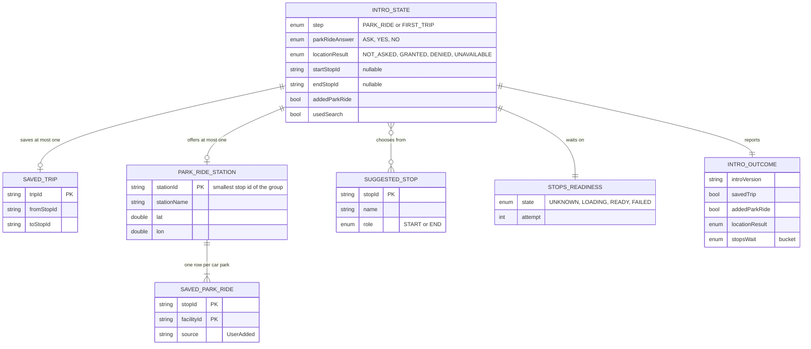
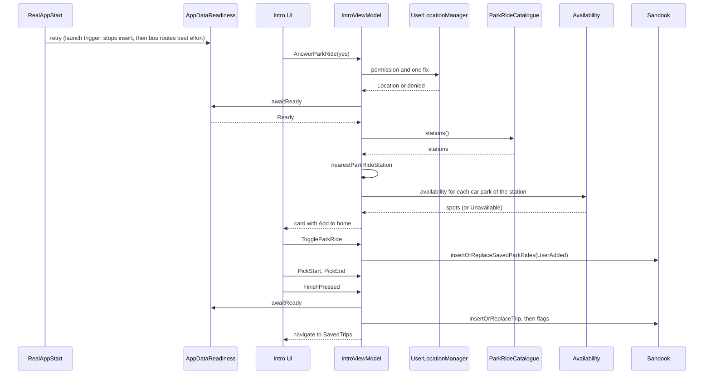

# Feature ERD: Intro redesign (Park & Ride question and first trip)

Status: Agreed for build (rows IA1 to IA13 of "Assumptions for approval" in section 9 approved by ksharma-xyz on 2026-11-21; the measurement targets and review points in section 11 are still owner decisions)
Owner: ksharma-xyz
Touches: `feature/trip-planner/ui` (`intro/`), `feature/trip-planner/state` (`intro/`), `core/analytics`, `io/gtfs` (stops readiness, first PR), `sandook` (one preference key), `.maestro/` (one shared flow, only if the tag changes)

The design behind this document was settled in review on 2026-11-21 against an interactive prototype that is not part of
this repository. Everything a builder needs from it is restated here, so this file stands alone.

---

## 1. Problem and scope

- **Who has the problem.** A rider who has just installed KRAIL taps through a tour of features and lands on a home screen
  that shows nothing of theirs. Nothing they did in the tour is kept.
- **What this does.** Replaces the seven-page carousel with a two-step first run that ends with something saved.
  - Step 1 asks "Driving to the station?". Yes asks for location, shows the nearest Park & Ride car park with its live
    spots and an Add to home button. No, or a denied location, goes straight to step 2.
  - Step 2 saves a first trip. The rider picks a start and an end from suggested stops (or searches for another stop), sees
    the pair as one tile, and taps one button: Save and start, or Skip for now.
  - The last button waits for the stops data to be ready, and the data layer reports readiness, failure and retry
    (`DATA_READINESS` in section 3).
- **What it deliberately does not do.**
  - No alerts, no departures and no trip planner call in the Intro. A trip is saved from two stop ids with no network.
  - No horizontal pager, no card or gradient border, no map, no transport mode picker, no invite page.
  - No hard gate. A rider can always finish with nothing saved.
  - No change for riders who already have the app. They never see the Intro and keep the one-time Park & Ride suggestion
    planned for the map-first home stack.
  - Does not build the home screen changes. It supplies two things the home stack reuses: `nearestParkRideStation` and the
    "suggestion shown" flag.

## 2. Entities and relationships



| Entity | Layer | Source of truth | Identity key | Lifetime |
|---|---|---|---|---|
| `IntroState` | ui | `IntroViewModel` | none, one per Intro | Process, survives rotation (view model plus saved state) |
| `SuggestedStop` | domain | Bundled default, optionally Remote Config key `intro_suggested_stops` | `stopId` | Until the list is next refreshed |
| `ParkRideStationPickerItem` (existing) | domain | `ParkRideCatalogue.stations()` | `stationId` (smallest stop id of the group) | Per call |
| `SavedParkRide` (existing) | db | `NswParkRideSandook` | (`stopId`, `facilityId`) | Until the rider removes it |
| `SavedTrip` (existing) | db | `Sandook` | `tripId` | Until the rider deletes it |
| `KEY_HAS_SEEN_INTRO` (existing) | prefs | `SandookPreferences` | key | Install |
| `KEY_PARK_RIDE_SUGGESTION_SHOWN` (new) | prefs | `SandookPreferences` | key | Install |
| `StopsReadiness` (new) | domain | `AppDataReadiness` in `:io:gtfs` | none | Process |
| `IntroOutcome` | analytics | built once, at finish | none | One event |

**Collision check, answered from real data** (the Remote Config default catalogue, the stops table and real trip events):

- One station name maps to several stop ids in the stops table (the station and its platforms or street-side stops). The suggested stops carry the station-level (parent) id, to be confirmed against the table for each stop.
- A Park & Ride "station" is not always a station. In the default catalogue (42 rows, 37 facilities) seven rows point at bus
  stops named like "Warriewood B-Line, Pittwater Rd". A start label built as "<name> Station" would be wrong for them. The
  label must be the stop's own name.
- Three catalogue rows point at stop ids that are absent from the stops table (a second Hornsby id, a second Mona Vale id and
  West Ryde). Such a station has no coordinates, so it can never be the nearest, and it can never pre-fill a trip start.
- One station maps to many car parks and one car park can serve several stop ids. `groupIntoStations` already resolves this
  with a union find. The Intro reuses it and does not group again.

## 3. Interfaces

```kotlin
// module: :io:gtfs (first PR), callers: IntroViewModel, later SearchStop and the map-first home
sealed interface StopsReadiness {
    data object Unknown : StopsReadiness
    data object Loading : StopsReadiness
    data class Ready(val stopCount: Int) : StopsReadiness
    data class Failed(val attempt: Int, val reason: String) : StopsReadiness
}

interface AppDataReadiness {
    val state: StateFlow<StopsReadiness>
    /** Suspends until the stops are Ready or Failed, or until [timeoutMs]. Never throws. Starts the first run if none has started. */
    suspend fun awaitReady(timeoutMs: Long): StopsReadiness
    /** A no-op while Loading or Ready. From Failed one more attempt. From Unknown the launch trigger. */
    fun retry()
}

// StopsManager.insertStops() changes from Unit to Result<Unit>, and the table clear moves inside the insert transaction.
```

How the first PR behaves, where it adds to the signatures above:

- `RealAppStart` calls `retry()` once at launch and no longer waits for the inserts, so remote config set up starts earlier.
  `retry()` is a no-op while Loading and while Ready, so calling it again in a live process never demotes good data. From
  Unknown it gets up to three automatic retries with a growing backoff. From Failed it is one more attempt.
- The automatic retries show as Loading, never as Failed. `Failed.attempt` counts every attempt in the process. A run that
  is cancelled or breaks unexpectedly ends in Failed, never stuck in Loading.
- Ready is about the stops only. It means all of: the stops insert returned success, the stored stops version is at or above
  the bundled one, the stop count is at or above the existing floor, and a read of one known stop (Central, the parent stop
  `200060`) returns a row. The decision is one pure function, `reduceReadiness`, so a table test holds every combination.
  A test reads the bundled data file and fails if that stop is ever dropped by a data refresh.
- The bus routes insert follows in the same run once the stops are Ready, best effort. A failure there is logged, does not
  change the state, and is not retried until the next launch. `awaitReady` returns as soon as the stops are Ready and never
  waits for the bus routes. The Intro needs only the stops table.
- WAL and the clear inside the transaction: proven on the JDBC test driver. The app sets WAL explicitly on iOS
  (`JournalMode.WAL`) and on Android (`enableWriteAheadLogging()` in `SandookCallback.onOpen`), and the `-wal` and `-shm`
  files have been seen on a real Android phone. The Android and iOS drivers themselves are not run in a test.

```kotlin
// module: :feature:trip-planner:ui, intro/, pure, no I/O, runs under a fixture suite
internal data class SuggestedStop(val stopId: String, val name: String)
internal data class SuggestedStops(val start: List<SuggestedStop>, val end: List<SuggestedStop>)

/**
 * Parses the Remote Config value, `{"start":[{"stopId":"..","name":".."}],"end":[..]}`, ignoring unknown fields. Returns
 * [fallback] as a whole, never a repaired half, for: text that is not that shape, an empty list, a stop id repeated
 * within a list, a blank id or name, or a start that equals the only end (or an end that equals the only start), where
 * picking that stop would leave the other list with nothing different to pick. The same stop on both lists is normal.
 * `name` is the stop's own name in the stops table (for example "Central Station").
 */
internal fun parseSuggestedStops(json: String, fallback: SuggestedStops): SuggestedStops

/**
 * The single nearest station within [radiusKm] of [location], or null. Stations with no coordinates are skipped.
 * Shared with the map-first home stack, which reuses it.
 */
internal fun nearestParkRideStation(
    location: LatLng,
    stations: List<ParkRideStationPickerItem>,
    radiusKm: Double,
): ParkRideStationPickerItem? // distance is GeoUtils.haversineDistance, the edge is inclusive, INTRO_PARK_RIDE_RADIUS_KM = 5.0

/** The start to pre-fill after Add to home (IA6), or null. Smallest stop id of the station that resolves, the stop's own name. */
internal fun parkRideStartPrefill(station: ParkRideStationPickerItem, stopNameLookup: (String) -> String?): SuggestedStop?

/** What the bottom button says and does. A table, so every state has exactly one answer. */
internal fun introFinishAction(state: IntroState, readiness: StopsReadiness): IntroFinishAction
internal enum class IntroFinishAction { Next, GettingReady, TryAgain, SaveAndStart, SkipForNow, LetsKrail }

/** savedTrip = state.saved, skipped = no saved trip and no complete pair. Param names and values as section 11.2. */
internal fun IntroState.toOutcome(stopsWait: StopsWait): IntroOutcome
internal fun IntroOutcome.toParams(): Map<String, Any>
/** Failed is failed. None is no wait, under 2 s, 2 s to 5 s inclusive, over 5 s. Takes a Duration, never reads a clock. */
internal fun stopsWaitBucket(waited: Duration, readiness: StopsReadiness): StopsWait
```

```kotlin
// module: :feature:trip-planner:state, intro/ (package intro.v2 until the carousel IntroState is deleted, then moved up)
// Every field has a default, so IntroState() is the first screen. hasTrip is true only when both stop ids are set.
data class IntroState(
    val step: IntroStep,
    val parkRideAnswer: ParkRideAnswer,
    val locationResult: LocationResult,
    val nearestStation: ParkRideStationPickerItem?,
    val availability: ParkRideAvailabilityState, // Loading, Content, Unavailable
    val startStopId: String?, val startName: String?,
    val endStopId: String?, val endName: String?,
    val addedParkRide: Boolean, val usedSearch: Boolean,
    val saved: Boolean,
)

// module: :feature:trip-planner:ui, intro/v2 (internal, because SuggestedStop is). Moves up with the carousel's deletion.
sealed interface IntroUiEvent {
    data object Back : IntroUiEvent
    data object Next : IntroUiEvent                    // the question step only
    data class AnswerParkRide(val yes: Boolean) : IntroUiEvent
    data class LocationResultReceived(val result: LocationResult, val location: LatLng?) : IntroUiEvent
    data object ToggleParkRide : IntroUiEvent          // Add to home / Added
    data class PickStart(val stop: SuggestedStop) : IntroUiEvent
    data class PickEnd(val stop: SuggestedStop) : IntroUiEvent
    data class StopPickedFromSearch(val isStart: Boolean, val stopId: String, val stopName: String) : IntroUiEvent
    data object FinishPressed : IntroUiEvent           // Save and start, Skip for now, Let's KRAIL, Try again
}

/** One shot, delivered once through a Channel and never replayed after rotation. */
sealed interface IntroEffect { data object NavigateToSavedTrips : IntroEffect }
```

- Every interface has a fake in `:core:testing`: `FakeAppDataReadiness` (controllable state), the existing location, catalogue,
  sandook and park ride fakes, and a fake clock. No `Clock.System` (the `ClockSystemBan` rule).
- The Intro never calls the trip planner. `IntroViewModel` keeps `StopsManager` out of its constructor and depends on
  `AppDataReadiness` instead.
- The Add to home action calls `NswParkRideSandook.insertOrReplaceSavedParkRides` with `UserAdded` and does **not** call
  `AppReviewManager.onDelightMoment(PARK_RIDE_ADDED)` (see IA11).
- Save trip calls `Sandook.insertOrReplaceTrip` with the two stop ids and names.

## 4. External contracts

| Call | Method and path | Key params | Auth | Response format | Measured wire size | Measured latency |
|---|---|---|---|---|---|---|
| Park & Ride availability (existing) | `GET https://api.transport.nsw.gov.au/v1/carpark` | `facility=<id>` | `Authorization: apikey` through `ApiCredential` | JSON | about 350 B gzip, about 665 B decoded | 0.09 to 0.31 s |
| Park & Ride catalogue | Remote Config `nsw_park_ride_facilities` | none | none | JSON array of (`stopId`, `parkRideFacilityId`, `parkRideName`) | bundled default, 42 rows | none, bundled |
| Suggested stops (proposed) | Remote Config `intro_suggested_stops` | none | none | JSON of start and end lists | bundled default | none, bundled |
| Device location | `UserLocationManager.getCurrentLocation()` | one fix, no updates | OS permission | `Location` | none | **not measured** |

- The availability numbers are a one-moment snapshot of nine real calls on 2026-11-21. They show the shape and order of
  magnitude, not a rate, and not behaviour at other times of day.
- Fields read from availability: free spots, percent full, the time of the reading. Fields ignored: everything else. The
  existing mapper stores a missing latitude as 0.0 and a missing longitude as 0.0. The Intro never reads those two.
- Not called by the Intro: trip planner, alerts, departures, add_info, the BFF (not live in the app).
- Parity: no BFF route is involved, so there is no parity gap.

## 5. Data flow



Readiness is published when the stops are usable. The bus routes insert runs after that in the same run and does not
hold the Intro back.

Order at finish, which differs from today: wait for readiness, write the trip, write `KEY_HAS_SEEN_INTRO` and
`KEY_PARK_RIDE_SUGGESTION_SHOWN`, track the outcome, then navigate. Today the screen navigates without waiting for the
insert, so a fast rider can reach home before the stops are committed.

## 6. Cost budget (mandatory, never "N/A")

| # | Question | Answer |
|---|---|---|
| 1 | **API calls.** | None at open. Step 1 Yes path only: one availability call per car park of the nearest station, once on arrival, no polling in the Intro. That is one call for most stations and up to three for the largest. Step 2: none. A rider who answers No makes none. The Intro makes no trip planner, alerts or departures call. |
| 2 | **Payload.** | About 350 B gzip and 665 B decoded per availability call (a snapshot, labelled as such). The stops files (about 2.3 MB and 2.6 MB) are bundled and are not downloaded. Parse cost for the suggestion JSON is trivial and bundled. |
| 3 | **Timing.** | The Intro opens with no network and no wait. The car park card needs a location fix, then stops readiness, then one call. The fix time is **not measured**. The stops insert is **assumed 3 to 5 seconds** (measured privately, not recorded here), and the code already logs it. Readiness waits for the stops only, so the bus routes insert adds nothing to the wait. The call is 0.09 to 0.31 s in the snapshot. The last button is the only forced wait, and only if the rider finishes before readiness. The `stopsWait` bucket in section 11 measures it in the field. |
| 4 | **UX.** | Loading: skeleton in the card's space. Slow stops data: last button reads Getting ready. Failed stops data: Try again. Failed or offline availability: the station name and Add stay, the numbers are omitted. No station near: a plain line and the normal Next. Denied location: step 2. No layout shift between states (same slot). |
| 5 | **Network efficiency.** | Availability goes through the existing repository, so its cooldown and cache apply. The Intro's read should seed the Saved Trips card so home does not refetch inside the cooldown. **To verify** in the repository before the UI branch. |
| 6 | **Battery.** | One location fix, not updates. No timer, no polling and no background work. Foreground only, so nothing needs lifecycle gating beyond collecting state with `collectAsStateWithLifecycle()`. |
| 7 | **Shared limits.** | At most three availability calls per rider who answers Yes, once, on the shared NSW key. Small next to the existing polling on home (a guess, label it as one). The BFF is not live, so nothing collapses. |

| Flow | Calls before | Calls after | Bytes before | Bytes after | Time to results before | after |
|---|---|---|---|---|---|---|
| First launch to home, rider says No | 0 | 0 | 0 | 0 | seven pages | two steps, last button waits only if stops are not ready |
| First launch to home, rider says Yes | 0 | 1 to 3 | 0 | under 1 KB | seven pages | two steps plus the card |

Decision rule met: the added calls buy a live car park card and a one tap add for riders who park and ride. They are
optional, non-blocking, once only and silent on failure.

## 7. States and UX

The reference is an interactive review page (private). The states it shows are restated here.

**Step 1, Park & Ride question**

| State | The rider sees |
|---|---|
| Ask | The question, "Yes, show me free spots", "No thanks", Next |
| Asking location | The system permission dialog |
| Locating, or waiting for stops | A skeleton card in the final card's space |
| Card | The nearest station with spots, percent full and the age of the reading, and Add to home |
| Added | The same card with the row reading Added to home |
| No station near | One plain line, and Next |
| Denied or no fix | Moves to step 2, nothing blocks |
| Availability failed or offline | The station name and Add, no numbers |

**Step 2, First trip**

| State | The rider sees |
|---|---|
| Start not chosen | A list of start suggestions plus Search another stop |
| Start pre-filled | The Park & Ride station as a collapsed row, with the end list below |
| Both chosen | One tile with the two stop names stacked on the theme tint (the shape of `SavedTripCard`), tap to change |
| Searching | The app's own stop search, then back with the pick |
| Stops not ready | Last button reads Getting ready, disabled |
| Stops failed | Last button reads Try again |

**Bottom button** (`introFinishAction`): Next on step 1. On step 2, Getting ready, Try again, Skip for now (nothing picked),
Save and start (a trip picked), Let's KRAIL (saved). It keeps the test tag `intro.action.primary`.

- Wording, in rider words: trip, saved trip, car park. No colon, em dash or arrow in any string.
- Layout rules: items stay whole and wrap to the next line at 320 dp and 200% text, and the screen scrolls. Pills are one
  line. Touch targets 48 dp. The theme colour appears on the one bottom button only.
- Motion: step 2 replaces step 1 with a short cross-fade, the tagline lines rise and the sticker pops. With reduced motion
  (`isReduceMotionEnabled()`) the steps swap with no fade.
- Rotation, theme and font changes: all Intro state lives in the view model with saved state, including the answer, the
  picks and the permission result. No new navigation route, so `SerializationConfig.kt` is untouched.
- Tablets and foldables: the Intro is a `detailPane()` route. Content is capped to a phone width and centred. To be drawn at
  600 dp and at dual-pane before the UI branch.
- Screen reader: the progress dots read "Step 1 of 2". Each row names its stop and role ("Change start stop, now Tallawong").

## 8. Test plan

- **Pure logic, fixtures first.**
  - `nearestParkRideStation` against the real default catalogue. Named cases from section 9 (a CBD station, an outer Metro
    station with a car park at the platform, a regional centre, a station with a missing coordinate).
  - `parseSuggestedStops`: valid, empty, malformed, duplicate ids, a start equal to an end.
  - `introFinishAction`: one row per state, so a new state cannot be missed.
  - `toOutcome`: every flag and bucket.
- **View model**, with fakes at the edges and `krailRunTest`.
  - Yes then granted then Add then pick then finish writes one trip, one park ride and both flags, once.
  - No, denied and no fix each reach step 2 and set the suggestion flag.
  - Finish before readiness waits, then writes. Finish while Failed offers Try again and writes nothing.
  - A tap on Next with step 1 unanswered sets the flag.
  - Rotation mid step keeps the answer, the picks and the pending permission.
  - Add to home never triggers the review delight moment.
  - Discriminating cases only: each test must fail if the behaviour it names is removed.
- **Database.** The real driver, via the existing test seam: the clear and the insert in one transaction leaves the old rows
  readable until the commit (this belongs to the readiness PR).
- **Screenshot tests.** Step 1 and step 2 in every state above, light and dark, 320 dp at 200%, using `@PreviewScreen` and
  `@PreviewComponent`. The old `IntroContent*` previews and screenshots are deleted with their code.
- **Guards that already exist and must stay green.** `ThemeColorRoleRule`, `ClockSystemBan`, `CollectAsStateBan`,
  `SnackbarBan`, `PollingLifecycleGuardTest` (the Intro must not poll), `ViewModelStateDurabilityTest`,
  `NavKeySerializationConfigTest`, `verifyTestWiring`.
- **Maestro.** `.maestro/shared/dismiss-intro.yaml` loops on the tag `intro.action.primary` and needs no page count. The new
  Intro keeps that tag, so six flows keep working. Check its `times` cap against a disabled Getting ready button on a cold
  device. Do not touch CI or workflow files.
- **Coverage.** Every PR passes `scripts/patch_coverage.py` at 80 percent or more. The result goes in the PR's Testing section.
- **Manual cases** (nothing automated reaches them): a real permission dialog on both platforms, a real fix indoors, airplane
  mode on the Yes path, a fresh install on a slow device.

## 9. Open gaps and decisions

| Gap or decision | Owner | Needed by |
|---|---|---|
| Measure the stops insert and the location fix on a mid-range phone and a fresh install | ksharma-xyz | Before the UI branch is called done |
| Verify the Intro availability read seeds the Saved Trips card cooldown | ksharma-xyz | Before the view model branch |
| Draw step 2 at 600 dp and at dual-pane, and step 1 at 320 dp and 200% | ksharma-xyz | Before the UI branch |
| Reuse audit: which existing stop search component "Search another stop" opens, and how it returns a pick | ksharma-xyz | Before the UI branch |
| Delete the old `IntroContent*` files, previews and screenshots in the UI branch | ksharma-xyz | UI branch |
| Add the ledger rows and ping the analytics side before the release that carries the new params | ksharma-xyz | Before the release is published |
| Read `docs/STORE_DATA_DECLARATIONS.md` again at the UI branch. Location stays on the device here, so nothing should change, but its "revisit when" test applies | ksharma-xyz | UI branch |
| Map-first home ERD: its first-run and suggestion rows now depend on this document | ksharma-xyz | Before the home stack starts |

### Assumptions for approval (mandatory, no code until signed off)

Evidence that comes from private analytics is shown to the owner in the message that introduces this ERD and is kept outside this repository. This table states the rule, the options and the public facts.

| # | Assumption | Evidence (real data, named cases) | What breaks if it is wrong | Decision |
|---|---|---|---|---|
| IA1 | Step 1 is asked of every rider who sees the Intro. Location is asked only on Yes. | Private evidence, shown to the owner in the message that introduces this ERD, kept outside the repository. Public fact: nothing records whether riders grant location today. | Riders without a car answer No and lose one tap. | Approved by ksharma-xyz, 2026-11-21 |
| IA2 | "Near" means within a radius of the rider's current location. Options were (a) 3 km, (b) 5 km, (c) 10 km. Decided: 5 km. | Nearest car park from 14 named stations, default catalogue. Within 5 km: Penrith, Tallawong, Hornsby, Bankstown, Liverpool, Gosford, Chatswood, Campbelltown. Added at 10 km: Central, Town Hall and Parramatta, whose nearest car parks are Ashfield (about 7.5 km) and Seven Hills (about 8 km). Regional centres are far from any car park (Wollongong about 27 km, Katoomba about 34 km). | Too small: a rider whose car park is 6 km away sees "No car parks near you". Too large: a rider in the city is offered a car park 8 km away that is not theirs. The rider may also install away from home. | Approved by ksharma-xyz, 2026-11-21 (option b, 5 km) |
| IA3 | Only the single nearest station is offered, not a list. | One station per rider is the normal Park & Ride habit. A list adds a choice the rider did not ask for. | A rider with two stations in range sees the closer one and can add the other later from the existing screen. | Approved by ksharma-xyz, 2026-11-21 |
| IA4 | No, a denied permission, a failed fix and a fix that takes longer than 10 seconds all go to step 2 with no further ask and no message. | The 10 seconds is a guess. | A slow fix on a good day skips a car park the rider wanted, and they can add it later. | Approved by ksharma-xyz, 2026-11-21 (the 10 second wait is the approved value) |
| IA5 | The suggested start and end stops are two short lists, one per role, with Search another stop always available. Proposed default start list: Tallawong, Central, Schofields, Parramatta, Town Hall. Proposed default end list: Central, Wynyard, Parramatta, Town Hall, Martin Place. Delivery: Remote Config `intro_suggested_stops` with the same bundled default (option b, taken from "approved as recommended"). | Private evidence, shown to the owner in the message that introduces this ERD, kept outside the repository. Public check: every id is the station-level (parent) stop in the stops table, to be confirmed against the table. | A rider whose stops are not listed must search. A list that goes stale costs taps until it is refreshed, and a constant only refreshes with a release. | Approved by ksharma-xyz, 2026-11-21 (delivery follows "approved as recommended", option b, Remote Config; the owner named only the radius, so correct this if a constant was meant) |
| IA6 | The start is pre-filled with the added Park & Ride station only if one of the station's stop ids resolves in the stops table (the smallest that does, since a station can span several ids and the smallest may be absent), and the label is the stop's own name. Otherwise there is no pre-fill. | 42 catalogue rows: three ids absent from the stops table, seven are bus stops. | A wrong or unresolvable id would save a trip the planner cannot use. | Approved by ksharma-xyz, 2026-11-21 |
| IA7 | The bottom button is a soft gate. Skip for now is always available once the stops are ready. Save and start saves and opens home in one tap. A hard gate is rejected. | A hard gate would stop a rider with location off or no destination from finishing. | A skipped rider reaches an empty home. The existing save prompt still reaches them. | Approved by ksharma-xyz, 2026-11-21 |
| IA8 | The Intro is shown only when `KEY_HAS_SEEN_INTRO` is false, which is a new install. Existing riders are unchanged. | The key exists and gates the current Intro. | A reinstall shows it again, as today. | Approved by ksharma-xyz, 2026-11-21 |
| IA9 | `KEY_PARK_RIDE_SUGGESTION_SHOWN` is set when step 1 is answered, or passed with Next, so no rider is asked twice on home. | Decided by the owner on 2026-11-21. | A rider who tapped Next by accident never gets the home suggestion. | Approved by ksharma-xyz, 2026-11-21 |
| IA10 | If availability fails or the phone is offline, the card shows the station name and Add with no numbers. Add never waits on the network. | The station list is local. | A card with no numbers looks incomplete. | Approved by ksharma-xyz, 2026-11-21 |
| IA11 | Add to home inside the Intro does not fire the app review delight moment. | The moment fires when the rider returns to Saved Trips, so it would fire on first launch. | A review prompt on the first minute of a new install. | Approved by ksharma-xyz, 2026-11-21 |
| IA12 | The last button waits for stops readiness and never opens home on an empty table. The wait is assumed 3 to 5 seconds. Failure shows Try again and the next launch retries. Readiness is about the stops only, bus routes follow best effort. | The insert is one transaction of about 37,000 rows. It is logged and measured privately. Before the readiness fix the clear ran outside the transaction and `insertStops()` swallowed failures. Failed stays until `retry()` or the next launch. | A rider could wait longer than expected on a slow phone. `stopsWait` measures it. | Approved by ksharma-xyz, 2026-11-21 |
| IA13 | The readiness fix ships first, as its own PR, because it also protects existing riders after every data refresh. | A data refresh raised the stops version on 2026-11-21, so every rider re-runs the clear and the insert. With the clear inside the insert transaction, a second connection in WAL mode keeps reading the old rows until the commit. Proven on the JDBC test driver in `NswTablesReplaceTransactionTest`. WAL is set explicitly on iOS and on Android (`SandookCallback.onOpen`) and the WAL files were seen on one real Android phone; the Android and iOS drivers are not run in a test. | Existing riders see empty search while the table refills. | Approved by ksharma-xyz, 2026-11-21 |

| Decision | Source (data field or parsed text) | Checked against | Reliable |
|---|---|---|---|
| Nearest station (IA2, IA3) | Data: the device fix and each station's stop coordinates from the stops table | 14 named stations against the 42-row default catalogue | Partly. Three catalogue rows have no coordinates and can never be nearest |
| Suggested stops (IA5) | Data: stop ids from the stops table | Private evidence, shown to the owner in the message that introduces this ERD | To confirm against the table |
| Start pre-fill (IA6) | Data: the catalogue `stopId` resolved in the stops table | All 42 default rows: three unresolved, seven bus stops | Partly. The rule falls back to no pre-fill |
| Finish button (IA7) | App state only | The state table in section 7 | Yes |

## 10. Build order

Each PR is under 500 lines with one concern, stacked with Graphite. Nothing is pushed and no PR is raised until the owner says.

0. `docs/intro-erd`: this document (done in this branch).
1. `fix/stops-readiness` (`:io:gtfs`): `AppDataReadiness`, `Result` from `insertStops`, clear and insert in one transaction,
   retries, tests. Its own PR, useful to every rider.
2. `feat/intro-pure-logic`: `nearestParkRideStation`, `parseSuggestedStops`, `introFinishAction`, `toOutcome`, fakes and
   fixtures. No UI.
3. `feat/intro-analytics`: new params on `intro_lets_krail`, two new screen names, `source` values on two existing events,
   ledger rows (section 11). Ping the analytics side.
4. `feat/intro-viewmodel`: state, events, readiness wait, flags, the `Result` handling. Old page logic removed.
5. `feat/intro-step-park-ride`: step 1 UI, cross-fade, dots, previews and screenshots.
6. `feat/intro-step-first-trip`: step 2 UI, the tile, the search hand-off, previews and screenshots. Deletes the old
   `IntroContent*` files.
7. `test/intro-maestro`: only if the tag or the cap needs a change.

## 11. Measurement plan (ROI)

**Objective.** A rider who finishes the Intro should leave with something saved that brings them back. The lever is what the rider leaves with, not how many finish.

### 11.1 What is measured

| Kind | Metric | Definition | Where it comes from |
|---|---|---|---|
| Primary, leading | **Has something saved by the end of day one** | A new rider with a saved trip or an added Park & Ride station by the end of their first day, by any route | `save_trip_click` and `park_ride_user_facility` (action add) joined to first open |
| Direct | Intro value rate | Riders who finish the Intro with `savedTrip` or `addedParkRide` | `intro_lets_krail` params |
| Direct | Step 1 yes rate, location grant rate among Yes, add rate among Yes | Share answering Yes, share granting, share adding | `intro_lets_krail` params |
| Direct | Skip rate, search rate | Share finishing with Skip, share using Search another stop | `intro_lets_krail` params. The search rate tells us whether the suggestions fit |
| Lagging | Day one and day seven return, saved card opens in week one | Active again on a later day, and `saved_trip_card_click` | Existing events, by cohort |
| Guardrail | Intro completion | Riders who see the Intro and finish | `view_screen` Intro and `intro_lets_krail` |
| Guardrail | Stops wait | Bucket of time the rider waited on Getting ready | `intro_lets_krail` param `stopsWait` |
| Guardrail | Stops failure | Finishes with a failed readiness | `stopsWait = failed` |

Targets are the owner's to set. They are `Pending owner`. Baselines are read from KRAIL-Analytics when the targets are set. No figure is kept in this repository.

### 11.2 Events and params (no new event names)

The 500 event-name budget is respected. Nothing here mints a name.

- `intro_lets_krail` (existing) gains params. Today it carries `completedOnPage` and `completedOnPageNumber`, which describe the
  old carousel. The new version stops sending them and sends:
  `introVersion` (2), `finishedOn` (park_ride or first_trip), `parkRideAnswer` (yes, no, skipped), `locationResult`
  (granted, denied, unavailable, not_asked), `addedParkRide` (bool), `savedTrip` (bool), `usedSearch` (bool), `skipped`
  (bool), `stopsWait` (none, under_2s, 2_to_5s, over_5s, failed). Nine params, well inside the 25 per event.
  In code, `IntroLetsKrailClickEvent` carries all eleven params as optional, and a null one is left out of the event, so
  the carousel keeps sending its two and the new Intro sends its nine until the last carousel caller is removed. That
  removal deletes `completedOnPage`, `completedOnPageNumber` and the `InteractionPage` enum. The four lists are enums in the
  event, with the values above, and `IntroOutcomeEventTest` holds them to `IntroOutcome.toParams()`.
- `view_screen` (existing) gets one new screen name, `IntroFirstTrip`. `Intro` stays as step 1. The pair gives the funnel
  with no new event, and a rider who reaches step 2 and never finishes is the drop-off.
- `park_ride_user_facility` (existing) gains `source = intro`. `save_trip_click` (existing) gains `source = intro`. These make
  Intro-created saves countable without a second event and without double counting.
- Nothing carries a coordinate, a stop name or free text. The "Search another stop" path reuses the app's existing search and
  its existing redaction rules. See `docs/SEARCH_QUERY_TELEMETRY_SPEC.md`.
- Dimension caps: BigQuery receives every param. The GA4 UI only shows registered dimensions, and the app is already over the
  event-scoped cap. A param missing in the UI means unregistered, not unsent. KRAIL-Analytics reads BigQuery.
- Gap in what we can learn: if the app is killed mid Intro no finish event fires, so outcomes describe finishers only. The
  `view_screen` pair covers the rest.

### 11.3 How the answer is read, and how long it takes

Options, with their trade-offs. The owner chooses.

| Option | What it tells us | Cost and risk |
|---|---|---|
| (a) Direct outcomes only | The Intro value rate and the step rates, from the first week | No counterfactual. It shows what riders did, not what they would have done |
| (b) Before and after cohorts, split by `introVersion` and app version | Whether day-one saves and week-one return moved | Cheap. Confounded by season, store features and campaigns. Needs several weeks of new riders on each side |
| (c) A concurrent split through a Remote Config flag | A clean answer on return | Halves the sample, and keeps the old Intro code alive. A small difference takes a long time to resolve |

Statistical honesty. A before and after on return is directional, not proof, and needs a long run of new riders on each side. The direct outcomes show up sooner. The riders who save on day one may already be the commuters, so a gap between
savers and non-savers is correlation, not the Intro's effect. State both when reporting.

### 11.4 Review points (defaults, targets still to be set by the owner)

- Four weeks after release: direct outcomes, completion, stops wait, stops failures. Fix anything that regresses a guardrail.
- Twelve weeks after release: day-one saves and week-one return, by `introVersion`. Decide keep, change or revert.
- The analytics claims behind this design, the suggestion lists and the saving-and-returning claim, are tracked with a three-month review date in private notes outside this repository.

### 11.5 Process

- Add the ledger rows to `docs/ANALYTICS_REGISTRY_HANDOFF.md` with `Status = Pending` in the analytics PR (branch 3). The
  ledger is not a gate.
- Ping the KRAIL-Analytics side before the release that carries the new params is published. Publishing creates the stable tag
  that their registry check reads.
- KRAIL-Analytics owns the dashboard: the Intro funnel from `view_screen`, outcomes by `introVersion`, and return by outcome.
  KRAIL does not keep a contract file.
- No private figure goes in this repository, a PR body or a commit message. Write qualitative results here and keep the numbers
  in private notes.
