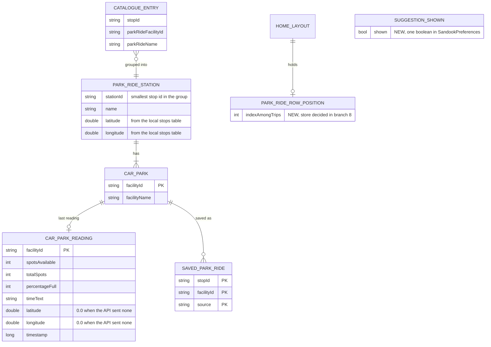
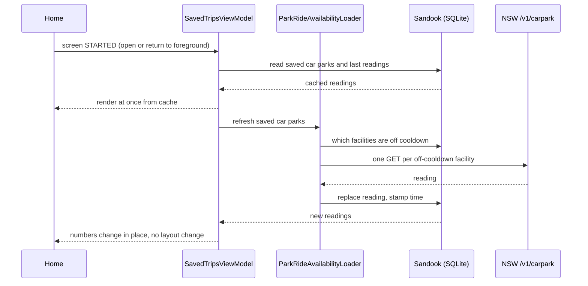

# Feature ERD: Map-first home

Status: Draft (every row of "Assumptions for approval" in section 9 is signed off except A13, which rule 30 states, and the once-a-minute redraw in A6, a default the owner has not seen)
Owner: ksharma-xyz
Touches: `feature/trip-planner/*`, `feature/park-ride/*`, `core/remote-config`, `core/maps/*`, `taj`

---

## 1. Problem and scope

- **Who has the problem.** A rider opens KRAIL and wants one of four things without reading anything: a trip
  they take often, a new destination, the free spots at a car park before leaving home, or the stops near them.
  Today the map only exists behind a toggle inside Search Stop, and Park & Ride numbers only load when a card is
  tapped open.
- **What this does.**
  - Home shows the map behind one column of cards (saved trips, then a Park & Ride row), with the search pill at
    the bottom.
  - Search Stop opens on the map with no keyboard, and has two states with a two-step back.
  - To sits above From, in fixed rows, with the go circle inside the From bar.
  - Home and Work chips stay once set; tapping Home plans a trip from the nearest stop.
  - A station with several car parks is one card showing every car park of the station at equal weight, each with
    its age. No car park is emphasised (A3).
  - Reorder mode moves the Park & Ride row as one block.
  - First run shows one choice at a time, then a nearby Park & Ride suggestion.
- **What it deliberately does not do.**
  - No bottom sheet, toast, snackbar, banner or custom transition.
  - No new polling, no per-feature `HttpClient`, no new analytics event names (parameters on existing events only).
  - No map options sheet. The mode filter survives as a row of chips on the Search Stop map (A7).
  - No BFF route. The app calls NSW directly.
  - No walking distance between a car park and the platform. We do not have that data.

The design rules this implements are written up in `docs/MAP_HOME_UX.md` (separate branch in the stack).

## 2. Entities and relationships



| Entity | Layer | Source of truth | Identity key | Lifetime |
|---|---|---|---|---|
| `CATALOGUE_ENTRY` | network config | Remote Config `nsw_park_ride_facilities` (defaults in `RemoteConfigDefaults.kt`) | stop id plus facility id | until the next config fetch |
| `PARK_RIDE_STATION` | domain, derived | `groupIntoStations` over the catalogue and the local stops table | smallest stop id in the group | recomputed, never stored |
| `CAR_PARK` | domain | the catalogue | facility id | as the catalogue |
| `CAR_PARK_READING` | db, existing `NSWParkRideFacilityDetail` | NSW `/v1/carpark` | facility id | replaced on each successful fetch |
| `SAVED_PARK_RIDE` | db, existing | the rider | stop id, facility id, source | until the rider removes it |
| `ParkRideFacilityDetail` | ui | mapped from `CAR_PARK_READING` | facility id | one composition. **Adds nullable `latitude` and `longitude`** |
| `PARK_RIDE_ROW_POSITION` | new, storage not yet chosen | the rider (drag in reorder mode) | one per rider | until changed |
| `SUGGESTION_SHOWN` | new, one boolean in `SandookPreferences` (the store `KEY_HAS_SEEN_INTRO` uses) | the app, set the first time the card is shown | one per install | permanent, the suggestion is shown once |
| `nearby_stops_radius_km` | Remote Config, new | Remote Config, default 3.0 | key | per config fetch |
| `park_ride_suggestion_radius_km` | Remote Config, new | Remote Config, default 5.0 to match the Intro (`docs/features/intro/ERD.md`, IA2, approved 2026-11-21). Earlier draft said 10.0 | key | per config fetch |

**Collision check, from the real default catalogue** (42 entries, 37 car parks, 37 stop ids; live Remote Config
may differ):

- One stop id with several car parks: four. Campbelltown (19, 20), Penrith (21, 22), Tallawong (26, 27, 28),
  Kellyville (29, 30).
- One car park behind several stop ids: four. Facility 12 (Mona Vale), 15 (Sutherland), 25 (Hornsby), 489.
- So a station key cannot be the stop id alone or the facility id alone. The existing smallest-stop-id identity
  survives both, and the UI must be built from stations, never from catalogue rows. Under A2b the card lists every car park the
  catalogue puts in the station, not only the saved `SAVED_PARK_RIDE` rows, so a car park the rider never saved
  still gets a reading row.

## 3. Interfaces

Pure logic first, each its own function with no I/O so one fixture suite covers it. Signatures are proposed.

```kotlin
// module: :feature:trip-planner:ui, caller: the Park & Ride card
/** "Last updated x mins ago", stepping to hours and days. Never hides a number. See A6. */
internal fun ageText(readAt: Instant, now: Instant): String

// module: :feature:trip-planner:ui, caller: the Directions button
/** Car park coordinates, else the station position, else null. 0.0 / 0.0 counts as missing. */
internal fun directionsTarget(carPark: LatLng?, station: LatLng?): LatLng?

// module: :feature:trip-planner:ui, caller: first-run suggestion. Defined by the Intro stack, see docs/features/intro/ERD.md
internal fun nearestParkRideStation(location: LatLng, stations: List<ParkRideStationPickerItem>, radiusKm: Double): ParkRideStationPickerItem?
```

Branch 7, the Home and Work chips. All pure, in `savedtrips/HomeLabelChips.kt`, so each rule is driven at its boundary
without a layout, a location fix or a database:

```kotlin
// module: :feature:trip-planner:ui, caller: the chip row above the home search row
internal fun chipRowModeFor(fontScale: Float): ChipRowMode               // Wrap up to and including 1.3, Scroll above it
internal fun homeChipsFor(stopLabels: List<StopLabel>): ImmutableList<HomeChip>   // Home, Work, then Park & Ride
internal fun startLabelChipTap(label: StopLabel): LabelChipTap           // set: Locating, unset: Decided(Assign)
internal fun nearestStopTo(latitude: Double, longitude: Double, candidates: List<NearbyStop>, radiusKm: Double): NearbyStop?
internal fun decideLabelTap(destination: StopItem, rider: LatLng?, candidates: List<NearbyStop>, radiusKm: Double): LabelTapOutcome
```

The tap is a small state machine held in `SavedTripsState.labelChipTap` (`Idle`, `Locating(labelKey)`, `Decided(outcome)`) so a
rotation mid tap loses nothing. `LabelChipTapEffect` plays it out: it takes the one fix (`UserLocationManager.getCurrentLocation()`)
and reports it, then acts on the decision once and reports it handled. A chip has no long press, so the row takes no
callback for one.

Branch 6, the To and From block. Plain functions and one holder in `components/ToFromRules.kt`, the block itself in
`components/ToFromBlock.kt`, built from taj parts (no hand built bar):

```kotlin
// module: :feature:trip-planner:ui, callers: SearchStopRow (home), SearchStopForm (Search Stop)
internal fun ToFromField.hasDarkFill(editing: ToFromField?): Boolean               // only the bar being edited
internal fun goCircleDiameter(column: Dp, margin: Dp): Dp                          // 48 less 4 on every side, 40
internal fun toFromFieldLabel(role: String, placeholder: String, stopName: String?): String
internal class ToFromBarInsets(column: Dp, startGap: Dp, endGap: Dp)               // textStart 52, textEndReserved 56, reserved 108
internal class ToFromEditor(state, modifier, maxLength, filter, onTextChange)      // the field the edited bar holds
internal fun ToFromBlock(..., editing: ToFromField?, editor: ToFromEditor?, ..., toLeading, toTrailing, fromTrailing)
```

A bar at rest is taj's `TextFieldButton`. The bar being edited, when an `editor` is given, is taj's `TextField` in
`TextFieldDefaults.invertedColors()`, with the slots as its `leadingIcon` and `trailingIcon`. The back arrow and the X are
taj's `RoundIconButton` with no fill, the origin marker is taj's `SeparatorIcon` and the go circle is taj's `RoundIconButton`
sized to 40 by modifier. `editor` replaces the earlier `toEditor` and `fromEditor` slots.

Reused unchanged: `ParkRideAvailabilityLoader` (fetch for a set of facilities), `filterRefreshableFacilities` and
`parkRideApiCooldown` (the cooldown), `pollWhileCardsAreOpen` (the expanded-card poll).

Fakes already in `:core:testing`: `FakeParkRideService`, `FakeNswParkRideSandook`, `FakeParkRideFacilityManager`.
Failures stay `Result<T>` with a typed `NetworkException`.

## 4. External contracts

| Call | Method and path | Key params | Auth | Response | Measured wire size | Measured latency |
|---|---|---|---|---|---|---|
| NSW car park | `GET https://api.transport.nsw.gov.au/v1/carpark` | `facility=<id>` | `Authorization: apikey` via `ApiCredential` | JSON, one facility | 344 to 356 bytes gzip (9 real calls, 2026-11-21); 662 to 665 bytes decoded (3 of them) | 0.09 to 0.31 s total (3 of them, from a laptop, not a phone) |
| Map tiles | the shared map instance | tile requests | none | tiles | **not measured**, measure on device in branch 9 | **not measured** |
| Stops, recents, nearby stops | local database | none | none | none | 0, local | local |

- **Fields read:** `spots`, `zones[].occupancy.total` (else `transients`), `location.latitude`,
  `location.longitude` (both strings, nullable), `MessageDate`, `facility_name`. Everything else is ignored.
- **Real responses carry coordinates:** 9 of 9 facilities measured on 2026-11-21 had both latitude and longitude.
- **Parity:** the BFF route (`/v1/parking/facilities/{id}/availability`) exists in code but is not live, so it is
  not used and there is no parity gap to list.

## 5. Data flow



No timer runs on home. A timer exists only while a tile is expanded, and it is the existing
`pollWhileCardsAreOpen`, unchanged.

## 6. Cost budget

Numbers marked "measured" were taken on 2026-11-21. Anything else says what it is.

| # | Question | Answer |
|---|---|---|
| 1 | **API calls** | Per tile expand: one call per car park of that station, only if off cooldown (as today). **On open (new): one call per car park of every station the rider has saved a car park at (A2b), if off cooldown.** A rider with any Tallawong car park saved is 3 calls, a rider with one single-car-park station is 1. Cooldown is 120 s from 05:00 to 10:00 and 600 s otherwise (Remote Config defaults). Per minute visible on home: 0, no timer (A5). While a tile is expanded: at most one call per car park per cooldown, existing. Nearby stops and search are local, 0 calls. |
| 2 | **Payload** | 344 to 356 bytes gzip and about 665 decoded per car park (measured, 9 calls). Tallawong's three car parks are about 1.0 kB on the wire. Parse cost is one small JSON object each (guess, not measured, no more than a few ms). No smaller endpoint on the NSW route. Map tile bytes: not measured. |
| 3 | **Timing** | Home content (trips, cards, last cached numbers) renders from the local database and must not wait for the fetch or for tiles. The fetch runs in parallel and never blocks. Latency 0.09 to 0.31 s measured from a laptop. Failure is silent: the last reading stays. Time to first content before and after: **to be measured on device in branch 9**, the target is no increase. |
| 4 | **UX** | Loading: the cached number stays, same line box, no spinner and no height change. First ever load: a placeholder in the same line box. Failed or offline: the last reading stays with its age shown (A6) and is never hidden. Empty: no stations means no row, no trips means the map only. No layout shift in any state. |
| 5 | **Network efficiency** | Cache key is the facility id, TTL is the cooldown, stored in the local database. Retry: a failed call resets the stamp so the next trigger retries (existing). Conditional requests: **not measured** whether the API sends `Cache-Control` or `Last-Modified`. In-flight dedupe when open and a tile expand land together: **to verify in branch 7**. |
| 6 | **Battery** | Foreground only, gated with `repeatOnLifecycle(STARTED)`. No background work. One radio burst on open and one on each return to foreground, bounded by the cooldown. The expanded-tile poll already exists and is reused. The age text (A6) is redrawn once a minute by a local tick that runs only while the screen is in front, with no network and no radio wake-up. Showing an absolute time instead would need no tick. The home map keeps a GL surface alive while visible: **cost not measured**, compare against the existing Search Stop map in branch 9. |
| 7 | **Shared limits** | One NSW key is shared by every phone. Each open adds up to N calls per phone, where N is the saved car parks, never more often than the cooldown. Ceiling per car park per hour, from the cooldown alone: 30 in the peak window, 6 outside it. That is a ceiling, not a forecast. A BFF would collapse this to one upstream poll for all riders, but it is not live. |

| Flow | Calls before | Calls after | Bytes before | Bytes after | Time to results before | after |
|---|---|---|---|---|---|---|
| Open home, 3 saved car parks, all off cooldown | 0 | 3 | 0 | about 1.0 kB wire | local, not measured | local, must not increase, not measured |
| Open home, all inside cooldown | 0 | 0 | 0 | 0 | local | local |
| Open home, no saved car parks | 0 | 0 | 0 | 0 | local | local |
| Home map tiles | none on home | not measured | none | not measured | none | not measured |
| Open home, Home and Work chips | 0 | 0 | 0 | 0 | local | local, the chips read the labels the screen already observes |
| Tap a set Home or Work chip | not a feature | 0 network calls, 1 location fix, 1 local query | not a feature | 0 over the wire, at most 5 local rows (about 1 kB decoded, a guess, not measured) | not a feature | one fix then the query, not measured on device |

The added calls are paid for by the rider seeing current numbers on open instead of only after a tap. They are
non-blocking, cached, lifecycle-gated and silent on failure.

**Branch 7, the Home and Work chips (one row, numbers from code, guesses labelled).** Opening home adds 0 calls, 0 queries and
no timer: the chips are drawn from `SavedTripsState.stopLabels`, which the ViewModel already observes. A tap on a set chip costs one
`UserLocationManager.getCurrentLocation()` (one shot, 10 s timeout inside `UserLocationManagerImpl`, never `locationUpdates`, never
polled) and, only when a fix came back, one `selectStopsNearby` query: bounding box on the existing `idx_stop_coordinates` index,
radius 1.0 km, `LIMIT 5`, so at most 5 rows. No network. With no permission the fix returns at once with a failure and no query
runs. A second tap while one is in flight changes nothing, so a tap is at most one fix. Radio and battery: one platform location
fix per tap and nothing between taps (cost of a fix: a guess, not measured). A rotation during the fix cancels the screen's
coroutine and the recreated screen asks once more for the same tap, so a rotation can cost one extra fix. Timing before and after on
a device: not measured, the target is a result inside the 10 s timeout and a fallback, never a spinner, when there is no fix.

**Branch 4, Search Stop opens on the map (one row, numbers from code, guesses labelled).** Opening Search Stop adds the map tiles and
nothing else: the existing shared MapLibre instance, drawn once as the screen opens (`InitializeMap`, one event). **Zero new network calls.**
The recents card, the nearest rows and the suggested rows are local. The nearest rows cost 0 queries: they sort the stops the map already
loaded for its camera, at most `MAX_NEARBY_RESULTS` (200) of them, by distance from the rider, a few hundred microseconds (a guess, not
measured). The map's own stops query is unchanged: one local `LIMIT 200` query per camera settle, after the 500 ms pan debounce
(`CAMERA_PAN_DEBOUNCE_MS`), and a repeat at the same centre inside the cache window reads no database. The suggested rows are one read of
Remote Config (`intro_suggested_stops`, already fetched by the app) or the bundled list, once when the view model is built. No timer,
no polling, nothing runs while the screen is behind another. The location pill adds no request: it reads `checkPermissionStatus()` once per
return to the screen (a local call), and tapping it either asks the system for permission, which is the platform's own dialog and no network, or
opens Settings. The one location stream (`TrackUserLocation`, every 5 s while the screen is in front, `UPDATE_INTERVAL_MS`) is the existing one.
Time to first content before and after: before, the list was the first frame; now the first frame is the form and the map, with the list one
tap away, so the card no longer waits for anything. Time to first map tiles: **not measured, measure on device**. Offline: the map shows the
flat ground and the rider dot as before, the card and the form still work because they are local. Radio: nothing between taps.

| Flow | Calls before | Calls after | Bytes before | Bytes after | Time to results before | after |
|---|---|---|---|---|---|---|
| Open Search Stop | 0 (list first, map opt in) | 0 new, map tiles from the shared instance | 0 | map tiles, not measured | local list, not measured | local form at once, tiles not measured |
| Tap the bar, see the card | 0 | 0 | 0 | 0 | local | local, not measured |
| Nearest rows, location known | not a feature | 0 queries, 1 in-memory sort of at most 200 stops | not a feature | 0 | not a feature | a guess, under a frame |
| Tap the location pill | not a feature | 0 network, 1 system permission dialog or 1 open of Settings | not a feature | 0 | not a feature | platform |

**Branch 5, nearby radius from Remote Config and the mode chips (one row, numbers from code, guesses labelled).** **Zero new network
calls and zero new fetches.** `nearby_stops_radius_km` rides the Remote Config fetch the app already does, and the value is read once, as the
map starts (`InitializeMap`), from the activated config in memory. The one real change is the radius, 1 km to 3 km by default. The stops
query is the same local SQLite statement (`selectStopsNearby`), still one per camera settle after the 500 ms pan debounce
(`CAMERA_PAN_DEBOUNCE_MS`) and the 300 ms query debounce (`QUERY_DEBOUNCE_MS`), with the 60 s and 200 m cache unchanged
(`CACHE_EXPIRY_MS`, `MIN_DISTANCE_FOR_RELOAD_KM`). The area searched grows 9 times (pi r squared, 3.1 km2 to 28.3 km2), so the statement
scans up to about 9 times the rows inside its bounding box before `ORDER BY distanceSquared LIMIT 200`: a guess of low thousands of stops in a dense
box, **not measured, measure on device**. Output is capped where it was, `MAX_NEARBY_RESULTS` (200), so the decoded payload and the map
layer cost are bounded as before: at most 200 features of id, name, position and mode list, a guess of tens of KB decoded, wire bytes none.
`MAX_NEARBY_RESULTS` is kept: the statement sorts by distance first, so the 200 are the nearest 200 (A40). Each chip toggle is one local query
(it invalidates the cache and reloads, rapid taps coalesce because a new query cancels the last), no network, no timer, no polling. Deleting the sheet
removes a `ModalBottomSheet` composition and its saved state from every map visit, and the first-open pop up (one preference read on every Search Stop
open, now none). Time to first content: unchanged until the first query lands, then pins for a wider area, a guess of milliseconds more, measure.
Offline: the stops table is local, so the chips and pins work offline. Battery: no radio wake-ups added, no work while the screen is behind another.
Shared rate limits: none touched, nothing for a BFF to collapse.

| Flow | Calls before | Calls after | Bytes before | Bytes after | Time to results before | after |
|---|---|---|---|---|---|---|
| Open Search Stop (map starts) | 0 network, 1 preference read, 1 stops query per settle | 0 network, 0 preference reads, 1 stops query per settle over 9 times the area | 0 | 0 | local query, not measured | local query, a guess of milliseconds more, not measured |
| Toggle a mode chip | not on the map (sheet, then Save) | 0 network, 1 local query | 0 | at most 200 features decoded, a guess of tens of KB | not measured | not measured |
| Remote Config radius | not a feature | 0 fetches, 1 in-memory read per visit | not a feature | 0 | not a feature | none |

## 7. States and UX

| Surface | Loading | Empty | Error or offline | Content |
|---|---|---|---|---|
| Home trips | cached rows | no trips, map only, no card | as content | the app's `SavedTripCard`. Both ends labelled stays the one-line "Home to Work" form (A1) |
| Park & Ride tile (one car park) | cached number, or placeholder in the same line box | no row | last reading with its age (A6) | number with "spots" beside it, station name small under it, and the age line |
| Park & Ride card (several car parks) | per row, as above | as above | per row, as above | one card, a row per car park in a fixed order at equal weight (A3) |
| Home map | flat ground and the rider dot | stops within the radius, or none | "Map offline" chip, flat ground, pins stay | pins, P pins, label pins |
| Home chips | none until the labels have loaded | not applicable, Home and Work always have a chip | the fallback search when there is no fix, no permission or no stop near | Set Home or Home, Set Work or Work, then + Park & Ride, each 48 dp, wrapping whole or one sideways line over 130% text |
| Search Stop | map state, no list, no keyboard | recents empty, nearest stops instead | offline chip | list state with recents or results |

- Wireframes and the review page live outside this repo. The rules they enforce are in `docs/MAP_HOME_UX.md`.
- The multi-car-park card was drawn at normal text (decision sheet, M1, equal weight picked). It is still to be
  drawn at 320 dp and 200% text before branch 8 is built.
- A card never changes height because data arrived. Only a tap expands a Park & Ride card.

## 8. Test plan

Fixtures: real responses captured on 2026-11-21 for facilities 19 to 22, 26 to 30 (Campbelltown, Penrith,
Tallawong, Kellyville) under the module's test resources. They are one moment in time, so they prove parsing and
shape only. Rule tests (age text) use hand-built readings that include very old ones, because no single capture can.

Pure logic, written before the code:

- `a reading is never hidden because it is old`
- `age text steps from minutes to hours to days`
- `car park rows keep their order when numbers change`
- `station card lists every car park of the station, saved or not`
- `directions prefers car park coordinates, then the station, then none`
- `directions ignores 0,0 coordinates`
- `suggests the nearest station within the radius`
- `suggestion shows once, then never again, whether or not the rider added`
- `no suggestion once a station is saved`

Park & Ride cases from the brief (nothing decided, tests first):

- `go here on a single-stop station sets that stop`
- `card lists every car park under one stop`
- `go here on a multi-stop station gives the same stop after a catalogue reorder`
- `station with no local stop has no pin and no Go here`
- `tile without coordinates has no Directions`
- `unknown stop still offers Go here`
- `p card in start search reads Start here`

Home and Work chips (branch 7), written before the code:

- `unset labels read Set Home and Set Work, then Park & Ride`, `set labels read Home and Work and the chips stay`, the order is
  Home, Work, Park & Ride, a deleted Work still has its chip, no chips until the labels load
- `the chip row wraps up to and including 130 percent text` and `scrolls sideways over 130 percent text`
- `the nearest stop wins whatever order`, `equal distances go to the smaller stop id`, `no stop within the radius gives none`
- `a fix and a stop near plans`, `no fix`, `no stop near`, `a failed lookup` and `the nearest stop is the labelled stop` all
  fall back to the search
- ViewModel: one tap at a time, a stale fix is ignored, handling steps the tap to idle, a tap in flight survives a rotation and is
  dropped after the screen has been away, a chosen stop lands on its label, a deleted label is created again, a stop another label
  holds is not given to a second label
- Layout (Robolectric, real bounds): chips above the search row with 8 dp between, on the cards' edges in a phone, a 700 dp and the
  dual pane, 48 dp tall, a chip is its icon and text and padding only so it has no chevron, wraps whole at 320 dp, one scrolling
  line with the first chip fully visible at 320 dp and 200%, tap plans, no chip has a long press and a set chip and Park & Ride tell
  a screen reader what a tap does
- The screen's effect: one fix per tap, a plan opens the results once, a rotation during the fix reports the real fix once and
  never a missing one

State survival and lifecycle:

- Rotate on every changed screen, loaded and loading. Expanded tile, reorder edit and first-run answer survive
  (`rememberSaveable`, never `remember`, for each).
- `uiState` collected with `collectAsStateWithLifecycle()`. The on-open fetch starts in `repeatOnLifecycle(STARTED)`.
- No new navigation route is expected. If one is added it goes in `SerializationConfig.kt`.
- Existing screenshots (`ParkRideCardPreview` and the saved trips ones) change and are re-recorded.
- Maestro smoke selectors on home and Search Stop are checked after branches 2 and 3.
- Device QA, Android: the Pixel 6 Pro, the tablet AVD and a Pixel 9 Pro Fold AVD. iOS: the simulators `iphone-duo`
  and `iphone-pro`. The iOS build must compile (`compileKotlinIosSimulatorArm64`) and install with Xcode 27.2 and
  spmForKmp 1.9.7, which is already on main.

### Existing rules and components this stack touches

| Existing rule or component | What the stack does to it | How it is held |
|---|---|---|
| `SEARCH_STOP_UX.md`, "The landing surface is the list, never the map", pinned by `singlePane_opensOnTheList_evenWhenAMapIsAlreadyInitialised`. The doc also records that a map-first default starts the whole MapLibre stack on every visit and that the flag once flipped by accident | Rule 39 reverses it on purpose, in branch 4. The doc section is rewritten as "Two states" in the same change. The pinned test is replaced by `singlePane_opensOnTheMapState_withTheBarAndNoListAndNoKeyboard`, which uses the same initialised-map fixture and now asserts the opposite. The map starts once through `InitializeMap`, the same event as before, with the same shared instance | doc, test, and a measurement of time to first tiles on the Pixel 6 Pro and the tablet AVD, to be reported before the stack is called done (not measured in this build) |
| Search Stop label pill row, the curated first-open stops (Town Hall, Central, Parramatta, Wynyard), `StopLabelAssignRow` and its "+" | The recents card replaces that list layout (rule 9). The label row is the first row of the card and scrolls sideways (G4), and the curated stops are replaced by the Intro's suggested stops (G5). `EMPTY_STATE_STOPS`, `shouldShowEmptyStateStops` and `shouldShowPillRow` are deleted and `SearchStopRulesTest` with them, their cases moved to `SearchStopRecentsTest` | the existing Search Stop tests pass or are changed on purpose, with the doc updated |
| Ask KRAIL on home (`AskKrailScreen`, the mic in the search row, listen on open, blur and dim while it is open, gated by the AI input flag and device availability) | The new home pill keeps it working. The mic shows only when the flag and the device allow it, never as a dead icon. The blur applies to the cards, and the map stays a sibling | to verify in the home map branch, with `DualPaneCompositingGuardTest` |
| The saved trips reorder callback treats every list key as a trip id | The Park & Ride row is a list item with its own key. The callback must move it as a block and never read its key as a trip id. Its position is stored as an anchor after a trip and clamped when trips are added or deleted | unit tests on the move and the clamp, before the code |
| `persistFacilityDetail` stores the stop id as the stop name when a car park is not saved | A2b writes readings for car parks the rider never saved. The station name comes from the catalogue and the stops table, never from a reading row | `station card shows the station name for an unsaved car park` |
| `SearchStopRow` (the home bottom search row), the Search button that sat beside the fields, the `SEARCH_ROW_*` tags and the Maestro flows that tap them (`02-plan-trip.yaml`, `01-launch-home.yaml`, `03-rotation-sweep.yaml`, `06-permissions-denied.yaml`) | Search becomes the go circle inside the From bar and To is above From. Every tag stays on the same kind of thing: `searchrow.to` and `searchrow.from` are the bars, `searchrow.search` is the 40 dp go button, taj's `RoundIconButton`, and `searchrow.gocircle` is the box around it. The circle is always drawn on home, because the smoke flow waits for it before any stop is chosen. Reverse and Ask KRAIL keep their tags and move under the From bar when width is short, and the click wiring and analytics are unchanged | `ToFromBlockLayoutTest` reads the real bounds and taps. The Maestro flows keep every `searchrow.*` tag they use, and the two that open Search Stop (`02-plan-trip.yaml`, `03-rotation-sweep.yaml`) tap the bar before they wait for the recents, because Search Stop opens on the map state |
| Search query telemetry (`SearchQueryTextEgressTest`, `SearchQueryRedactionCallSiteTest`), the address search gate and `searchSessionId` | Text fields move but keep going through the same helpers. No raw text reaches any event | the existing tests pass unchanged |
| `MapOptionsSaved` and `DepartureBoardSource.MAP_SHEET` analytics | Deleting the sheet ends `MapOptionsSaved` and `MapOptionsOpened`, both classes removed, names spent. Mode toggles are not given an event of their own (no new name): the chips are a filter on the rider's own map, and `stop_selected_from_map` already carries `enabledModesCount` and `searchRadiusKm`, now the Remote Config value. `MAP_SHEET` is unchanged: it names the stop details sheet opened from a map pin (`StopDetailsBottomSheet`), which stays, so its stored value and the default in `DeparturesViewModel` do not move. Four ledger rows are added (`docs/ANALYTICS_REGISTRY_HANDOFF.md`, Pending) and the lead tells the KRAIL-Analytics side before the release | `docs/ANALYTICS_EVENTS.md` ("Retired names"), `DeparturesViewModelTest` and `DeparturesRelativeTimeTickerTest` pass unchanged |
| Guards that run on every branch | `ThemeColorRoleRule`, `LazyItemKeyRule`, `ClockSystemBan` (the age text takes `now`), `CollectAsStateBan`, `SnackbarBan`, `PollingLifecycleGuardTest` (a new `WhileSubscribed` is registered in `docs/POLLING_LIFECYCLE.md`), `DualPaneCompositingGuardTest`, `BrandHexUniquenessTest` (mode chips use the `TransportMode` colours, no hex), `ScreenshotPreviewAnnotation`, `ViewModelStateDurabilityTest`, `NavKeySerializationConfigTest`, `verifyTestWiring` | passing is the bar, and no allowlist entry is added to get past one |

## 9. Open gaps and decisions

| Gap or decision | Owner | Needed by |
|---|---|---|
| The multi-car-park card at 320 dp and 200% text is not drawn yet | ksharma-xyz | before branch 8 |
| Where the shortcuts for custom labels (beyond Home and Work) live in the new Search Stop. Decided (G4): one row at the top of the recents card, scrolling sideways | ksharma-xyz | decided, built in branch 4 |
| Whether the curated first-open stops (Town Hall, Central, Parramatta, Wynyard) stay for a new rider with location off and no recents. Decided (G5): the Intro's suggested stops list replaces them, each row carrying its own stop id and name | ksharma-xyz | decided, built in branch 4 |
| Whether the home pill is the same entry as today's search row, with the mic opening Ask KRAIL unchanged | ksharma-xyz | before the home map branch |
| Whether the stop card's Lines chip merges into one chip in the board heading (decision 8) | ksharma-xyz | before the stop card branch |
| Decision 16, every Go here case in the table in section 8 | ksharma-xyz | before branch 11 |
| What branch 4 supplies to the To and From block: the back arrow and the clear X (the two slots), edit in place with `editing` and one `editor` (the bar being edited is taj's dark text field), no go circle while From has no start, and the placeholders Choose destination and Choose starting point (the block now says these on home too). Built, with the decisions A25 to A38 below | ksharma-xyz | built in branch 4 |
| The width at which the action button goes under the bars. It is a measured default the owner has not seen: "Town Hall Station" is 145 dp at 100 percent text, scaled linearly by the font scale, and the button stays beside the bars while that fits in what is left after its 64 dp column and the bars' 108 dp of end columns (52 at the start and 56 at the end). That is beside at 360 dp and 411 dp at 100 percent, and under at 320 dp at any size and at 411 dp from about 150 percent. Android 14 and later grow large text more slowly than linear, so it goes under slightly early, never late | ksharma-xyz | before branch 4 |
| The go circle on a dark From bar. Rule 33 makes the circle near-black, which cannot be seen on a near-black bar. The block draws it in the bar's own text colour, so it is the other of the two surface colours on either bar | ksharma-xyz | before branch 4 |
| The Intro redesign has its own ERD, `docs/features/intro/ERD.md`, and is built before this stack. It takes over the first-run choice (A9) and the Park & Ride suggestion for new riders (A10), and supplies `nearestParkRideStation` and the suggestion flag | ksharma-xyz | before branch 12 |

### Assumptions for approval (no code until signed off)

**What counts as evidence here.** A single live car park reading is a snapshot of one moment (this one was Saturday evening). It says nothing about weekday mornings, so it is used only for response shape (which fields exist, how big a response is) and never to justify a rule. Evidence about rider behaviour is private. It is shown to the owner in the message that introduces this ERD and is kept outside this repository, which is public.

| # | Assumption | Evidence (real data, named cases) | What breaks if it is wrong | Decision |
|---|---|---|---|---|
| A1 | A saved trip with both ends labelled keeps the app's one-line form, "Home to Work" | The shipped `SavedTripCard` already draws it | none, nothing changes | Approved by ksharma-xyz, 2026-11-21 |
| A2 | A station with several car parks is one card, every car park visible without a tap, in a fixed row order | Tallawong has 3, Campbelltown 2, Penrith 2, Kellyville 2 in the default catalogue. A rider choosing between them needs to compare in one glance | Options: (a) one tile per car park, comparison scattered across a sideways row; (b) one card with all rows, taller card makes the row's tiles equal height; (c) one wide card, the third car park can fall off a narrow phone | Approved by ksharma-xyz, 2026-11-21 (decision sheet M1, option A: one card, equal weight) |
| A2b | A station card lists **every car park of the station**, not only the ones the rider saved | Saves are per car park (`SavedParkRide` is keyed by stop id and facility id). A card limited to saved car parks shows one row for a rider who saved one car park, so the rider who wants to compare P1, P2 and P3 never sees the other two | Options: (a) saved car parks only, no extra calls, no comparison; (b) all car parks of the station, comparison works, and a rider who saved one car park of Tallawong pays 2 more calls on open (3 instead of 1); (c) all car parks only when the card is expanded | Approved by ksharma-xyz, 2026-11-21: (b), every car park of the station |
| A3 | Which car park is emphasised: the metric is a choice, not something the data settles | One live reading (Saturday evening, 2026-11-21) shows the two obvious metrics can disagree: at Penrith the at-grade lot had the lower percent full and the multi-level lot had more free spots, and Kellyville did the same. One reading says nothing about how often, or at what hour. **No all-time or weekday-morning occupancy data exists to settle it** | Options: (a) most free spots, favours the big lot; (b) lowest percent full, favours the emptier lot and less circling; (c) emphasise nothing and show both numbers. To settle it with data, collect readings for the multi-car-park stations over several weekday mornings first (a collection job, owner's call, not started) | Approved by ksharma-xyz, 2026-11-21 (decision sheet M1, option A): no emphasis in this stack. Revisit once weekday morning readings exist |
| A4 | No emphasis when: every car park is full, only one reading exists, or the readings come from different refreshes (their ages differ by more than the current cooldown, which means one fetch failed). A tie emphasises every tied car park. Rows never move | Rule is on `spots` and zone occupancy, which are data fields. A6 removed the stale cutoff, so this reuses the existing cooldown (120 s from 05:00 to 10:00, 600 s otherwise) instead of a new number | A rider is steered to a car park by an old number sitting next to fresh ones | Dropped with A3, there is no emphasis in this stack |
| A5 | Fetch every saved car park on open and on return to foreground, cooldown-gated. No timer on home. The timer runs only while a tile is expanded (existing) | Cooldown 120 s and 600 s from `RemoteConfigDefaults.kt`. Code read: no call on open today | Too few: numbers older than the rider expects. Too many: shared NSW key pressure | Approved by ksharma-xyz, 2026-11-21 |
| A6 | A number is never hidden for being old. Every Park & Ride number shows its age in words, "Last updated x mins ago" (final wording not chosen, no colon in rider-facing copy), stepping to hours and days when old | The number is from the last successful fetch, so with no network it can be hours old. The reading already carries its time (`timeText`, `timestamp`), and the expanded card already shows "Last updated at". Choosing a cutoff would need data on how fast a lot's number changes, and none exists | A rider reads an old number as current if they miss the age, so the age line is the safeguard and must be on the card face, in the same line box in every state. It adds one line to each tile face. The age text is redrawn once a minute by a local tick while the screen is in front (no network). Showing the absolute time instead would need no tick | Approved by ksharma-xyz, 2026-11-21 (show the age, never hide). The once-a-minute redraw is `Default, not yet seen by owner` |
| A7 | The map keeps a mode filter. It moves out of the deleted Map Options sheet into a row of the existing `TransportModeChip`s on the Search Stop map state only, under the search pill. The six modes the nearby map offers: Train, Metro, Bus, Light rail, Ferry, Coach. All on by default, not saved between launches (as today). The home map shows every mode | Today the filter is a sideways `LazyRow` of `TransportModeChip` inside `MapOptionsBottomSheet`, which rule 30 deletes. The nearby query is capped at 200 results (`MAX_NEARBY_RESULTS`) and the radius goes from 1 km to 3 km, so in a dense area buses can fill the cap and hide stations. The filter is the rider's way out | Normal text wraps as whole items (rule 13). Over 130% text the row scrolls sideways with a fade at the right edge and the first chip fully visible, the exception rule 4 gives the Home chips. Wrapping at 200% text would cover about half the map, read off the drawn frame and not measured | Approved by ksharma-xyz, 2026-11-21 (decision sheet M2, option B). Keeping the filter was approved earlier |
| A8 | Directions use car park coordinates, else the station position from the stops table, else no button. A coordinate of exactly 0.0, 0.0 counts as missing | 9 of 9 real responses carry coordinates. The mapper writes `?: 0.0` into `NOT NULL` columns, so a missing value would route to 0,0. No migration is needed: `NSWParkRideFacilityDetail` already stores latitude and longitude | A rider is sent to the wrong place. A car park with no reading yet has no coordinates at all | Approved by ksharma-xyz, 2026-11-21 |
| A9 | First run shows only the "Show stops near you" card, then the rest appears after any answer (rule 46) | The app already has an Intro (seven content pages, gated by `KEY_HAS_SEEN_INTRO`, and Splash sends a first launch to `IntroRoute`). So this first run is the home a rider reaches after the Intro | A new rider sees an empty-looking home | Approved by ksharma-xyz, 2026-11-21 (one choice at a time on home). Superseded in part by `docs/features/intro/ERD.md` (IA1 to IA9): new riders answer the Park & Ride question in the Intro. Pending the owner's approval of that ERD |
| A10 | A Park & Ride suggestion appears once, when a station is within 5 km (the Intro's approved radius, IA2; this row said 10 km before) of the rider's Home (or their current location before Home is set). Add saves it. Whether or not they add, it is never shown again: one boolean in `SandookPreferences`, set the first time the card is shown. No suggestion if a station is already saved. The radius is Remote Config | Station positions are local, so no network. The earlier 10 km came from rule 47 and is replaced by the Intro's 5 km, to be confirmed by the owner for this stack | A rider who ignores the one card never gets another chance. Accepted | Approved by ksharma-xyz, 2026-11-21 (show once, then never). Superseded in part by the Intro ERD: the Intro sets the flag when it asks, so new riders are not asked again on home, and the radius is decided once, in IA2 there. Pending the owner's approval |
| A11 | Stations keep the order they were added and do not reorder one by one (rule 38) | none | A rider who wants a different order removes and re-adds a station. Accepted for now, dragging inside the row can come later | Approved by ksharma-xyz, 2026-11-21 (simple for now) |
| A12 | The Park & Ride row stays after the second trip in the morning peak. It does not move to the top | Rule 29 says the row has no setting. The code already treats 05:00 to 10:00 as the peak window for the cooldown, so there is a case for moving the row at peak. Private evidence, shown to the owner in the message that introduces this ERD, kept outside the repository. | A rider wants car parks first at 7am. Options: (a) fixed place (the assumption); (b) the row moves to the top during the peak window on weekdays, which changes the layout by time of day and fights "nothing jumps" | Approved by ksharma-xyz, 2026-11-21: (a), a fixed place after the second trip. A rider who wants it at the top drags it there in reorder mode |
| A13 | The nearby radius is Remote Config `nearby_stops_radius_km`, default 3.0 (today the default is 1.0 and it is not saved between launches). Built in branch 5 (`resolveNearbyStopsRadiusKm`), see A39 | Rule 30 | More stops per query, more pins | Stated by rule 30 |
| A14 | The two "Long press..." tip lines on `SavedTripsScreen` are removed | They are helper text next to items | A rider never learns long press exists | Approved by ksharma-xyz, 2026-11-21 |
| A15 | Discover stays beside Settings in the top right of the home top row, the same round button and badge as today | Today's title bar shows a round Discover button when it is available, with a badge, next to Settings | At large text the right group takes more of the row, so the Map offline chip drops below as a whole item | Approved by ksharma-xyz, 2026-11-21 (decision sheet M3, option A) |
| A16 | The top row, the location status pill and a floating stop card join the stack at the places in section 10. A tapped pin opens a floating card, never a bottom sheet | Wireframe frames exist for each. Today's bottom sheet already runs the departure board with its own view model | The stop card must make no more departure calls than the sheet does today. To confirm before it is built | Approved by ksharma-xyz, 2026-11-21 (decision sheet M4, option A) |
| A17 | Rule 29 settles how many show on open: two trips, then the Park & Ride row, then the rest. Nothing is capped, the stack scrolls and the row scrolls sideways | Rule 29 | A rider with many stations sees two and scrolls for the rest | Approved by ksharma-xyz, 2026-11-21 (decision sheet M5, option A) |

Branch 7, the Home and Work chips. The spec was silent on each of these. Every one is `Default, not yet seen by owner`.

| # | Assumption | Evidence | What breaks if it is wrong | Decision |
|---|---|---|---|---|
| A18 | Nearest stop to the rider means the nearest of at most 5 local stops within 1.0 km, by great circle distance, ties to the smaller stop id | 1.0 km is the radius Ask KRAIL's origin already uses (`RiderOriginLocator`). Stops are local, so the radius costs nothing | A rider more than 1 km from any stop gets the search instead of a trip. A larger radius plans a long walk as if it were a start | Default, not yet seen by owner |
| A19 | The fallback (no permission, no fix, no stop near, or the nearest stop is the labelled stop) puts the labelled stop in To and opens the From search. It never opens trip results. It does not clear a From the rider chose earlier, because there is no event that can | The spec says the existing search flow with From empty. The home row's To and From live in `StopResultsManager` | A rider who had a From set sees it kept, not emptied, and picks again in the From search | Default, not yet seen by owner |
| A20 | The chips sit on the cards' edges (16 inside the column), not on the column's own edges, because that is where the cards and the search row's fields are. The row has the screen's surface behind it so trips scrolling under it never show between chips. The chips show only while the search row is open, so not in phone landscape where it collapses to one button. They show only once the labels have loaded | Rule 45 says the cards, the chips and the pill share edges, and the cards sit 16 inside the column | A rider in phone landscape reaches the chips after opening the row. Chips drawn on the column's own edges would not line up with the cards | Default, not yet seen by owner |
| A21 | An unset chip opens Search Stop with the LABEL field type, and the home screen now saves the result (it ignored it before). A stop another label already holds is not given to a second label and nothing happens, because a stop is on one label. A label deleted in Manage keeps its chip as unset, and setting it creates the label again | `SEARCH_STOP_UX.md` holds one stop to one label. No screen opened the LABEL search before this branch | A rider who picks a stop that is already Work for Home sees nothing change. The alternative, moving it, silently clears Work | Default, not yet seen by owner |
| A22 | The Park & Ride chip is built. Its text is "+ Park & Ride", the plus a glyph as in the "+ New label" chip, and it opens the same picker as the Add card (`navigateToAddParkRide()`, a plain call from the home entry) | The Add card already calls it with no arguments | none, it is one more way into the existing picker | Default, not yet seen by owner |
| A23 | A chip tap logs no analytics event. There is no new event name and no existing event that fits | The 500 name limit, and `AnalyticsSavedTripCardClick` means a saved card | The product cannot count chip use until an existing event gets a parameter | Default, not yet seen by owner |
| A24 | There is no long press on a chip, so Manage stop labels is not behind one. It opens from the Manage button on the label row in Search Stop. A tap left in flight is kept over a rotation (it is ViewModel state) and dropped when the screen has been away longer than the subscription grace, so coming back later never starts a trip | The owner dropped the long press in the taj compliance pass: taj's buttons have no long press and a raw combined clickable was not allowed. Rule 41 is reworded to match | A rider cannot reach Manage from the home chips, only from Search Stop and Settings | Decided by the owner (the long press is dropped). The tap rule is `Default, not yet seen by owner` |

Branch 4, Search Stop opens on the map. The spec was silent on each of these. Every one is `Default, not yet seen by owner`.

| # | Assumption | Evidence | What breaks if it is wrong | Decision |
|---|---|---|---|---|
| A25 | A pick still returns to the caller (a result, then back), as today. The picture in rule 36 and Search Stop section 4 and 5 (the screen stays after a pick, From fills itself, go shows trips) needs a home with no To and From rows, which is the home pill in branch 11 | `02-plan-trip.yaml` taps a result and then waits for `searchrow.root` on home, and `SearchStopRoundTripFlowTest` and the home entry read the result. Staying on Search Stop would end that flow at the wrong screen | The owner's mock shows the stay-after-pick flow now. Branch 11 is where it lands, with the Maestro flows edited in the same change | Default, not yet seen by owner |
| A26 | From fills itself with the nearest stop within 1 km (the A18 radius), taken from the stops the map already loaded, never a new query. A destination pick sends that start home with it as a second result marked `onlyIfEmpty`, and home takes it only where it has no start | A18, and the result bus is buffered so two results arrive in order | A rider more than 1 km from any stop sees a From that reads Choose starting point, and one whose map has not loaded its stops sees the same until it has | Default, not yet seen by owner |
| A27 | The go circle shows only when From and To both have a stop (`goVisible`). Search Stop holds no destination while one is being chosen, so it never shows in this branch. It is built and tested so branch 11 turns it on by giving the screen a destination at open | Rule 36 hides it with no start. A go that cannot start a trip would be a dead control | A rider expects go on this screen now. Hidden is safer than a control that does nothing | Default, not yet seen by owner |
| A28 | Search Stop section 4 says "Choose start" when location is off, and section 5 says From reads Choose starting point. Read as one thing: the From bar's placeholder is "Choose starting point". No "Choose start" button is added | The Language table lists Choose start under Buttons | A button was meant. Easy to add once its place is drawn | Default, not yet seen by owner |
| A29 | The location pill reads "Location permission required", the old banner's words, so no new copy. Not asked or temporarily denied asks, denied or restricted opens Settings, the way the location button always did | `handleLocationButtonClick` and `TrackUserLocation` | A rider who denied once on Android could be asked again, and is sent to Settings instead, as the old banner did | Default, not yet seen by owner |
| A30 | The pill is white with a 4 dp shadow so it reads over the map. The form bars have no shadow, as on home | Rule 10 allows a shadow, not an outline | The bars are hard to see on a busy map. Measure on device | Default, not yet seen by owner |
| A31 | With no recents and a known location the card shows the nearest stops from the map's loaded stops, sorted by distance from the rider, ties to the smaller stop id, at most five. They follow the map's mode filter and nearby radius | The stops query already runs for the map | A rider who panned the map far away sees the nearest of what is loaded there. Acceptable, and no extra query | Default, not yet seen by owner |
| A32 | A start field reads the Intro's start list and a destination, a label or one leg reads its end list. The rows carry no mode badges, because the list has none | `SuggestedStops.start` and `.end` | A rider choosing a label sees destinations, not starts | Default, not yet seen by owner |
| A33 | Nearest and suggested rows report as the `empty_state` label surface and as not a recent search. No new analytics value | The 500 name limit and the registered surface values | The funnel counts them with the old curated stops | Default, not yet seen by owner |
| A34 | The label row leads the card whenever a label has a stop, with or without recents. Unset labels still have no chip here, because the stop's own plus assigns them | The old row waited for a recent stop, which the nearest and suggested rows make wrong | A rider with only unset labels sees no label row | Default, not yet seen by owner |
| A35 | Back is two steps for every field type. Back from a start field that was switched to in place lands on the field the screen opened on. With the maps flag off the list is the only state and back leaves in one step | Rules 35 and 39 | A rider on a start search expects the destination field to stay in the list state | Default, not yet seen by owner |
| A36 | The dual pane layout has no two step back and no map state, because both panes are always on screen | `DualPaneScaffold` | none | Default, not yet seen by owner |
| A37 | The wall that opens under a stop's plus is a `FlowRow` of whole chips, not a sideways list | Rule 4 allows one sideways row on this screen, the label row | none | Default, not yet seen by owner |
| A38 | The Select on map button is gone, and so is its UI event. The `select_on_map_button_click` event class is removed in branch 5 with the two Options events, and its name stays spent against the 500 budget (ledger row, no successor). The location button stays on the map, and the Options button goes in branch 5 | Rule 39 has no map button | none | Default, not yet seen by owner |

Branch 5, nearby radius and mode chips. The spec was silent on each of these. Every one is `Default, not yet seen by owner`.

| # | Assumption | Evidence | What breaks if it is wrong | Decision |
|---|---|---|---|---|
| A39 | `nearby_stops_radius_km` is read as a whole number or as text, and a value that is not a number, or is outside 0.5 to 10, is ignored as a whole and the default 3.0 applies. It is not pulled into range. It is read once as the map starts and is not saved | The same contract as `search_stop_address_min_query_length` (`resolveAddressSearchMinQueryLength`). A Double default reaches the app as the text "3.0", a console whole number as a number, so both are read | A typo of 300 shows the usual map and not the widest. A value pushed while Search Stop is open applies on the next visit | Default, not yet seen by owner |
| A40 | `MAX_NEARBY_RESULTS` stays 200 at 3 km | `selectStopsNearby` orders by distance and then applies `LIMIT`, so the 200 are the nearest 200. A7 already notes that in a dense area buses can fill the cap, and the chips are the way out | A rider in a dense area sees no stop in the outer ring of 3 km until they pan or filter. Measure on device | Default, not yet seen by owner |
| A41 | The mode chips are on the single pane map state only. The two pane layout never had Options, because its map is the separate `MapStopSelectionPane`, so it gets no chips | `SearchStopScreenDualPane` draws `MapStopSelectionPane` | A tablet rider who wants the filter has none, as before | Default, not yet seen by owner |
| A42 | The chip row follows the home chip rule (`chipRowModeFor`): whole chips wrap up to and including 130 percent text, and above it the row is one line that scrolls sideways with the first chip fully visible and a fade at the right edge. The fade runs into the surface colour, as the home row's does | A7 and rules 4 and 13 | Over the map the fade is a pale strip at the right edge. Check on device in light and dark | Default, not yet seen by owner |
| A43 | Turning every chip off shows every mode, as the sheet did: the query treats an empty mode set as no filter | `filterByModes = if (productClasses.isEmpty()) 0 else 1` in `RealNearbyStopsRepository` | A rider who turns every chip off expects an empty map | Default, not yet seen by owner |
| A44 | The compass stays on and the scale bar stays off, from `MapConfig.Ornaments`, the values the sheet's toggles started at. The ornaments start below the chip row because the header height is measured | Rule 30 removes the toggles and names no value | A rider who had the scale bar on loses it | Default, not yet seen by owner |
| A45 | A chip toggle is not reported as an event of its own. `stop_selected_from_map` already carries `enabledModesCount` and `searchRadiusKm`, now the config value. The two Options events are removed and their names stay spent | The 500 name budget and the ledger rule that a change should be a param, not a name | A question about which modes riders turn off has no answer | Default, not yet seen by owner |
| A46 | Existing installs keep the stored `KEY_HAS_SEEN_MAP_OPTIONS_SHEET` value, unread, and nothing migrates it. The constant is removed | A preference nobody reads costs a row and nothing else | none | Default, not yet seen by owner |
| A47 | `.maestro/shared/dismiss-map-options.yaml` and the tag `searchstop.mapoptions.done` have no callers or element now. The flow is left as is because every wait in it is `optional` and nothing calls it. The flows that open Search Stop are edited for the map state, see A56 | The file's own header says no flow calls it | none until someone calls it | Default, not yet seen by owner |
| A48 | Each mode chip is announced as a toggle (role checkbox, on or off), because the chip itself carries no state for a screen reader | `TransportModeChip` has a click and no semantics | none | Default, not yet seen by owner |

The taj compliance pass over the To and From block and the home chips. The spec was silent on each of these. Every one is `Default, not yet seen by owner`.

| # | Assumption | Evidence | What breaks if it is wrong | Decision |
|---|---|---|---|---|
| A49 | The From bar's start marker is taj's `SeparatorIcon`, a filled dot, drawn at 8 dp by modifier in the bar's own content colour. The 12 dp ring is gone and the tag is `searchrow.origindot` | The owner chose the dot over a hand drawn ring. The dot's own size is 4 dp, which is small beside 18 sp text | A rider finds an 8 dp dot too small or too big. It is one modifier | Default, not yet seen by owner |
| A50 | The go circle is taj's `RoundIconButton` at 40 dp and is its own tap target, so the tap target is 40 dp, not the 48 dp column it sat in. It is centred in a 48 dp column so the 4 dp margin and the column shared with the X above it are kept | taj's button is the tap target and is sized by modifier. The button has no way to be 40 to look at and 48 to touch | A rider with a large finger misses a 40 dp circle. The Android guideline is 48 dp | Default, not yet seen by owner |
| A51 | The bars reserve 52 dp at the start (48 column, 4 dp gap) and 56 dp at the end (48 column, 8 dp gap) when they have an end control. The end gap is 8, not the 4 the first block had, because taj's text field keeps 8 dp between its text and a trailing control and the idle button is padded to match, so nothing moves when the dark bar changes. The action placement reserves 108 dp, so the button goes under the bars about 8 dp of width earlier | The measured layout test, `ToFromBlockLayoutTest` | At 411 dp and 150 percent text the answer is the same as before. A window within 8 dp of a boundary flips | Default, not yet seen by owner |
| A52 | A bar at rest measures its text without taj's 4 dp limit above and below, so one 200 percent line is whole in the 48 dp bar. taj's text field keeps 8 dp above and below its text when it has a trailing control, which clips the dark bar's line by about 3 dp at 200 percent. It is not worked around, because the owner ruled out changing taj | The measured layout test at 200 percent: the light line is 35 dp tall and the dark one 32 | A descender is cut a little in the dark bar at the largest text size. The fix is in taj's text field, for the owner to decide | Default, not yet seen by owner |
| A53 | A set chip keeps its dark mode edge with a border modifier on taj's filled `Button`, drawn over the fill in the outline token. taj's `Button` has no border parameter, so the modifier is the closest thing. The stop label surface is the same near black as the dark screen | `stopLabelSurface` and the dark surface are one value | A rider sees the border differently from the old pill. It is the same token and width | Default, not yet seen by owner |
| A54 | An unset chip and Park & Ride use taj's `OutlinedButton` as it is, so their ring is the label colour and not the surface colour the in-app pill used | `OutlinedButton` takes its ring from its content colour | The ring is a shade off the old pill in one theme. Check on device | Default, not yet seen by owner |
| A55 | The back arrow and the X keep their tags inside the dark bar by merging their own children, because taj's text field merges the semantics of everything inside it and drops a tag on a node that does not merge. The go circle and the dot are not given the same, because Search Stop never puts them in the dark bar | The Search Stop X test failed until the tag's node merged | A tag that Maestro reads inside the dark bar goes missing again if it is not given the same | Default, not yet seen by owner |
| A56 | Search Stop opens on the map state, so `02-plan-trip.yaml` and `03-rotation-sweep.yaml` wait for `searchstop.query`, tap it, and only then wait for `searchstop.recents` and type. No flow is changed in any other way. The recents list is not on screen before the tap | Rule 39 | A device with no map still opens on the list, and the extra tap is harmless there | Default, not yet seen by owner |

Source judgement, one row per rule that reads data:

| Decision | Source (data field or parsed text) | Checked against | Reliable |
|---|---|---|---|
| A6 | data fields `MessageDate` and the stored `timestamp` | the 9 real facilities above | yes, no text parsed |
| A5 | clock and the cooldown stored per facility | code read, not run | to verify on device |
| A8 | data fields `location.latitude`, `location.longitude` | the 9 real facilities above | yes, 9 of 9 present. The `0.0` path is untested on real data |
| A10 | local stops table positions | not checked | to verify in branch 10 |
| A2b, A12 | Private evidence, shown to the owner in the message that introduces this ERD | Kept outside the repository | Not stated here |

## 10. Build order

One worktree, one Graphite stack, every branch under 500 lines with one concern. Nothing is pushed and no PR is
raised until the whole stack has passed device QA, then it merges bottom-up. No feature flag. Built after the Intro stack
(`docs/features/intro/ERD.md`).

0. `docs/map-home-erd`, this file.
1. `docs/map-home-ux`, `docs/MAP_HOME_UX.md`, the rules, with no internal metrics or quotes.
2. `refactor/home-search-extract`, only if detekt has no headroom in `SearchStopScreen.kt` or `SavedTripsScreen.kt`.
3. `feat/map-home-one-column`, one column with shared edges (rule 45). The column is `min(pane width, 560)` and
   centred (`columnWidthFor` in `SavedTripsColumn.kt`). Phones narrower than 560 keep every dp, and in the 480 dp
   list pane it is the whole pane. The list stays the pane's full width and takes the gutter as content padding, so
   a swipe in the gutter still scrolls. Cards and headings sit one 16 dp page padding inside the column. Until the
   home pill (branch 11) replaces it, the search row's coloured block sits on the column's edges and its fields on
   the cards' edges. The title bar keeps the screen's edges (rule 20) and is not part of the column.
4. `feat/search-stop-map-first`, the map state, list state and two-step back (rule 39), the recents card (rule 9),
   and the location status pill under the form (rule 24). Built as one pure reducer (`SearchStopFlow.kt`), the pure card and form rules
   (`SearchStopRecents.kt`, `SearchStopForm.kt`), the form (`SearchStopFormBars.kt`, which fills the block's `editor` and the back
   arrow and X slots), the card (`SearchStopListContent.kt` and its row files) and the pill (`SearchStopLocationPill.kt`).
   Decisions A25 to A38 in section 9. detekt forced no separate extraction: the screen file shrank from 1572 lines because the list
   sections moved into their own files in the same change.
5. `feat/search-stop-radius-config`, delete `MapOptionsBottomSheet`, move the mode filter to a chip row on the map
   that scrolls sideways over 130% text (A7), add `nearby_stops_radius_km` (rule 30).
   Built as `NearbyStopsRadius.kt` (`resolveNearbyStopsRadiusKm`, with `nearby_stops_radius_km` in `FlagKeys` and
   `RemoteConfigDefaults`), `SearchStopModeChips.kt` (the chip row, under the pill on the map state) and the deletion of
   `MapOptionsBottomSheet`, the radius chips, the scale and compass toggles, the first-open pop up, `SearchRadius`, the two Options
   analytics events and the preferences parameter of `SearchStopViewModel`. Decisions A39 to A48 in section 9.
6. `feat/search-stop-to-from`, To above From, go inside the From bar (rules 35 and 36). Built as `ToFromBlock`
   (`components/ToFromBlock.kt`), which `SearchStopRow` now draws. To is the top bar and From sits under it, 8 apart,
   both 48 tall, one line, with the same left and right edges. Each bar reserves a 48 column at its start (the
   `toLeading` slot on To, the origin dot on From) so both values start at one x, and From reserves one at its end
   for the go circle (40, 4 around it, one state, a plain arrow) in line with the `toTrailing` slot above it. A bar at
   rest is taj's `TextFieldButton` and the bar being edited is taj's `TextField` in its inverted colours, so `editing`
   changes which bar is the dark one and nothing else, and no fill slides. Search left the button column, so Reverse (or the
   Ask KRAIL mic where the device allows it) is now the one 48 button. It sits beside the block, centred on the two
   bars, while the bars keep room for a typical stop name, and in its own row under the From bar, at its end in
   line with the go circle, when they would not, so the names are never squeezed for it (rule 13).
   `actionPlacementFor` decides from the row's content width and the font scale. The block has no back arrow, X or
   edit in place of its own: those slots, `editing` and the `editor` are branch 4's to fill. The compliance pass rebuilt the
   bars from taj parts, decisions A49 to A55 in section 9.
7. `feat/home-label-chips`, Home chip plans from the nearest stop, with no long press (rule 41). Built as
   `HomeChipRow` (`savedtrips/HomeChipRow.kt`) inside the search row's column, above the row and on the cards' edges, and the pure
   rules in `HomeLabelChips.kt`. Set Home, Set Work, Home, Work and + Park & Ride, each at least 48 dp, whole chips that wrap, or
   one sideways line with a fade over 130% text. Each chip is taj's chip sized button: a set label is the filled `Button` on the
   stop label surface and an unset label and Park & Ride are the `OutlinedButton`. Set chips plan from the nearest stop, unset
   chips open the stop search for the label, and Manage stop labels opens from the label row on Search Stop. Decisions A18 to A24
   in section 9, and A53 and A54 for the taj parts.
8. `feat/home-park-ride-row`, the row after the second trip, the multi-car-park card at equal weight with every car
   park of the station and each age, Directions (rules 29, 40, A2b, A6, A8).
9. `feat/home-reorder-block`, the row moves as a block, tip lines removed (rules 31, 38, A14).
10. `feat/stop-card`, the floating stop card replacing the bottom sheet, with the Park & Ride pin card (A16).
11. `feat/home-map-background`, the map behind the cards, P pins and label pins, the top row with Discover beside
    Settings, and the home location pill (rules 1, 12, 20, 24, A15).
12. `feat/home-first-run`, rules 46 and 47. Shrinks to existing riders once the Intro stack has shipped: the one-time
    suggestion (A10) using `nearestParkRideStation` and the shared flag from the Intro ERD.
13. `feat/saved-trip-labels-go-here`, the label shown whenever a card's stop is the labelled stop, and the Go here
    cases. Blocked on decision 16. Its size depends on a diff against today's `SavedTripCard`, which has not been done.

Branches 8, 10 and 11 are likely over 500 lines and will be split when built.
