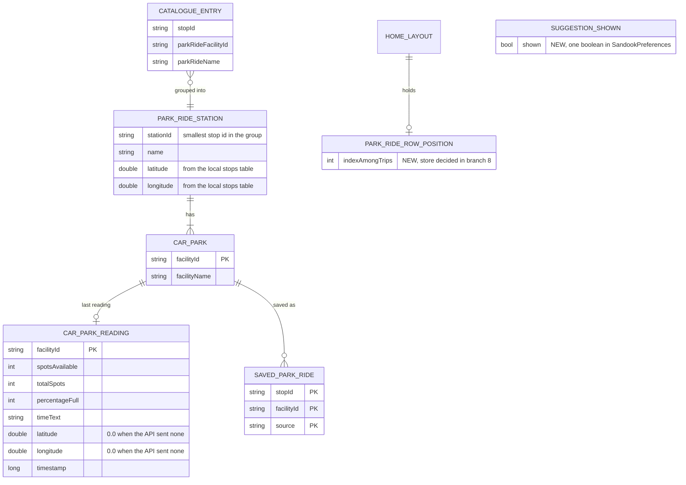
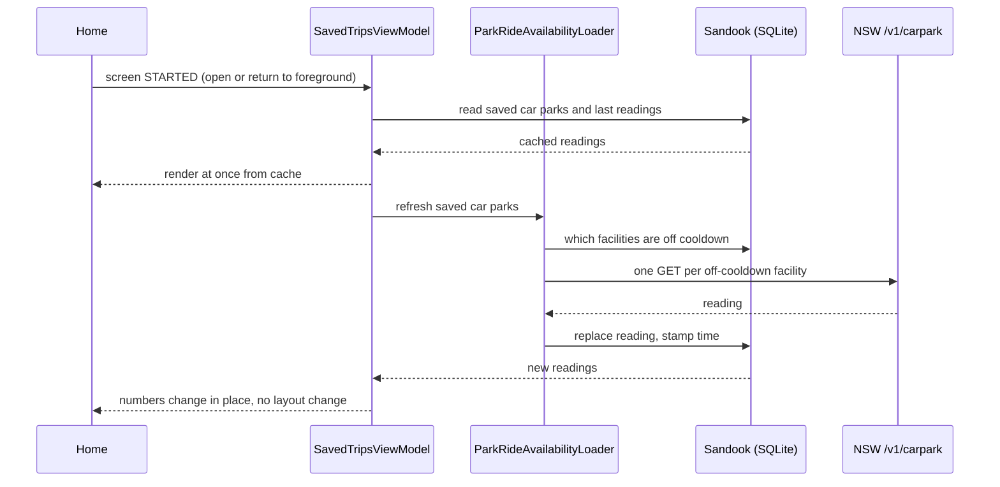

# Feature ERD: Map-first home

Status: Draft (every row of "Assumptions for approval" in section 9 is signed off except A13, which rule 30 states, and the once-a-minute redraw in A6, a default the owner has not seen)
Owner: ksharma-xyz
Touches: `feature/trip-planner/*`, `feature/park-ride/*`, `core/remote-config`, `core/maps/*`, `taj`

---

## 1. Problem and scope

- **Who has the problem.** A rider opens KRAIL and wants one of four things without reading anything: a trip
  they take often, a new destination, the free spots at a car park before leaving home, or the stops near them.
  Today the map only exists behind a toggle inside Search Stop, and Park & Ride numbers only load when a card is
  tapped open.
- **What this does.**
  - Home shows the map behind one column of cards (saved trips, then a Park & Ride row), with the search pill at
    the bottom.
  - Search Stop opens on the map with no keyboard, and has two states with a two-step back.
  - To sits above From, in fixed rows, with the go circle inside the From bar.
  - Home and Work chips stay once set; tapping Home plans a trip from the nearest stop.
  - A station with several car parks is one card showing every car park of the station at equal weight, each with
    its age. No car park is emphasised (A3).
  - Reorder mode moves the Park & Ride row as one block.
  - First run shows one choice at a time, then a nearby Park & Ride suggestion.
- **What it deliberately does not do.**
  - No bottom sheet, toast, snackbar, banner or custom transition.
  - No new polling, no per-feature `HttpClient`, no new analytics event names (parameters on existing events only).
  - No map options sheet. The mode filter survives as a row of chips on the Search Stop map (A7).
  - No BFF route. The app calls NSW directly.
  - No walking distance between a car park and the platform. We do not have that data.

The design rules this implements are written up in `docs/MAP_HOME_UX.md` (separate branch in the stack).

## 2. Entities and relationships



| Entity | Layer | Source of truth | Identity key | Lifetime |
|---|---|---|---|---|
| `CATALOGUE_ENTRY` | network config | Remote Config `nsw_park_ride_facilities` (defaults in `RemoteConfigDefaults.kt`) | stop id plus facility id | until the next config fetch |
| `PARK_RIDE_STATION` | domain, derived | `groupIntoStations` over the catalogue and the local stops table | smallest stop id in the group | recomputed, never stored |
| `CAR_PARK` | domain | the catalogue | facility id | as the catalogue |
| `CAR_PARK_READING` | db, existing `NSWParkRideFacilityDetail` | NSW `/v1/carpark` | facility id | replaced on each successful fetch |
| `SAVED_PARK_RIDE` | db, existing | the rider | stop id, facility id, source | until the rider removes it |
| `ParkRideFacilityDetail` | ui | mapped from `CAR_PARK_READING` | facility id | one composition. **Adds nullable `latitude` and `longitude`** |
| `PARK_RIDE_ROW_POSITION` | new, storage not yet chosen | the rider (drag in reorder mode) | one per rider | until changed |
| `SUGGESTION_SHOWN` | new, one boolean in `SandookPreferences` (the store `KEY_HAS_SEEN_INTRO` uses) | the app, set the first time the card is shown | one per install | permanent, the suggestion is shown once |
| `nearby_stops_radius_km` | Remote Config, new | Remote Config, default 3.0 | key | per config fetch |
| `park_ride_suggestion_radius_km` | Remote Config, new | Remote Config, default 10.0 | key | per config fetch |

**Collision check, from the real default catalogue** (42 entries, 37 car parks, 37 stop ids; live Remote Config
may differ):

- One stop id with several car parks: four. Campbelltown (19, 20), Penrith (21, 22), Tallawong (26, 27, 28),
  Kellyville (29, 30).
- One car park behind several stop ids: four. Facility 12 (Mona Vale), 15 (Sutherland), 25 (Hornsby), 489.
- So a station key cannot be the stop id alone or the facility id alone. The existing smallest-stop-id identity
  survives both, and the UI must be built from stations, never from catalogue rows. Under A2b the card lists every car park the
  catalogue puts in the station, not only the saved `SAVED_PARK_RIDE` rows, so a car park the rider never saved
  still gets a reading row.

## 3. Interfaces

Pure logic first, each its own function with no I/O so one fixture suite covers it. Signatures are proposed.

```kotlin
// module: :feature:trip-planner:ui, caller: the Park & Ride card
/** "Last updated x mins ago", stepping to hours and days. Never hides a number. See A6. */
internal fun ageText(readAt: Instant, now: Instant): String

// module: :feature:trip-planner:ui, caller: the Directions button
/** Car park coordinates, else the station position, else null. 0.0 / 0.0 counts as missing. */
internal fun directionsTarget(carPark: LatLng?, station: LatLng?): LatLng?

// module: :feature:trip-planner:ui, caller: first-run suggestion. Defined by the Intro stack, see docs/features/intro/ERD.md
internal fun nearestParkRideStation(location: LatLng, stations: List<ParkRideStationPickerItem>, radiusKm: Double): ParkRideStationPickerItem?
```

Reused unchanged: `ParkRideAvailabilityLoader` (fetch for a set of facilities), `filterRefreshableFacilities` and
`parkRideApiCooldown` (the cooldown), `pollWhileCardsAreOpen` (the expanded-card poll).

Fakes already in `:core:testing`: `FakeParkRideService`, `FakeNswParkRideSandook`, `FakeParkRideFacilityManager`.
Failures stay `Result<T>` with a typed `NetworkException`.

## 4. External contracts

| Call | Method and path | Key params | Auth | Response | Measured wire size | Measured latency |
|---|---|---|---|---|---|---|
| NSW car park | `GET https://api.transport.nsw.gov.au/v1/carpark` | `facility=<id>` | `Authorization: apikey` via `ApiCredential` | JSON, one facility | 344 to 356 bytes gzip (9 real calls, 2026-11-21); 662 to 665 bytes decoded (3 of them) | 0.09 to 0.31 s total (3 of them, from a laptop, not a phone) |
| Map tiles | the shared map instance | tile requests | none | tiles | **not measured**, measure on device in branch 9 | **not measured** |
| Stops, recents, nearby stops | local database | none | none | none | 0, local | local |

- **Fields read:** `spots`, `zones[].occupancy.total` (else `transients`), `location.latitude`,
  `location.longitude` (both strings, nullable), `MessageDate`, `facility_name`. Everything else is ignored.
- **Real responses carry coordinates:** 9 of 9 facilities measured on 2026-11-21 had both latitude and longitude.
- **Parity:** the BFF route (`/v1/parking/facilities/{id}/availability`) exists in code but is not live, so it is
  not used and there is no parity gap to list.

## 5. Data flow



No timer runs on home. A timer exists only while a tile is expanded, and it is the existing
`pollWhileCardsAreOpen`, unchanged.

## 6. Cost budget

Numbers marked "measured" were taken on 2026-11-21. Anything else says what it is.

| # | Question | Answer |
|---|---|---|
| 1 | **API calls** | Per tile expand: one call per car park of that station, only if off cooldown (as today). **On open (new): one call per car park of every station the rider has saved a car park at (A2b), if off cooldown.** A rider with any Tallawong car park saved is 3 calls, a rider with one single-car-park station is 1. Cooldown is 120 s from 05:00 to 10:00 and 600 s otherwise (Remote Config defaults). Per minute visible on home: 0, no timer (A5). While a tile is expanded: at most one call per car park per cooldown, existing. Nearby stops and search are local, 0 calls. |
| 2 | **Payload** | 344 to 356 bytes gzip and about 665 decoded per car park (measured, 9 calls). Tallawong's three car parks are about 1.0 kB on the wire. Parse cost is one small JSON object each (guess, not measured, no more than a few ms). No smaller endpoint on the NSW route. Map tile bytes: not measured. |
| 3 | **Timing** | Home content (trips, cards, last cached numbers) renders from the local database and must not wait for the fetch or for tiles. The fetch runs in parallel and never blocks. Latency 0.09 to 0.31 s measured from a laptop. Failure is silent: the last reading stays. Time to first content before and after: **to be measured on device in branch 9**, the target is no increase. |
| 4 | **UX** | Loading: the cached number stays, same line box, no spinner and no height change. First ever load: a placeholder in the same line box. Failed or offline: the last reading stays with its age shown (A6) and is never hidden. Empty: no stations means no row, no trips means the map only. No layout shift in any state. |
| 5 | **Network efficiency** | Cache key is the facility id, TTL is the cooldown, stored in the local database. Retry: a failed call resets the stamp so the next trigger retries (existing). Conditional requests: **not measured** whether the API sends `Cache-Control` or `Last-Modified`. In-flight dedupe when open and a tile expand land together: **to verify in branch 7**. |
| 6 | **Battery** | Foreground only, gated with `repeatOnLifecycle(STARTED)`. No background work. One radio burst on open and one on each return to foreground, bounded by the cooldown. The expanded-tile poll already exists and is reused. The age text (A6) is redrawn once a minute by a local tick that runs only while the screen is in front, with no network and no radio wake-up. Showing an absolute time instead would need no tick. The home map keeps a GL surface alive while visible: **cost not measured**, compare against the existing Search Stop map in branch 9. |
| 7 | **Shared limits** | One NSW key is shared by every phone. Each open adds up to N calls per phone, where N is the saved car parks, never more often than the cooldown. Ceiling per car park per hour, from the cooldown alone: 30 in the peak window, 6 outside it. That is a ceiling, not a forecast. A BFF would collapse this to one upstream poll for all riders, but it is not live. |

| Flow | Calls before | Calls after | Bytes before | Bytes after | Time to results before | after |
|---|---|---|---|---|---|---|
| Open home, 3 saved car parks, all off cooldown | 0 | 3 | 0 | about 1.0 kB wire | local, not measured | local, must not increase, not measured |
| Open home, all inside cooldown | 0 | 0 | 0 | 0 | local | local |
| Open home, no saved car parks | 0 | 0 | 0 | 0 | local | local |
| Home map tiles | none on home | not measured | none | not measured | none | not measured |

The added calls are paid for by the rider seeing current numbers on open instead of only after a tap. They are
non-blocking, cached, lifecycle-gated and silent on failure.

## 7. States and UX

| Surface | Loading | Empty | Error or offline | Content |
|---|---|---|---|---|
| Home trips | cached rows | no trips, map only, no card | as content | the app's `SavedTripCard`. Both ends labelled stays the one-line "Home to Work" form (A1) |
| Park & Ride tile (one car park) | cached number, or placeholder in the same line box | no row | last reading with its age (A6) | number with "spots" beside it, station name small under it, and the age line |
| Park & Ride card (several car parks) | per row, as above | as above | per row, as above | one card, a row per car park in a fixed order at equal weight (A3) |
| Home map | flat ground and the rider dot | stops within the radius, or none | "Map offline" chip, flat ground, pins stay | pins, P pins, label pins |
| Search Stop | map state, no list, no keyboard | recents empty, nearest stops instead | offline chip | list state with recents or results |

- Wireframes and the review page live outside this repo. The rules they enforce are in `docs/MAP_HOME_UX.md`.
- The multi-car-park card was drawn at normal text (decision sheet, M1, equal weight picked). It is still to be
  drawn at 320 dp and 200% text before branch 8 is built.
- A card never changes height because data arrived. Only a tap expands a Park & Ride card.

## 8. Test plan

Fixtures: real responses captured on 2026-11-21 for facilities 19 to 22, 26 to 30 (Campbelltown, Penrith,
Tallawong, Kellyville) under the module's test resources. They are one moment in time, so they prove parsing and
shape only. Rule tests (age text) use hand-built readings that include very old ones, because no single capture can.

Pure logic, written before the code:

- `a reading is never hidden because it is old`
- `age text steps from minutes to hours to days`
- `car park rows keep their order when numbers change`
- `station card lists every car park of the station, saved or not`
- `directions prefers car park coordinates, then the station, then none`
- `directions ignores 0,0 coordinates`
- `suggests the nearest station within the radius`
- `suggestion shows once, then never again, whether or not the rider added`
- `no suggestion once a station is saved`

Park & Ride cases from the brief (nothing decided, tests first):

- `go here on a single-stop station sets that stop`
- `card lists every car park under one stop`
- `go here on a multi-stop station gives the same stop after a catalogue reorder`
- `station with no local stop has no pin and no Go here`
- `tile without coordinates has no Directions`
- `unknown stop still offers Go here`
- `p card in start search reads Start here`

State survival and lifecycle:

- Rotate on every changed screen, loaded and loading. Expanded tile, reorder edit and first-run answer survive
  (`rememberSaveable`, never `remember`, for each).
- `uiState` collected with `collectAsStateWithLifecycle()`. The on-open fetch starts in `repeatOnLifecycle(STARTED)`.
- No new navigation route is expected. If one is added it goes in `SerializationConfig.kt`.
- Existing screenshots (`ParkRideCardPreview` and the saved trips ones) change and are re-recorded.
- Maestro smoke selectors on home and Search Stop are checked after branches 2 and 3.
- Device QA, Android: the Pixel 6 Pro, the tablet AVD and a Pixel 9 Pro Fold AVD. iOS: the simulators `iphone-duo`
  and `iphone-pro`. The iOS build must compile (`compileKotlinIosSimulatorArm64`) and install with Xcode 27.2 and
  spmForKmp 1.9.7, which is already on main.

### Existing rules and components this stack touches

| Existing rule or component | What the stack does to it | How it is held |
|---|---|---|
| `SEARCH_STOP_UX.md`, "The landing surface is the list, never the map", pinned by `singlePane_opensOnTheList_evenWhenAMapIsAlreadyInitialised`. The doc also records that a map-first default starts the whole MapLibre stack on every visit and that the flag once flipped by accident | Rule 39 reverses it on purpose. Branch 4 flips the pinned test with the same initialised-map fixture, rewrites that doc section in the same change, and adds a measured before and after of time to first content and map start cost to section 6 | doc, test, and a measurement on the Pixel 6 Pro and the tablet AVD, reported before the branch is called done |
| Search Stop label pill row, the curated first-open stops (Town Hall, Central, Parramatta, Wynyard), `StopLabelAssignRow` and its "+" | The recents card replaces that list layout (rule 9). Custom labels beyond Home and Work, and the curated stops with location off, are open gaps below | the existing Search Stop tests must pass or be changed on purpose, with the doc updated |
| Ask KRAIL on home (`AskKrailScreen`, the mic in the search row, listen on open, blur and dim while it is open, gated by the AI input flag and device availability) | The new home pill keeps it working. The mic shows only when the flag and the device allow it, never as a dead icon. The blur applies to the cards, and the map stays a sibling | to verify in the home map branch, with `DualPaneCompositingGuardTest` |
| The saved trips reorder callback treats every list key as a trip id | The Park & Ride row is a list item with its own key. The callback must move it as a block and never read its key as a trip id. Its position is stored as an anchor after a trip and clamped when trips are added or deleted | unit tests on the move and the clamp, before the code |
| `persistFacilityDetail` stores the stop id as the stop name when a car park is not saved | A2b writes readings for car parks the rider never saved. The station name comes from the catalogue and the stops table, never from a reading row | `station card shows the station name for an unsaved car park` |
| Search query telemetry (`SearchQueryTextEgressTest`, `SearchQueryRedactionCallSiteTest`), the address search gate and `searchSessionId` | Text fields move but keep going through the same helpers. No raw text reaches any event | the existing tests pass unchanged |
| `MapOptionsSaved` and `DepartureBoardSource.MAP_SHEET` analytics | Deleting the sheet ends `MapOptionsSaved`. Mode toggles log through an existing event with parameters, no new event name, with a ledger row and a message to the KRAIL-Analytics side before the release | `docs/ANALYTICS_EVENTS.md` checklist |
| Guards that run on every branch | `ThemeColorRoleRule`, `LazyItemKeyRule`, `ClockSystemBan` (the age text takes `now`), `CollectAsStateBan`, `SnackbarBan`, `PollingLifecycleGuardTest` (a new `WhileSubscribed` is registered in `docs/POLLING_LIFECYCLE.md`), `DualPaneCompositingGuardTest`, `BrandHexUniquenessTest` (mode chips use the `TransportMode` colours, no hex), `ScreenshotPreviewAnnotation`, `ViewModelStateDurabilityTest`, `NavKeySerializationConfigTest`, `verifyTestWiring` | passing is the bar, and no allowlist entry is added to get past one |

## 9. Open gaps and decisions

| Gap or decision | Owner | Needed by |
|---|---|---|
| The multi-car-park card at 320 dp and 200% text is not drawn yet | ksharma-xyz | before branch 8 |
| Where the shortcuts for custom labels (beyond Home and Work) live in the new Search Stop. Today they are pills in the label pill row | ksharma-xyz | before branch 4 |
| Whether the curated first-open stops (Town Hall, Central, Parramatta, Wynyard) stay for a new rider with location off and no recents | ksharma-xyz | before branch 4 |
| Whether the home pill is the same entry as today's search row, with the mic opening Ask KRAIL unchanged | ksharma-xyz | before the home map branch |
| Whether the stop card's Lines chip merges into one chip in the board heading (decision 8) | ksharma-xyz | before the stop card branch |
| Decision 16, every Go here case in the table in section 8 | ksharma-xyz | before branch 11 |
| The Intro redesign has its own ERD, `docs/features/intro/ERD.md`, and is built before this stack. It takes over the first-run choice (A9) and the Park & Ride suggestion for new riders (A10), and supplies `nearestParkRideStation` and the suggestion flag | ksharma-xyz | before branch 12 |

### Assumptions for approval (no code until signed off)

**What counts as evidence here.** A single live car park reading is a snapshot of one moment (this one was Saturday evening). It says nothing about weekday mornings, so it is used only for response shape (which fields exist, how big a response is) and never to justify a rule. Evidence about rider behaviour is private. It is shown to the owner in the message that introduces this ERD and is kept outside this repository, which is public.

| # | Assumption | Evidence (real data, named cases) | What breaks if it is wrong | Decision |
|---|---|---|---|---|
| A1 | A saved trip with both ends labelled keeps the app's one-line form, "Home to Work" | The shipped `SavedTripCard` already draws it | none, nothing changes | Approved by ksharma-xyz, 2026-11-21 |
| A2 | A station with several car parks is one card, every car park visible without a tap, in a fixed row order | Tallawong has 3, Campbelltown 2, Penrith 2, Kellyville 2 in the default catalogue. A rider choosing between them needs to compare in one glance | Options: (a) one tile per car park, comparison scattered across a sideways row; (b) one card with all rows, taller card makes the row's tiles equal height; (c) one wide card, the third car park can fall off a narrow phone | Approved by ksharma-xyz, 2026-11-21 (decision sheet M1, option A: one card, equal weight) |
| A2b | A station card lists **every car park of the station**, not only the ones the rider saved | Saves are per car park (`SavedParkRide` is keyed by stop id and facility id). A card limited to saved car parks shows one row for a rider who saved one car park, so the rider who wants to compare P1, P2 and P3 never sees the other two | Options: (a) saved car parks only, no extra calls, no comparison; (b) all car parks of the station, comparison works, and a rider who saved one car park of Tallawong pays 2 more calls on open (3 instead of 1); (c) all car parks only when the card is expanded | Approved by ksharma-xyz, 2026-11-21: (b), every car park of the station |
| A3 | Which car park is emphasised: the metric is a choice, not something the data settles | One live reading (Saturday evening, 2026-11-21) shows the two obvious metrics can disagree: at Penrith the at-grade lot had the lower percent full and the multi-level lot had more free spots, and Kellyville did the same. One reading says nothing about how often, or at what hour. **No all-time or weekday-morning occupancy data exists to settle it** | Options: (a) most free spots, favours the big lot; (b) lowest percent full, favours the emptier lot and less circling; (c) emphasise nothing and show both numbers. To settle it with data, collect readings for the multi-car-park stations over several weekday mornings first (a collection job, owner's call, not started) | Approved by ksharma-xyz, 2026-11-21 (decision sheet M1, option A): no emphasis in this stack. Revisit once weekday morning readings exist |
| A4 | No emphasis when: every car park is full, only one reading exists, or the readings come from different refreshes (their ages differ by more than the current cooldown, which means one fetch failed). A tie emphasises every tied car park. Rows never move | Rule is on `spots` and zone occupancy, which are data fields. A6 removed the stale cutoff, so this reuses the existing cooldown (120 s from 05:00 to 10:00, 600 s otherwise) instead of a new number | A rider is steered to a car park by an old number sitting next to fresh ones | Dropped with A3, there is no emphasis in this stack |
| A5 | Fetch every saved car park on open and on return to foreground, cooldown-gated. No timer on home. The timer runs only while a tile is expanded (existing) | Cooldown 120 s and 600 s from `RemoteConfigDefaults.kt`. Code read: no call on open today | Too few: numbers older than the rider expects. Too many: shared NSW key pressure | Approved by ksharma-xyz, 2026-11-21 |
| A6 | A number is never hidden for being old. Every Park & Ride number shows its age in words, "Last updated x mins ago" (final wording not chosen, no colon in rider-facing copy), stepping to hours and days when old | The number is from the last successful fetch, so with no network it can be hours old. The reading already carries its time (`timeText`, `timestamp`), and the expanded card already shows "Last updated at". Choosing a cutoff would need data on how fast a lot's number changes, and none exists | A rider reads an old number as current if they miss the age, so the age line is the safeguard and must be on the card face, in the same line box in every state. It adds one line to each tile face. The age text is redrawn once a minute by a local tick while the screen is in front (no network). Showing the absolute time instead would need no tick | Approved by ksharma-xyz, 2026-11-21 (show the age, never hide). The once-a-minute redraw is `Default, not yet seen by owner` |
| A7 | The map keeps a mode filter. It moves out of the deleted Map Options sheet into a row of the existing `TransportModeChip`s on the Search Stop map state only, under the search pill. The six modes the nearby map offers: Train, Metro, Bus, Light rail, Ferry, Coach. All on by default, not saved between launches (as today). The home map shows every mode | Today the filter is a sideways `LazyRow` of `TransportModeChip` inside `MapOptionsBottomSheet`, which rule 30 deletes. The nearby query is capped at 200 results (`MAX_NEARBY_RESULTS`) and the radius goes from 1 km to 3 km, so in a dense area buses can fill the cap and hide stations. The filter is the rider's way out | Normal text wraps as whole items (rule 13). Over 130% text the row scrolls sideways with a fade at the right edge and the first chip fully visible, the exception rule 4 gives the Home chips. Wrapping at 200% text would cover about half the map, read off the drawn frame and not measured | Approved by ksharma-xyz, 2026-11-21 (decision sheet M2, option B). Keeping the filter was approved earlier |
| A8 | Directions use car park coordinates, else the station position from the stops table, else no button. A coordinate of exactly 0.0, 0.0 counts as missing | 9 of 9 real responses carry coordinates. The mapper writes `?: 0.0` into `NOT NULL` columns, so a missing value would route to 0,0. No migration is needed: `NSWParkRideFacilityDetail` already stores latitude and longitude | A rider is sent to the wrong place. A car park with no reading yet has no coordinates at all | Approved by ksharma-xyz, 2026-11-21 |
| A9 | First run shows only the "Show stops near you" card, then the rest appears after any answer (rule 46) | The app already has an Intro (seven content pages, gated by `KEY_HAS_SEEN_INTRO`, and Splash sends a first launch to `IntroRoute`). So this first run is the home a rider reaches after the Intro | A new rider sees an empty-looking home | Approved by ksharma-xyz, 2026-11-21 (one choice at a time on home). Superseded in part by `docs/features/intro/ERD.md` (IA1 to IA9): new riders answer the Park & Ride question in the Intro. Pending the owner's approval of that ERD |
| A10 | A Park & Ride suggestion appears once, when a station is within 10 km of the rider's Home (or their current location before Home is set). Add saves it. Whether or not they add, it is never shown again: one boolean in `SandookPreferences`, set the first time the card is shown. No suggestion if a station is already saved. The radius is Remote Config | Station positions are local, so no network. The 10 km comes from rule 47 | A rider who ignores the one card never gets another chance. Accepted | Approved by ksharma-xyz, 2026-11-21 (show once, then never). Superseded in part by the Intro ERD: the Intro sets the flag when it asks, so new riders are not asked again on home, and the radius is decided once, in IA2 there. Pending the owner's approval |
| A11 | Stations keep the order they were added and do not reorder one by one (rule 38) | none | A rider who wants a different order removes and re-adds a station. Accepted for now, dragging inside the row can come later | Approved by ksharma-xyz, 2026-11-21 (simple for now) |
| A12 | The Park & Ride row stays after the second trip in the morning peak. It does not move to the top | Rule 29 says the row has no setting. The code already treats 05:00 to 10:00 as the peak window for the cooldown, so there is a case for moving the row at peak. Private evidence, shown to the owner in the message that introduces this ERD, kept outside the repository. | A rider wants car parks first at 7am. Options: (a) fixed place (the assumption); (b) the row moves to the top during the peak window on weekdays, which changes the layout by time of day and fights "nothing jumps" | Approved by ksharma-xyz, 2026-11-21: (a), a fixed place after the second trip. A rider who wants it at the top drags it there in reorder mode |
| A13 | The nearby radius is Remote Config `nearby_stops_radius_km`, default 3.0 (today the default is 1.0 and it is not saved between launches) | Rule 30 | More stops per query, more pins | Stated by rule 30 |
| A14 | The two "Long press..." tip lines on `SavedTripsScreen` are removed | They are helper text next to items | A rider never learns long press exists | Approved by ksharma-xyz, 2026-11-21 |
| A15 | Discover stays beside Settings in the top right of the home top row, the same round button and badge as today | Today's title bar shows a round Discover button when it is available, with a badge, next to Settings | At large text the right group takes more of the row, so the Map offline chip drops below as a whole item | Approved by ksharma-xyz, 2026-11-21 (decision sheet M3, option A) |
| A16 | The top row, the location status pill and a floating stop card join the stack at the places in section 10. A tapped pin opens a floating card, never a bottom sheet | Wireframe frames exist for each. Today's bottom sheet already runs the departure board with its own view model | The stop card must make no more departure calls than the sheet does today. To confirm before it is built | Approved by ksharma-xyz, 2026-11-21 (decision sheet M4, option A) |
| A17 | Rule 29 settles how many show on open: two trips, then the Park & Ride row, then the rest. Nothing is capped, the stack scrolls and the row scrolls sideways | Rule 29 | A rider with many stations sees two and scrolls for the rest | Approved by ksharma-xyz, 2026-11-21 (decision sheet M5, option A) |

Source judgement, one row per rule that reads data:

| Decision | Source (data field or parsed text) | Checked against | Reliable |
|---|---|---|---|
| A6 | data fields `MessageDate` and the stored `timestamp` | the 9 real facilities above | yes, no text parsed |
| A5 | clock and the cooldown stored per facility | code read, not run | to verify on device |
| A8 | data fields `location.latitude`, `location.longitude` | the 9 real facilities above | yes, 9 of 9 present. The `0.0` path is untested on real data |
| A10 | local stops table positions | not checked | to verify in branch 10 |
| A2b, A12 | Private evidence, shown to the owner in the message that introduces this ERD | Kept outside the repository | Not stated here |

## 10. Build order

One worktree, one Graphite stack, every branch under 500 lines with one concern. Nothing is pushed and no PR is
raised until the whole stack has passed device QA, then it merges bottom-up. No feature flag. Built after the Intro stack
(`docs/features/intro/ERD.md`).

0. `docs/map-home-erd`, this file.
1. `docs/map-home-ux`, `docs/MAP_HOME_UX.md`, the rules, with no internal metrics or quotes.
2. `refactor/home-search-extract`, only if detekt has no headroom in `SearchStopScreen.kt` or `SavedTripsScreen.kt`.
3. `feat/map-home-one-column`, one column with shared edges (rule 45).
4. `feat/search-stop-map-first`, the map state, list state and two-step back (rule 39), the recents card (rule 9),
   and the location status pill under the form (rule 24).
5. `feat/search-stop-radius-config`, delete `MapOptionsBottomSheet`, move the mode filter to a chip row on the map
   that scrolls sideways over 130% text (A7), add `nearby_stops_radius_km` (rule 30).
6. `feat/search-stop-to-from`, To above From, go inside the From bar (rules 35 and 36).
7. `feat/home-label-chips`, Home chip plans from the nearest stop, long press opens Manage stop labels (rule 41).
8. `feat/home-park-ride-row`, the row after the second trip, the multi-car-park card at equal weight with every car
   park of the station and each age, Directions (rules 29, 40, A2b, A6, A8).
9. `feat/home-reorder-block`, the row moves as a block, tip lines removed (rules 31, 38, A14).
10. `feat/stop-card`, the floating stop card replacing the bottom sheet, with the Park & Ride pin card (A16).
11. `feat/home-map-background`, the map behind the cards, P pins and label pins, the top row with Discover beside
    Settings, and the home location pill (rules 1, 12, 20, 24, A15).
12. `feat/home-first-run`, rules 46 and 47. Shrinks to existing riders once the Intro stack has shipped: the one-time
    suggestion (A10) using `nearestParkRideStation` and the shared flag from the Intro ERD.
13. `feat/saved-trip-labels-go-here`, the label shown whenever a card's stop is the labelled stop, and the Go here
    cases. Blocked on decision 16. Its size depends on a diff against today's `SavedTripCard`, which has not been done.

Branches 8, 10 and 11 are likely over 500 lines and will be split when built.
