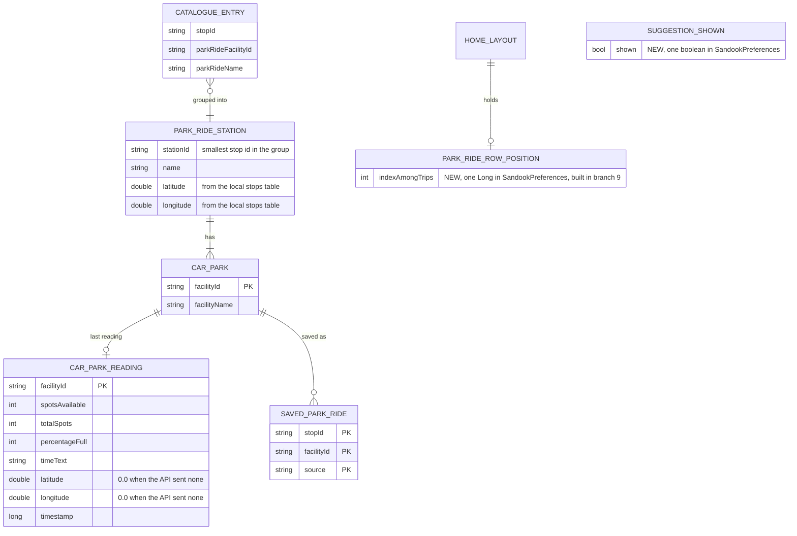
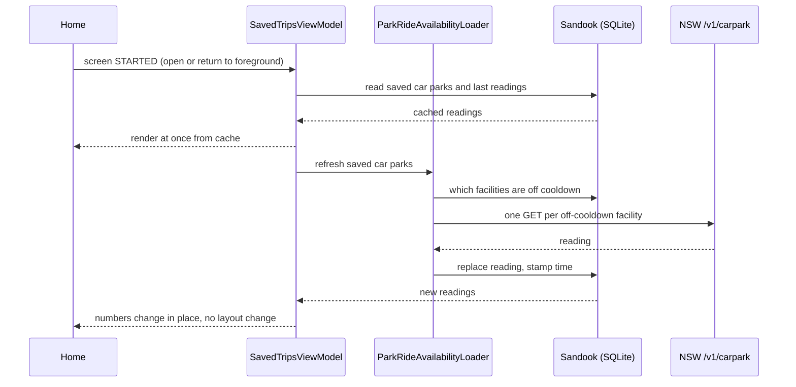

# Feature ERD: Map-first home

Status: Draft (every row of "Assumptions for approval" in section 9 is signed off except A13, which rule 30 states, and the once-a-minute redraw in A6, a default the owner has not seen)
Owner: ksharma-xyz
Touches: `feature/trip-planner/*`, `feature/park-ride/*`, `core/remote-config`, `core/maps/*`, `taj`

> **SUPERSEDED for the home screen (2026-11-22).** The home is not the map-first home. It is main's Saved Trips
> screen with two additions, specified in section 11 at the end of this document. Everything in this document that
> describes the home map (the map behind the cards, the Park & Ride tiles and row, the notices, the floating cards on
> home, the pill, the one column, reorder mode as redesigned, the suggestion and the home chips) is SUPERSEDED. That
> code is kept in the repository and is drawn by nothing. What stands: Search Stop (its two states, the To and From
> form, the stay in place picks, the back stack fix), the nearby radius and mode chips, the stop card, the Intro hand
> off, and the Park & Ride store the Intro and Add Park & Ride write to. The home entry no longer reads the maps flag
> to choose a screen, and `maps_stop_search` gates only Search Stop's map state.

---

## 1. Problem and scope

- **Who has the problem.** A rider opens KRAIL and wants one of four things without reading anything: a trip
  they take often, a new destination, the free spots at a car park before leaving home, or the stops near them.
  Today the map only exists behind a toggle inside Search Stop, and Park & Ride numbers only load when a card is
  tapped open.
- **What this does.**
  - Home shows the map behind one column of cards (saved trips, then a Park & Ride row), with the search pill at
    the bottom.
  - Search Stop opens on the map with no keyboard, and has two states with a two-step back.
  - To sits above From, in fixed rows, with the go circle inside the From bar.
  - Home and Work chips stay once set; tapping Home plans a trip from the nearest stop.
  - A station with several car parks is one card showing every car park of the station at equal weight, each with
    its age. No car park is emphasised (A3).
  - Reorder mode moves the Park & Ride row as one block.
  - First run shows one choice at a time, then a nearby Park & Ride suggestion.
- **What it deliberately does not do.**
  - No bottom sheet, toast, snackbar, banner or custom transition.
  - No new polling, no per-feature `HttpClient`, no new analytics event names (parameters on existing events only).
  - No map options sheet. The mode filter survives on the Search Stop map as a small button at the bottom left that opens the chips as a card (A7, A146).
  - No BFF route. The app calls NSW directly.
  - No walking distance between a car park and the platform. We do not have that data.

The design rules this implements are written up in `docs/MAP_HOME_UX.md` (separate branch in the stack).

## 2. Entities and relationships



| Entity | Layer | Source of truth | Identity key | Lifetime |
|---|---|---|---|---|
| `CATALOGUE_ENTRY` | network config | Remote Config `nsw_park_ride_facilities` (defaults in `RemoteConfigDefaults.kt`) | stop id plus facility id | until the next config fetch |
| `PARK_RIDE_STATION` | domain, derived | `groupIntoStations` over the catalogue and the local stops table | smallest stop id in the group | recomputed, never stored |
| `CAR_PARK` | domain | the catalogue | facility id | as the catalogue |
| `CAR_PARK_READING` | db, existing `NSWParkRideFacilityDetail` | NSW `/v1/carpark` | facility id | replaced on each successful fetch |
| `SAVED_PARK_RIDE` | db, existing | the rider | stop id, facility id, source | until the rider removes it |
| `ParkRideFacilityDetail` | ui | mapped from `CAR_PARK_READING` | facility id | one composition. **Adds nullable `latitude` and `longitude`** |
| `PARK_RIDE_ROW_POSITION` | new, one Long in `SandookPreferences` under `KEY_PARK_RIDE_ROW_INDEX`, the store `KEY_HAS_SEEN_INTRO` uses (branch 9) | the rider (drag in reorder mode), written by Done | one per rider | until changed. Absent until the first drag, which puts the row after the second trip. Read clamped to the trips there are, so it is never wrong after a delete |
| `REORDER_SESSION` | new, ui state only, `SavedTripsState.reorder`, never stored | the rider's long press, ended by Done, cancel or being away | one at a time | a rotation keeps it, Done and cancel end it, leaving the screen for longer than the 5 s grace drops it unsaved |
| `SUGGESTION_SHOWN` | one boolean in `SandookPreferences` (the store `KEY_HAS_SEEN_INTRO` uses), `KEY_PARK_RIDE_SUGGESTION_SHOWN`, **the Intro's own key** (branch 12 adds none) | the Intro when it asks, else the home card the first time it is drawn (A111) | one per install | permanent, the suggestion is shown once |
| `nearby_stops_radius_km` | Remote Config, new | Remote Config, default 3.0 | key | per config fetch |
| `park_ride_suggestion_radius_km` | Remote Config, new (branch 12) | Remote Config, default 5.0 to match the Intro (`docs/features/intro/ERD.md`, IA2, approved 2026-11-21). Earlier draft said 10.0. Read once as the suggestion's ViewModel is made. A number from 0.5 to 10 is used, one outside it is ignored whole and 5.0 applies, as `nearby_stops_radius_km` does (A114) | key | per config fetch |

**Collision check, from the real default catalogue** (42 entries, 37 car parks, 37 stop ids; live Remote Config
may differ):

- One stop id with several car parks: four. Campbelltown (19, 20), Penrith (21, 22), Tallawong (26, 27, 28),
  Kellyville (29, 30).
- One car park behind several stop ids: four. Facility 12 (Mona Vale), 15 (Sutherland), 25 (Hornsby), 489.
- So a station key cannot be the stop id alone or the facility id alone. The existing smallest-stop-id identity
  survives both, and the UI must be built from stations, never from catalogue rows. Under A2b the card lists every car park the
  catalogue puts in the station, not only the saved `SAVED_PARK_RIDE` rows, so a car park the rider never saved
  still gets a reading row.

## 3. Interfaces

Pure logic first, each its own function with no I/O so one fixture suite covers it. Signatures are proposed.

```kotlin
// module: :feature:trip-planner:ui, caller: the Park & Ride card
/** "Last updated x mins ago", stepping to hours and days. Never hides a number. See A6. */
internal fun ageText(readAt: Instant, now: Instant): String

// module: :feature:trip-planner:ui, caller: the Directions button. Built in branch 8, see below
/** The car park's own position, else null. Never the station's. 0.0 / 0.0 counts as missing. */
internal fun directionsTarget(latitude: Double?, longitude: Double?): LatLng?

// module: :feature:trip-planner:ui, caller: first-run suggestion. Defined by the Intro stack, see docs/features/intro/ERD.md
internal fun nearestParkRideStation(location: LatLng, stations: List<ParkRideStationPickerItem>, radiusKm: Double): ParkRideStationPickerItem?
```

Branch 7, the Home and Work chips. All pure, in `savedtrips/HomeLabelChips.kt`, so each rule is driven at its boundary
without a layout, a location fix or a database:

```kotlin
// module: :feature:trip-planner:ui, caller: the chip row above the home search row
internal fun chipRowModeFor(fontScale: Float): ChipRowMode               // Wrap up to and including 1.3, Scroll above it
internal fun homeChipsFor(stopLabels: List<StopLabel>): ImmutableList<HomeChip>   // Home, Work, then Park & Ride
internal fun startLabelChipTap(label: StopLabel): LabelChipTap           // set: Locating, unset: Decided(Assign)
internal fun nearestStopTo(latitude: Double, longitude: Double, candidates: List<NearbyStop>, radiusKm: Double): NearbyStop?
internal fun decideLabelTap(destination: StopItem, rider: LatLng?, candidates: List<NearbyStop>, radiusKm: Double): LabelTapOutcome
```

The tap is a small state machine held in `SavedTripsState.labelChipTap` (`Idle`, `Locating(labelKey)`, `Decided(outcome)`) so a
rotation mid tap loses nothing. `LabelChipTapEffect` plays it out: it takes the one fix (`UserLocationManager.getCurrentLocation()`)
and reports it, then acts on the decision once and reports it handled. A chip has no long press, so the row takes no
callback for one.

Branch 6, the To and From block. Plain functions and one holder in `components/ToFromRules.kt`, the block itself in
`components/ToFromBlock.kt`, built from taj parts (no hand built bar):

```kotlin
// module: :feature:trip-planner:ui, callers: SearchStopRow (classic home), SearchStopForm (Search Stop)
internal fun ToFromField.hasDarkFill(editing: ToFromField?): Boolean               // only the bar being edited
internal fun goCircleDiameter(column: Dp, margin: Dp): Dp                          // 48 less 4 on every side, 40
internal fun toFromFieldLabel(role: String, placeholder: String, stopName: String?): String
internal class ToFromBarInsets(column: Dp, startGap: Dp, endGap: Dp)               // textStart 52, textEndReserved 56, reserved 108
internal class ToFromEditor(state, modifier, maxLength, filter, onTextChange)      // the field the edited bar holds
internal fun ToFromBlock(..., editing: ToFromField?, editor: ToFromEditor?, ..., toLeading, toTrailing, fromTrailing)
```

With `ToFromBlockStyle.Classic`, the home's own look, a bar at rest is taj's `TextFieldButton`. The bar being edited, when an
`editor` is given, is taj's `TextField` in `TextFieldDefaults.invertedColors()`, with the slots as its `leadingIcon` and `trailingIcon`.
Search Stop passes `ToFromBlockStyle.FloatingRows(rowGap)` instead (A143): both bars are taj's `TextField` in
`FloatingDark.barColors()` with no fill of their own, the idle bar is the same field read only and unfocused with a tap over its
text, and a thin divider with `rowGap` above and below sits between them (`ToFromFloatingRows.kt`). The back arrow and the X are
taj's `RoundIconButton` with no fill, the origin marker is taj's `SeparatorIcon` and the go circle is taj's `RoundIconButton`
sized to 40 by modifier. `editor` replaces the earlier `toEditor` and `fromEditor` slots.

Branch 8, the Park & Ride row. All pure, in `savedtrips/ParkRideTile.kt`, `HomeStackOrder.kt` and `ParkRideRefreshHelper.kt`, so each
rule is a table test and none needs a layout, a clock or a database:

```kotlin
// module: :feature:trip-planner:ui, callers: ParkRideRow (home), the home list body, SavedTripsViewModel
internal fun ParkRideUiState.toTile(): ParkRideTile                              // one block per car park, fixed order by name then id
internal fun totalFreeSpots(facilities: Collection<ParkRideFacilityDetail>): Int? // sum of the car parks with a reading, null with none
internal fun oldestReadingTime(facilities: Collection<ParkRideFacilityDetail>): String?
internal fun directionsTarget(latitude: Double?, longitude: Double?): LatLng?    // the car park's own position or null
internal fun parkRideTileWidth(columnWidth: Dp, fontScale: Float): Dp            // min(148 dp x font scale, column less 60 dp)
internal fun openTilesAfterTap(open: Set<String>, tapped: String): Set<String>   // one open at a time
internal fun rowIndexFor(tripCount: Int, storedIndex: Int? = null): Int          // trips before the row: 2 by default, clamped
internal fun homeStackKeys(tripIds: List<String>, hasRow: Boolean, storedIndex: Int?, session: ReorderSession?): List<String> // the stack's keys in draw order
internal fun isOffCooldown(lastCallEpochSeconds: Long?, cooldown: Duration, now: Instant): Boolean // the one decision every fetch makes
internal fun stopsToRefreshOnOpen(savedStopIds: Collection<String>, openStopIds: Set<String>): List<String>
```

`ParkRideTile` carries `stationId`, `stationName`, every `stopId` of its car parks (so the Go here branch of branch 13 can pick the
smallest one that exists in the stops table without reading the state again), `totalFreeSpots`, the time of the oldest reading and one
`CarParkBlock` per car park (name, free spots, percent full, time, and `directionsTo`, null without a position of its own). The tile has
no Go here and no Directions of its own: a tile never promises a trip it cannot start (rule 40).

`ParkRideFacilityDetail` gains `latitude` and `longitude` (nullable, null when the stored 0.0 and 0.0 says the reading carried none) and
`readAtEpochSeconds` (the stored `timestamp`, so the oldest reading can be told). The screen draws `ParkRideRow` from the tiles. A tap on a
tile raises the existing `ParkRideCardClick`, so the ViewModel's refresh set and poll stay in step, and a tap on Directions raises the new
`ParkRideDirectionsClick`, which calls `PlatformOps.openMapDirections`, the call the Add Park & Ride sheet already makes.

Branch 9, reorder mode. The reducer is pure and lives in the state module (`ReorderSession.kt`), the rest is plain functions with no
layout, so each rule is a table test and the ViewModel tests use the shared fakes:

```kotlin
// module: :feature:trip-planner:state, the one thing the screen and the ViewModel agree on
const val PARK_RIDE_ROW_KEY = "park_ride_row"                       // the row's key among the trips' ids in the one list
data class ReorderSession(keys, startKeys, removed, lifted) {        // the stack as the rider is arranging it
    val tripOrder: List<String>; val rowIndex: Int?; val hasChanges: Boolean
    fun move(fromKey: String, toKey: String): ReorderSession         // the item lands where the target was, a trip or the row
    fun remove(tripId: String): ReorderSession                       // staged, never the row, never an unknown id
    fun result(): ReorderResult                                      // tripOrder, removed, rowIndex, what Done writes
    companion object { fun start(tripIds: List<String>, rowIndex: Int?, lifted: String? = null): ReorderSession }
}
// module: :feature:trip-planner:ui, callers: SavedTripsViewModel
internal fun SavedTripsState.beginReorder(liftedKey: String): ReorderSession?    // null when there is nothing to reorder
internal fun SavedTripsState.withReorderApplied(result: ReorderResult): SavedTripsState
internal fun persistReorder(sandook, preferences, analytics, session, before: List<Trip>)   // Done's writes, off the main thread
// module: :sandook
fun Sandook.reorderSavedTrips(orderedTripIds: List<String>, removedTripIds: Set<String>)   // one transaction, default body for fakes
```

New events on `SavedTripUiEvent`: `EnterReorder(liftedKey)`, `ReorderMove(fromKey, toKey)`, `ReorderRemove(tripId)`, `ReorderDone` and
`ReorderCancel`. They replace `DeleteSavedTrip`, `MoveSavedTripToIndex` and `MarkReorderTipSeen`, and `hasSeenReorderTip` and its
preference key go with the tip lines. The drag library is the existing `sh.calvin.reorderable` (2.5.1): its move callback raises
`ReorderMove`, the whole card carries `draggableHandle`, and no dependency is added.

Branch 10, the floating stop card. All pure, in `stopcard/StopCardRules.kt`, `StopCardBoardRules.kt` and `ParkRidePinCardRules.kt`, so each
rule is a table test and none needs a layout, a clock or a database:

```kotlin
// module: :feature:trip-planner:ui, callers: SearchStopMap (a stop pin), ParkRideMapPane (a P pin)
internal enum class StopCardKind { Stop, ParkRide }
internal fun stopCardLayout(kind, modeCount: Int, carParkCount: Int): StopCardLayout   // modes row, board, total, action slot
internal fun nearbyStopFor(selectedStopId: String?, nearbyStops: List<NearbyStopFeature>): NearbyStopFeature?
internal fun stopCardStateKey(kind: StopCardKind, id: String): String                 // what the card's saved state is keyed on
internal fun stopCardWidth(paneWidth: Dp): Dp                                          // the one column less 16 dp each side, at most 560 dp (rule 45)
internal fun stopCardMaxHeight(paneHeight: Dp, topReserve: Dp, bottomInset: Dp): Dp   // below the form, above the nav bar, floor 120 dp
internal fun controlsClearance(cardHeight: Dp): Dp                                     // the location button rides above an open card
// the board on a stop card
internal enum class BoardPhase { Collapsed, Loading, Failed, Empty, Content }
internal fun stopCardBoard(state: DeparturesState, expanded: Boolean): StopCardBoard   // phase, refreshing, body floor
internal fun boardFloorHeight(fontScale: Float): Dp                                    // an open board never shrinks below it
// the Park & Ride pin card
internal fun ParkRideStationPickerItem.toPinCardTile(readings: Collection<ParkRideFacilityDetail>): ParkRideTile  // every car park, equal weight
internal fun parkRidePinActionLabel(isOnHome: Boolean): String                         // Add to home, Remove from home (rule 38)
```

`StopCardLayout` carries `showsActionSlot`, true for every card: the room at the bottom of the card for the actions it hosts. Today it holds
the stop's one pick action (the sheet's Select Stop, carried over) and the Park & Ride card's Add to home or Remove from home. Branch 13 filled
the same slot with Save as, Go here and Start here and the card did not change shape. The pin card builds the same `ParkRideTile` the home
row draws, so a station's total, its time and each car park's block read the same on both surfaces, and `directionsTarget` is the one rule
for where Directions go.

Branch 13, the stop card actions. All pure, in `stopcard/StopCardActionRules.kt`, so each rule is a table test and none needs a layout, a clock or a
database:

```kotlin
// module: :feature:trip-planner:ui, callers: StopCardPickActions (the stop card), ParkRidePinCard, SearchStopScreen, HomeMapEntryContent
enum class PickRole { Destination, Start, Choose }                                  // the field being filled in: Go here, Start here, Select stop
internal fun pickRoleFor(field: SearchStopFieldType): PickRole                      // TO, FROM, LABEL
internal fun pickActionText(role: PickRole): String
internal fun offersPick(stopId: String): Boolean                                    // any stop with an id, known to the stops table or not
internal fun offersSaveAs(role: PickRole): Boolean                                  // not while choosing a stop for a label
internal fun saveAsPillsFor(stopId: String, role: PickRole, labels: List<StopLabel>): List<SaveAsPill>   // Saved (this stop's label) or Offered (unset labels)
internal fun reservedRoom(reserved: Dp, measured: Dp): Dp                           // the Save as row never gives back height
internal fun goHereStopId(stopIds: Collection<String>, inStopsTable: Set<String>): String?   // smallest id the table holds, else none
internal fun parkRidePickActionFor(stationName: String, goHereStopId: String?, role: PickRole): PickAction?          // Go here or Start here, null with no stop
```

Branch 11, the map home. Pure rules in `homemap/HomeMapPins.kt` and `homemap/HomeMapChromeRules.kt`, the camera rule beside the other map
helpers in `searchstop/map/MapLocationHelpers.kt`, so each is a table test and none needs a map, a layout or a database:

```kotlin
// module: :feature:trip-planner:ui, callers: HomeMapViewModel, HomeMapEntryContent, HomeMapScreen, SearchStopMap
internal fun labelPinsFor(labels: List<StopLabel>, coordinates: Map<String, Pair<Double, Double>>): ImmutableList<LabelPin>
internal fun parkRidePinsFor(tiles: List<ParkRideTile>, coordinates: Map<String, Pair<Double, Double>>): ImmutableList<ParkRidePin>
internal fun pinStopIdsFor(labels: List<StopLabel>, tiles: List<ParkRideTile>): List<String>           // one local lookup for both
internal fun homePinsFor(nearby, parkRide, labels): HomePins                                            // one pin per place: label beats P beats stop
internal fun homeCardFor(key: String?, pins: HomePins): HomeCard?                                       // Stop or ParkRide, looked up again, null when the pin left
internal fun MapUiState.withNearbyStops(stops: ImmutableList<NearbyStopFeature>): MapUiState
internal fun labelGlyph(label: String): String                                                          // the pin's one character
internal fun homeNoticesFor(pill: LocationPill, mapOffline: Boolean): List<HomeNotice>                  // location first, then Map offline
internal fun mapOfflineFor(transport: TransportState): Boolean                                          // only Down says it
internal fun homeMapPlacementFor(mapsAvailable: Boolean, dualPane: Boolean): HomeMapPlacement          // None, Behind, SidePane
internal fun homeBottomFor(loading: Boolean, reordering: Boolean, cardOpen: Boolean, holdsStops: Boolean): HomeBottom
internal fun stackBottomReserve(bottom: HomeBottom, blockHeight: Dp, cardHeight: Dp, cardEdge: Dp): Dp
internal fun stackMaxHeight(available: Dp, reserve: Dp): Dp
internal fun shouldAutoCenter(hasUserLocation: Boolean, alreadyCentered: Boolean): Boolean              // the once-only glide
```

`HomeMapViewModel(sandook, connectivity, flag, ioDispatcher)` holds `HomeMapState(isMapsAvailable, mapOffline, labelPins, parkRidePins)`. The screen
sends it `HomeMapInputs(labels, tiles)` through `HomeMapEvent.InputsChanged` whenever either changes. `HomeMapScreen` is the maps-on home and takes a
`HomeMapHost` (the map slot, the notices, what the location pill does, the open card). `HomeMapEntryContent` wires the pins, the saved card key and the
location state, and `SavedTripsEntry` chooses between it and `SavedTripsScreen` on `HomeMapState.isMapsAvailable`. `SavedTripUiEvent.RemoveParkRideStation`
removes the car parks the rider added at a station.

Reused unchanged: `ParkRideAvailabilityLoader` (fetch for a set of facilities), `filterRefreshableFacilities` and
`parkRideApiCooldown` (the cooldown), `pollWhileCardsAreOpen` (the expanded-card poll).

Fakes already in `:core:testing`: `FakeParkRideService`, `FakeNswParkRideSandook`, `FakeParkRideFacilityManager`.
Failures stay `Result<T>` with a typed `NetworkException`.

## 4. External contracts

| Call | Method and path | Key params | Auth | Response | Measured wire size | Measured latency |
|---|---|---|---|---|---|---|
| NSW car park | `GET https://api.transport.nsw.gov.au/v1/carpark` | `facility=<id>` | `Authorization: apikey` via `ApiCredential` | JSON, one facility | 344 to 356 bytes gzip (9 real calls, 2026-11-21); 662 to 665 bytes decoded (3 of them) | 0.09 to 0.31 s total (3 of them, from a laptop, not a phone) |
| Map tiles | the shared map instance | tile requests | none | tiles | **not measured**, measure on device in branch 9 | **not measured** |
| Stops, recents, nearby stops | local database | none | none | none | 0, local | local |

- **Fields read:** `spots`, `zones[].occupancy.total` (else `transients`), `location.latitude`,
  `location.longitude` (both strings, nullable), `MessageDate`, `facility_name`. Everything else is ignored.
- **Real responses carry coordinates:** 9 of 9 facilities measured on 2026-11-21 had both latitude and longitude.
- **Parity:** the BFF route (`/v1/parking/facilities/{id}/availability`) exists in code but is not live, so it is
  not used and there is no parity gap to list.

## 5. Data flow



No timer runs on home. A timer exists only while a tile is expanded, and it is the existing
`pollWhileCardsAreOpen`, unchanged.

## 6. Cost budget

Numbers marked "measured" were taken on 2026-11-21. Anything else says what it is.

| # | Question | Answer |
|---|---|---|
| 1 | **API calls** | Per tile expand: one call per car park of that station, only if off cooldown (as today). **On open (new): one call per car park of every station the rider has saved a car park at (A2b), if off cooldown.** A rider with any Tallawong car park saved is 3 calls, a rider with one single-car-park station is 1. Cooldown is 120 s from 05:00 to 10:00 and 600 s otherwise (Remote Config defaults). Per minute visible on home: 0, no timer (A5). While a tile is expanded: at most one call per car park per cooldown, existing. Nearby stops and search are local, 0 calls. |
| 2 | **Payload** | 344 to 356 bytes gzip and about 665 decoded per car park (measured, 9 calls). Tallawong's three car parks are about 1.0 kB on the wire. Parse cost is one small JSON object each (guess, not measured, no more than a few ms). No smaller endpoint on the NSW route. Map tile bytes: not measured. |
| 3 | **Timing** | Home content (trips, cards, last cached numbers) renders from the local database and must not wait for the fetch or for tiles. The fetch runs in parallel and never blocks. Latency 0.09 to 0.31 s measured from a laptop. Failure is silent: the last reading stays. Time to first content before and after: **to be measured on device in branch 9**, the target is no increase. |
| 4 | **UX** | Loading: the cached number stays, same line box, no spinner and no height change. First ever load: a placeholder in the same line box. Failed or offline: the last reading stays with its age shown (A6) and is never hidden. Empty: no stations means no row, no trips means the map only. No layout shift in any state. |
| 5 | **Network efficiency** | Cache key is the facility id, TTL is the cooldown, stored in the local database. Retry: a failed call resets the stamp so the next trigger retries (existing). Conditional requests: **not measured** whether the API sends `Cache-Control` or `Last-Modified`. In-flight dedupe when open and a tile expand land together: **to verify in branch 7**. |
| 6 | **Battery** | Foreground only, gated with `repeatOnLifecycle(STARTED)`. No background work. One radio burst on open and one on each return to foreground, bounded by the cooldown. The expanded-tile poll already exists and is reused. The age text (A6) is redrawn once a minute by a local tick that runs only while the screen is in front, with no network and no radio wake-up. Showing an absolute time instead would need no tick. The home map keeps a GL surface alive while visible: **cost not measured**, compare against the existing Search Stop map in branch 9. |
| 7 | **Shared limits** | One NSW key is shared by every phone. Each open adds up to N calls per phone, where N is the saved car parks, never more often than the cooldown. Ceiling per car park per hour, from the cooldown alone: 30 in the peak window, 6 outside it. That is a ceiling, not a forecast. A BFF would collapse this to one upstream poll for all riders, but it is not live. |

| Flow | Calls before | Calls after | Bytes before | Bytes after | Time to results before | after |
|---|---|---|---|---|---|---|
| Open home, 3 saved car parks, all off cooldown | 0 | 3 | 0 | about 1.0 kB wire | local, not measured | local, must not increase, not measured |
| Open home, all inside cooldown | 0 | 0 | 0 | 0 | local | local |
| Open home, no saved car parks | 0 | 0 | 0 | 0 | local | local |
| Home map tiles | none on home | not measured | none | not measured | none | not measured |
| Open home, Home and Work chips | 0 | 0 | 0 | 0 | local | local, the chips read the labels the screen already observes |
| Tap a set Home or Work chip | not a feature | 0 network calls, 1 location fix, 1 local query | not a feature | 0 over the wire, at most 5 local rows (about 1 kB decoded, a guess, not measured) | not a feature | one fix then the query, not measured on device |

The added calls are paid for by the rider seeing current numbers on open instead of only after a tap. They are
non-blocking, cached, lifecycle-gated and silent on failure.

**Branch 8, the Park & Ride row (one row, numbers from code, guesses labelled).** Opening home asks for the saved stations' numbers once
(`refreshSavedParkRidesOnOpen`, started from the same `onStart` as the rest of the screen, so also once on each return to the front after
the 5 s grace). **At most one call per saved car park, only for the ones `isOffCooldown` lets through**, which is the same decision the
tile tap and the poll make: 120 s in the morning peak (05:00 to 10:00), 600 s outside it, Remote Config defaults. A saved Tallawong is 3
calls and about 1.0 kB on the wire (the measured 344 to 356 bytes gzip each), a single car park 1 call and about 350 bytes, a station
inside its cooldown 0 calls and the cached number at once. Opening a tile adds 0 calls beyond what open already spent, because the car
parks are inside their cooldown. The poll is unchanged and runs only while a tile is open and the screen is in front. **Nothing blocks the
first frame**: the fetch is its own coroutine, and a test holds the first request open and checks the cached screen has already been
drawn. The fetch pass is serialized by a mutex, so open and a tile tap landing together call the API once per car park and not twice (the
cooldown stamp is only written when a reading comes back). A failed call leaves the cached reading as it was and resets the stamp, so
the next open asks again, and nothing is shown for it: no banner, no toast. The row draws from the database as before: parse cost is the
existing mapper, and the tile model is a sort of at most a few car parks and a sum (a guess, microseconds, not measured). The row adds no
timer, so no wake-up: the time on a tile is the stored time of the reading (`Last updated at 8:05 AM`), which needs no tick, and A6's
once-a-minute redraw of a relative age is not built (A58). Layout: tiles are measured once per frame, the row is `horizontalScroll` with
the tallest tile setting the height (`IntrinsicSize.Max`), a handful of tiles by construction, so there is no lazy list and no
subcomposition to pay for. Shared limits: unchanged, still one NSW key shared by every phone, at most 30 calls per car park per hour in
the peak window and 6 outside it, a ceiling and not a forecast.

| Flow | Calls before | Calls after | Bytes before | Bytes after | Time to results before | after |
|---|---|---|---|---|---|---|
| Open home, saved Tallawong (3 car parks), all off cooldown | 0 | 3 | 0 | about 1.0 kB wire | local, not measured | local, the screen is drawn before the first reply, not measured on device |
| Open home, one saved single car park, off cooldown | 0 | 1 | 0 | about 350 bytes wire | local | local |
| Open home, every saved car park inside its cooldown | 0 | 0 | 0 | 0 | local | local |
| Open home, no saved station | 0 | 0 | 0 | 0 | local | local |
| Tap a tile open (cooldown path) | up to the saved car parks of that station | 0 more when open already asked | up to the same | 0 more | local plus fetch | local, the open tile shows the cached numbers at once |
| A tile stays open, screen in front | the poll, each cooldown | the same poll | the same | the same | not a feature | unchanged |
| Home in the background | 0 | 0 | 0 | 0 | none | none |

**Branch 9, reorder mode (all local, numbers from code, guesses labelled).** **0 network calls, 0 timers, 0 background work.** Entering the
mode is a state change in memory: the session is a list of at most one key per saved trip plus the row's, so a dozen strings, built from
what home already holds (a guess at microseconds, not measured). A drag is one in memory `move` per row crossed, which is the existing
library's callback and a list copy of those few keys. Nothing is read or written while the mode is open, so **cancel, back, a tap on the map
and leaving the screen cost 0 writes**. **Done writes once, off the main thread**: the trips in one database transaction
(`Sandook.reorderSavedTrips`, the deletes and one `UPDATE SavedTrip SET sort_order` per trip, a rider's handful of rows, so about N+D
statements inside one commit, not measured) and the row's place as one `SandookPreferences` long, and a Done with nothing moved writes
neither. The old edit mode wrote on every drop, one `UPDATE` per move and one delete per tap, so a long drag is now one commit and not
many. The row's place is read once with the trips, before the list is first drawn, so the row never jumps: one preference read on a
store the screen already reads. Payload: 0 bytes. Time to first content: unchanged, the read is on the same coroutine as the trips and
is a local key. The list is one `LazyColumn` of keys, as before, so a drag recomposes the rows that moved. Loading, slow, failed and
offline do not apply, there is no network: a failed write leaves the screen showing the order the rider chose and the stored order
as it was, which the next observation of the table puts right (A77). Caching, dedupe and conditional requests: none needed. Battery:
no radio wake-up, no wake lock, the lifecycle drops the session when the screen has been away longer than the grace. Shared rate
limits: none touched, a BFF would collapse nothing here.

| Flow | Calls before | Calls after | Bytes before | Bytes after | Time to results before | after |
|---|---|---|---|---|---|---|
| Long press a card, enter reorder mode | 0 | 0 | 0 | 0 | local | local, one state change |
| Drag a card across the stack | 0 network, 1 write per drop (old edit mode) | 0 network, 0 writes | 0 | 0 | local | local, in memory |
| Done after moving trips and the row | 0 network, a write per move and a delete per tap | 0 network, 1 transaction and 1 preference write | 0 | 0 | local | local, off the main thread |
| Done with nothing moved | not a feature | 0 writes | 0 | 0 | local | local |
| Back, swipe back, tap the map, leave the app | not a feature | 0 writes, the session is dropped | 0 | 0 | local | local |
| Open home, row place read | 0 | 0 network, 1 preference read | 0 | 0 | local | local, before the first list |

**Branch 10, the floating stop card (numbers from code, guesses labelled).** **A pin tap costs 0 calls, 0 queries and no timer.** The card draws the
stop's name and modes from the nearby stops the map already holds (the local `selectStopsNearby` list), and the only thing a tap changes is one
saved string, the stop id. **The board fetch is the one the sheet made, not a new one**: the chevron sends the same `LoadDepartures` with the same
source (`DepartureBoardSource.MAP_SHEET`), through the same `DepartureBoardRepository.pollStop` and the same per stop window (`fetchIfWindowOpen`,
30 s, `DEFAULT_REFRESH_INTERVAL_MS`), so an open board is **one call, then at most one call per 30 s per stop** while the board is open and the
screen is in front, shared with any other collector of that stop. The card opens with the board closed, as the sheet's board card did, so looking
at pins fetches nothing (A79). **Closing the card or the board sends `StopPolling` at once**, where the sheet left the view model to wait out its 5 s
`WhileSubscribed` grace, so a closed card ends its poll sooner and never later. The 10 s relative time ticker is the existing
`DeparturesRelativeTimeTicker`, collected with the lifecycle by the card, so it runs only while the card is on screen and the screen is in front. No new
timer, no background work, no radio wake-up beyond the existing poll. Payload: the departures board response, unchanged and **not measured in this
branch** because the call is not new. The line filter is the board's own, in memory over rows already decoded, a few dozen rows at most, a guess of
microseconds, not measured. Time to first content: the card
draws from the held stop on the first frame and never waits for the board, which is closed. Opened, the board shows its floor of height while the
repository's cached entry or the first reply lands (A81), and a failed fetch is the error with Retry inside the same floor. Offline: the card and
its modes still draw because they are local, and the board shows the existing error. Caching and dedupe are the repository's own, and a card plus
another collector of the same stop is one call per window, as `docs/POLLING_LIFECYCLE.md` already requires. Shared limits: unchanged, one NSW key
shared by every phone, a card left open in front is the same 2 calls a minute per stop the sheet was. The Park & Ride pin card makes 0 calls of its
own: the readings are the ones the picker loads when a station is selected, through the existing cooldown, and Directions hand off to the maps app
with 0 calls.

| Flow | Calls before | Calls after | Bytes before | Bytes after | Time to results before | after |
|---|---|---|---|---|---|---|
| Tap a stop pin | 0 (sheet, board closed) | 0 (card, board closed) | 0 | 0 | local, not measured | local, one saved string, not measured |
| Open the board with the chevron | 1 | 1, the same event and window | the board response, not measured | the same | not measured | not measured, floor of height while it loads |
| Board open, screen in front | 1 per 30 s per stop | 1 per 30 s per stop | the same | the same | not a feature | unchanged |
| Close the card or the board | the poll ends within the 5 s grace | the poll ends at once | 0 | 0 | none | none |
| Tap a line in the board's own filter | a filter pill | the same, 0, an in memory filter over the rows held | 0 | 0 | local | local, a guess under a frame |
| Tap a P pin | the existing cooldown read per car park | the same | up to about 350 bytes a car park (measured, branch 8 table) | the same | not measured | not measured |
| Directions on a car park | 0 | 0, a hand off to the maps app | 0 | 0 | platform | platform |
| Card with the app in the background | 0 | 0 | 0 | 0 | none | none |

**Branch 11, the map home (numbers from code, guesses labelled).** **Zero new network calls beyond the map tiles the existing maps already
load.** The tiles are the shared MapLibre style (`https://tiles.openfreemap.org/styles/liberty`), requested by the library as the camera moves, the
same instance and the same style Search Stop and the dual pane draw. Their bytes and request count are **not measured, measure on device**. Everything
else on the map is local. **Nearby stops** are the existing `selectStopsNearby` query: one per camera settle after the 500 ms pan debounce
(`CAMERA_PAN_DEBOUNCE_MS`) and the 300 ms query debounce (`QUERY_DEBOUNCE_MS`), with the 60 s and 200 m cache (`CACHE_EXPIRY_MS`,
`MIN_DISTANCE_FOR_RELOAD_KM`), at most 200 rows (`MAX_NEARBY_RESULTS`), within `nearby_stops_radius_km`, default 3.0 km. That radius is now applied to
the home map, which read the 3.0 constant before and ignored the config (one constructor argument, read once as the ViewModel is made). **Pins** cost one
`selectStopCoordinatesBatch` for the union of the label stop ids and the saved stations' stop ids, a handful (a guess, not measured, under a millisecond
for a few rows), on the I/O dispatcher, once per change of the labels or the saved stations, and none when there is no stop to look up. **The Map offline
chip** reads the app-wide connectivity flow, 0 calls, and says offline only when the OS reports the transport down. **Location** is the existing stream,
one fix every 5 s while home is in front (`UPDATE_INTERVAL_MS`), started only when the permission is already granted and never asked for unprompted: the
location pill is the one place a tap asks. The camera glides once, 1.5 s (`AUTO_CENTER_ANIMATION_MS`) to zoom 15, and the once-only guard is saved across a
rotation. **Time to first content** is from local data only and never waits for tiles: the cards, the chips and the pill draw from state the screen already
holds, and the map is its own layer that adds nothing they read. The stack sizes itself from what is left and measures nothing new. Before and after on a
device: **not measured**, the target is no increase. **UX:** loading is the cards' own, the map shows its flat ground until tiles land, offline keeps the
ground, the pins and the dot plus the chip, and failed tiles are not reported (no signal for them, see A94). **Battery:** a GL surface is alive while home is
in front, cost **not measured**, compare against Search Stop's. The rider dot's breathing is the existing 2.5 s transition and runs only while the map is
composed. No timer, no polling and no background work is added: the ViewModel is `WhileSubscribed(5 s)` behind `collectAsStateWithLifecycle`, the location
lookup is a `LifecycleStartEffect`, and the home entry is not composed behind another screen. **Caching and dedupe:** the nearby cache above, and the pin
lookup is keyed on its inputs, so an unchanged list asks nothing. **Shared limits:** none touched, no NSW call is added, nothing for a BFF to collapse. A P pin
tap makes 0 calls of its own: the card draws the station's cached readings the home row already holds.

| Flow | Calls before | Calls after | Bytes before | Bytes after | Time to results before | after |
|---|---|---|---|---|---|---|
| Open home, maps flag off | 0 new | 0 new, today's home | 0 | 0 | local | local, unchanged |
| Open home, maps flag on | 0 | 0 new network, map tiles from the shared instance | 0 | map tiles, not measured | local, not measured | local, the map never gates the cards, not measured on device |
| Camera settles | not a feature | 1 local nearby query, at most 200 rows | not a feature | at most 200 features decoded, a guess of tens of KB | not a feature | not measured |
| Labels or saved stations change | not a feature | 1 local coordinate lookup, none with no stop | not a feature | 0 | not a feature | a guess, under a frame |
| Tap a pin | not a feature | 0, the card opens with its board closed | not a feature | 0 | not a feature | local, one saved string |
| Tap the location pill | not a feature | 0 network, 1 system permission dialog or 1 open of Settings | not a feature | 0 | not a feature | platform |
| Connectivity changes | not a feature | 0, one flow read | not a feature | 0 | not a feature | local |
| Remove from home on a P card | not a feature | 0 network, up to one local delete per car park | not a feature | 0 | not a feature | local |
| Home in the background | 0 | 0, tracking and the ViewModel stop | 0 | 0 | none | none |

**Branch 12, the one-time Park & Ride suggestion (numbers from code, guesses labelled).** **0 network calls, 0 timers, 0 background work,
0 new location fixes.** Opening home with the maps flag on reads one preference (`KEY_PARK_RIDE_SUGGESTION_SHOWN`) and, only while the
card is still on offer, keeps three local reads open: the saved stations (one observed query), the stop labels (one observed query, plus
one coordinate lookup only when Home has a stop) and, per offered station, one read of the stored readings. The station list is the
in-memory catalogue (the default one has 42 entries, per the collision check above), so choosing the nearest is about 40 distance
computations per anchor change, a guess of well under a millisecond. The anchor is Home or the position the map home already tracks, so
there is no extra fix and no extra permission prompt. Anchor changes before the first draw recompute the offer (a few at most, a guess);
once drawn the station is held and later fixes are ignored. The write is one boolean, once, ever. **Payload:** a stored row per car
park, so under 5 KB for any one station (a guess: 3 car parks of a few fields each), no wire bytes, no parsing beyond the existing row
mapping. **Time to first content:** the card never blocks the home stack, it is added in the row's place as soon as a fix gives a
station, so the trips draw first. The cost is one list item appearing after the first fix, which the page accepts (A113). **UX:**
loading, slow and offline are the same because nothing is fetched. A station with no stored reading shows its name alone at the same
height (rule 22), and Add does not fetch, so its numbers arrive on the next open or tap (A108). **Caching and dedupe:**
`distinctUntilChanged` on every input, the first draw holds the station, a second tap on Add adds nothing, and the shown flag is written
once. **Battery:** no radio wake-up and no background work. `uiState` is `WhileSubscribed` and collected with the lifecycle, so it
stops five seconds after the screen leaves. It is registered in `docs/POLLING_LIFECYCLE.md` as state only. **Shared rate limits:** none
used. A BFF would collapse nothing here.

**Branch 13, Save as, Go here and the labels on cards (numbers from code, guesses labelled).** **0 network calls, 0 timers, 0 background work, 0 new
location fixes.** Everything is local. **Open home:** one more local read, `observeStopLabels().first()`, in the coroutine that already reads the
Park & Ride row's place before the first list (A116), so the label table is read twice on open, once for that first value and once by the
screen's observer that was already there. The table holds a handful of rows (the default is two, Home and Work, a guess of a few hundred bytes
for a rider with several custom labels, not measured) and the read is off the main thread. It does not wait for the network and it adds no
frame: the trips were already waiting for their own query. **Stop card:** opening it adds 0 queries. The Save as pills are an in memory filter over
the labels the screen already holds (`saveAsPillsFor`, a few rows, a guess of microseconds, not measured), recomputed only when the stop, the role
or the labels change. **Save as tap:** one local write, the existing assign (`AssignLabelStop` on Search Stop, `LabelStopAssigned` on home), then
the existing label observer re-emits the table once and the pill turns filled. Nothing is fetched. **Go here:** 0 calls, an in memory event that
sets the destination (`ToStopChanged` on home, the pick result on Search Stop) and closes the card, and the next screen owns any loading or error.
**Park & Ride:** the pin's Go here stop is worked out when the pins are built, from the one coordinate lookup the pins already make
(`selectStopCoordinatesBatch`), so it adds 0 queries: the answer is the smallest id among the ones that lookup returned. **Time to first content:**
unchanged, the card draws from state it already holds. **UX:** loading, slow, failed and offline are the same as the card's, because nothing here
waits on the network; a Save as write that fails leaves the pills as they were. The Save as row measures once and keeps its tallest height, one
extra recomposition when the row first lays out (a guess, not measured). **Caching and dedupe:** none needed. **Battery:** no radio wake-up and
no timer, so nothing runs while the screen is behind another. **Shared rate limits:** none touched, a BFF would collapse nothing here.

| Flow | Calls before | Calls after | Bytes before | Bytes after | Time to results before | after |
|---|---|---|---|---|---|---|
| Open home with trips | 0 network, 1 labels observation | 0 network, 1 more local read of the labels table | 0 | 0 over the wire, a few rows decoded, a guess | local | local, before the first list, not measured on device |
| Open a stop card | 0 | 0 | 0 | 0 | local | local, the pills are an in memory filter |
| Tap a Save as pill | not a feature | 0 network, 1 local write | not a feature | 0 | not a feature | local, one write and one re-emit, not measured |
| Tap Go here or Start here | not a feature on the card | 0, an in memory event | not a feature | 0 | not a feature | local, the card closes at once |
| Open a Park & Ride pin card | 0 | 0, the Go here stop was found with the pins | 0 | 0 | local | local |
| Home or Search Stop in the background | 0 | 0 | 0 | 0 | none | none |

**Branch 7, the Home and Work chips (one row, numbers from code, guesses labelled).** Opening home adds 0 calls, 0 queries and
no timer: the chips are drawn from `SavedTripsState.stopLabels`, which the ViewModel already observes. A tap on a set chip costs one
`UserLocationManager.getCurrentLocation()` (one shot, 10 s timeout inside `UserLocationManagerImpl`, never `locationUpdates`, never
polled) and, only when a fix came back, one `selectStopsNearby` query: bounding box on the existing `idx_stop_coordinates` index,
radius 1.0 km, `LIMIT 5`, so at most 5 rows. No network. With no permission the fix returns at once with a failure and no query
runs. A second tap while one is in flight changes nothing, so a tap is at most one fix. Radio and battery: one platform location
fix per tap and nothing between taps (cost of a fix: a guess, not measured). A rotation during the fix cancels the screen's
coroutine and the recreated screen asks once more for the same tap, so a rotation can cost one extra fix. Timing before and after on
a device: not measured, the target is a result inside the 10 s timeout and a fallback, never a spinner, when there is no fix.

**Branch 4, Search Stop opens on the map (one row, numbers from code, guesses labelled).** Opening Search Stop adds the map tiles and
nothing else: the existing shared MapLibre instance, drawn once as the screen opens (`InitializeMap`, one event). **Zero new network calls.**
The recents, the nearest rows and the suggested rows are local. The nearest rows cost 0 queries: they sort the stops the map already
loaded for its camera, at most `MAX_NEARBY_RESULTS` (200) of them, by distance from the rider, a few hundred microseconds (a guess, not
measured). The map's own stops query is unchanged: one local `LIMIT 200` query per camera settle, after the 500 ms pan debounce
(`CAMERA_PAN_DEBOUNCE_MS`), and a repeat at the same centre inside the cache window reads no database. The suggested rows are one read of
Remote Config (`intro_suggested_stops`, already fetched by the app) or the bundled list, once when the view model is built. No timer,
no polling, nothing runs while the screen is behind another. The location pill adds no request: it reads `checkPermissionStatus()` once per
return to the screen (a local call), and tapping it either asks the system for permission, which is the platform's own dialog and no network, or
opens Settings. The one location stream (`TrackUserLocation`, every 5 s while the screen is in front, `UPDATE_INTERVAL_MS`) is the existing one.
Time to first content before and after: before, the list was the first frame; now the first frame is the form and the map, with the list one
tap away, so the card no longer waits for anything. Time to first map tiles: **not measured, measure on device**. Offline: the map shows the
flat ground and the rider dot as before, the card and the form still work because they are local. Radio: nothing between taps.

| Flow | Calls before | Calls after | Bytes before | Bytes after | Time to results before | after |
|---|---|---|---|---|---|---|
| Open Search Stop | 0 (list first, map opt in) | 0 new, map tiles from the shared instance | 0 | map tiles, not measured | local list, not measured | local form at once, tiles not measured |
| Tap the bar, see the card | 0 | 0 | 0 | 0 | local | local, not measured |
| Nearest rows, location known | not a feature | 0 queries, 1 in-memory sort of at most 200 stops | not a feature | 0 | not a feature | a guess, under a frame |
| Tap the location pill | not a feature | 0 network, 1 system permission dialog or 1 open of Settings | not a feature | 0 | not a feature | platform |

**Branch 5, nearby radius from Remote Config and the mode chips (one row, numbers from code, guesses labelled).** **Zero new network
calls and zero new fetches.** `nearby_stops_radius_km` rides the Remote Config fetch the app already does, and the value is read once, as the
map starts (`InitializeMap`), from the activated config in memory. The one real change is the radius, 1 km to 3 km by default. The stops
query is the same local SQLite statement (`selectStopsNearby`), still one per camera settle after the 500 ms pan debounce
(`CAMERA_PAN_DEBOUNCE_MS`) and the 300 ms query debounce (`QUERY_DEBOUNCE_MS`), with the 60 s and 200 m cache unchanged
(`CACHE_EXPIRY_MS`, `MIN_DISTANCE_FOR_RELOAD_KM`). The area searched grows 9 times (pi r squared, 3.1 km2 to 28.3 km2), so the statement
scans up to about 9 times the rows inside its bounding box before `ORDER BY distanceSquared LIMIT 200`: a guess of low thousands of stops in a dense
box, **not measured, measure on device**. Output is capped where it was, `MAX_NEARBY_RESULTS` (200), so the decoded payload and the map
layer cost are bounded as before: at most 200 features of id, name, position and mode list, a guess of tens of KB decoded, wire bytes none.
`MAX_NEARBY_RESULTS` is kept: the statement sorts by distance first, so the 200 are the nearest 200 (A40). Each chip toggle is one local query
(it invalidates the cache and reloads, rapid taps coalesce because a new query cancels the last), no network, no timer, no polling. Deleting the sheet
removes a `ModalBottomSheet` composition and its saved state from every map visit, and the first-open pop up (one preference read on every Search Stop
open, now none). Time to first content: unchanged until the first query lands, then pins for a wider area, a guess of milliseconds more, measure.
Offline: the stops table is local, so the chips and pins work offline. Battery: no radio wake-ups added, no work while the screen is behind another.
Shared rate limits: none touched, nothing for a BFF to collapse.

| Flow | Calls before | Calls after | Bytes before | Bytes after | Time to results before | after |
|---|---|---|---|---|---|---|
| Open Search Stop (map starts) | 0 network, 1 preference read, 1 stops query per settle | 0 network, 0 preference reads, 1 stops query per settle over 9 times the area | 0 | 0 | local query, not measured | local query, a guess of milliseconds more, not measured |
| Toggle a mode chip | not on the map (sheet, then Save) | 0 network, 1 local query | 0 | at most 200 features decoded, a guess of tens of KB | not measured | not measured |
| Remote Config radius | not a feature | 0 fetches, 1 in-memory read per visit | not a feature | 0 | not a feature | none |

## 7. States and UX

| Surface | Loading | Empty | Error or offline | Content |
|---|---|---|---|---|
| Home trips | cached rows | no trips, map only, no card | as content | the app's `SavedTripCard`. Both ends labelled stays the one-line "Home to Work" form (A1) |
| Park & Ride tile (closed, any number of car parks) | the cached number at once. With none yet the number and time keep their line boxes, drawn clear and hidden from a screen reader, so the tile shows the station name alone at the same height | no row (no saved station) | last reading with the time it was read (A6, A58), never an error and never hidden for being old | the free spots across the station's car parks with "spots" small beside it, the car icon and station name, and the time of the oldest reading |
| Park & Ride tile (open) | per car park, the name alone until its reading lands | as above | per car park, the last reading with its time | the station name (closes it), then one block per car park in a fixed order at equal weight (A3, A59), each stacked under the last at every width and text size, with its numbers, its time and, when it has a position of its own, a 48 dp round Directions button (A8) |
| Reorder mode | not applicable, local | the stack with no trip and no station is not enterable | a failed write shows the order the rider chose and leaves the stored order as it was (A77) | no logo, gear, chips or search bar, one dark Done 48 dp tall, 16 dp from the top and right. A grip centred on each trip card's top edge and its delete circle, the Park & Ride row in one outlined block with a wider grip, the pressed card lifted. The whole card is the drag target, and the row's own tiles are shut and still |
| Home map | flat ground and the rider dot, the cards draw at once from local state | stops within the radius, or none | "Map offline" chip when the OS reports the transport down, flat ground, pins and the dot stay | stop pins, `P` pins for the saved stations, Home and Work pins, no locate button, decorative to a screen reader |
| Home top row | the logo, Discover beside Settings, always | not applicable | the notices row holds the location pill and the Map offline chip as whole items, centred, wrapping one under the other at large text | logo at the left, Discover and Settings at the right, 48 dp, 16 dp insets, the stack below it |
| Home bottom | nothing until the trips have loaded | the chips and the pill, no empty state card | as content | the pill with Ask KRAIL's microphone where the flag and the device allow it, or the To and From block while a stop is held, or a pin's card in their place |
| Park & Ride suggestion card | nothing is drawn until a fix or Home gives a station near, the trips draw first | no card: a station already saved, the Intro or an earlier card already asked, no station within the radius, the maps flag off | no card, never an error, nothing is fetched. With no stored reading the card shows the station name alone at the same height | the free spots, car icon and station name and time of the closed tile, then Not now at the left and Add to home at the right, stacked with Add to home on top when two whole buttons do not fit. No heading, tip or caption |
| Home chips | none until the labels have loaded | not applicable, Home and Work always have a chip | the fallback search when there is no fix, no permission or no stop near | Set Home or Home, Set Work or Work, then + Park & Ride, each 48 dp, wrapping whole or one sideways line over 130% text |
| Search Stop | clean map state, the box with the two pills, the Options button and the location control on one bottom row, no list and no keyboard | recents empty, nearest stops instead | offline chip | list state with recents or results |
| Stop card | the board is closed on open, so nothing loads. Open, the board holds its floor of height (A81) with the loading dots | a stop with no departures shows the existing empty message inside the floor | the existing error with Retry inside the floor, the rows kept if a refresh fails | the stop name and a 48 dp close button, the stop's mode icons, the Departure Board with the title and the chevron, then the actions: the Save as pills (the label this stop carries filled, the labels no stop carries outlined and worded Save as Home, none while a stop is being chosen for a label or when there is no label to offer), then Go here, Start here in a start search or Select stop for a label. The Save as row keeps the tallest room it has held, so assigning a label never shortens the card |
| Park & Ride pin card | each car park shows its name alone, with the room for its numbers and Directions held clear, the total and its time held clear too, so the card is the same height | not applicable, a station with no car park shows only its name | a car park with no reading keeps its name alone, never an error, never a banner | the station name and close button, the total and its oldest time when it has several car parks, every car park stacked at equal weight with free spots, percent full, its time and a 48 dp Directions where it has a position of its own, then Add to home or Remove from home and, under it, Go here when the station has a stop in the stops table (the home map's `P` pin only, the Add Park & Ride screen is not choosing a trip). A station with no stop shows the home action alone as the primary |

- Wireframes and the review page live outside this repo. The rules they enforce are in `docs/MAP_HOME_UX.md`.
- The multi-car-park tile was drawn at normal text (decision sheet, M1, equal weight picked). Branch 8 draws it at 320 dp and 200% text
  in `ParkRideRowPreviews.kt` (closed row, open with several car parks, open with one, no coordinates, loading, stale, each at 100 and
  200 percent text in light and dark) and pins it with `ParkRideRowLayoutTest`, which reads real node bounds at 320 dp and 200%.
- A card never changes height because data arrived. Only a tap expands a Park & Ride card.

## 8. Test plan

Fixtures: real responses captured on 2026-11-21 for facilities 19 to 22, 26 to 30 (Campbelltown, Penrith,
Tallawong, Kellyville) under the module's test resources. They are one moment in time, so they prove parsing and
shape only. Rule tests (age text) use hand-built readings that include very old ones, because no single capture can.

Pure logic, written before the code:

- `a reading is never hidden because it is old`
- `age text steps from minutes to hours to days`
- `car park rows keep their order when numbers change`
- `station card lists every car park of the station, saved or not`
- `directions go to the car parks own position or nowhere` (replaces "prefers car park, then the station, then none": the owner ruled that
  a car park never borrows the station's position, see A8)
- `directions ignores 0,0 coordinates`
- `suggests the nearest station within the radius`
- `suggestion shows once, then never again, whether or not the rider added`
- `no suggestion once a station is saved`

Park & Ride cases from the brief (nothing decided, tests first):

- `go here on a single-stop station sets that stop`
- `card lists every car park under one stop`
- `go here on a multi-stop station gives the same stop after a catalogue reorder`
- `station with no local stop has no pin and no Go here`
- `tile without coordinates has no Directions`
- `unknown stop still offers Go here`
- `p card in start search reads Start here`

Park & Ride row (branch 8), written before the code:

- Pure (`ParkRideTileTest`, `HomeStackOrderTest`, `ParkRideCooldownTest`): `the total is the free spots of every car park with a reading`
  (one car park, three, a full car park, all full is 0 and not missing, a car park with no reading left out, none at all gives no total),
  `the time is the oldest reading the total is made of`, `an old reading is still shown and never hidden for being old`,
  `directions go to the car parks own position or nowhere` (a real position, either coordinate missing, 0.0 and 0.0, one zero, off the
  globe, the edge of the globe), `a car park without a position has no Directions and never borrows the stations`, `car parks keep their
  order when the numbers change`, `every car park of the station is listed at equal weight, with or without a reading`, `a tile carries
  every stop id of its station for the Go here branch`, `a station with no car park has no tile`, `a tile is 148 dp scaling with the text
  and never wider than the column less 60` (the 320 dp at 200% case stops at 260), `a closed tile always leaves 60 dp for the next one`,
  `tapping a tile opens it, and only one tile is open at a time`, `the row is after the second trip until dragged` (0, 1, 2, 3 and many
  trips), `a dragged place is kept and clamped`, `a facility is off cooldown once a full cooldown has passed` (never fetched, one second
  inside, exactly the cooldown, past it, reset by a failed call, a zero cooldown, a stamp in the future).
- ViewModel (`SavedTripsParkRideOnOpenTest`, existing fakes): `opening home fetches each car park of a saved station once`, `opening
  home again inside the cooldown spends nothing`, `a car park past its cooldown is fetched again and its neighbour is not`, `several saved
  stations are each asked once`, `no saved station means no call`, `a failed fetch is retried on the next open`, `opening home does not
  wait for the network`, `a tap while the open fetch is in flight does not call the same car park twice`, `Directions open the maps app on
  the car parks own position and name`.
- Layout (`ParkRideRowLayoutTest`, Robolectric, real bounds): tiles 148 dp wide, 8 dp apart, the first 16 dp in; the next tile peeks past
  the right edge; the last tile ends 16 dp in at the end of the scroll; 296 dp at 200% in the 560 dp column; 260 dp at 320 dp and 200%
  with the second tile peeking; the same height with the number loaded, loading or stale, at 411 dp and at 320 dp and 200%; a tile with
  no reading shows its name alone; a tap opens the tile to the row's width, 16 dp in both sides; every car park a block of its own under
  the last at one left edge, at 411 dp and at 320 dp and 200%; the name closes the tile and is at least 48 dp tall; Directions is 48 by 48
  and only on a car park with a position, and tells a screen reader which car park it is for; a closed tile says what a tap does.
  `SavedTripsListBodyTest`: the row after the second trip, after the only trip, first with no trips, absent with no station, and no
  heading and no Add card. `SavedTripsColumnLayoutTest`: the row and its first tile sit on the column's edges at every window width.
  `SavedTripsParkRideRestoreTest`: an open tile survives recreation and the next tap closes it.

Reorder mode (branch 9), written before the code:

- Pure reducer (`ReorderSessionTest`, state module): `start` with the row after the trips, first, last and clamped, with no row, with
  no trips; `move` of a trip to a trip, a trip past the row, the row past trips, to itself, an unknown key, with the lift cleared;
  `remove` stages a trip, twice, an unknown id and never the row; `hasChanges` false until something moved and false again after a
  move back; `result` carries the order, the removals and the row's place with a removed trip gone from both
- Pure order (`HomeStackOrderTest`): `rowIndexFor` default, dragged, clamped on delete and on a bad negative; `homeStackKeys` with the
  row at every place, no row, a session's order with a removed trip gone, a session key no longer on home dropped, cancel as the saved order
- ViewModel (`SavedTripsReorderTest`, `FakeSandook`, `FakeSandookPreferences`): a long press begins a session with the row after the
  second trip and the pressed card lifted, the row first with no trips, nothing to reorder with no trip and no station, a second long
  press does not restart it, the stored place is read with the trips; moves and removals write nothing and cancel writes nothing;
  Done writes the order and the row's place and shows them at once, writes nothing when nothing moved, deletes a staged removal only
  on Done, reports the existing events for each trip that moved and for each removed; a rotation keeps the session and being away past
  the grace drops it unsaved
- Layout (`ReorderModeLayoutTest`, Robolectric, real bounds, 411 dp and 320 dp at 200%): the logo, gear, chips and search row are gone
  and come back outside the mode; one Done, 48 dp tall, its right edge 16 dp in and its top 16 dp down at both widths; a grip on
  every trip card centred on its top edge, 32 dp wide; the Park & Ride block on the cards' edges with a 64 dp grip centred on its
  top; the delete circle's 48 dp target centred 6 dp in from the card's corner; no delete circle on the row and no touch on a tile;
  the delete tap stages the trip; a long press on a trip card or a tile begins the mode and a short tap still opens the tile; Done
  saves; back cancels and does nothing outside the mode; state survives a restore; the last card sits near the window's bottom while
  reordering and 400 dp clear of it outside
- Not covered by a test, to look at on a device: the drag itself, the lifted look while dragging, the animation back on cancel, a tap
  on the map cancelling (the pointer observer is not reachable from a host test), TalkBack

Home and Work chips (branch 7), written before the code:

- `unset labels read Set Home and Set Work, then Park & Ride`, `set labels read Home and Work and the chips stay`, the order is
  Home, Work, Park & Ride, a deleted Work still has its chip, no chips until the labels load
- `the chip row wraps up to and including 130 percent text` and `scrolls sideways over 130 percent text`
- `the nearest stop wins whatever order`, `equal distances go to the smaller stop id`, `no stop within the radius gives none`
- `a fix and a stop near plans`, `no fix`, `no stop near`, `a failed lookup` and `the nearest stop is the labelled stop` all
  fall back to the search
- ViewModel: one tap at a time, a stale fix is ignored, handling steps the tap to idle, a tap in flight survives a rotation and is
  dropped after the screen has been away, a chosen stop lands on its label, a deleted label is created again, a stop another label
  holds is not given to a second label
- Layout (Robolectric, real bounds): chips above the search row with 8 dp between, on the cards' edges in a phone, a 700 dp and the
  dual pane, 48 dp tall, a chip is its icon and text and padding only so it has no chevron, wraps whole at 320 dp, one scrolling
  line with the first chip fully visible at 320 dp and 200%, tap plans, no chip has a long press and a set chip and Park & Ride tell
  a screen reader what a tap does
- The screen's effect: one fix per tap, a plan opens the results once, a rotation during the fix reports the real fix once and
  never a missing one

Stop card (branch 10), written before the code:

- Pure (`StopCardRulesTest`, `StopCardBoardRulesTest`, `ParkRidePinCardRulesTest`): `a card has the parts its kind and its stop give it` (a
  stop with several modes, one mode, none, a stop that ignores car parks, a station of three, two, one and no car parks, a station that
  ignores modes), `every card keeps room for the actions a later branch fills`, `the open stop is looked up again in the stops the map is
  drawing`, `no stop open or a stop that left the map leaves the card closed`, `a card's state is kept per stop and per kind`, `the card is
  one column wide less its margins, at most 560 and the pane when narrower` (320, 411, 480, 560, 700, 1200), `a pane with no room gets a card with no
  width and never a negative one`, `the card stops short of the form above it and the navigation bar below it`, `a pane too short for the
  card keeps the card at its floor`, `the map controls sit above an open card and stay put with none`.
- Board: `the board is in the phase its state and the chevron say` (closed, closed with rows, first load, failed with nothing, empty,
  content, loading over a stale error, a failed refresh that kept its rows), `an open board holds its height floor in every phase and a
  closed one holds none`, `a refresh in flight leaves the rows and says so`, `the board floor is the failed
  message's height at normal text and grows with the text`.
- Park & Ride pin card: `the card lists every car park of the station, with a reading or not`, `a car park with no reading shows its name
  alone and never borrows a position`, `directions go to the car parks own position and never the stations`, `a car park whose reading
  carried no position has no directions even when the station has one`, `a station with no position of its own still gets directions for a
  car park that has one`, `the total is the free spots of the car parks that have a reading and its time is the oldest`, `a station with no
  reading yet has no total and no time`, `car parks keep their order when the numbers change`, `a car park behind two stop ids is listed
  once`, `the action reads Remove from home on home and Add to home off it`.

Map home (branch 11), written before the code:

- Pure (`HomeMapPinsTest`, `HomeMapChromeRulesTest`): `a label with a stop and a position is a pin with its own emoji`, `a label with no stop has no pin`,
  `a label whose stop has no position has no pin` (missing, 0.0 and 0.0, off the globe), `a stop that is two labels keeps the first label`, `a station is
  plotted at its own stop`, `a station with no stop position falls back to a car park with its own`, `a station with no position anywhere has no pin`,
  `a station behind two stops uses the first stop that has a position`, `a stop that is a label pin is drawn once, as the label`, `a stop a station sits
  behind gives way to the P`, `a station behind a labelled stop gives way to the label`, `a stop pin opens the stop card`, `a P pin opens the Park and Ride
  card`, `a label pin opens the stop card of its stop with no modes held`, `a pin that left the map leaves the card closed`, `a stop key never opens a station
  and a station key never opens a stop`, `the notices are none, the location pill, the Map offline chip or both in that order`, `the map is offline only when the
  transport is reported down` (Unknown and Up are not), `a wide window keeps the one map pane whatever the flag says`, `a single pane window gets the map behind
  only when the flag is on`, `the bottom is the pill, the block, an open card or nothing` (reorder wins, a card beats loading), `the stack stops short of what the
  bottom holds and never takes a negative height`, `the camera glides to the first fix and never again`, `a stream of jittering fixes glides exactly once`.
- ViewModel (`HomeMapViewModelTest`, `FakeSandook`, `FakeConnectivityObserver`, `FakeFlag`): flag off is no map and no work, flag on says so before anything is
  drawn, a label becomes a pin at its stop, a saved station a P pin, the pins follow the labels, labels with no stop ask nothing, the map is offline only while the
  transport is down, an unknown transport is not called offline, nothing is worked out for a screen that is not in front. `MapStopSelectionRadiusTest`: the map
  looks within the radius it was given and within the default with none. `SavedTripsRemoveParkRideTest`: removing a station removes every car park the rider added
  there, another station is left, a car park a saved trip holds stays, a station with no rows is not an error.
- Layout (`HomeMapScreenLayoutTest`, Robolectric, real bounds): the map fills the window behind everything; the logo is left of Settings on one centre line; Discover
  sits left of Settings and Settings keeps its 16 dp inset; the stack starts below the top row; the location pill is centred under the buttons; both notices share one
  row, centred as a pair; at 320 dp and 200 percent they are whole items, one under the other, inside the window with the text whole; the Map offline chip does nothing when
  tapped and the location pill asks; the pill is 48 dp on the cards' edges, 16 dp above the bottom, with the chips 8 dp above it; the pill reads Where are you going and
  a tap opens Search Stop; no microphone without the flag or on a device that cannot run it; where it is allowed the microphone is 48 dp at the pill's end, the text stops
  short of it and a tap opens Ask KRAIL and never the pill; at 320 dp and 200 percent the pill is one line 48 dp tall with the microphone whole and the chips are one
  scrolling line with the first whole; holding a stop shows the block and no pill, on the cards' edges; an open card takes the chips and the pill away and the stack stops
  above it; loading leaves the bottom empty and the top row showing; a wide window keeps the 480 dp list pane with the map beside it, and a card floats over the map
  while the chips and the pill stay.
- Not covered by a test, to look at on a device: the map itself (a host test has no GPU), the pins and their taps, the camera gliding once, TalkBack on the cards, the
  blur and the map on iOS, rotation with a card open, the logo's contrast over tiles, the pill over a busy map.

Branch 13, Save as, Go here and the labels on cards, written before the code:

- Pure (`StopCardActionRulesTest`, 23): the field decides the role, the words (Go here, Start here, Select stop), a stop with an id offers its action
  even when the stops table knows nothing else of it and a blank id offers none, Save as for a stop with no label (every label no stop carries, in
  stored order, outlined), a label on another stop left out, a stop that carries a label (one filled pill and nothing else, a custom label, two labels
  on one stop with the first in stored order, a label with an id but no name is not set), no Save as while choosing a stop for a label, no labels or no
  id, every label set elsewhere, the row keeping the tallest room it has held, Go here on a single stop station, a multi stop station gives the smallest
  id the table holds and the same one after the catalogue is reordered, a stop the table does not hold is never chosen, ids compare as text, a station
  with no stop in the table has no Go here, the Park & Ride action reads Go here or Start here and is null with no stop or a blank id. These are the
  seven cases above: `go here on a single-stop station sets that stop`, `a multi-stop station gives the same stop after a catalogue reorder`, `a
  station with no local stop has no Go here`, `an unknown stop still offers Go here`, `a P card in a start search reads Start here`, and the two that
  stay with Directions and the car park list (`ParkRidePinCardRulesTest`).
- Pins (`HomeMapPinsTest`, 5 more): the Go here stop is the single stop, the smallest of two whatever the order, never an id the table does not hold,
  none for a station whose pin comes only from a car park's position, and a stop the table holds with no usable position still counts.
- Home options (`HomeStopCardOptionsTest`, 3): home picks a destination and never a start, offers its labels, and Save as raises `LabelStopAssigned`.
- ViewModel (`SavedTripsLabelsWithTripsTest`, 6, canonical fakes): the first list a card can draw from holds the labels of its stops, a custom label
  reaches a card at either end, a trip with no labelled stop shows none, a label set while the screen is open reaches the card at once, Save as gives
  a stop a custom label and its pill is then filled, and a stop another label holds is refused. `SearchStopViewModelLabelHandlersTest` holds the
  `map_card` surface on the existing event. The first of these cannot catch the production ordering, see A116.
- Layout (`StopCardActionsLayoutTest`, 14, and `ParkRidePinCardActionsLayoutTest`, 6, Robolectric, real bounds): Go here under the pills at 411 dp, Start
  here, Select stop with no Save as, an unknown stop still offering Go here, one tap hands the stop on once, an outlined pill 48 dp tall that assigns on
  a tap, the filled pill not a control and read as "Saved as Home", a label on another stop not offered, no labels leaves no row and keeps Go here,
  assigning a label keeps the card's height at 411 dp and at 320 dp at 200% text, every pill whole inside the card and none over another at 320 dp at 200%,
  Go here the card's full width and under every pill, and the card at most one column wide in a 840 dp window. The pin card: Go here under Remove from
  home and both 48 dp, Go here hands the station on as a stop named as the station, a station with no stop shows only the home action, Start here, Add to
  home, and both buttons the card's full width at 320 dp at 200%.
- Not covered by a test, to look at on a device: a card whose stop is Home on the home list (the production ordering of the labels and the trips), the
  seven cases on a real P pin, rotation with a Save as just tapped, dark mode, TalkBack on the pills ("Save as Home" and "Saved as Home"), the Search Stop
  FROM, TO and LABEL cards, and the Maestro flows, which were syntax checked and not run.

State survival and lifecycle:

- Rotate on every changed screen, loaded and loading. Expanded tile, reorder edit and first-run answer survive
  (`rememberSaveable`, never `remember`, for each).
- `uiState` collected with `collectAsStateWithLifecycle()`. The on-open fetch starts in `repeatOnLifecycle(STARTED)`.
- No new navigation route is expected. If one is added it goes in `SerializationConfig.kt`.
- Existing screenshots (the saved trips ones, `ParkRideCardPreview` is unchanged because the Intro still draws it) change and are re-recorded.
- Maestro smoke selectors on home and Search Stop are checked after branches 2 and 3.
- Device QA, Android: the Pixel 6 Pro, the tablet AVD and a Pixel 9 Pro Fold AVD. iOS: the simulators `iphone-duo`
  and `iphone-pro`. The iOS build must compile (`compileKotlinIosSimulatorArm64`) and install with Xcode 27.2 and
  spmForKmp 1.9.7, which is already on main.

Branch 12, the one-time suggestion. Pure tables first (`ParkRideSuggestionRulesTest`, 22), then the real stations table
(`ParkRideSuggestionRealStationsTest`, 7: Tallawong, Kellyville, Town Hall, Central, Parramatta, Ashfield at 8 km and a West Ryde with no
coordinates), the radius guard (`ParkRideSuggestionRadiusTest`, 7), the shared add (`ParkRideStationAdderTest`, 7, and two more in
`AddParkRideViewModelTest` for the picker), the ViewModel on the canonical fakes (`ParkRideSuggestionViewModelTest`, 25), the button
placement rule (`SuggestionActionsLayoutTest`, 2) and the stack key (`HomeStackOrderTest`, 2 more). Robolectric on real nodes
(`ParkRideSuggestionCardLayoutTest`, 14, at 411 dp, 320 dp at 200% text and 840 dp): beside or stacked with the primary on top, whole
labels, every control at least 48 dp, the same height loaded, name alone and stale, one region for a screen reader, exactly two
controls and no other text, and shown raised once however often it recomposes. `ParkRideSuggestionRotationTest` (4) turns the device three
times with the real ViewModel: an unanswered card stays and is not marked twice, Add keeps its stations, Not now adds nothing, no
position draws nothing. Not run: a device, Roborazzi record or verify, iOS.

Search Stop map state layout (A143 to A148), written with the code:

- Pure (`SearchStopLayoutRulesTest`): the group card rows in order, the status chip last and never between the bars, a single bar with no divider
  or From row, every gap on the 4, 8, 12, 16 scale, the card radius and padding tokens, the mode controls' bottom padding and the lift above an
  open stop card, the controls only in the map state of a ready map, the active look while any mode is off, the block's open and shut moves, the
  top stack cap.
- Layout (`SearchStopMapStateLayoutTest`, `ToFromFloatingRowsTest`, `SearchStopModeChipsLayoutTest`, Robolectric, real bounds): the group card one
  edge in from the top and sides, the bars two 48 rows of one width one padding inside the card with a divider gap between, the chip its own row
  under From and left aligned, the list card a separate card one gap below on the same edges, no chips in the group card, the button at the bottom
  left inside the window and above the bottom row, the open block above its button with the list card above it, both gone in the list state, at 320
  dp and 200 percent nothing overlaps and nothing leaves the window, both bars the same text field whichever is edited, the fixed dark and light
  read in light and dark mode, the chips wrapping at 100, 130 and 200 percent with no scroller inside the block.
- Changed on purpose: `SearchStopScreenInteractionTest` (the chips are behind the button, the 320 dp case reads the new stack, a recent row has no
  chevron, the go circle is read in the unmerged tree because it is inside the From field). Deleted on purpose: the scrolling row over 130 percent
  and every check of the fade, with `SEARCH_STOP_MODE_CHIPS_FADE` and `ScrollingModeChips`. Not run here: Roborazzi, detekt, Kover, iOS, and
  pixel reads of the fill (the Robolectric capture times out), so the fill is read from the colours the rows are given.
- Back from the results (A149 to A154): `TripSearchTriggerTest` (go pushes the timetable and never pops, the stops are written then the load is
  counted then the timetable opens, the time the rider set travels, a stop to itself opens nothing), `TripPlannerNavigatorImplTest` (the timetable is
  a single instance push and pops nothing), `TripResultsBackStackTest` on the real `Navigator` (Saved Trips, Search Stop, Timetable after go, back
  lands on Search Stop, back again on Saved Trips, a second go stacks one timetable, a leg edit still returns to the timetable),
  `SearchStopFlowTest` and `SearchStopScreenInteractionTest` (go saves the map state with nothing edited, from the list state too), and the Maestro
  flows 02 and 03 (back lands on Search Stop with both bars, then home). Changed on purpose: nothing asserted the old result and goBack pair, so no
  test was edited for it. Needs a device: dual pane, rotation on the timetable then back, process kill then back.

### Existing rules and components this stack touches

| Existing rule or component | What the stack does to it | How it is held |
|---|---|---|
| `SEARCH_STOP_UX.md`, "The landing surface is the list, never the map", pinned by `singlePane_opensOnTheList_evenWhenAMapIsAlreadyInitialised`. The doc also records that a map-first default starts the whole MapLibre stack on every visit and that the flag once flipped by accident | Rule 39 reverses it on purpose, in branch 4. The doc section is rewritten as "Two states" in the same change. The pinned test is replaced by `singlePane_opensOnTheMapState_withTheBarAndNoListAndNoKeyboard`, which uses the same initialised-map fixture and now asserts the opposite. The map starts once through `InitializeMap`, the same event as before, with the same shared instance | doc, test, and a measurement of time to first tiles on the Pixel 6 Pro and the tablet AVD, to be reported before the stack is called done (not measured in this build) |
| Search Stop label pill row, the curated first-open stops (Town Hall, Central, Parramatta, Wynyard), `StopLabelAssignRow` and its "+" | The recents card replaces that list layout (rule 9). The label row is the first row of the card and scrolls sideways (G4), and the curated stops are replaced by the Intro's suggested stops (G5). `EMPTY_STATE_STOPS`, `shouldShowEmptyStateStops` and `shouldShowPillRow` are deleted and `SearchStopRulesTest` with them, their cases moved to `SearchStopRecentsTest` | the existing Search Stop tests pass or are changed on purpose, with the doc updated |
| Ask KRAIL on home (`AskKrailScreen`, the mic in the search row, listen on open, blur and dim while it is open, gated by the AI input flag and device availability) | The home pill keeps it working, and so does the block that takes its place while a stop is held. The mic shows only when the flag and the device allow it (`isWayInAvailable`, the gate the search row used), never as a dead icon. The blur applies to the cards, and the map stays a sibling: on the map home the blur sits on the cards only, so the map is never under it, and the scaffold call is in another function from the blur, which the guard's lexical scan accepts with no exception | `HomeMapScreenLayoutTest` (no mic without the flag or the device, the mic opens Ask KRAIL and not the pill), `DualPaneCompositingGuardTest` unchanged |
| The saved trips reorder callback treats every list key as a trip id | The Park & Ride row is a list item with its own key. The callback moves it as a block and never reads its key as a trip id: it raises `ReorderMove(fromKey, toKey)` and the reducer treats `PARK_RIDE_ROW_KEY` as one more key. Its position is stored as a count of trips before it and clamped when trips are added or deleted. `MoveSavedTripToIndex`, `DeleteSavedTrip` and `MarkReorderTipSeen` are removed, and the old edit mode that wrote on every drop with them | `ReorderSessionTest`, `HomeStackOrderTest`, `SavedTripsReorderTest` |
| `persistFacilityDetail` stores the stop id as the stop name when a car park is not saved | A2b writes readings for car parks the rider never saved. The station name comes from the catalogue and the stops table, never from a reading row | `station card shows the station name for an unsaved car park` |
| `SearchStopRow` (the home bottom search row), the Search button that sat beside the fields, the `SEARCH_ROW_*` tags and the Maestro flows that tap them (`02-plan-trip.yaml`, `01-launch-home.yaml`, `03-rotation-sweep.yaml`, `06-permissions-denied.yaml`) | Search becomes the go circle inside the From bar and To is above From. Every tag stays on the same kind of thing: `searchrow.to` and `searchrow.from` are the bars, `searchrow.search` is the 40 dp go button, taj's `RoundIconButton`, and `searchrow.gocircle` is the box around it. The circle is always drawn on home, because the smoke flow waits for it before any stop is chosen. Reverse and Ask KRAIL keep their tags and move under the From bar when width is short, and the click wiring and analytics are unchanged | `ToFromBlockLayoutTest` reads the real bounds and taps. The Maestro flows keep every `searchrow.*` tag they use, and the two that open Search Stop (`02-plan-trip.yaml`, `03-rotation-sweep.yaml`) tap the bar before they wait for the recents, because Search Stop opens on the map state |
| Search query telemetry (`SearchQueryTextEgressTest`, `SearchQueryRedactionCallSiteTest`), the address search gate and `searchSessionId` | Text fields move but keep going through the same helpers. No raw text reaches any event | the existing tests pass unchanged |
| `MapOptionsSaved` and `DepartureBoardSource.MAP_SHEET` analytics | Deleting the sheet ends `MapOptionsSaved` and `MapOptionsOpened`, both classes removed, names spent. Mode toggles are not given an event of their own (no new name): the chips are a filter on the rider's own map, and `stop_selected_from_map` already carries `enabledModesCount` and `searchRadiusKm`, now the Remote Config value. `MAP_SHEET` is unchanged: it names the board opened from a map pin, which is the floating stop card's board from branch 10 (the shared `StopDetailsBottomSheet` stays for the timetable and the journey map), so its stored value and the default in `DeparturesViewModel` do not move. Branch 10 adds no event name and no parameter. Four ledger rows are added (`docs/ANALYTICS_REGISTRY_HANDOFF.md`, Pending) and the lead tells the KRAIL-Analytics side before the release | `docs/ANALYTICS_EVENTS.md` ("Retired names"), `DeparturesViewModelTest` and `DeparturesRelativeTimeTickerTest` pass unchanged |
| Guards that run on every branch | `ThemeColorRoleRule`, `LazyItemKeyRule`, `ClockSystemBan` (the age text takes `now`), `CollectAsStateBan`, `SnackbarBan`, `PollingLifecycleGuardTest` (a new `WhileSubscribed` is registered in `docs/POLLING_LIFECYCLE.md`), `DualPaneCompositingGuardTest`, `BrandHexUniquenessTest` (mode chips use the `TransportMode` colours, no hex), `ScreenshotPreviewAnnotation`, `ViewModelStateDurabilityTest`, `NavKeySerializationConfigTest`, `verifyTestWiring` | passing is the bar, and no allowlist entry is added to get past one |

## 9. Open gaps and decisions

| Gap or decision | Owner | Needed by |
|---|---|---|
| The multi-car-park tile at 320 dp and 200% text. Drawn in `ParkRideRowPreviews.kt` and pinned by `ParkRideRowLayoutTest` in branch 8 | ksharma-xyz | built in branch 8, to look at on a device |
| Where the shortcuts for custom labels (beyond Home and Work) live in the new Search Stop. Decided (G4): one row at the top of the recents card, scrolling sideways | ksharma-xyz | decided, built in branch 4 |
| Whether the curated first-open stops (Town Hall, Central, Parramatta, Wynyard) stay for a new rider with location off and no recents. Decided (G5): the Intro's suggested stops list replaces them, each row carrying its own stop id and name | ksharma-xyz | decided, built in branch 4 |
| Whether the home pill is the same entry as today's search row, with the mic opening Ask KRAIL unchanged. Decided (G6): the same entry, the mic on the home pill only. Built in branch 11, see A92 and A93 | ksharma-xyz | decided, built in branch 11 |
| Whether the stop card's Lines chip merges into one chip in the board heading (decision 8). Reversed in branch 15: no Lines chip, the board's own filter returns (A137) | ksharma-xyz | decided, built in branch 15 |
| Decision 16, every Go here case in the table in section 8. Decided (G3): the seven defaults, built in branch 13 (A118 to A128) | ksharma-xyz | decided, built in branch 13 |
| What branch 4 supplies to the To and From block: the back arrow and the clear X (the two slots), edit in place with `editing` and one `editor` (the bar being edited is taj's dark text field, until A143 made both bars one fixed dark card on Search Stop), no go circle while From has no start, and the placeholders Choose destination and Choose starting point (the block now says these on home too). Built, with the decisions A25 to A38 below | ksharma-xyz | built in branch 4 |
| The width at which the action button goes under the bars. It is a measured default the owner has not seen: "Town Hall Station" is 145 dp at 100 percent text, scaled linearly by the font scale, and the button stays beside the bars while that fits in what is left after its 64 dp column and the bars' 108 dp of end columns (52 at the start and 56 at the end). That is beside at 360 dp and 411 dp at 100 percent, and under at 320 dp at any size and at 411 dp from about 150 percent. Android 14 and later grow large text more slowly than linear, so it goes under slightly early, never late | ksharma-xyz | before branch 4 |
| The go circle on a dark From bar. Rule 33 makes the circle near-black, which cannot be seen on a near-black bar. The block draws it in the bar's own text colour, so it is the other of the two surface colours on either bar | ksharma-xyz | before branch 4 |
| The Intro redesign has its own ERD, `docs/features/intro/ERD.md`, and is built before this stack. It takes over the first-run choice (A9) and the Park & Ride suggestion for new riders (A10), and supplies `nearestParkRideStation` and the suggestion flag | ksharma-xyz | before branch 12 |

### Taj reuse audit

The rule for the map home is to use taj components as they ship, with their own sizes and defaults and only the parameters they expose. Not allowed are a feature composable that redraws a taj look, a custom shape or shadow, a size outside `ButtonDefaults`, a nested forced theme, a new shape, and padding that changes a taj component's look. Allowed is a colour token passed through a taj component's own `colors` parameter, because the map is always light, so everything floating on it is a fixed dark container (`stopLabelSurface`) with fixed light content (`onStopLabelSurface`), the same in both app modes. taj has no card, chip or pill component, so a container reuses an existing in-app card shell. This audit lists every composable added on the branch that draws a button, chip, pill, field, icon button, badge or card shell, or restyles a taj component, what it drew, what it should be, and what was done.

| Composable | What it drew | Should be | Decision |
|---|---|---|---|
| `HomeChipRow` chips (`LabelChip`, `ParkRideChip`) | taj `Button` at `chipButtonSize` for a set label with a hand drawn `border` over it, taj `OutlinedButton` for an unset label and for Park & Ride, a sideways scroll with a black fade edge over 130 percent text | taj filled `Button` at `smallButtonSize` in `FloatingDark.buttonColors()` for all three, one `FlowRow` of whole items at every width | Replace. Done: the border hack, the scroll, the fade and `chipRowModeFor` are deleted |
| `HomeChipRow` and `ChipLabel` | the `FlowRow` and an icon and text `Row` inside the button | the same | Keep, pure layout. The icon is `KrailDimensions.iconSmall`, the text is the button's own type |
| `StatusPill`, `LocationStatusPill` | taj `Button` at `mediumButtonSize` in the `surface` colours inside a 48 dp `Box` with a custom `shadow` | one taj `Button` at `extraSmallButtonSize` in the fixed dark | Replace. Done: both are deleted, the shadow with them |
| `HomeNoticesRow` | a centred `FlowRow` of the two pills | whole items in the chips' own flow, at the chips' left edge | Replace. Done: it is now `HomeNotices`, which emits items into the chips' `FlowRow` |
| `FloatingStatusButton` (new) | not applicable, it replaces the two above | taj `Button` with `colors`, `dimensions` and the 48 dp `minimumInteractiveComponentSize` and nothing else | Keep, a parameter pass through with no look of its own. It is the one style of the home notices and the Search Stop location chip |
| `HomeSearchPill` | taj `TextFieldButton` (light `surface` fill, no colours parameter) with the microphone drawn over its end | taj `TextField`, read only, unfocusable, in `FloatingDark.fieldColors()`, the microphone in its own trailing slot, as the Search Stop bars are | Replace. Done: `TextFieldButton` is retired on the home. The microphone and its flag gate are as they were |
| `DirectionsButton`, `DirectionsButtonStyle`, the 45 degree shape | a rounded square turned 45 degrees, drawn by hand, with a `Circle` alternative | taj `RoundIconButton`, filled with the theme colour through `color`, the white glyph through its tint | Replace. Done: the diamond, the style enum and its constant are deleted. The glyph is chosen in one named place. Needs owner decision only if a diamond is wanted later, which is a taj change |
| `CarIcon` | the car drawable as an `Image` | the same | Keep, an icon with no look of its own. It exists because the resource class is internal to the park ride module |
| `FloatingDark` (object) | tokens only | tokens passed through taj's `colors` parameters | Keep. It now also gives `buttonColors`, `outlinedButtonColors` and `fieldColors`, which are `ButtonDefaults.buttonColors` and `TextFieldColors` filled with the two tokens |
| `FloatingDarkTheme` | a nested theme fixed to the dark scheme | nothing, where a colour can be passed | Keep only where a reused component reads mode adaptive tokens inside and takes no colours. The home cards need it in two places, the departure board rows and the Save as label pills on the stop card. Search Stop's group card, list card, mode block and mode button were already inside it and are unchanged. See A157 |
| `FloatingContent` (new) | taj's `LocalTextColor` and `LocalContentColor` set to the fixed light | the same | Keep. It is the taj locals and not a theme, so every taj `Text` and icon without a colour of its own reads the fixed light |
| `StopCardFrame` | the stop card shell, the theme wash over a solid `surface` | the saved trip card's corners on the fixed dark, opaque | Replace the surface. Done. The shell stays, because taj has no card |
| `tileShell` (Park & Ride tile, open tile, suggestion card) | the saved trip card's corners with the translucent theme wash | the same corners on the fixed dark, opaque | Replace the surface. Done. The saved trip card's own tint is not touched |
| `StopCardAction`, `StopCardSecondaryAction` | taj `Button` and `OutlinedButton` at the large size | the same, the outlined one in the fixed light | Keep. The outlined one now passes `FloatingDark.outlinedButtonColors()`, which it needed because its default text is mode adaptive and was dark on the dark card |
| `SaveAsRow`, `SavedPill`, `OfferedPill` | the app's own label pills | the same | Keep, inside `FloatingDarkTheme`. `UnsetLabelPill` has no colours parameter. A set label pill is the same dark as the card, so it reads as text, not as a pill. Needs owner decision |
| `SearchStopGroupCard` | a rounded `Column` with `clip` and the fixed dark fill, holding the To and From rows | an existing card shell | Keep. taj has no card and the saved trip card's shell is a theme wash. It uses the card corner and padding tokens. Needs owner decision whether taj should get a card |
| `SearchStopTopBlock` (new) | the group card and the location chip under it | the same | Keep, pure layout |
| `ToFromFloatingRows` | taj `TextField` in `FloatingDark.barColors()`, taj `Divider`, a click layer over the idle bar | the same | Keep. Every control in it is already taj: `TextField`, `Divider`, `RoundIconButton` (back, clear, go circle), `SeparatorIcon` |
| `SearchStopListContent` card shell, `SearchStopModeBlock` shell | a rounded `Column` with the fixed dark fill | an existing card shell | Keep for the same reason as the group card. The chips inside the block are the app's own `TransportModeChip` |
| `SearchStopModeButton` | taj `RoundIconButton` in the fixed dark, or the active look | the same | Keep |
| `LocationStatusChip` | taj `OutlinedButton` at the small size inside the group card | the home notice's own `FloatingStatusButton`, under the card | Replace. Done, see A155 |
| `ReorderTopRow` Done | taj `Button` in `monochromeButtonColors` at `chipButtonSize` | the same | Keep. It is taj as shipped |
| `ReorderGrip`, `liftedLook`, `ParkRideReorderBlock` outline | a hand drawn bar, a `shadow` and a bordered card | nothing in taj | Needs owner decision. These are reorder mode's drag handle and lift, and taj has no equivalent |
| `ParkRideSuggestionCard` buttons | taj `OutlinedButton` and `Button` at the medium size | the same | Keep. The outlined one now passes the fixed light colours |
| Logo in `HomeTopRow` | bare `Text` on the map | the same surface as the Settings and Discover `RoundIconButton`, which is `KrailTheme.colors.surface` | Replace. Done: taj `TextFieldButton` with no click, as wide as the wordmark. Needs owner decision, see A158 |
| Intro pieces (`IntroDecisionBar`, `IntroThemeBadge`, `IntroStopRow`, the park ride card) | hand drawn backgrounds and badges | not audited here | Outside this pass, which does not touch the Intro |

### Assumptions for approval (no code until signed off)

**What counts as evidence here.** A single live car park reading is a snapshot of one moment (this one was Saturday evening). It says nothing about weekday mornings, so it is used only for response shape (which fields exist, how big a response is) and never to justify a rule. Evidence about rider behaviour is private. It is shown to the owner in the message that introduces this ERD and is kept outside this repository, which is public.

| # | Assumption | Evidence (real data, named cases) | What breaks if it is wrong | Decision |
|---|---|---|---|---|
| A1 | A saved trip with both ends labelled keeps the app's one-line form, "Home to Work" | The shipped `SavedTripCard` already draws it | none, nothing changes | Approved by ksharma-xyz, 2026-11-21 |
| A2 | A station with several car parks is one card, every car park visible without a tap, in a fixed row order | Tallawong has 3, Campbelltown 2, Penrith 2, Kellyville 2 in the default catalogue. A rider choosing between them needs to compare in one glance | Options: (a) one tile per car park, comparison scattered across a sideways row; (b) one card with all rows, taller card makes the row's tiles equal height; (c) one wide card, the third car park can fall off a narrow phone | Approved by ksharma-xyz, 2026-11-21 (decision sheet M1, option A: one card, equal weight) |
| A2b | A station card lists **every car park of the station**, not only the ones the rider saved | Saves are per car park (`SavedParkRide` is keyed by stop id and facility id). A card limited to saved car parks shows one row for a rider who saved one car park, so the rider who wants to compare P1, P2 and P3 never sees the other two | Options: (a) saved car parks only, no extra calls, no comparison; (b) all car parks of the station, comparison works, and a rider who saved one car park of Tallawong pays 2 more calls on open (3 instead of 1); (c) all car parks only when the card is expanded | Approved by ksharma-xyz, 2026-11-21: (b), every car park of the station |
| A3 | Which car park is emphasised: the metric is a choice, not something the data settles | One live reading (Saturday evening, 2026-11-21) shows the two obvious metrics can disagree: at Penrith the at-grade lot had the lower percent full and the multi-level lot had more free spots, and Kellyville did the same. One reading says nothing about how often, or at what hour. **No all-time or weekday-morning occupancy data exists to settle it** | Options: (a) most free spots, favours the big lot; (b) lowest percent full, favours the emptier lot and less circling; (c) emphasise nothing and show both numbers. To settle it with data, collect readings for the multi-car-park stations over several weekday mornings first (a collection job, owner's call, not started) | Approved by ksharma-xyz, 2026-11-21 (decision sheet M1, option A): no emphasis in this stack. Revisit once weekday morning readings exist |
| A4 | No emphasis when: every car park is full, only one reading exists, or the readings come from different refreshes (their ages differ by more than the current cooldown, which means one fetch failed). A tie emphasises every tied car park. Rows never move | Rule is on `spots` and zone occupancy, which are data fields. A6 removed the stale cutoff, so this reuses the existing cooldown (120 s from 05:00 to 10:00, 600 s otherwise) instead of a new number | A rider is steered to a car park by an old number sitting next to fresh ones | Dropped with A3, there is no emphasis in this stack |
| A5 | Fetch every saved car park on open and on return to foreground, cooldown-gated. No timer on home. The timer runs only while a tile is expanded (existing) | Cooldown 120 s and 600 s from `RemoteConfigDefaults.kt`. Code read: no call on open today | Too few: numbers older than the rider expects. Too many: shared NSW key pressure | Approved by ksharma-xyz, 2026-11-21 |
| A6 | A number is never hidden for being old. Every Park & Ride number shows its age in words, "Last updated x mins ago" (final wording not chosen, no colon in rider-facing copy), stepping to hours and days when old | The number is from the last successful fetch, so with no network it can be hours old. The reading already carries its time (`timeText`, `timestamp`), and the expanded card already shows "Last updated at". Choosing a cutoff would need data on how fast a lot's number changes, and none exists | A rider reads an old number as current if they miss the age, so the age line is the safeguard and must be on the card face, in the same line box in every state. It adds one line to each tile face. The age text is redrawn once a minute by a local tick while the screen is in front (no network). Showing the absolute time instead would need no tick | Approved by ksharma-xyz, 2026-11-21 (show the age, never hide). The once-a-minute redraw is `Default, not yet seen by owner` |
| A7 | The map keeps a mode filter. It moves out of the deleted Map Options sheet into a row of the existing `TransportModeChip`s on the Search Stop map state only, under the search pill. The six modes the nearby map offers: Train, Metro, Bus, Light rail, Ferry, Coach. All on by default, not saved between launches (as today). The home map shows every mode | Today the filter is a sideways `LazyRow` of `TransportModeChip` inside `MapOptionsBottomSheet`, which rule 30 deletes. The nearby query is capped at 200 results (`MAX_NEARBY_RESULTS`) and the radius goes from 1 km to 3 km, so in a dense area buses can fill the cap and hide stations. The filter is the rider's way out | Superseded by A146: the chips are no longer a row under the pill. They wrap whole at every text size, in a card at the bottom of the map that opens from a small button, so nothing scrolls sideways and nothing covers the top of the map | Approved by ksharma-xyz, 2026-11-21 (decision sheet M2, option B). Keeping the filter was approved earlier |
| A8 | Directions use the car park's own coordinates and nothing else. A car park without them has no Directions button, and never falls back to the station position. A coordinate of exactly 0.0, 0.0 counts as missing | 9 of 9 real responses carry coordinates. The mapper writes `?: 0.0` into `NOT NULL` columns, so a missing value would route to 0,0. No migration is needed: `NSWParkRideFacilityDetail` already stores latitude and longitude | A rider is sent to the wrong place. A car park with no reading yet has no coordinates at all and so no button | Approved by ksharma-xyz, 2026-11-21 (car park, else station, else none). **Narrowed by the owner's ruling (G3, built in branch 8): the car park's own position only, no station fallback** |
| A9 | First run shows only the "Show stops near you" card, then the rest appears after any answer (rule 46) | The app already has an Intro (seven content pages, gated by `KEY_HAS_SEEN_INTRO`, and Splash sends a first launch to `IntroRoute`). So this first run is the home a rider reaches after the Intro | A new rider sees an empty-looking home | Approved by ksharma-xyz, 2026-11-21 (one choice at a time on home). Superseded in part by `docs/features/intro/ERD.md` (IA1 to IA9): new riders answer the Park & Ride question in the Intro. Pending the owner's approval of that ERD |
| A10 | A Park & Ride suggestion appears once, when a station is within 5 km (the Intro's approved radius, IA2; this row said 10 km before) of the rider's Home (or their current location before Home is set). Add saves it. Whether or not they add, it is never shown again: one boolean in `SandookPreferences`, set the first time the card is shown. No suggestion if a station is already saved. The radius is Remote Config | Station positions are local, so no network. The earlier 10 km came from rule 47 and is replaced by the Intro's 5 km, to be confirmed by the owner for this stack | A rider who ignores the one card never gets another chance. Accepted | Approved by ksharma-xyz, 2026-11-21 (show once, then never). Superseded in part by the Intro ERD: the Intro sets the flag when it asks, so new riders are not asked again on home, and the radius is decided once, in IA2 there. Pending the owner's approval |
| A11 | Stations keep the order they were added and do not reorder one by one (rule 38) | none | A rider who wants a different order removes and re-adds a station. Accepted for now, dragging inside the row can come later | Approved by ksharma-xyz, 2026-11-21 (simple for now) |
| A12 | The Park & Ride row stays after the second trip in the morning peak. It does not move to the top | Rule 29 says the row has no setting. The code already treats 05:00 to 10:00 as the peak window for the cooldown, so there is a case for moving the row at peak. Private evidence, shown to the owner in the message that introduces this ERD, kept outside the repository. | A rider wants car parks first at 7am. Options: (a) fixed place (the assumption); (b) the row moves to the top during the peak window on weekdays, which changes the layout by time of day and fights "nothing jumps" | Approved by ksharma-xyz, 2026-11-21: (a), a fixed place after the second trip. A rider who wants it at the top drags it there in reorder mode |
| A13 | The nearby radius is Remote Config `nearby_stops_radius_km`, default 3.0 (today the default is 1.0 and it is not saved between launches). Built in branch 5 (`resolveNearbyStopsRadiusKm`), see A39 | Rule 30 | More stops per query, more pins | Stated by rule 30 |
| A14 | The two "Long press..." tip lines on `SavedTripsScreen` are removed | They are helper text next to items | A rider never learns long press exists | Approved by ksharma-xyz, 2026-11-21 |
| A15 | Discover stays beside Settings in the top right of the home top row, the same round button and badge as today | Today's title bar shows a round Discover button when it is available, with a badge, next to Settings | At large text the right group takes more of the row, so the Map offline chip drops below as a whole item | Approved by ksharma-xyz, 2026-11-21 (decision sheet M3, option A) |
| A16 | The top row, the location status pill and a floating stop card join the stack at the places in section 10. A tapped pin opens a floating card, never a bottom sheet | Wireframe frames exist for each. Today's bottom sheet already runs the departure board with its own view model | The stop card must make no more departure calls than the sheet does today. To confirm before it is built | Approved by ksharma-xyz, 2026-11-21 (decision sheet M4, option A) |
| A17 | Rule 29 settles how many show on open: two trips, then the Park & Ride row, then the rest. Nothing is capped, the stack scrolls and the row scrolls sideways | Rule 29 | A rider with many stations sees two and scrolls for the rest | Approved by ksharma-xyz, 2026-11-21 (decision sheet M5, option A) |

Branch 7, the Home and Work chips. The spec was silent on each of these. Every one is `Default, not yet seen by owner`.

| # | Assumption | Evidence | What breaks if it is wrong | Decision |
|---|---|---|---|---|
| A18 | Nearest stop to the rider means the nearest of at most 5 local stops within 1.0 km, by great circle distance, ties to the smaller stop id | 1.0 km is the radius Ask KRAIL's origin already uses (`RiderOriginLocator`). Stops are local, so the radius costs nothing | A rider more than 1 km from any stop gets the search instead of a trip. A larger radius plans a long walk as if it were a start | Default, not yet seen by owner |
| A19 | The fallback (no permission, no fix, no stop near, or the nearest stop is the labelled stop) puts the labelled stop in To and opens the From search. It never opens trip results. It does not clear a From the rider chose earlier, because there is no event that can | The spec says the existing search flow with From empty. The home row's To and From live in `StopResultsManager` | A rider who had a From set sees it kept, not emptied, and picks again in the From search | Default, not yet seen by owner |
| A20 | The chips sit on the cards' edges (16 inside the column), not on the column's own edges, because that is where the cards and the search row's fields are. The row has the screen's surface behind it so trips scrolling under it never show between chips. The chips show only while the search row is open, so not in phone landscape where it collapses to one button. They show only once the labels have loaded | Rule 45 says the cards, the chips and the pill share edges, and the cards sit 16 inside the column | A rider in phone landscape reaches the chips after opening the row. Chips drawn on the column's own edges would not line up with the cards | Default, not yet seen by owner |
| A21 | An unset chip opens Search Stop with the LABEL field type, and the home screen now saves the result (it ignored it before). A stop another label already holds is not given to a second label and nothing happens, because a stop is on one label. A label deleted in Manage keeps its chip as unset, and setting it creates the label again | `SEARCH_STOP_UX.md` holds one stop to one label. No screen opened the LABEL search before this branch | A rider who picks a stop that is already Work for Home sees nothing change. The alternative, moving it, silently clears Work | Default, not yet seen by owner |
| A22 | The Park & Ride chip is built. Its text is "+ Park & Ride", the plus a glyph as in the "+ New label" chip, and it opens the same picker as the Add card (`navigateToAddParkRide()`, a plain call from the home entry) | The Add card already calls it with no arguments | none, it is one more way into the existing picker | Default, not yet seen by owner |
| A23 | A chip tap logs no analytics event. There is no new event name and no existing event that fits | The 500 name limit, and `AnalyticsSavedTripCardClick` means a saved card | The product cannot count chip use until an existing event gets a parameter | Default, not yet seen by owner |
| A24 | There is no long press on a chip, so Manage stop labels is not behind one. It opens from the Manage button on the label row in Search Stop. A tap left in flight is kept over a rotation (it is ViewModel state) and dropped when the screen has been away longer than the subscription grace, so coming back later never starts a trip | The owner dropped the long press in the taj compliance pass: taj's buttons have no long press and a raw combined clickable was not allowed. Rule 41 is reworded to match | A rider cannot reach Manage from the home chips, only from Search Stop and Settings | Decided by the owner (the long press is dropped). The tap rule is `Default, not yet seen by owner` |

Branch 4, Search Stop opens on the map. The spec was silent on each of these. Every one is `Default, not yet seen by owner`.

| # | Assumption | Evidence | What breaks if it is wrong | Decision |
|---|---|---|---|---|
| A25 | A pick on the To and From form stays on Search Stop. The stop fills its bar, editing moves to the other bar, and only the go circle leaves, with both stops, and it opens the trip results itself, on top of Search Stop (A149), where it was a `TripChosenResult` that the home turned into the trip results (reverses the earlier rule that a pick returned to the caller at once). A single field, a label or one leg of a trip, still returns at once with its stop. Back before go leaves with no result, so a half pick is dropped | Rules 35, 36 and 39, and `SearchStopTripTest` | The rider who expected a pick to finish the search now taps go. A caller that only needs one stop is not changed | Default, not yet seen by owner |
| A26 | From fills itself with the nearest stop within 1 km (the A18 radius), taken from the stops the map already loaded, never a new query. It counts as a filled From, so a destination pick with a stop nearby leaves both bars set and the rider only taps go. It stays editable: tapping From edits it, and a stop the rider picks there replaces it. A rider more than 1 km from any stop sees a From that reads Choose starting point, and one whose map has not loaded its stops sees the same until it has, and when it arrives while the map state waits on From with a destination held, editing drops to nothing and go shows | A18, and `settleLateAutoFrom` | The second `onlyIfEmpty` result and its handling are removed, because go carries both stops | Default, not yet seen by owner |
| A27 | The go circle shows as soon as From and To both hold a stop (`goVisible`), with the nearest stop counting as From, so it works from the home pill. It is hidden while the From bar is the one being edited (its end column holds the clear X), and for a trip from a stop to itself, which is not a trip | Rule 36, and `triggerTripSearch` which never opens that trip | A rider editing From sees no go until the pick lands | Default, not yet seen by owner |
| A28 | Search Stop section 4 says "Choose start" when location is off, and section 5 says From reads Choose starting point. Read as one thing: the From bar's placeholder is "Choose starting point". No "Choose start" button is added | The Language table lists Choose start under Buttons | A button was meant. Easy to add once its place is drawn | Default, not yet seen by owner |
| A29 | The location status reads "Location permission required", the old banner's words, so no new copy (on Search Stop it is the small button under the group card of A155, on home the notice of A159). Not asked or temporarily denied asks, denied or restricted opens Settings, the way the location button always did | `handleLocationButtonClick` and `TrackUserLocation` | A rider who denied once on Android could be asked again, and is sent to Settings instead, as the old banner did | Default, not yet seen by owner |
| A30 | **Replaced by A159.** On home the pill is white with a 4 dp shadow so it reads over the map. On Search Stop the bars are rows of the group card (A143), which is a fixed dark surface, and the card has no shadow | Rule 10 | The card is hard to see on a busy map. Measure on device | Default, not yet seen by owner |
| A31 | With no recents and a known location the card shows the nearest stops from the map's loaded stops, sorted by distance from the rider, ties to the smaller stop id, at most five. They follow the map's mode filter and nearby radius | The stops query already runs for the map | A rider who panned the map far away sees the nearest of what is loaded there. Acceptable, and no extra query | Default, not yet seen by owner |
| A32 | A start field reads the Intro's start list and a destination, a label or one leg reads its end list. The rows carry no mode badges, because the list has none | `SuggestedStops.start` and `.end` | A rider choosing a label sees destinations, not starts | Default, not yet seen by owner |
| A33 | Nearest and suggested rows report as the `empty_state` label surface and as not a recent search. No new analytics value | The 500 name limit and the registered surface values | The funnel counts them with the old curated stops | Default, not yet seen by owner |
| A34 | The label row leads the card whenever a label has a stop, with or without recents. Unset labels still have no chip here, because the stop's own plus assigns them | The old row waited for a recent stop, which the nearest and suggested rows make wrong | A rider with only unset labels sees no label row | Default, not yet seen by owner |
| A35 | Back is two steps for every field type. Back from a start field that was switched to in place lands on the field the screen opened on. With the maps flag off the list is the only state and back leaves in one step | Rules 35 and 39 | A rider on a start search expects the destination field to stay in the list state | Default, not yet seen by owner |
| A36 | The dual pane layout has no two step back and no map state, because both panes are always on screen | `DualPaneScaffold` | none | Default, not yet seen by owner |
| A37 | The wall that opens under a stop's plus is a `FlowRow` of whole chips, not a sideways list | Rule 4 allows one sideways row on this screen, the label row | none | Default, not yet seen by owner |
| A38 | The Select on map button is gone, and so is its UI event. The `select_on_map_button_click` event class is removed in branch 5 with the two Options events, and its name stays spent against the 500 budget (ledger row, no successor). The location button stays on the map, and the Options button goes in branch 5 | Rule 39 has no map button | none | Default, not yet seen by owner |

Branch 5, nearby radius and mode chips. The spec was silent on each of these. Every one is `Default, not yet seen by owner`.

| # | Assumption | Evidence | What breaks if it is wrong | Decision |
|---|---|---|---|---|
| A39 | `nearby_stops_radius_km` is read as a whole number or as text, and a value that is not a number, or is outside 0.5 to 10, is ignored as a whole and the default 3.0 applies. It is not pulled into range. It is read once as the map starts and is not saved | The same contract as `search_stop_address_min_query_length` (`resolveAddressSearchMinQueryLength`). A Double default reaches the app as the text "3.0", a console whole number as a number, so both are read | A typo of 300 shows the usual map and not the widest. A value pushed while Search Stop is open applies on the next visit | Default, not yet seen by owner |
| A40 | `MAX_NEARBY_RESULTS` stays 200 at 3 km | `selectStopsNearby` orders by distance and then applies `LIMIT`, so the 200 are the nearest 200. A7 already notes that in a dense area buses can fill the cap, and the chips are the way out | A rider in a dense area sees no stop in the outer ring of 3 km until they pan or filter. Measure on device | Default, not yet seen by owner |
| A41 | The mode chips are on the single pane map state only. The two pane layout never had Options, because its map is the separate `MapStopSelectionPane`, so it gets no chips | `SearchStopScreenDualPane` draws `MapStopSelectionPane` | A tablet rider who wants the filter has none, as before | Default, not yet seen by owner |
| A42 | **Replaced by A146.** The chip row followed the home chip rule (`chipRowModeFor`): whole chips wrapped up to and including 130 percent text, and above it the row was one line that scrolled sideways with a fade at the right edge. That scrolling row, its fade and their tests are deleted, and the chips always wrap | A7 and rules 4 and 13 | Over the map the fade is a pale strip at the right edge. Check on device in light and dark | Default, not yet seen by owner |
| A43 | Turning every chip off shows every mode, as the sheet did: the query treats an empty mode set as no filter | `filterByModes = if (productClasses.isEmpty()) 0 else 1` in `RealNearbyStopsRepository` | A rider who turns every chip off expects an empty map | Default, not yet seen by owner |
| A44 | The compass stays on and the scale bar stays off, from `MapConfig.Ornaments`, the values the sheet's toggles started at. The ornaments start below the chip row because the header height is measured | Rule 30 removes the toggles and names no value | A rider who had the scale bar on loses it | Default, not yet seen by owner |
| A45 | A chip toggle is not reported as an event of its own. `stop_selected_from_map` already carries `enabledModesCount` and `searchRadiusKm`, now the config value. The two Options events are removed and their names stay spent | The 500 name budget and the ledger rule that a change should be a param, not a name | A question about which modes riders turn off has no answer | Default, not yet seen by owner |
| A46 | Existing installs keep the stored `KEY_HAS_SEEN_MAP_OPTIONS_SHEET` value, unread, and nothing migrates it. The constant is removed | A preference nobody reads costs a row and nothing else | none | Default, not yet seen by owner |
| A47 | `.maestro/shared/dismiss-map-options.yaml` and the tag `searchstop.mapoptions.done` have no callers or element now. The flow is left as is because every wait in it is `optional` and nothing calls it. The flows that open Search Stop are edited for the map state, see A56 | The file's own header says no flow calls it | none until someone calls it | Default, not yet seen by owner |
| A48 | Each mode chip is announced as a toggle (role checkbox, on or off), because the chip itself carries no state for a screen reader | `TransportModeChip` has a click and no semantics | none | Default, not yet seen by owner |

The taj compliance pass over the To and From block and the home chips. The spec was silent on each of these. Every one is `Default, not yet seen by owner`.

| # | Assumption | Evidence | What breaks if it is wrong | Decision |
|---|---|---|---|---|
| A49 | The From bar's start marker is taj's `SeparatorIcon`, a filled dot, drawn at 8 dp by modifier in the bar's own content colour. The 12 dp ring is gone and the tag is `searchrow.origindot` | The owner chose the dot over a hand drawn ring. The dot's own size is 4 dp, which is small beside 18 sp text | A rider finds an 8 dp dot too small or too big. It is one modifier | Default, not yet seen by owner |
| A50 | The go circle is taj's `RoundIconButton` at 40 dp and is its own tap target, so the tap target is 40 dp, not the 48 dp column it sat in. It is centred in a 48 dp column so the 4 dp margin and the column shared with the X above it are kept | taj's button is the tap target and is sized by modifier. The button has no way to be 40 to look at and 48 to touch | A rider with a large finger misses a 40 dp circle. The Android guideline is 48 dp | Default, not yet seen by owner |
| A51 | The bars reserve 52 dp at the start (48 column, 4 dp gap) and 56 dp at the end (48 column, 8 dp gap) when they have an end control. The end gap is 8, not the 4 the first block had, because taj's text field keeps 8 dp between its text and a trailing control and the idle button is padded to match, so nothing moves when the dark bar changes. The action placement reserves 108 dp, so the button goes under the bars about 8 dp of width earlier | The measured layout test, `ToFromBlockLayoutTest` | At 411 dp and 150 percent text the answer is the same as before. A window within 8 dp of a boundary flips | Default, not yet seen by owner |
| A52 | A bar at rest measures its text without taj's 4 dp limit above and below, so one 200 percent line is whole in the 48 dp bar. taj's text field keeps 8 dp above and below its text when it has a trailing control, which clips the dark bar's line by about 3 dp at 200 percent. It is not worked around, because the owner ruled out changing taj | The measured layout test at 200 percent: the light line is 35 dp tall and the dark one 32 | A descender is cut a little in the dark bar at the largest text size. The fix is in taj's text field, for the owner to decide | Default, not yet seen by owner |
| A53 | A set chip keeps its dark mode edge with a border modifier on taj's filled `Button`, drawn over the fill in the outline token. taj's `Button` has no border parameter, so the modifier is the closest thing. The stop label surface is the same near black as the dark screen | `stopLabelSurface` and the dark surface are one value | A rider sees the border differently from the old pill. It is the same token and width | Default, not yet seen by owner |
| A54 | An unset chip and Park & Ride use taj's `OutlinedButton` as it is, so their ring is the label colour and not the surface colour the in-app pill used | `OutlinedButton` takes its ring from its content colour | The ring is a shade off the old pill in one theme. Check on device | Default, not yet seen by owner |
| A55 | The back arrow and the X keep their tags inside the dark bar by merging their own children, because taj's text field merges the semantics of everything inside it and drops a tag on a node that does not merge. The go circle and the dot are not given the same, because Search Stop never puts them in the dark bar | The Search Stop X test failed until the tag's node merged | A tag that Maestro reads inside the dark bar goes missing again if it is not given the same | Default, not yet seen by owner |
| A56 | Search Stop opens on the map state, so `02-plan-trip.yaml` and `03-rotation-sweep.yaml` wait for `searchstop.query`, tap it, and only then wait for `searchstop.recents` and type. No flow is changed in any other way. The recents list is not on screen before the tap | Rule 39 | A device with no map still opens on the list, and the extra tap is harmless there | Default, not yet seen by owner |

Branch 8, the Park & Ride row. The spec was silent on each of these. Every one is `Default, not yet seen by owner`.

| # | Assumption | Evidence | What breaks if it is wrong | Decision |
|---|---|---|---|---|
| A57 | The Saved Trips and Park & Ride headings, the Add Park & Ride and Add another card and the helper line under it are gone from home. With no saved station there is no row and nothing in its place. The + Park & Ride chip is the way in | Rule 19 bans helper text, the card stack has no headings, and rule 29 says no stations means no row. The chip row already carries "+ Park & Ride" and opens the same picker | A phone in landscape collapses the chips behind the "Plan a trip" button, so a rider with no station opens that first. The "Save a trip and its station's parking shows here" line is gone with its card | Default, not yet seen by owner |
| A58 | A tile shows the stored time of its oldest reading as `Last updated at 8:05 AM`, the words the open card already used. A6's relative age ("x mins ago") and its once-a-minute redraw are not built | A6 names the absolute time as the alternative that needs no tick, and the owner's brief for this branch says "the time of the reading". The closed tile's time is the oldest of its readings because the total is only as fresh as that | A rider reads "8:05 AM" less quickly than "3 mins ago". The tick is one local timer and can be added later without changing the tile | Default, not yet seen by owner |
| A59 | An open tile takes the whole row and the other tiles are not drawn while it is open. Tapping the station name closes it. Every car park of the station is one block, stacked under the last at every width, with its own Directions button when it has a position | Rule 29 says one tile open at a time and expanded to the full row width. Drawing the others behind it would stretch every tile to the open one's height | A rider cannot see the next station's tile while one is open and closes it to move on | Default, not yet seen by owner |
| A60 | The closed tile's total adds the car parks that have a reading and leaves out the ones that do not. With none it shows no number | G1 gives a total across the car parks. A station with one car park still loading or failed would otherwise read as full (0) or hide the others | The total understates until the last car park lands. It can only understate, never promise a space | Default, not yet seen by owner |
| A61 | A tile with no reading yet, or a failed first fetch, shows the station name alone. The number and the time keep their line boxes, drawn clear and hidden from a screen reader, so the tile is the same height in every state | Rule 22, and "a failed reading shows the cached number or the name without numbers, never a banner" | A permanent failure on first ever load reads as a tile with only a name | Default, not yet seen by owner |
| A62 | **Replaced by A140.** Directions was taj's `RoundIconButton`, 48 dp, with no fill and a ring in the ink colour | The UX doc then said 48 round, outline | A140 | **Replaced by A161.** Default, not yet seen by owner |
| A141 | The type of the map home is the home's own again. Each element that is on `main` was compared with the branch (`git show main:<path>` against the file now, the table under this block). Every element that existed on `main` already has the type it had there, except two, which are restored: the **car park name** (`bodyLarge` on the branch, `displaySmall` at the normal weight on `main`) and the **station name on the closed tile** (`bodySmall` on the branch, `displaySmall` at the normal weight on `main`, where it was the collapsed card's name). Both use one helper, `parkRideNameStyle()`, so a Park & Ride name reads the same on a closed tile, an open tile, the pin card and the old card. The Park & Ride tiles, the suggestion card, the chips, the pill and the notices are new on the branch, so they take the closest existing home style, and no new type token was made. No colour was changed | `git show main:feature/trip-planner/ui/src/commonMain/kotlin/xyz/ksharma/krail/trip/planner/ui/components/ParkRideCard.kt` and `SavedTripCard.kt`, `SavedTripsScreen.kt`, `SearchStopRow.kt` against the branch. taj is unchanged on the branch | The closed tile reads larger than the "station name small" line the tile was first drawn with, and a long name wraps onto two lines inside the tile, whole, never squeezed. The text colour roles are listed in the table and left alone for the colour pass | Default, not yet seen by owner |
| A142 | The Ask KRAIL microphone on the home pill follows `isWayInAvailable`, the flag and the device and the speech check together, the same gate the classic home uses (`HomeMapScreen` and `SavedTripsScreen` both pass `aiState.isWayInAvailable`, and the pill draws the button only when it is true). On a phone with the build's flag off there is no microphone, and that is the expected result: `ai_search_input_enabled` defaults to off in Remote Config and the debug override defaults to off too. One real gap is fixed: the flag was read once, when the ViewModel was built, and the ViewModel outlives the home while Search Stop or Settings sit on top of it, so turning the flag on afterwards (a Remote Config activation, the debug toggle in Settings) never brought the microphone back until the app was restarted. The entry now sends `AiSearchInputEvent.RefreshFeatureFlag` each time the home starts, a local read with no network call. The device check (`isDeviceCapable`) is optimistic until the on-device model's status answers and drops the microphone only for a device the model does not support, and the speech check drops it only after a phone has failed to listen once, so neither hides the microphone on a phone that supports both. The committed flag default is not changed | `AiSearchInputUiState.isWayInAvailable`, `AiSearchInputViewModel`, `isAiSearchInputEnabled`, `RemoteConfigDefaults`, `DebugSettingsState.DEFAULT_AI_SEARCH_INPUT_ENABLED`, `AndroidAiTextService.checkExtractionAvailability`. Not run on a device: whether the on-device model reports available on a given phone is a device fact to read from the `AiTextService: checkExtractionAvailability` log line | A phone whose model reports unsupported still has no microphone, by design | Default, not yet seen by owner |

Search Stop map state, the group card, the fixed dark and the mode button. The spec was silent on each of these. Every one is `Default, not yet seen by owner`.

| # | Assumption | Evidence | What breaks if it is wrong | Decision |
|---|---|---|---|---|
| A143 | **Replaced by A178 and A180.** The top of the map state is one group card: a fixed dark surface with fixed light content, 16 corner and 16 padding (the card's own `cardCornerRadius` and `cardHorizontalPadding` tokens, nearest to the numbers asked for, nothing invented). Inside, in the order `groupCardRows` gives, the To bar and the From bar as two rows with a thin taj `Divider` between them and nothing else: the location chip is not inside the card (A155). One 8 gap (`spacingM`) is every gap inside the card. The bars are taj's `TextField` with no fill of their own, so a bar is a row on the card and never a card in it. The location chip, while it shows, is its own small button directly under the card at its left edge, one 8 gap below it, and the recents or results card is a separate card under that, one 8 gap away (under the card when there is no chip). Dual pane draws the same on its gradient | Rules 9, 10, 33, 35, 36 and `ToFromBlockStyle.FloatingRows` | The card is heavier than one bar and a pill were. Measure on device | Default, not yet seen by owner |
| A144 | Fixed dark in both modes uses taj's existing `stopLabelSurface` (dark) and `onStopLabelSurface` (light), which are the same in light and dark. Components that are not ours (the stop row, the label pills, the chips, the text button) read the app tokens, so each card sits inside `FloatingDarkTheme`: taj's public `KrailTheme` with a `ThemeController` fixed to `ThemeMode.DARK`. No taj file changed and no hex is written. Nested, `KrailTheme` replays its glow stage on `surface` when it first composes (a guess: a few percent of drift for about 1.5 s, not measured), which only a chip's unselected fill reads. The fills we draw use the static pair, so they never drift. Proposed taj change if it shows: a public way to set the colours without the transition, or a `fixedDark` flag on `KrailTheme` | `KrailTheme`, `ThemeController`, `KrailColors.stopLabelSurface` | An unselected mode chip fill moves slightly for a second on open | Default, not yet seen by owner |
| A145 | **Replaced by A180.** The bars are one taj `TextField` each, both in `FloatingDark.barColors()` (no fill, light text, light caret, a placeholder at 70 percent), with or without focus, so focus shows only by caret, keyboard and placeholder. The idle bar is the same field read only and unfocused, holding its stop as text, with a tap over its text between the two 48 columns that edits it. That retires `TextFieldButton` on Search Stop, and the old rule that the bar being edited is the inverted one. The status is no longer a row of the card: it moved out and under it, and is the home notice's own taj `Button` (A155). The home's `StatusPill` is deleted (A159) and the classic `ToFromBlock` is unchanged | Rules 10, 24 and 36 | The idle bar's text no longer slides when it changes, as the classic bar's did | Default, not yet seen by owner |
| A146 | **Replaced by A181.** The mode chips are not in the group card. A small round taj `RoundIconButton`, 48 across, at the bottom left of the map state opens them as a card (16 corner, 16 padding, fixed dark) of the existing `TransportModeChip`s in a `FlowRow` that always wraps whole chips: no sideways scroll, no fade, `ScrollingModeChips` and `SEARCH_STOP_MODE_CHIPS_FADE` deleted. The button is the app's existing `ic_filter` in the fixed light, and while any mode is switched off it takes the active look, the go circle's light fill and dark icon, with no text and no count. It reads "Transport modes" and says Expanded or Collapsed. The block shuts from the button, a tap on the map, or leaving the map state, and the selection is the existing `selectedTransportModes`, so it survives shutting | Rule 39, `reduceModeBlock` | The filter is one tap further away than a row that was always showing | Default, not yet seen by owner |
| A147 | **Replaced by A181.** The controls stand 16 in from the left and right, and `modeControlsBottomPadding` above the system bottom inset: the 16 edge, the 48 control row and one 8 gap. The map's bottom row holds the attribution icon at the left (the app asks the library for `BottomStart` and passes only a top ornament padding) and the location button at the right (`MapActionButtons`, 16 above the inset, 48 tall), so the controls stand one row above both and never over either. The attribution icon's size is the library's and was not measured, so one 48 row is assumed. An open stop card lifts the controls with the location button (`controlsClearance`). The list card yields to the controls: the top stack is capped one gap above where they start and the list card scrolls inside | `MapActionButtons`, `MapConfig.Ornaments`, `StopCardPlacement` | A taller attribution icon would sit under the button. Check on a device | Default, not yet seen by owner |
| A148 | **Replaced by A182.** A recent, nearest or suggested row has no chevron, confirmed by the owner. A plain row has nothing to expand in the card, so the label wall opens from a result row and the stop card's Save as only. The row's own type, name over mode icons, is the list's, and the gap under the name is 3 dp, one named constant, 1.5 times the old 2 dp. Clear all is taj's `TextButton` at its small size in a wrapping row with its heading, so at large text it drops under the heading | Rule 9 | A rider can no longer open Save as from a recent row, only from a result or a pin | Default, not yet seen by owner |
| A149 | The go circle opens the trip results from Search Stop itself, so Search Stop stays on the back stack. The stack is Saved Trips, Search Stop, Timetable, and back from the timetable lands on Search Stop with From and To still set, the go circle still shown and no keyboard. Back again leaves for home with nothing. This replaces the result the home turned into results: `TripChosenResult` and its home listener are deleted. A single field (a label, one leg of a trip) is untouched and still returns at once | Navigation 3 does not compose an entry that something covers, so the home's result listener could not be the trigger while Search Stop was on top. `TripSearchTriggerTest`, `TripPlannerNavigatorImplTest` and `TripResultsBackStackTest` | A rider who expected back from the results to reach home now needs a second back. The two screens are the same ones the rider just used | Default, not yet seen by owner |
| A150 | Search Stop asks Koin for the one Saved Trips ViewModel by the same key the home uses (`SAVED_TRIPS_VIEW_MODEL_KEY`), instead of a route parameter or a second holder. ViewModels are scoped to the Activity here, so it is the same instance. At go it writes the two stops (`FromStopChanged`, `ToStopChanged`, which the classic home's bars still read) and reads the time the rider set (Ask KRAIL's "by 6pm") from it, so the time is held in one place and nothing is copied. The existing `triggerTripSearch` moved to a shared file and now takes the ViewModel's `onEvent`, and is not forked | The ViewModel already held the time and the stops. `TripSearchTriggerTest` pins the order and the carried time | After a process kill the held time is not saved, so a go from the restored Search Stop opens at now. The open timetable itself still carries its time in its route | Default, not yet seen by owner |
| A151 | Pressing go saves Search Stop as the map state with nothing edited and the typed text cleared (`SearchStopFlowEvent.TripSent`), even when the rider tapped a bar to change it first. Without it a go pressed in the list state came back with the keyboard up | Rule 39, `SearchStopFlowTest` and `goWhileABarIsBeingEdited_savesTheScreenAsTheMapStateWithBothBarsSet` | A rider who pressed go, then back, wanted the bar they were editing still open | Default, not yet seen by owner |
| A152 | Back from Search Stop after returning from the results leaves for home with nothing sent, the same as before a go. The stops were written to the home's ViewModel at go, so the classic home's bars show them. Both stops being set does not change what back does | Rule 39, and A25 | A rider who goes, comes back and backs out finds the classic home's bars holding the last trip | Default, not yet seen by owner |
| A153 | No analytics event is added or renamed, and the calls at go keep their order: stops written, then the load timetable click, then the timetable opens. Two things follow from the stack and need no event. Saved Trips is no longer shown between Search Stop and the results, so its screen view does not fire at go, and Search Stop is shown again on back. A second go from the same visit has no search session to join, because the session is used once | `SearchSessionStore.consumeFor` is consume once, by its own rule | A funnel that counted the Saved Trips screen view at go reads one fewer, and one that counted Search Stop views reads one more after a back | Default, not yet seen by owner |
| A154 | The go circle starts the search from the entry in the dual pane layout too. Search Stop and the timetable are full width entries that split themselves (neither declares a pane), so the results appear in their own pane of the timetable and Search Stop stays under it. `triggerTripSearch` and the navigator call (`pushSingleInstance` of the timetable route) are unchanged | `SearchStopEntry` and `TimeTableEntry` declare no pane metadata, and `RoutePaneMetadataTest` | Not run on a tablet or a fold. Needs a device look in landscape and unfolded | Default, not yet seen by owner |
| A155 | The location status chip is not inside the Search Stop group card, which holds only the To and From rows with the divider. It is `LocationStatusChip`, its own small button directly under the card at the card's left edge, one `betweenCards` (8) gap below it, drawn only while the location is not allowed (`locationChipShownFor`). It is `FloatingStatusButton`, the home notice's own style: taj's filled `Button` at `extraSmallButtonSize`, whose text is the normal weight, in `FloatingDark.buttonColors()`, with a 48 dp touch target from `minimumInteractiveComponentSize`, so its words wrap inside it at large text. The list card is one 8 gap under the chip, and under the card when there is no chip. `groupCardRows` lost its pill input and `GroupRow.LocationChip`. The top block (`SearchStopTopBlock`) measures the card and the chip together for the map's top ornaments. The mode button and block and the stay in place back stack are unchanged. The brief said the small size with normal weight text. taj's small size is bold and a `Text` style cannot override a button's, so the size whose text is the normal weight is the extra small one | The brief, `ButtonDefaults`, A143 and A145 | The chip is 24 dp tall to the eye and 48 dp to the finger. If the small size is wanted with bold text it is one constant | Default, not yet seen by owner |
| A156 | The home's Home, Work and Park & Ride chips are taj's filled `Button` at `smallButtonSize` (14 sp bold, 26 dp tall to the eye), in `FloatingDark.buttonColors()`, one style for a set label, an unset label and Park & Ride, with the 48 dp touch target from `minimumInteractiveComponentSize`. The icon is `KrailDimensions.iconSmall` (20 dp) so it reads against the 14 sp text, where the old chip had a 16 dp icon beside labelLarge text, `chipButtonSize` being the larger of the sizes. The chips are always one `FlowRow` of whole items at every width and text size: the sideways scroll, its black fade edge, `chipRowModeFor`, `ChipRowMode`, `CHIP_ROW_SCROLL_ABOVE_FONT_SCALE` and their tests are deleted, and the hand drawn `border` on a set chip with them. The classic home uses the same chip. `extraSmallButtonSize` was not chosen for the chips because its text is regular weight and they are the primary controls over the map | `ButtonDefaults` sizes read in `Button.kt`, rule 41 | On the classic home in dark mode the fixed dark chip is the same near black as the screen behind it and has no edge. The classic home is behind the maps flag being off | Default, not yet seen by owner |
| A157 | The home cards are the fixed dark, opaque, with fixed light content, and not the translucent theme wash. The stop card shell (`StopCardFrame`) and the Park & Ride shell (`tileShell`: the closed tile, the open tile and the suggestion card) fill with `FloatingDark.container` on the saved trip card's own corners. The saved trip card's tint is untouched. What is drawn on them is `FloatingContent`, taj's `LocalTextColor` and `LocalContentColor` set to the fixed light, and every explicit colour is a `FloatingDark` token (the close icon, the chevron, the refresh dots, the quieter time lines are `FloatingDark.softContent`). `CarParkFigures` takes the time's colour as a parameter, defaulting to the classic card's. The outlined buttons on the cards pass `FloatingDark.outlinedButtonColors()` because their default text is mode adaptive. `FloatingDarkTheme` is kept only where a reused component reads mode adaptive tokens inside and takes no colours: the departure board's rows (`DepartureBoardBody`) and the Save as label pills (`UnsetLabelPill`) on the stop card, and, unchanged from before, the Search Stop group card, list card, mode block and mode button (the stop row, the divider and the mode chips). A set label pill is the same dark as the card, so on the card it reads as light text and not as a pill | The brief, `FloatingDark`, `StopLabelPill` read | The set Save as pill has no edge on the card | Default, not yet seen by owner |
| A158 | The KRAIL logo at the top left sits on the same surface as the Discover and Settings buttons, `KrailTheme.colors.surface`, which is how taj's `RoundIconButton` fills. The only taj piece that draws that surface as a pill that can hold text is `TextFieldButton`, which taj documents as a read only field at full strength when it has no click, so the logo is `TextFieldButton(onClick = null)`, as wide as the wordmark (`width(IntrinsicSize.Max)`) and 48 dp tall like the buttons beside it, so the row's heights match. The wordmark keeps its own type, headlineMedium, set through taj's `LocalTextStyle`, and its theme colour. Two things are not settled and taj would have to change: the title bar puts the logo 18 dp from the left edge and the buttons 16 dp from the right, a taj fact, and the field is a fixed 48 dp, so at 200 percent text the wordmark is taller than its backing | `TitleBar`, `TextFieldButton`, `RoundIconButton` read | The logo is 2 dp further in than Settings is, and clips at very large text. Needs owner decision | Default, not yet seen by owner |
| A159 | The home notices (location permission required, Map offline) are `FloatingStatusButton`s, taj's filled `Button` at `extraSmallButtonSize`, normal weight text, in the fixed dark, left aligned on the same edge as the chips and the pill, and emitted into the chips' own `FlowRow` so a notice wraps onto the next line with the chips when the line is full. This replaces the centred notices row (A95 and A132). The chips, the notices and the search pill share one left and one right edge (`pageHorizontalPadding`, applied once on the bottom group) and one gap (`spacingM`) between the rows. `HOME_MAP_NOTICES` is gone with the row. The Map offline notice stays a disabled button, so it is dimmed to 60 percent by taj and does nothing when it is tapped | The brief | A disabled button is dimmer than the location notice beside it. If it is too faint it should be an enabled button with no action | Default, not yet seen by owner |
| A160 | The home search pill is taj's `TextField`, read only and unfocusable, in `FloatingDark.fieldColors()` (the fixed dark fill, light text, a placeholder at 70 percent), the same field the Search Stop bars are, and a tap over it opens Search Stop. This replaces A93: `TextFieldButton` is retired on the home. The microphone is Ask KRAIL's `AiSheetEntryButton` in the field's own trailing slot, a 48 column like the bars', under the same `isWayInAvailable` gate, and the tap that opens Search Stop covers the field and stops short of that column. The tags are the search row's, as before | A93, `ToFromFloatingRows` idle bar | none | Default, not yet seen by owner |
| A161 | The Directions button is taj's `RoundIconButton`, 48 dp, filled with `themeGroundColor()` through its `color` parameter, with a white glyph. This replaces A140's diamond. `DirectionsButtonStyle`, `DIRECTIONS_BUTTON_STYLE`, the 45 degree shape, the 38 dp side and the 8 dp radius and their tests are deleted. The glyph is one private constant, `DIRECTIONS_GLYPH`, so changing the arrow is one line. The 48 dp target, the car park's own coordinates only and the spoken label "Directions to" and the car park's name are kept. A diamond would be a new taj shape and is the owner's call | The brief | The white glyph can be low contrast on a light theme colour, as A140 said | Default, not yet seen by owner |

The type comparison for A141, one row per text element of the home. "On main" is read from `main`, "Branch before" is the branch before A141, and the last column is what the branch has now. Colour roles are noted only where the roles differ, and are not changed here.

| Element | On main | Branch before A141 | Now |
|---|---|---|---|
| KRAIL logo in the top row | `TitleBar` title, `Text` with the theme decor colour | the same | the same type and colour, on the Settings button's own surface (A158) |
| Discover and Settings | `SavedTripsTitleBarActions`, taj round buttons | the same | the same |
| Saved trip card, each end of a trip | `SavedTripCard`: the label `titleMedium`, the stop under a label `bodySmall`, a bare stop `bodyLarge`, "to" `bodySmall` | the same file, not edited on the branch | the same |
| Tracking Real Time title | `SavedTripsTitle`, `titleMedium` | the same | the same |
| Saved Trips and Park & Ride headings | `SavedTripsTitle`, `titleMedium` | gone on purpose (A57) | gone |
| Reorder tip lines | `bodySmall`, `softLabel` | gone on purpose (branch 9, A67 to A78) | gone |
| Park & Ride name, collapsed card and closed tile | `displaySmall`, normal weight | `bodySmall` | `displaySmall`, normal weight (restored) |
| Car park name, expanded card and open tile | `displaySmall`, normal weight | `bodyLarge` | `displaySmall`, normal weight (restored) |
| Open tile heading, the station name | not on `main`, the card had none open | `displaySmall`, normal weight | the same |
| Free spots number and "spots" | `headlineMedium` and `bodyMedium` | the same | the same |
| Percent full number and "full" | `headlineMedium` and `bodyMedium` | the same | the same |
| Last updated line | `bodySmall`, `secondaryLabel` | the same | the same |
| Search pill text | the To bar at rest, `bodyLarge` in `onSurface` | `bodyLarge` in `secondaryLabel` (taj `TextFieldButton`) | the same type, the colour role left for the colour pass |
| Home and Work chips, Park & Ride chip | not on the home of `main` | taj `Button` and `OutlinedButton` at the chip size | the same, taj's own type |
| Location pill and Map offline chip | not on the home of `main` | taj pill and button, taj's own type | the same |
| Park & Ride suggestion card | not on `main` | the closed tile's figures and taj buttons | the closed tile's type, so it follows the restore |
| Stop card and pin card | not on `main` (the sheet) | the stop name `titleMedium`, the board title `titleMedium`, rows as the board | the same |
| A63 | A tile is one saved stop id, as the home cards were, with the car parks the saved rows hold for it. A station whose car parks sit behind several stop ids would draw as several tiles | The default catalogue has none: the four stations with several stop ids (Mona Vale, Sutherland, Hornsby, 489) each have one car park, and the mapper already keeps a car park under one stop id | A live catalogue with a multi stop, multi car park station shows it as two tiles | Default, not yet seen by owner |
| A64 | In a window wider than the 560 dp column the row runs to the column's edge and not the screen's, so it shares the stack's edges (rule 45). On a phone the column is the screen, so it runs off the screen edge | Rule 45 and the home stack section | On a 700 dp window the peeking tile is cut at the column edge inside the screen | Default, not yet seen by owner |
| A65 | At 320 dp and normal text two 148 dp tiles and their gaps exactly fill the row, so a third tile has no peek. The 60 dp cap keeps a peek at large text, and at 411 dp the third tile peeks by 83 dp | 16 + 148 + 8 + 148 is 320. The brief fixes 148 dp | A rider with three stations on the narrowest phone at normal text has no sign there is a third | Default, not yet seen by owner |
| A66 | Opening home fetches every car park the catalogue puts at a saved stop id (the saved rows already hold all of them, because adding a station and a saved trip both store every car park), through `fetchAndSaveParkRideFacilityIfNeeded`, one pass at a time, and the pass is cancelled when the screen has been away longer than the grace | A2b, and the shipped path, which the tap already used | A station saved with only some of its car parks would be asked for all of them | Default, not yet seen by owner |

Branch 9, reorder mode. The spec was silent on each of these. Every one is `Default, not yet seen by owner`.

| # | Assumption | Evidence | What breaks if it is wrong | Decision |
|---|---|---|---|---|
| A67 | The reorder session is held in the ViewModel's state, not in the screen. A rotation keeps it, and `onStart` drops it when the screen has been away longer than the 5 s grace, so backgrounding mid edit is a cancel and killing the app loses it. Nothing is written until Done | Rule 31 says backgrounding or killing does not save and a rotation keeps the edit. `WhileSubscribed(5 s)` already separates a rotation from being away, and A18 to A24 use the same pattern for the chip tap | A rider who switches app for under 5 s returns to the edit still open, and for longer to the saved order | Default, not yet seen by owner |
| A68 | A trip removed with the delete circle is staged in the session and deleted by Done. Cancel brings it back. The old edit mode deleted at once | Rule 31 says cancel writes nothing, and a delete is a write | A rider who deletes and then backs out sees the trip again | Default, not yet seen by owner |
| A69 | Done writes in two stores: the trips in one database transaction and the row's place in one preference. "One write" is read as one save action, not one store | The row's place has no table, and the brief allows a new `SandookPreferences` key | A process killed between the two leaves the new trip order with the old row place, which is a valid home | Default, not yet seen by owner |
| A70 | The row's place is stored as the number of trips before it (`KEY_PARK_RIDE_ROW_INDEX`) and clamped on read, not as an anchor after a trip id. It is read with the trips, before the first list, so the row never jumps | The brief names the clamp rule `rowIndexFor`. A count needs no cleanup when a trip is deleted | After a trip is deleted above the row, the row slides up by one trip with it, not staying under the same trip | Default, not yet seen by owner |
| A71 | Done with nothing moved writes nothing and sends no analytics. The existing `SavedTripCardReorderedEvent` is sent on Done for each trip whose place changed, its previous index counted among the trips that stay, and the existing delete event for each trip removed. No event name is added | The 500 name limit. The event fired per drop before, so it now counts a finished arrangement, not each step | The count of reorder events per rider changes meaning and must be read that way. No parameter was added, so no ledger row | Default, not yet seen by owner |
| A72 | The wiggle on trip cards is dropped. The grip bars and the lifted card tell the rider the mode is on | Rule 31 gives each card a grip and the Done button | A rider who liked the wiggle sees none | Default, not yet seen by owner |
| A73 | A drag starts at once from any touch on a card in reorder mode (`draggableHandle`), not after a second long press. The long press that began the mode is the only one needed | Rule 31, "the whole card is the drag target" | A rider who meant to scroll the list moves a card. The list scrolls from the gutter and the top row | Default, not yet seen by owner |
| A74 | A long press on a closed tile begins the mode with the row lifted. The tile uses `combinedClickable` with the app's ripple and no second entry, because taj's `klickable` has no long press, as `SavedTripCard` already does. In reorder mode the row is drawn shut and still, with no touch of its own, so the whole block is one drag target | Rule 31, "long press any card" | The tile's tap and long press are not taj's own modifier | Default, not yet seen by owner |
| A75 | The 48 dp hit area of `TripDeleteOverlay` is a 48 dp box centred on the 24 dp circle, which overhangs the card's corner by 6 dp, so the box reaches 18 dp past the card on the right and the top. It is the app's own overlay, changed in place | Rule 38 says 48 hit area, and the overlay had none | The box sits over the card above's lower edge when cards are 12 dp apart, and a tap there deletes this card, not that one | Default, not yet seen by owner |
| A76 | The top row of reorder mode is taj's `Button` in `monochromeButtonColors()` and `chipButtonSize()`, at least 48 dp tall, 16 dp below the status bar and 16 dp from the right. It replaces the whole title bar, so the logo and gear are gone and not hidden. The list's bottom padding drops from 400 dp to 16 dp, which is the height the chips and search row held | Rule 31 and the brief | The title bar and the Done row differ in height, so the stack jumps up by the difference on entering | Default, not yet seen by owner |
| A77 | A tap on the map cancels, with a pointer observer that sees the touch first and consumes nothing, around the right pane only when a dual pane window shows the map. On a phone there is no map behind the cards, so back is the way out. A failed Done write leaves the screen showing the chosen order until the table is next observed | Rule 31 and rule 38. The map pane stays a sibling of the list so the iOS compositing rule holds | iOS draws the map as a native view, which may not deliver the touch to the observer. To verify on a device | Default, not yet seen by owner |
| A78 | A station is never removed in reorder mode: the row carries no delete circle and no touch of its own. Its tiles do not scroll or open while the mode is on | Rule 38, "stations do not reorder one by one and carry no delete overlay" | A rider with an open tile who long presses sees it closed in the mode, and open again after | Default, not yet seen by owner |

Branch 10, the floating stop card. The spec was silent on each of these. Every one is `Default, not yet seen by owner`.

| # | Assumption | Evidence | What breaks if it is wrong | Decision |
|---|---|---|---|---|
| A79 | A tapped pin opens the card with the Departure Board closed. The chevron opens it and only then is the board fetched. Opening the card is 0 calls and opening the board is one, the cooldown the sheet had | The sheet's board card is closed until its header is tapped (`DepartureBoardStopCard`, uncontrolled), so this keeps the calls per pin tap where they were. Opening the board on a pin tap would turn every pin a rider looks at into a request | A rider who wants the times on the first tap taps once more. The alternative is a call per pin looked at | Default, not yet seen by owner |
| A80 | **Replaced by A137.** The Lines chip, its badges and the room the heading reserved for it are removed. The card lists the entire board for every line and the rider filters with the board's own filter pill and per mode groups | A137 | None, the chip is gone | Default, not yet seen by owner |
| A138 | The whole Departure Board heading row opens and closes the board, the title and the end cluster as well as the arrow: one taj `klickable` row at least 48 dp tall with the card's rounded ripple. The chevron stays as the visual cue and is no longer a control of its own, so there is one tap target and not two. A screen reader hears one button, the title, with its state "Expanded" or "Collapsed" and the action "Expand the departure board" or "Collapse the departure board" (the words the arrow button used to carry). The heading is private to the stop card, so no other screen changes. `DepartureBoardStopCard`, which the timetable and the saved trips accordion use, already toggles from its whole header and is untouched | The brief. The existing pattern is `DepartureBoardStopCard`'s `SubtleButton` header and the Lines chip's `stateDescription` and `onClick` label this row replaces. Rule 21 for the 48 dp | A rider who taps the title now toggles the board, which a rider who meant to select the title text cannot do. The test tag moves from the arrow to the row | Default, not yet seen by owner |
| A139 | The stop card and the Park & Ride pin card are one surface. The Departure Board draws no card shell, background or padding of its own, where the card used to hold a light board card inside the tinted card, with the rows on a third panel. The heading, the filter row and the rows sit straight on the card's surface with their dividers. The page edge inset, `pageHorizontalPadding`, 16 dp, is applied once: the heading line, the mode icons, the action slot and the pin card's blocks put it on themselves with `cardInset`, and the board's rows already carry it, so a stop name, the board title, a row and a button start on the same left edge. Before, the board's text sat 32 dp in (16 for the card and 16 more for the inner card), now 16. The card keeps 16 above and below. The one colour consequence: the rows that sat on the inner card's `surface` now sit on the outer card's surface under its theme wash, and no colour token changed | The brief, rule 37 (the cards are one family: the saved trip card pads 16), the spacing table (edge inset 16) | The inset is the page edge token and not a narrower one, so a rider who wanted less than 16 still sees 16 at the card's edges. The past departure rows' own surface now sits against the wash, which the colour pass should look at | Default, not yet seen by owner |
| A140 | One reusable `DirectionsButton` in the park-ride ui module draws every car park's Directions button, on the open tile, the pin card and so the Add Park & Ride map pane card. It is a filled button in the theme colour, `themeGroundColor()`, with a white turn right arrow, like the directions button of a maps app. The look is one constant, `DIRECTIONS_BUTTON_STYLE`, of the enum `DirectionsButtonStyle`: `Diamond` (the default) is a rounded square, 38 dp with an 8 dp corner, turned 45 degrees inside a 48 dp box so it is about 47 dp tip to tip, and `Circle` is taj's `RoundIconButton` filled in the theme colour with the same arrow. taj has only the cookie shape, which is not a diamond, so the diamond is a `rotate(45f)` background drawn as a sibling under the arrow, which is never turned, with the press feedback of taj's `scalingKlickable`, because a ripple would show as a circle or square outside the sign. That is a gap: taj has no diamond. The arrow is a new vector drawable, `ic_directions_turn_right`, because the icon sets hold no turn or directions glyph (`ic_arrow_up_right` is a link arrow). The arrow is `Color.White` as asked, which is not a role colour, so on a theme colour that is light the white arrow has less contrast than `getForegroundColor` would give: the colour pass must settle it. Kept from before: the 48 dp touch target (the diamond's corners stay tappable), the car park's own coordinates only and no button without them, the spoken label "Directions to" and the car park's name, and no analytics event. Previews of both looks are one `@PreviewScreen`, which draws light, dark and 200 percent text | The brief. `CookieShapeBox`, `RoundIconButton` and the icon sets read for what fits | The owner may prefer the circle, which is one constant away. A theme colour that is near white hides the white arrow | Default, not yet seen by owner |
| A81 | An open board holds a floor of height, 296 dp at normal text and growing with the font scale, so the loading dots, the failed message, the empty message and a short list all stand in the room the failed message takes. 296 dp is what the layout test measured for the failed message at density 1, **a host test figure and not a device one, read it against a device**. A board of four or more rows is taller and grows past it | Rule 22. The placeholders previously had their own heights, so the card changed height when data landed. The failed message with its Retry is the tallest of them | A one row board shows blank space under its row, and at 200% text the floor is 592 dp, which the card's own scroll holds inside its room | Default, not yet seen by owner |
| A82 | The Park & Ride pin card lists every car park of the station stacked at equal weight and shows the station's total only when the station has more than one car park. With one, the car park's own block already says the number and the total would repeat it. The card's action reads "Add to home" or "Remove from home", the words of rule 38, and not "Add Park & Ride" and "Remove Park & Ride" as the sheet said | G1 and A2b. Rule 38 | A rider with one car park sees no total line where the closed home tile shows one. The sheet's old wording is gone from this card | Default, not yet seen by owner |

| A83 | The card floats at the bottom of the map pane, centred, in the one column of rule 45 (at most 560 dp) and 16 dp in from the column's sides, on a solid surface under the theme wash so the map does not show through the text, with no scrim, no handle and no snap points. A touch outside it falls through to the map. It is at most as tall as the pane less the status bar, the form above it, the navigation bar and 40 dp of margins and gap, with its content scrolling inside while the close button stays. The map's location button rides above it with an 8 dp gap. In the 480 dp pane of a dual pane window it is 448 dp wide | Rules 1, 2, 3 and 45, and the card shell. The form floats above the map on single pane Search Stop and its height is already measured for the map's ornaments | A rider on a very short window sees a small card that scrolls. A wide pane shows a card narrower than the pane | Default, not yet seen by owner |
| A84 | Three ways to close it: the 48 dp close button, a tap on the map, and system back. A tap on the map with a card open closes the card and is the whole of that tap, so it does not also take the screen's first step back to the map state. System back closes the card first and only then takes the screen's two step back. Tapping another pin switches the card to that stop with its board closed. Nothing animates | The brief, rule 44 and rule 39 | A rider who taps the map twice expecting one step back and then another gets the card closed first | Default, not yet seen by owner |
| A85 | The action slot holds the sheet's one action, now written "Select stop" in sentence case, which hands the stop back and closes the card. Save as, Go here and Start here are branch 13 and fill the same slot. The sheet's Stop ID line, its large Transport Modes section and its "Park & Ride Available" line are gone: the last was driven by `NearbyStopFeature.hasParkAndRide`, which nothing sets, so it never showed | Branch 13 in section 10. `grep` for `hasParkAndRide` finds only the sheet reading it and the default false | The field is left on `NearbyStopFeature`, unread, until a branch that needs it. A rider loses a technical Stop ID line | Default, not yet seen by owner |
| A86 | The stop name is `titleMedium`, the type of the saved trip card's stop names, and the card's heading, not `bodyLarge` as the UX doc's type line says for stop names. The mode row is the app's own mode icons at the small size, whole items that wrap, read by a screen reader as one line of mode names | `SavedTripCard` uses `titleMedium` for a stop name and `bodyLarge` for a stop under a label | A stop name looks a size larger than the doc's line says | Default, not yet seen by owner |
| A87 | The chevron is the existing arrow icon, turned over while open. The heading is a wrapping row of the title and one end cluster of the refresh dots and the chevron, so at large text the cluster goes under the title whole. The Lines chip this row once held is gone (A137). The whole row toggles the board (A138) | G2. Rule 13 | At large text the cluster sits under the title, still inside the one tap target | Default, not yet seen by owner |
| A88 | The board's open state is saved with the card (the line filter is the board's own, saved by the board itself) and keyed on the stop, so a rotation keeps them and another stop starts closed. The selected stop id is saved as before | Rule 31's pattern for saved state. `SearchStopMap` held the id in `rememberSaveable` already | A theme switch mid board keeps the board open, which is the point | Default, not yet seen by owner |
| A89 | On the Park & Ride pin card Directions use each car park's own position only (G3), with the car park's name as the maps app's label. The sheet's Directions button on the station's position is gone. A car park with no reading shows its name alone and keeps the room its numbers and Directions will take, so the card does not change height when they land. A car park whose reading arrives with no position loses its held Directions room, a 48 dp shrink, because the position is only known once the reading is. The sheet's "Parking numbers are not available right now" line is gone | G3, rule 40, rule 22 | 9 of 9 real readings carried a position, so the shrink is rare. A station with every reading failed shows names alone for ever | Default, not yet seen by owner |
| A90 | Closing the board or the card sends `StopPolling` at once, from the card's own dispose, and does not wait out the view model's grace | `docs/POLLING_LIFECYCLE.md`, "polling stops when the card closes" | A rotation sends `StopPolling` and then `LoadDepartures` again as the card is recreated, which the repository's window absorbs: one call per window, not two | Default, not yet seen by owner |

Branch 11, the map home. The spec was silent on each of these. Every one is `Default, not yet seen by owner`.

| # | Assumption | Evidence | What breaks if it is wrong | Decision |
|---|---|---|---|---|
| A91 | The map home is drawn only when the Search Stop maps flag (`search_stop_maps_available`) is on. With it off, `SavedTripsScreen` is drawn exactly as before, including the wide window's read-only map pane. The two screens are separate composables chosen in `SavedTripsEntry`, so today's home is not edited | The brief says a build with the flag off shows today's screens, as Search Stop does. The flag defaults to false in `RemoteConfigDefaults` | Two home screens to keep in step until the flag is retired. The classic one is left alone on purpose | Default, not yet seen by owner |
| A92 | The home pill is always the one search bar, and the To and From block is not drawn on the map home at all, with no go circle and no swap button (reverses the earlier rule that the block took the pill's place while the rider held a stop). The home holds no stop of its own: a pick, a pin card, a Home or Work chip with no fix and an Ask KRAIL answer all open Search Stop, which holds the To and From form (A25, A131). The block's code and tests that only served it are deleted (A133) | Rule 6 and the Home structure table | A rider who held a stop on home before now holds it on Search Stop, one screen away | Default, not yet seen by owner |
| A93 | **Replaced by A160.** The pill is taj's `TextFieldButton` in its one colour, `KrailTheme.colors.surface`, with Ask KRAIL's own `AiSheetEntryButton` as a sibling over its end, so the pill and the mic are two controls. The pill keeps the search row's tags (`searchrow.root` on the container, `searchrow.to` on the pill) so a flow written for it still reads. `TextFieldButton` has no colours parameter and taj is not changed, so the dark inverted field of rule 10 is a gap | `TextFieldButton` in taj, the To and From bars at rest | The pill is light in light theme where rule 10 asks for dark. One taj parameter would close it | Default, not yet seen by owner |
| A94 | The Map offline chip shows only when the OS reports the transport down (`TransportState.Down`), read from the app-wide `ConnectivityObserver`, never when it is unknown or up. It is taj's `Button`, disabled, at the extra small size (A159), because taj has no read-only status pill, so it is a status that does nothing when tapped. The map has no signal for a failed tile, so a rider on a network that is up but not carrying data sees no chip | `docs/NETWORK_RELIABILITY.md`: an offline claim needs the transport down, and the OS flag alone is not a request outcome | A rider behind a captive portal reports down and sees the chip, which is true of the map. A blackholing carrier reports up and sees none | Default, not yet seen by owner |
| A95 | **Replaced by A159.** The notices are one wrapping row of whole items, centred, in the bottom group directly above the search pill and below the chips, and not in the top row, which holds only the logo, Discover and Settings (see A132, which moves them down from under the top row). "Location permission required" is about 29 characters and does not fit beside the buttons on a phone, so the row wraps: measured at 320 dp and 200 percent in `HomeMapScreenLayoutTest`, both items are whole and one under the other | The lead's brief and rule 24 | The notice costs 48 dp of height above the pill while it shows | Default, not yet seen by owner |
| A96 | The `P` pins are the saved stations only, the ones on the stack, not every catalogue station. Rule 30's cached number on the disc is not built, the number is on the card a tap opens. A Home or Work pin is a disc in the app's ink with the label's first letter, since a map font cannot be trusted with an emoji. One pin per place: a label beats a `P`, a `P` beats a plain stop | The picker already shows every station and owns Add. Pins for stations the rider has not saved would need the catalogue and the add path inside home | A rider looks for a station they have not saved and finds it only on the picker's map. The pin layer is the picker's own, so showing every station later is one input | Default, not yet seen by owner |
| A97 | A pin's card is drawn above the cards, in the place of the chips and the pill on a single pane window, and over the map pane on a wide one. The stack stops short of it, so nothing is laid over content. It closes with its button, a tap on the map or system back. A stop pin's one action is Select stop, which sets the destination as the dual pane's pin sheet did, and a label pin's card shows no mode icons because the local table was not asked for them | Rules 42 and 45, and `docs/TABLET_FOLDABLE_UX.md` | A rider on a phone loses the pill while a card is open and gets it back on close. A label stop outside the nearby radius shows its name and board without mode icons | Default, not yet seen by owner |
| A98 | Remove from home on a `P` pin's card removes the car parks the rider added at that station and nothing else. A station a saved trip holds stays, as on the picker, and the card closes either way. It raises no analytics event | The picker's toggle, rule 38 and the 500 name limit | A rider taps Remove on a station a trip holds and sees it stay | Default, not yet seen by owner |
| A99 | The map and its pins are hidden from a screen reader (`clearAndSetSemantics`). A pin is a feature the GL layer draws with no node of its own, so it cannot carry a content description, and the rider dot has no tap and no label today. The stops are reached through the cards and Search Stop. No locate button is drawn (rule 20). This is a **gap against** "each pin has a content description": not buildable on a GL pin | `NearbyStopsLayer` and `ParkRideStationsLayer` are circle layers | A screen reader rider cannot reach a pin from home. They reach the saved stops through the cards and every stop through Search Stop | Default, not yet seen by owner |
| A100 | The camera glide is keyed on whether there is a fix and guarded by a saved flag, so it runs once and a rotation never glides it back. Search Stop shares the same code, so its glide is saved across a rotation too (it was remembered and re-ran). The map's `nearby_stops_radius_km` is read once as the home ViewModel is made | `docs/MAPLIBRE_IOS_PITFALLS.md` section 5 | A rider who rotates before the first fix glides on the first fix after, as before | Default, not yet seen by owner |
| A101 | The card stack takes only the height its cards need, up to what is left below the top row and above the bottom, so a short stack leaves the map under it free to touch and the map shows around and between the cards. Pins under a card are not reachable, so nothing the rider must reach is there. The wide window's gutter beside the 560 dp column is still the list's, so a touch there scrolls | The Home structure table | A rider with many trips has the map reachable only in the gaps and the gutters | Default, not yet seen by owner |
| A102 | The KRAIL wordmark has no backing, so it sits on the map as the title bar draws it, in the rider's colour. "Solid" is read as no glass and no blur. Its contrast over tiles is not verified | Rule 12 | The wordmark can be hard to read over a busy or light map. A backing would be a new component, which needs a yes | Default, not yet seen by owner |
| A103 | The chips float with no surface behind them (`HomeChipRow(floating = true)`). In phone landscape the chips go and the pill stays, as the search row's collapse always took the chips away. The Discover button shows when the title bar showed it, so on the same flag and with at least one saved trip | A20, rule 2 and `SavedTripsViewModel.updateDiscoverState` | A landscape rider reaches the chips only in portrait | Default, not yet seen by owner |
| A104 | No new analytics event and no new parameter, so no ledger row. The pill's tap keeps `AnalyticsToButtonClick`, Settings and Discover keep theirs, and a pin tap, the location pill and Remove from home raise none | The 500 name limit | The product cannot count pin taps or Map offline. An existing event would need a parameter first | Default, not yet seen by owner |
| A105 | The Maestro flows are not edited. They run on the flag's default, off, where every tag they read still exists. With the flag on, the smoke flow's first step taps `searchrow.from`, which is not drawn until a stop is held, so `02-plan-trip.yaml`, `03-rotation-sweep.yaml` and `05-kill-relaunch.yaml` need their first tap to be `searchrow.to` on the pill, and a go tap after both stops are held. **Done in branch 13 (A128): 05 already used `searchrow.to` alone and needed no edit** | `.maestro` read, no device was run | The lanes break the day the flag is turned on in a build they run against | Default, not yet seen by owner |
| A106 | The suggestion is measured from Home when Home has a stop, else from the rider's current position, never both. A Home with no station within the radius gives no card even when the rider is standing at one | Rule 47, "the nearest one to Home, or to the current location before Home is set" | A rider whose Home is far from any station and who commutes by one near their work is not offered it. Falling back to the fix would offer a station that is not on their trip | Default, not yet seen by owner |
| A107 | The card names the station with the stop's own name from the catalogue ("Tallawong Station"), and the catalogue's station name only when that is blank | The Park & Ride row's tile, which names the stop | The card and the row it becomes read the same | Default, not yet seen by owner |
| A108 | The card's figures are the stored readings only, 0 network calls. With none it shows the station name alone. After Add the numbers arrive on the next open or tap through the existing on open fetch | The cost budget (branch 12) and rule 22 | A rider who adds a station sees no number for it until the next open | Default, not yet seen by owner |
| A109 | The card is a map home feature only. With the maps flag off the classic home never shows it, reads nothing and writes nothing | `mapHomeEnabled`, shared with `HomeMapViewModel` | The classic home never offers a first station | Default, not yet seen by owner |
| A110 | Add reports the existing `park_ride_user_facility` event with the new `source` value `home_suggestion`, so no new event name (the 500 limit). Not now reports nothing. The value is a Pending row in `docs/ANALYTICS_REGISTRY_HANDOFF.md` | The 500 name limit and the registered source values | The product cannot count Not now. An existing event would need a parameter first | Default, not yet seen by owner |
| A111 | "Shown" is written the first time the card is drawn, not when it is chosen, so a card never scrolled into view is not counted. The station is held on the first draw and a rotation keeps the card and the decision, because both are in the ViewModel. A process killed with the card unanswered never offers it again | A10, "set the first time the card is shown" | A rider who is killed before answering never gets the card back. Accepted by A10 | Default, not yet seen by owner |
| A112 | The two buttons sit beside each other, Not now at the left and Add to home at the right, only while both fit whole at the width each asks for alone (`maxIntrinsicWidth`), and stack with Add to home on top otherwise. They are taj's `OutlinedButton` and `Button` at `mediumButtonSize`, with a 48 dp minimum height, because taj's large size fills the width and the chip size has no height. No taj change was made | Rules 13 and 43, and the 320 dp at 200% frame | The width judgement is made on one pass of measuring. A gap in taj: there is no button that sizes to its label at 48 dp | Default, not yet seen by owner |
| A113 | The card takes the Park & Ride row's place in the stack, after the second trip until the row was dragged, only while there is no row, never in reorder mode, and it is not draggable. It appears when the first fix gives a station, so it can be inserted under a card the rider is already reading | Rule 29 and the stack's key order | A rider scrolling in the first moments may see the cards below it move down | Default, not yet seen by owner |
| A114 | The radius is read once as the ViewModel is made. A value outside 0.5 to 10 is ignored whole and 5.0 applies, not clamped. Two stations the same distance away tie by lower-case name then stop id, so the answer never depends on list order | `resolveNearbyStopsRadiusKm`, which does the same | A change of the Remote Config value shows on the next launch | Default, not yet seen by owner |
| A115 | Rule 46, the first run with only a "Show stops near you" card, is not built here. This branch is the existing riders' half, as section 10 says. The Intro owns the first run. Rule 47 says the button is "Add", and the card says "Add to home" and "Not now", the words the Park & Ride pin card already uses. `IntroEventsTest` pins the source set, which now has `home_suggestion` | Section 10, branch 12 and the Intro ERD | A new rider whose Intro is skipped has no first-run card. A person reading rule 47 will find "Add to home" | Default, not yet seen by owner |

Branch 13, the diff against today's `SavedTripCard`, done first as section 10 asked. The card is not rebuilt: it already draws what rule 37 asks.

| What | Today's code | Rule 37 and A1 | Result |
|---|---|---|---|
| Where a label comes from | `Trip.fromStopDisplay(labels)` and `Trip.toStopDisplay(labels)` resolve `StopDisplay.label` with `findLabelFor(stopId)`: the first set label whose `stopId` is the card's stop id | "A label shows on a card whenever that card's stop is the labelled stop" | Already true, for Home, Work and any custom label, at either end, and live: the home list reads `SavedTripsState.stopLabels`, which the label table feeds |
| How a labelled end is drawn | The label in bold (`titleMedium`) with the stop name small under it (`bodySmall`). Both ends labelled is the one-line "Home to Work" with no stop names | "A labelled end is the label in bold with its stop small under it" and A1 | Already true. The rule's own words say bold text, so **no pill is added to the card** (A117) |
| Several labels on one stop | First in the stored order wins. A stop is on one label by construction (`SEARCH_STOP_UX.md`, `LabelStopAssigned` refuses a stop another label holds), so this is the data corruption case only | not stated | Kept. `StopDisplayTest` already pins it |
| A card drawn before its labels | The labels were observed by their own coroutine, so a card could draw first without its label and grow when the label landed | Rule 22, nothing jumps as data arrives | **The gap.** Fixed by reading the labels with the trips (A116) |
| Height | One line per unlabelled end, two per labelled end, by content and not by timing | Rule 22 | With A116 a card is the same height from its first frame |

Branch 13 decisions. The spec was silent on each of these. Every one is `Default, not yet seen by owner`.

| # | Assumption | Evidence | What breaks if it is wrong | Decision |
|---|---|---|---|---|
| A116 | `observeSavedTrips` reads the stop labels once, before it first marks the trips loaded, in the same coroutine that already reads the Park & Ride row's place for the same reason. The labels' own observer keeps them current after. One local read, no network, no timer | The two observers were independent coroutines on two queries, so the order was luck. `SavedTripsLabelsWithTripsTest` pins the contract (the first state a card can draw from holds its labels). It passes with and without the read under the shared test scheduler, because the fake's labels land first there, so it cannot catch a production ordering. **Device QA is the check** | A cold start on a slow disk draws one frame of cards without labels, as before | Default, not yet seen by owner |
| A117 | The saved trip card keeps rule 37's bold label with the stop small under it. No Home pill is drawn on it, and `SetLabelPill` is not used on the card. The brief for this branch said "pill"; the rule, A1 and the card shell say bold text, and a pill would be a second look for the same fact | `SavedTripCard.kt`, `docs/MAP_HOME_UX.md` rule 37, A1 | A rider expected a pill on the card. It is one component swap in `StopDisplayRow` if the owner wants it | Default, not yet seen by owner |
| A118 | The Save as pills are the app's own `UnsetLabelPill` and `SetLabelPill`, reused unchanged. An unset one is worded by the caller, "Save as Home", through the pill's own `text` parameter, so the pill says what it does with no heading, tip or caption beside it. Neither shows an icon, as in Search Stop's assign row. Each is in a 48 dp tall target, so the pill keeps its look and the touch target is the search bar's height | `StopLabelPill.kt` (the `text` parameter exists for the Home chips' "Set Home") and `StopLabelAssignRow` (no icon) | The pill is shorter than taj's 48 dp chip button beside it on home. The gap is that taj has no non-interactive filled pill and no outlined pill with a 48 dp target, so the in-app pills are the closest | Default, not yet seen by owner |
| A119 | Filled means this stop's own label. A stop that carries a label shows that one pill filled, not tappable and read as "Saved as Home", and no other. A stop with none shows every label no stop carries, outlined. A label that sits on another stop is not offered, because a filled pill would read as this stop's and a tap would be a reassignment, which the assign path never makes (`SEARCH_STOP_UX.md`). The brief said "set labels show filled"; this reads it as set here | `StopLabelAssignRow`, `LabelStopAssigned` refusing a held stop | A rider who wants to move Home to this stop goes to Manage stop labels, as before | Default, not yet seen by owner |
| A120 | The Save as row keeps the tallest height it has held while the card is open (`reservedRoom`, a measured high water mark in `remember`), because a tap turns a row of outlined pills into one filled pill, which can be a line shorter. It is not saved across a rotation: a recreated card measures its row fresh | Rule 22. `StopCardActionsLayoutTest` taps a pill at 411 dp and at 320 dp at 200% text and reads the card's height before and after | A rotation after assigning lets the card settle at its true height | Default, not yet seen by owner |
| A121 | The pick action follows the field being filled in. TO reads Go here, FROM reads Start here (also when the rider switched to From in place, and for one leg of a trip being changed), LABEL reads Select stop and offers no Save as, because that search is already choosing a stop for a label. The home map and the wide window's pin card always read Go here, because home has no start search | `pickFieldFor`, which already decides which field a pick fills | A rider in a label search expected Go here. It would set a trip end that is not being edited | Default, not yet seen by owner |
| A122 | A stop with an id offers its action whether or not the local stops table has a row or modes for it. Nothing in the rule asks the table. A blank id offers none | The seven cases: an unknown stop still offers Go here. The trip planner takes a stop id | A stop the planner rejects gives an error on the next screen, which owns errors (rule 26) | Default, not yet seen by owner |
| A123 | On the Park & Ride pin card Go here is the primary and Add to home or Remove from home is the outlined button above it, one whole button under another at every width. A station with no stop shows the home action alone, filled. There is no Save as on a station: a station is not a rider's Home, and a label would sit on one of several platform stop ids | Rule 40 and the card shell | A rider cannot label a station from its card. Search Stop still can | Default, not yet seen by owner |
| A124 | Go here on a station sets the smallest stop id the stops table holds, compared as text, as the station's own id is, so it never depends on the catalogue's order. The stop is named as the station, which is what the rider tapped. A station whose pin only exists from a car park's position (it has no stop in the table) gets no Go here. The table is asked once with the pins' coordinates, so a stop that exists with no usable position still counts. Only the home map's `P` pin has Go here: the Add Park & Ride screen is not choosing a trip | The seven cases in section 8 and `HomeMapPinsTest` | A station keyed by several stop ids opens the trip at the lowest id, which may be a different platform than the rider's | Default, not yet seen by owner |
| A125 | `StopCardAction` is at least 48 dp tall, a `heightIn` on taj's large `Button`, which is shorter. The old Select stop button gets the same 48 dp. No taj change | Rule 21, the home chips' own `heightIn` | The card is a few dp taller than the B10 card was, the same in every state | Default, not yet seen by owner |
| A126 | Save as on Search Stop raises the existing `stop_label_stop_assigned` event with a new `assignmentSurface` value, `map_card`, so there is no new event name. It is a Pending ledger row. Save as on home raises nothing, as the Home and Work chips raise nothing (A23) | The 500 name limit | The product cannot count Save as on home | Default, not yet seen by owner |
| A127 | Today's home on a wide window, with the maps flag off, gets Go here and Save as on its pane card too: the card is the one component, and its action was the destination already | `SavedTripsEntry` passes the pane the home options | The flag off home changes from Select stop to Go here with Save as | Default, not yet seen by owner |
| A128 | `02-plan-trip` and `03-rotation-sweep` are valid with the maps flag on or off with no condition: they pick the destination first from `searchrow.to`, which is the To bar on today's home and the pill on the map home, then the origin from `searchrow.from`, waited for. `01-launch-home` asserts the From bar, the go circle and the list only where `searchrow.from` is drawn, in a `when` condition, which skips quietly if the From bar is late. `05` already used `searchrow.to` alone. `maestro check-syntax` passes on all four, no flow was run on a device | A105, `.maestro` read | A device run on the map home may show a step that needs a wait | Default, not yet seen by owner |
| A129 | After a pick, editing moves to the other bar only while that bar is empty, for From as for To. A From pick with To already held leaves nothing being edited, and so does a To pick with From held or filled by the nearest stop. With nothing edited both bars are the light bar, the go circle shows, there is no keyboard and no list. A pick from the map state keeps the map state, so a pin card pick never raises the keyboard over the map, and a pick from the list state keeps the keyboard on the other bar | Rule 36 says the dark bar is the one edited, and the keyboard follows it | A rider who picked From first and wanted to change To taps To, which edits in place | Default, not yet seen by owner |
| A130 | With nothing being edited a pick (a pin card on the map) replaces the destination. Back from the list state lands on the bar that still needs a stop, the one the screen opened on first, and on nothing when both are held. A bar edited while it holds a stop reads that stop as its placeholder until the rider types, so a pick is never hidden by the dark field | The destination is the question the screen asks, and rule 35 | A rider cannot clear a held stop to empty, only replace it | Default, not yet seen by owner |
| A131 | Callers of Search Stop. The home pill opens the To and From form (stays in place, go leaves). A Home or Work chip with a fix still plans from the nearest stop and opens the trip results at once, with no Search Stop. A Home or Work chip with no location fix opens the form with the labelled stop as the destination and the start being chosen. A pin card on the home map (Go here, on a stop or a Park & Ride pin) opens the form with that stop as the destination. An Ask KRAIL answer opens the form with whichever stops it resolved. Assigning a label from a chip, and changing one leg from the timetable header, are single fields and return at once as before. Intro is not a caller | `SearchStopRoute.fromStopJson` and `toStopJson`, `TripPlannerNavigator.navigateToSearchStop` | The route carries two optional stops, so a held stop is never lost on a rotation | Default, not yet seen by owner |
| A132 | **Replaced by A159.** The location pill and the Map offline chip moved from under the top row to the bottom group, directly above the search pill, so from the bottom the order is the search pill, the notices, the chips, then the cards. The same shared status pill, same taps, drawn by the home only: Search Stop's own pill is unchanged. The pill keeps its 48 hit area, so above it there are 8 inside the area plus the chip row's own 8 (16 from the chips) and below it 8 to the search pill. A card or reorder mode takes the whole group with the chips and the pill, so the notices are hidden while a pin card is open (before, they stayed at the top). Phone landscape keeps the notices (the chips go, the pill stays). The pure rule is `noticesShownFor` | The brief that the top row holds only the logo and the buttons, and rule 42 | The permission pill is not visible while a pin card is open | Default, not yet seen by owner |
| A133 | Deleted with the block: `HomeBottom.Block`, the `holdsStops` input of `homeBottomFor`, `HomeMapActions.fromButtonClick` and `onSearchButtonClick` (the classic home keeps its own two as local callbacks), the `floating` parameter of `SearchStopRow` which only the map home used, and the layout tests that asserted the block took the pill's place. The classic home (maps flag off) keeps its To and From row, as A91 says, and still gets the go circle's trip, because Search Stop writes both stops to the home's ViewModel when it goes (A150) | A91 | The classic home still shows a held stop that only Ask KRAIL and its wide pane set | Default, not yet seen by owner |
| A134 | Ask KRAIL on the map home: the answer is still written to the ViewModel (the time it found travels with the trip), and when its dialog closes onto home after an answer, Search Stop opens holding whichever stops it found and the rider chooses the rest and taps go. The answer is remembered while the dialog is in its settle beat and acted on once at the close, so a rotation in the beat loses nothing, and a dialog closed with no answer opens nothing | `closeAfterHandoff`, and the old rule that the rider reads the two stops and presses the button themselves | The rider reads the answer on Search Stop and not on a home row | Default, not yet seen by owner |
| A135 | **Replaced by A179.** The recents card shows on the map state, under the group card (A143), as rule 9 says, and rule 39 is reworded to agree (the map state has no keyboard and no full height list, not no card). It is the same card the list state shows, so tapping a bar raises the keyboard and the card grows into the list, with no second composable. On the map state it is capped to 40 percent of the window, never under 200 dp, and scrolls inside, and the room left under the group card and above the mode controls (A147) still limits it first on a short window, so the order group card, list card, mode controls never overlaps at 320 dp and 200 percent text. With both stops held there is nothing to edit, so there is no card. A card that holds search results (text typed, then a tap on the map) is capped the same way | Rules 9 and 39, `mapStateCardMaxHeight` | A short window shows one or two rows before the card scrolls | Default, not yet seen by owner |
| A136 | `02-plan-trip` and `03-rotation-sweep` follow the stay in place flow with the maps flag on or off: tap `searchrow.to` on home, pick the destination on Search Stop, wait for the From bar, tap it whether or not it filled itself with the nearest stop (which is what makes it editable, and keeps the flow the same on a device with a fix and one without), pick the origin, then tap the go circle (`searchrow.search`) and wait for the timetable. They no longer wait for `searchrow.root` after a pick, because a pick no longer returns home. `01-launch-home` keeps its guarded From bar checks, which now only apply to the classic home, and `05-kill-relaunch` only opens Search Stop, so it needed no change. `maestro check-syntax` passes on all four and no flow was run on a device | A105, A128 and A25 | A device run may show a step that needs a wait | Default, not yet seen by owner |

Branch 15, the stop card, Directions and home type fixes, from testing the build on phones. The spec was silent on each of these. Every one is `Default, not yet seen by owner`.

| # | Assumption | Evidence | What breaks if it is wrong | Decision |
|---|---|---|---|---|
| A137 | The Lines chip is removed from the stop card (it replaces A80). The card lists the entire departure board for every line, with no filtering of its own, and the rider narrows it with the departure board's own filter, the pill and the per mode line groups that sit above the rows, restored exactly as `DepartureBoardBody` draws them everywhere else, with its Show previous departures. The `HostedLineFilter` hook that existed only to let the card own the filter is deleted, and so are `showsLinesChip`, `distinctLineCount`, `lineBadges`, `lineFilterAfterTap`, `LineBadge`, the heading's reserved chip room and the `LINES_CHIP`, `LINE_BADGES` and `lineBadge` test tags. The board's filter row scrolls sideways as it always has, which rule 4 allows only for the label row, so this is a known gap against rule 4 that the restore accepts | The board before the card (`git log -p` on `DepartureBoardBody`, the sheet's `DepartureBoardStopCard`). The restore reuses the existing `LinesServedRow` and adds no filter UI | The filter row is a sideways scroller on a card whose other rows wrap whole items. A rider with many lines scrolls it | Default, not yet seen by owner |

Branch 12, the one-time Park & Ride suggestion. All pure, in `parkride/suggestion/ParkRideSuggestionRules.kt` and
`ParkRideSuggestionRadius.kt`, so each rule is driven at its boundary without a layout, a fix or a database:

```kotlin
// module: :feature:trip-planner:ui, caller: ParkRideSuggestionViewModel
internal fun canSuggest(mapHomeOn: Boolean, alreadyAsked: Boolean, hasSavedStation: Boolean): Boolean
internal fun suggestionAnchor(home: LatLng?, currentFix: LatLng?): LatLng?       // Home, else the fix, never both (A106)
internal fun stationToSuggest(anchor: LatLng?, stations: List<ParkRideStationPickerItem>, radiusKm: Double): ParkRideStationPickerItem?
internal fun homeStopId(labels: List<StopLabel>): String?                        // the protected Home label, only when it has a stop
internal fun homePosition(labels: List<StopLabel>, coordinates: (String) -> LatLng?): LatLng?
internal fun suggestionTile(station: ParkRideStationPickerItem, cachedReadings: List<NSWParkRideFacilityDetail>): ParkRideTile
internal fun suggestionSpokenLabel(tile: ParkRideTile): String                   // one line for a screen reader
internal fun addToHomeSpokenLabel(tile: ParkRideTile): String                    // "Add Tallawong Station to home"
internal fun resolveParkRideSuggestionRadiusKm(flag: Flag): Double
internal fun suggestionActionsLayout(notNowWidth: Int, addToHomeWidth: Int, gap: Int, available: Int): SuggestionActionsLayout
internal fun withSuggestionKey(keys: List<String>, show: Boolean, storedIndex: Int?): List<String>
```

`ParkRideSuggestionViewModel` takes the preferences, `ParkRideSuggestionSources` (the catalogue, the stops table and the saved
stations), `ParkRideStationAdder` (the add the picker uses) and the flag. `ParkRideSuggestionEvent` is `LocationChanged(fix)`, `Shown(stationId)`,
`AddToHome` and `NotNow`. The Intro supplies only `nearestParkRideStation` and `KEY_PARK_RIDE_SUGGESTION_SHOWN`.

Source judgement, one row per rule that reads data:

| Decision | Source (data field or parsed text) | Checked against | Reliable |
|---|---|---|---|
| A6 | data fields `MessageDate` and the stored `timestamp` | the 9 real facilities above | yes, no text parsed |
| A5 | clock and the cooldown stored per facility | code read, not run | to verify on device |
| A8 | data fields `location.latitude`, `location.longitude` | the 9 real facilities above | yes, 9 of 9 present. The `0.0` path is untested on real data |
| A10 | local stops table positions | `BundledStops.defaultStations()`, 7 cases in `ParkRideSuggestionRealStationsTest` | checked in branch 12 against the real catalogue. A station with no position is never offered |
| A2b, A12 | Private evidence, shown to the owner in the message that introduces this ERD | Kept outside the repository | Not stated here |

## 10. Build order

One worktree, one Graphite stack, every branch under 500 lines with one concern. Nothing is pushed and no PR is
raised until the whole stack has passed device QA, then it merges bottom-up. No feature flag. Built after the Intro stack
(`docs/features/intro/ERD.md`).

0. `docs/map-home-erd`, this file.
1. `docs/map-home-ux`, `docs/MAP_HOME_UX.md`, the rules, with no internal metrics or quotes.
2. `refactor/home-search-extract`, only if detekt has no headroom in `SearchStopScreen.kt` or `SavedTripsScreen.kt`.
3. `feat/map-home-one-column`, one column with shared edges (rule 45). The column is `min(pane width, 560)` and
   centred (`columnWidthFor` in `SavedTripsColumn.kt`). Phones narrower than 560 keep every dp, and in the 480 dp
   list pane it is the whole pane. The list stays the pane's full width and takes the gutter as content padding, so
   a swipe in the gutter still scrolls. Cards and headings sit one 16 dp page padding inside the column. Until the
   home pill (branch 11) replaces it, the search row's coloured block sits on the column's edges and its fields on
   the cards' edges. The title bar keeps the screen's edges (rule 20) and is not part of the column.
4. `feat/search-stop-map-first`, the map state, list state and two-step back (rule 39), the recents card (rule 9),
   and the location status pill under the form (rule 24). Built as one pure reducer (`SearchStopFlow.kt`), the pure card and form rules
   (`SearchStopRecents.kt`, `SearchStopForm.kt`), the form (`SearchStopFormBars.kt`, which fills the block's `editor` and the back
   arrow and X slots), the card (`SearchStopListContent.kt` and its row files) and the pill (`SearchStopLocationPill.kt`).
   Decisions A25 to A38 in section 9. detekt forced no separate extraction: the screen file shrank from 1572 lines because the list
   sections moved into their own files in the same change.
5. `feat/search-stop-radius-config`, delete `MapOptionsBottomSheet`, move the mode filter to a chip row on the map
   that scrolls sideways over 130% text (A7), add `nearby_stops_radius_km` (rule 30).
   Built as `NearbyStopsRadius.kt` (`resolveNearbyStopsRadiusKm`, with `nearby_stops_radius_km` in `FlagKeys` and
   `RemoteConfigDefaults`), `SearchStopModeChips.kt` (the chip row, under the pill on the map state) and the deletion of
   `MapOptionsBottomSheet`, the radius chips, the scale and compass toggles, the first-open pop up, `SearchRadius`, the two Options
   analytics events and the preferences parameter of `SearchStopViewModel`. Decisions A39 to A48 in section 9.
6. `feat/search-stop-to-from`, To above From, go inside the From bar (rules 35 and 36). Built as `ToFromBlock`
   (`components/ToFromBlock.kt`), which `SearchStopRow` now draws. To is the top bar and From sits under it, 8 apart,
   both 48 tall, one line, with the same left and right edges. Each bar reserves a 48 column at its start (the
   `toLeading` slot on To, the origin dot on From) so both values start at one x, and From reserves one at its end
   for the go circle (40, 4 around it, one state, a plain arrow) in line with the `toTrailing` slot above it. A bar at
   rest is taj's `TextFieldButton` and the bar being edited is taj's `TextField` in its inverted colours, so `editing`
   changes which bar is the dark one and nothing else, and no fill slides. Search left the button column, so Reverse (or the
   Ask KRAIL mic where the device allows it) is now the one 48 button. It sits beside the block, centred on the two
   bars, while the bars keep room for a typical stop name, and in its own row under the From bar, at its end in
   line with the go circle, when they would not, so the names are never squeezed for it (rule 13).
   `actionPlacementFor` decides from the row's content width and the font scale. The block has no back arrow, X or
   edit in place of its own: those slots, `editing` and the `editor` are branch 4's to fill. The compliance pass rebuilt the
   bars from taj parts, decisions A49 to A55 in section 9.
7. `feat/home-label-chips`, Home chip plans from the nearest stop, with no long press (rule 41). Built as
   `HomeChipRow` (`savedtrips/HomeChipRow.kt`) inside the search row's column, above the row and on the cards' edges, and the pure
   rules in `HomeLabelChips.kt`. Set Home, Set Work, Home, Work and + Park & Ride, each at least 48 dp, whole chips that wrap, or
   one sideways line with a fade over 130% text. Each chip is taj's chip sized button: a set label is the filled `Button` on the
   stop label surface and an unset label and Park & Ride are the `OutlinedButton`. Set chips plan from the nearest stop, unset
   chips open the stop search for the label, and Manage stop labels opens from the label row on Search Stop. Decisions A18 to A24
   in section 9, and A53 and A54 for the taj parts.
8. `feat/home-park-ride-row`, the row after the second trip, the multi-car-park card at equal weight with every car
   park of the station and each age, Directions (rules 29, 40, A2b, A6, A8). Built as `ParkRideTile.kt` (the tile, its total, its time,
   Directions' target, the width and which tile is open), `HomeStackOrder.kt` (`rowIndexFor`, where the row sits), `ParkRideRow.kt`
   and `ParkRideRowParts.kt` (the row, the closed and open tile, the car park block and Directions, built from taj's `RoundIconButton`
   and `Text`, the app's `klickable`, the card shell of `SavedTripCard`, `CarParkFigures` shared with the map sheet card and `CarIcon`
   from the park ride ui module), `SavedTripsStackItems.kt` (the stack in order, no headings) and the on open fetch in
   `SavedTripsViewModel` through the existing cooldown. The Saved Trips and Park & Ride headings, the Add card and its helper line
   are gone. Decisions A57 to A66 in section 9, and the owner's ruling that Directions use a car park's own position only (A8).
   Left to branch 9: the tip lines, reorder mode and the row's drag.
9. `feat/home-reorder-block`, the row moves as a block, tip lines removed (rules 31, 38, A14). Built as `ReorderSession.kt` (the pure
   reducer, in the state module), `HomeStackOrder.kt` (`homeStackKeys` in place of `splitAroundParkRideRow`), `SavedTripsReorder.kt`
   (begin, apply and persist), `ReorderChrome.kt` (the grip, the Done row, the outlined row block, the lifted look and the first touch
   observer), `SavedTripsStackItems.kt` (the one list of keys, the row as one reorderable item) and `Sandook.reorderSavedTrips` (one
   transaction). The row's place is `SandookPreferences.KEY_PARK_RIDE_ROW_INDEX`. The old edit mode, its wiggle, the two tip lines and
   `KEY_HAS_SEEN_SAVED_TRIP_CARD_REORDER_TIP` are gone. Decisions A67 to A78 in section 9.
10. `feat/stop-card`, the floating stop card replacing the bottom sheet, with the Park & Ride pin card (A16). Built as `stopcard/StopCardRules.kt`,
    `StopCardBoardRules.kt` and `ParkRidePinCardRules.kt` (the pure rules), `StopCardFrame.kt` (where it floats and the shell, from taj's
    `RoundIconButton` and the card shell), `StopCard.kt` (the stop card and its action slot), `StopCardBoard.kt` (the board heading with the
    title and the chevron, over the existing board body with its own line filter) and `ParkRidePinCard.kt` (the pin
    card, from the home tile's `StationLine`, `SpotsLine`, `ReservedLine` and `CarParkBlockContent`). `SearchStopMap` opens the stop card and
    `ParkRideMapPane` the pin card, each with a tap on the map and system back to close it, and the Search Stop sheet wrapper
    (`searchstop/map/StopDetailsBottomSheet.kt`) is deleted because nothing else used it. The shared `components/map/StopDetailsBottomSheet` stays,
    for the timetable and the journey map. Left for branch 13: Save as, Go here and Start here, in the action slot. Decisions A79 to A90 in section 9.
11. `feat/home-map-background`, the map behind the cards, P pins and label pins, the top row with Discover beside
    Settings, and the home location pill (rules 1, 12, 20, 24, A15). Built as `homemap/HomeMapPins.kt` and
    `HomeMapChromeRules.kt` (the pure rules), `HomeMapViewModel.kt` (pins and the offline notice), `HomeMapPane.kt` and
    `LabelPinsLayer.kt` (the one map: Search Stop's map with extra layers, the picker's `P` layer, the label layer, no locate
    button), `HomeMapScreen.kt` (the maps-on home), `HomeNoticesRow.kt`, `HomeLocationState.kt`, `HomeSearchPill.kt`
    (taj's `TextFieldButton` with Ask KRAIL's mic over its end), `HomeMapEntryContent.kt` (the wiring and the pin cards) and
    `SavedTripsEntry.kt` choosing between it and `SavedTripsScreen` on the maps flag. Shared parts changed with a default that
    keeps today's behaviour: `SearchStopMap` (pin taps, extra layers, no button, a saved camera guard), `StatusPill` (the
    location pill's shape), `HomeChipRow` (`floating`). Decisions A91 to A105 in section 9.
    Not built here: the `P` disc's cached number, a station that is not saved, a pin's content description, the dark inverted
    pill (A93, A96, A99). The stay-after-pick flow and the single home bar were built later (A25, A92, A131).
12. `feat/home-first-run`, rules 46 and 47. Shrinks to existing riders once the Intro stack has shipped: the one-time
    suggestion (A10) using `nearestParkRideStation` and the shared flag from the Intro ERD. Built as
    `parkride/suggestion/ParkRideSuggestionRules.kt` and `ParkRideSuggestionRadius.kt` (the pure rules and the Remote Config guard),
    `ParkRideSuggestionViewModel.kt` and `ParkRideSuggestionSources.kt` (when the card is on offer and what it reads),
    `ParkRideSuggestionCard.kt` and `SuggestionActionsLayout.kt` (the card, from the row's `tileShell` and `ClosedTileFigures`, with
    taj's `Button` and `OutlinedButton`), `ParkRideStationAdder.kt` (the add the picker and the card share), the stack item in
    `SavedTripsStackItems.kt` and `park_ride_suggestion_radius_km` in `FlagKeys` and `RemoteConfigDefaults`. Rule 46 is **not built**: the
    Intro owns the first run (A115). Decisions A106 to A115 in section 9.
13. `feat/saved-trip-labels-go-here`, the label shown whenever a card's stop is the labelled stop, and the Go here cases. The diff against
    today's `SavedTripCard` found the label already drawn by rule 37, so the card is not rebuilt: the labels are read with the trips so no
    card draws without its label (A116) and no pill is added (A117). Built as `stopcard/StopCardActionRules.kt` (the pure rules),
    `StopCardOptions.kt` and `StopCardActions.kt` (what a card offers, the Save as row from the app's `SetLabelPill` and `UnsetLabelPill`,
    the pick action from taj's `Button` and `OutlinedButton`), `ParkRidePinCard.kt` (Go here under Add to home), `homemap/HomeStopCardOptions.kt`
    (home's options), `ParkRidePin.goHereStopId` and the wiring in `SearchStopScreen`, `SearchStopMap`, `MapStopSelectionPane`,
    `HomeMapEntryContent` and `SavedTripsEntry`. Decisions A118 to A128 in section 9. Left to the owner's device QA: the seven cases on a real
    card, 320 dp at 200% text, rotation, dark mode and TalkBack.

Branches 8, 10 and 11 are likely over 500 lines and will be split when built.

## 11. The classic home with two additions (current)

Status: built, `Default, not yet seen by owner` for every row below.

**What it is.** `SavedTripsScreen.kt` and `SavedTripsScreenSections.kt` are main's files, with two changes only. The
entry draws this screen and nothing else on the home.

1. **Home and Work pills**, inside the sheet of item 2, directly above the search bar (`HomeLabelPills.kt`, composed by
   `SavedTripsBottomSearchRow`, not in `savedTripsListBody`, so the list is main's list). A wrapping `FlowRow` of whole pills in
   the sheet's own 16 dp side inset, 8 dp apart, with an 8 dp gap (`spacingM`) down to the bar, each with a 48 dp touch target
   from the interactive size modifier. An unset label is taj's `OutlinedButton` at `chipButtonSize()` reading "+ Home" or
   "+ Work", its text and outline in `getForegroundColor` of the sheet passed through its `colors` parameter
   (`homeUnsetPillColors()`). A set label is the in-app `SetLabelPill`, with a
   1 dp `outlineSubtle` hairline drawn inside it. When the pills do not fit one line a whole pill wraps to the next line, they
   never scroll sideways, and a pill's text is one line that ends in an ellipsis only if that pill alone is wider than the
   row. A tap raises `SavedTripUiEvent.LabelChipClick`, and the entry's `LabelChipTapEffect` and the view model's tap state
   decide it exactly as they did for the chips: unset opens Search Stop in label mode, set plans from the nearest stop or opens
   Search Stop holding that stop as the destination.
2. **One search bar in main's sheet** at the bottom (`HomeSearchPill.kt` and `HomeSearchSheet.kt`, in the saved trips
   package, the pill moved from the home map package so there is one copy). The sheet is main's search row container: the
   theme colour, 36 dp rounded top corners, cutout inset on the outer box, 28 dp above the first row and 20 dp below the bar
   plus the navigation bar, revealed by the same slide up and fade in. It is 96 dp tall with no pills, 56 dp taller with them,
   and taller again for each line the pills wrap onto. The list keeps the sheet's measured height plus 8 dp clear at its end
   (`onSizeChanged` into state in `SavedTripsScreen`, converted with the density), in place of the constant of 144 dp. The bar is taj's read only `TextField` in taj's default colours
   (`homeSearchPillColors()`), 48 dp, a full pill, placeholder "Where are you going?", on the page's 16 dp edges. Taj's plain
   `MicIcon` sits at its end in a 48 dp slot, only when `aiState.isWayInAvailable`. A tap on the bar opens Search Stop on the
   destination field (`navigateToSearchStop(TO)`), a tap on the microphone raises `AiSearchInputEvent.OpenInput`. It replaces
   main's From and To `SearchStopRow` in every posture, so the collapsed "Plan a trip" button of compact height landscape is
   not used.

**Wiring kept.** `AiSearchInputEvent`, the Ask KRAIL dialog and its blur, `RefreshFeatureFlag` on `ON_START`, the shared
Saved Trips view model by key, the stay in place Search Stop, `TripSearchTrigger` and the back stack fix, the Intro and the
Park & Ride store. An Ask KRAIL answer opens Search Stop holding the stops it found (`AskKrailHandoffEffect`), because the
home has no From and To rows to land them in, and the stops are still written to the shared view model.

**The wide window.** The list pane is 480 dp and the right pane is `MapStopSelectionPane`, as on main. The location
permission notice is the Search Stop chip (`LocationStatusChip`) at the top left of that map pane
(`navigation/entries/SavedTripsMapPane.kt`), 16 dp from the left edge and 8 dp below the corner safe top inset. The branch's
map home put its notices in the bottom group of the list pane, above the pill, so there was no earlier place on the map pane.
The map asks for the permission only when the chip is tapped.

**Unused, kept.** `homemap/` (the screen, entry content, pins, notices, view model, location state), `HomeChipRow`,
`HomeStackList.kt`, `SavedTripsStackItems.kt`, `ReorderChrome.kt`, `SavedTripsReorder.kt`, `SavedTripsColumn.kt`,
`ParkRideRow*`, `ParkRideTile.kt`, `parkride/suggestion/`, `stopcard/ParkRidePinCard*` and `SearchStopRow.kt`. Their tests stay and
run against the map home screen where they used to run against the classic one.

**Cost budget.**

| Question | Answer |
|---|---|
| API calls | None new. The pills and the bar read local state. The rest is as before: the saved car parks are fetched on open, gated by the existing cooldown (A5), and an open card polls as on main |
| Payload and parse | None. No new data is read |
| Time to first content | Local only, and it does not wait for a map. The pill row is in the sheet and slides in with the bar. On a phone no map composes at all, so the map's tiles and permission check are not paid |
| UX in loading, slow, failed, offline | The pills and the bar draw from local data, so they look the same offline. The pills wait for the labels, which are read with the trips, so the row never grows a pill later |
| Caching, dedupe, retries | None added |
| Battery | No timer, no radio, no background work. The wide window's chip checks the permission on each start of the screen, locally |
| Shared limits and BFF | Nothing changes. The app still calls NSW directly |

**Tests.** `SavedTripsHomeLayoutTest` (the pills in the sheet above the bar and not in the list, both pills fit at 411 dp at 100
and 150 percent, a whole pill wraps and an over wide one ends in an ellipsis at 320 dp at 200 percent, the 152 dp sheet and the
96 dp one before the labels load, the 48 dp bar and microphone, the end of the list clearing the sheet at 100 and 200 percent and
when the text size changes, reorder mode taking the sheet away, tap routing, nothing of the map home on a phone),
`HomeSearchPillColorsTest` and `HomeLabelPillColorsTest` (against the sheet's colour, every text pair is at least 4.5 to 1 and
every edge or outline at least 3 to 1, in the four themes in light and dark, with the measured numbers pinned),
`SavedTripsMapPaneTest` (the chip), `HomeBarFlowTest` (the real entry and the recording navigator), and the two flow tests that
used to read stops off the old From and To rows now read the shared state and the Search Stop handoff.

Silent decisions. The brief was silent on each of these. Every one is `Default, not yet seen by owner`.

| # | Assumption | Evidence | What breaks if it is wrong | Decision |
|---|---|---|---|---|
| A162 | The bar is the same one row in every posture, so the collapsed "Plan a trip" button of compact height landscape is not used | One row is 48 dp plus its margin, the old expanded row was about 200 dp, so the room that button saved is no longer short | Nothing is hidden. A rider in landscape sees the bar where they saw the button | Default, not yet seen by owner |
| A163 | **Replaced by A175.** The pills are the first row of the list, above the info tiles, and are hidden while cards are reordered | The brief puts them first under the title bar. Main hides the search row in reorder mode for the same reason, a tap must not leave the mode | The list gives up 48 dp when reorder mode starts, animated like the reorder hint | Default, not yet seen by owner |
| A164 | **Replaced by A171.** The bar sits on a strip of the page surface (8 dp above it, 16 dp and the navigation bar below), and the list keeps 160 dp clear at its end | Cards scrolling under a bare pill showed between the pill and the edge. 48 plus 8 plus 16 plus up to 48 for a three button bar is 120 | A different bottom inset leaves more or less blank under the last card | Default, not yet seen by owner |
| A165 | An Ask KRAIL answer opens Search Stop with the stops it found, as the map home did, and the answer also writes them to the shared view model as main did | The home has no From and To rows to show an answer in | A rider who expected the old rows sees Search Stop with both stops filled | Default, not yet seen by owner |
| A166 | The handoff spin of the old mic's ring is dropped, because the plain microphone has no ring | The brief says plain, no gradient, no circle | The beat after the dialog closes has no motion on the bar | Default, not yet seen by owner |
| A167 | The location chip is at the top left of the wide window's map pane, 16 dp in and 8 dp below the corner safe inset, and the map asks only when it is tapped | The map's own controls are at the right and bottom, and its attribution is at the bottom left | A different corner would sit under another control | Default, not yet seen by owner |
| A168 | The home pill component is the one bar and the map home inherits its look (inverted colours, plain microphone), since there is no second copy | The brief says reuse or move it, never copy it | The unused map home draws a different bar from the one it was designed with | Default, not yet seen by owner |
| A169 | `ParkRideCard` keeps two additive parameters the Intro needs (a card with no tap, reading space kept). With their defaults it draws exactly as main's | The Intro draws the same card | If the Intro's card is changed to something else, the parameters can go | Default, not yet seen by owner |
| A170 | The saved car park refresh on open (A5) stays in the view model for the classic home | It is a view model behaviour, not a screen file, and the cooldown gates it | Main did not fetch on open. A rider sees current numbers on a Park & Ride card without tapping it | Default, not yet seen by owner |
| A171 | The bar sits in main's theme coloured sheet (36 dp rounded top corners, cutout inset, 28 dp above the bar, 20 dp below plus the navigation bar, the same slide up and fade in), and the list keeps 144 dp clear at its end (**the 144 dp is replaced by A176**). It replaces the strip of page surface of A164 | The rider rejected the plain strip on a phone and asked for the home to equal main plus two additions. 96 dp of sheet plus 48 dp for a three button navigation bar is 144 | With gesture navigation (24 dp or less) there is up to 24 dp more blank under the last card than the sheet needs | Default, not yet seen by owner |
| A172 | The bar is taj's `TextField` in taj's default colours, not the inverted set (it replaces the inverted colours of A168). The placeholder is 4.54 to 1 in light mode and 7.93 in dark, and the microphone is 20.87 and 16.04, on the bar's fill in all four themes | The inverted set was a cream bar in dark mode and a black one in light mode, which the rider rejected. The default fill is the page surface, which stands off the sheet by 3.53 (Metro) down to 2.37 (Bus) in light mode, so in light mode the Train, Bus and Ferry pills are under 3 to 1 against their sheet, the same pairing main's fields had | The light pill edge against a Train, Bus or Ferry sheet is soft. The fix is a taj colour decision, not a change here | Default, not yet seen by owner |
| A173 | An unset label is taj's `OutlinedButton` at `chipButtonSize()` reading "+ Home" or "+ Work", and a set label is the in-app `SetLabelPill` with a 1 dp `outlineSubtle` hairline drawn inside it, in every place the pill is used | The hairline is the one thing that shows the near black pill's edge on a dark page, where the fill and the page are the same colour (3.11 to 1 with it, 1.00 without). It is invisible in light mode. A border a caller passes in is painted under the fill and would not show | The pill on Search Stop gains the same hairline, where it sits on the gradient | Default, not yet seen by owner |
| A174 | The pills are a wrapping row of whole pills, not a sideways scroller, and a pill's text is one line that ends in an ellipsis only when that pill alone is wider than the row. `SetLabelPill` gets a `maxLines` parameter, off by default, so other callers draw as they did. This replaces the sideways scroll the first pill row had | Rule 4 wraps whole items and the rider chose the ellipsis over a growing line | A rider with a very long custom label sees it shortened with an ellipsis | Default, not yet seen by owner |
| A175 | The Home and Work pills are in the sheet, directly above the search bar, in the sheet's own side inset with an 8 dp gap (`spacingM`) to the bar, and not in the list. They keep their wrapping `FlowRow` of whole pills, 48 dp touch targets and one line ellipsis. They go with the sheet while the cards are reordered. This replaces A163 | The rider saw the pills as the first row of the list and chose the placement directly above the search bar, within thumb reach beside the one control they feed. The list is main's list again | The sheet is 56 dp taller (and taller when the pills wrap), so the list has less room. The drawn pill is shorter than its 48 dp target, so it sits a little higher than 8 dp above the bar | Default, not yet seen by owner |
| A176 | The end of the list keeps the sheet's measured height plus 8 dp clear (`onSizeChanged` on the sheet into a state, converted with the density), in place of the constant of 144 dp. The last measured height is kept while the sheet is hidden for reorder mode. The sheet never reads the list | The sheet is taller with the pills and taller again when they wrap at large text, so no constant fits. Measuring follows the real navigation bar inset and text size. The sheet does not depend on the list, so there is no layout loop. The height reaches the list one frame after it changes | One frame after the text size or a rotation changes the sheet, the list's end is still clear by the old height. Before the first measure the end clearance is only the 8 dp | Default, not yet seen by owner |
| A177 | The unset pill's text and outline are `getForegroundColor` of the sheet's colour, passed through taj `OutlinedButton`'s own `colors` parameter (`homeUnsetPillColors()`). The set pill is unchanged. Against the sheet in all four themes the unset pill is 5.92 (Metro), 7.64 (Ferry), 8.47 (Train) and 8.80 (Bus) to 1, light and dark. taj's default is the page's text colour, which is near black in light mode (the same figures) and cream in dark mode, where it is 2.30 (Train), 3.29 (Metro), 2.21 (Bus) and 2.55 (Ferry). The set pill's text on its fill is 16.04, and its fill against the sheet is 4.88 (Metro) to 7.25 (Bus), in both modes | The earlier ratios were measured on the white page. The sheet is the rider's theme colour in both modes, and cream on it fails 4.5 in dark mode. The set pill's near black fill does not disappear into any sheet, so it is not changed | In dark mode the set pill's `outlineSubtle` hairline is lighter than its fill, 1.56 (Metro) to 2.32 (Bus) to 1 on the sheet, so it softens the edge and the fill carries it. In dark mode the unset pill is near black on the theme colour, not cream | Default, not yet seen by owner |
| A178 | The Search Stop box is taj's `surface`, white in light mode and dark in dark mode, with `Modifier.infoTileGlow(shape)` from `:info-tile:ui` around its own 16 dp corner and no plain outline. The glow is the info tile's theme coloured shadow (12 dp radius, 2 dp spread) and 1 dp border from `InfoTileDefaults`, applied in one place that the tile now uses too. It replaces the fixed dark box. The Options card wears the same glow | The rider picked option C1, soft and mode aware surfaces, and asked for the glow the info tile has "rather than a plain border" | The box fill against the light map is 1.19 to 1, so the edge is the theme wash and glow, which is soft on a very light theme colour. The tile's border is now painted over its press ripple, a 1 dp change. Roborazzi snapshots of the tile may move by an anti aliased pixel | Default, not yet seen by owner |
| A179 | Search Stop opens on a clean map. Only the box, the location chip while location is not allowed, and the bottom row float on it. There is no list card, no recents and no near you at open, and the list is the list state a tap on a pill raises. `mapStateCardMaxHeight`, `MAP_STATE_CARD_SHARE`, `MAP_STATE_CARD_FLOOR` and `topStackMaxHeight` are removed. It replaces A135 and reverses the card at open | The rider said the map should be clean, that most of it was covered, and "no near me unless I click on choose points" | A rider who wants a recent stop at once taps a pill first, one tap more than before | Default, not yet seen by owner |
| A180 | The two pills are taj `TextField` in the shared `softFieldColors()`, 48 dp tall, 8 dp apart (`spacingM`) with no divider, so the box is 136 dp at every text size, and a pill's text ends in an ellipsis and never grows. The go circle is the pill's text colour with the pill's fill as its arrow. Text on the pill is 17.99 to 1 in light mode and 13.18 in dark, the placeholder 6.04 and 5.78, and the pill against the box 1.16 and 1.22, soft on purpose and held by `SearchStopContrastTest`. `FloatingDark.barColors()` is removed. It replaces A145 and the divider of A143 | The rider asked for pills inside the box in a slightly lighter or darker colour by mode, visible, and chose ellipsis over growing lines | The pills are 1.16 and 1.22 against the box, so they read by their rounded shape and their text. If that is too soft the one place to change is `softFieldColors()` | Default, not yet seen by owner |
| A181 | The bottom row is one 48 dp row, 16 dp above the system bottom inset, holding the map's info icon at the start, the Options button and the location control at the end, all centred on the row so they share one centre line. Options is taj's extra small `Button` reading Options after the filter icon, in the fixed dark (the two colours swapped while any mode is off), with the same tag and expanded and collapsed state as the round button it replaces. It starts after a 48 dp slot for the info icon (`MAP_ATTRIBUTION_SLOT`). The Options card is `surface` with the glow, wraps whole chips and sits 8 dp above the row. The map's compass, scale bar and info icon get margins from `mapOrnamentPadding`: 16 at the sides, 8 under the box and the chip at the top, and 16 above the inset at the bottom. It replaces A146 and A147 | The mock's bottom row table was copied from `UserLocationButton` and `MapActionButtons`. Tests read the centre lines at 100, 150 and 200 percent text on 411 dp and 320 dp. The drawn Options button measures 20, 29 and 34 dp tall (the mock drew 24, 34 and 44 from a 20 dp line, where taj's extra small text line is 16), starts at 64 and ends at 154, 182 and 198 dp (the mock 152, 178 and 204), and its centre line is the row's at every size | The 48 dp slot is a guess. The native info icon is not in a host test, so its real size and where the library puts it are unmeasured, and a different icon size would part its centre from the row's. The first thing to check on a phone | Default, not yet seen by owner |
| A182 | A tap on a pill is the list state: the cloud gradient covers the map and the list sits under the same box, as the Search Stop list always was, with the label chips and Manage, Select on map, Recent with Clear all, and stop rows with a chevron and a divider (a labelled stop shows its pill and no chevron). Near you and the suggested stops show here. The map stays composed under the gradient with its semantics cleared and the gradient taking touches, so its camera and nearby stops survive the round trip. An open stop card is closed while the map is covered (`isCovered`), so system back is never spent on a card the rider cannot see. Select on map and back return to the map state. The location chip is not drawn in the single pane list state, and a wide window's list pane keeps it. The status bar icons follow the app mode while the gradient shows. It replaces A148 | The brief restores main's list look. Rebuilding the map on each return would reset the rider's pan and run `MapCenterChanged` again, so one more nearby stops lookup | A screen reader never reaches the hidden map controls. On iOS a Compose layer over the map view is the same pattern the old cards used, but it was not run there. The label row keeps main's 6 dp top padding where the mock drew 12, so the chips sit about 6 dp closer to the box than drawn | Default, not yet seen by owner |
| A183 | Cost, for A178 to A182. Layout only. No API calls, no payload, no storage, no timers, no battery change and no new state. Time to first content is the same. The cloud gradient runs only in the list state, as it always did, and the map renders on demand while covered | The change moves where existing composables are drawn | Nothing to measure on the wire, so nothing was measured | Default, not yet seen by owner |
