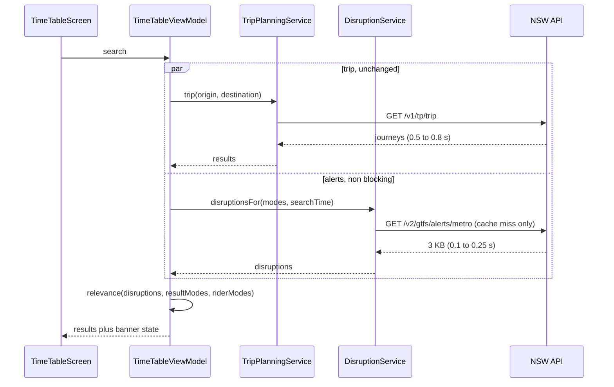

# Feature ERD: Service disruptions in trip results

Status: Built for review (metro banner). Deferred items are listed in section 10.
Touches: `feature/trip-planner/state`, `feature/trip-planner/network`, `feature/trip-planner/ui`, `feature/track/network` (alerts feed type), `io/gtfs` (proto), `KRAIL-BFF` (alerts proxy)

Measurements below were taken from the live NSW APIs on 2026-11-20 with `curl --compressed`.
They are point-in-time; re-run before relying on them.

---

## 1. Problem and scope

A rider searching a trip they normally make by metro gets replacement buses and odd changes,
with no sign that the metro is not running. The trip planner silently routes around a closed
line, and KRAIL only shows alerts attached to the journeys the planner returned.

In scope (built):
- Show a disruption banner above results when metro is out of service, both ends of the trip are
  served by metro, and metro is missing from, or replaced by buses in, the results.

Deferred (section 10): replacement-bus leg chips, the neutral "no metro, no alert" banner, alert
sheet grouping by severity, saved-trip chip, train and light-rail alerts.

Out of scope:
- Lift and escalator outages, standing notices, station facility notices (not service impact).
- Bus-network alerts and train alerts in the first version. Train alerts name routes such as
  `T6_1a` and `BNK_1a` that the planner does not use, so a train banner needs a route-to-line
  mapping first; without it every train rider would see every train alert.
- Push notifications.
- Any background polling.

## 2. Entities and relationships


| Entity | Layer | Source of truth | Identity key | Lifetime |
|---|---|---|---|---|
| ALERT_FEED | network | NSW GTFS-R alerts v2, one per mode | feedName | cache TTL, in memory only |
| RAW_ALERT, INFORMED_ENTITY, ACTIVE_PERIOD | network (Wire-generated) | same feed | position in feed | one parse |
| DISRUPTION | domain | classifier output | feedName + header + window start | cache TTL |
| DISRUPTION_CONTEXT | domain | search request | none, value object | one classification |
| STOP_PRODUCT_CLASS | db (existing `NswStopProductClass`) | bundled stop data | stopId + productClass | app data |
| LEG tag | ui | classifier plus journey legs | journeyId + leg index | screen state |

Collision check, from real data:
- One alert maps to many entities: the metro alerts carry 2 informed entities each, both
  `routeId = SMNW_M1` with an empty `stopId`. Line alerts name no stops, so matching by stop
  is impossible. Matching is by mode (feed) plus the rider's modes.
- One line maps to many alerts: M1 has four concurrent alerts for different stretches and
  windows. The identity key therefore includes the window start, not only the route.
- The route id `SMNW_M1` is a GTFS id; the trip API uses `nsw:...` line ids. They are not
  joined in v1. Mode comes from the feed name, which avoids the join.

Relevance rule, as built (`DisruptionRelevance.kt`). A banner shows only when all hold:
1. The alert's severity is NOT_RUNNING.
2. Both the origin and the destination are served by that mode. A train trip from Central, which
   also has a metro, is not a metro trip; Parramatta has no metro, so it gets no banner.
3. The rider has not filtered that mode out.
4. The alert's window overlaps the times of the results on screen. With no results, the next 2 hours.
5. The mode is missing from the results, or the alert says buses replace it and the results contain a bus leg.

Alerts name no stops, so (5) cannot tell which stretch the rider uses; the banner prints the
alert's own headline so the rider can judge. The replacement-bus branch can fire for a rider whose
bus leg is unrelated to the closure while a "buses replace metro" alert is active for some stretch
and time window that overlaps their results. This is the main false-positive risk and is listed
in section 9.

## 3. Interfaces

```kotlin
// :feature:trip-planner:state, package ...state.disruption
interface DisruptionRepository {
    suspend fun load(feed: DisruptionFeed): Result<List<Disruption>>
}
enum class DisruptionFeed(val feedName: String, val productClass: Int) { METRO("metro", 2) }
sealed interface DisruptionBannerState { data object None; data class Shown(val disruption: Disruption) }

// :feature:trip-planner:network, internal, pure, no I/O
internal fun classifyAlerts(feed: DisruptionFeed, alerts: List<Alert>): List<Disruption>
internal class RealDisruptionRepository(service: GtfsRealtimeService, clock, ttl = 3.minutes, requestBudget = 3.seconds)

// :feature:trip-planner:ui, internal
internal fun disruptionBanner(disruptions, endpointProductClasses, resultProductClasses, spanStartEpochSec, spanEndEpochSec): DisruptionBannerState
internal class DisruptionLoader(repository, sandook, scope, dispatcher, nowEpochSec)

// :feature:track:network, extended
enum class GtfsFeedType { TRIP_UPDATES, VEHICLE_POSITIONS, ALERTS }
```

- `GtfsRealtimeService.fetchFeed(feedName, ALERTS)` is reused; no new HTTP client.
- Endpoint modes come from `Sandook.selectStopsByIds` (the bundled `NswStopProductClass` table), so
  deciding whether a trip is a metro trip needs no network.
- `TimeTableViewModel` takes an optional `DisruptionRepository`, like `CarriageForecastRepository`.
- The banner reuses the shared `InfoTile` (CRITICAL_ALERT type, expanded, no dismiss).
- The classifier keeps alerts whose effect is NO_SERVICE, REDUCED_SERVICE, SIGNIFICANT_DELAYS,
  DETOUR or MODIFIED_SERVICE, plus any headline worded "do not run", "buses replace", "suspended",
  "no service" or "not running". It drops UNKNOWN_EFFECT facility notices, lift and escalator
  headlines, alerts with no start, and empty headlines. An open end date means ongoing.
- Fakes: `FakeGtfsRealtimeService` and `FakeClock` already exist in `:core:testing`.

## 4. External contracts

| Call | Method and path | Key params | Auth | Format | Wire size | Latency (3 samples) |
|---|---|---|---|---|---|---|
| Metro alerts | GET `/v2/gtfs/alerts/metro` | none | NSW key | protobuf | 3.2 KB | 0.12 to 0.23 s |
| Train alerts | GET `/v2/gtfs/alerts/sydneytrains` | none | NSW key | protobuf | 20 KB | 0.13 s |
| Light rail alerts | GET `/v2/gtfs/alerts/lightrail` | none | NSW key | protobuf | 1.3 KB | 0.22 s |
| Regional train alerts | GET `/v2/gtfs/alerts/nswtrains` | none | NSW key | protobuf | 11.6 KB | 0.21 s |
| Bus alerts (not v1) | GET `/v2/gtfs/alerts/buses` | none | NSW key | protobuf | 35 KB | 0.55 s |
| add_info metro (rejected) | GET `/v1/tp/add_info` | `filterMOTType=2` | NSW key | JSON | 21 KB gzip, 217 KB decoded | 0.18 to 0.27 s |
| Trip (existing, for scale) | GET `/v1/tp/trip` | `calcNumberOfTrips=6` | NSW key | JSON | 34 KB | 0.54 to 0.78 s |

- Responses carry `cache-control: public, max-age=90`, so data is never fresher than 90 s.
- Fields read: header text, description text, url, effect, cause, active period, informed
  route id. Fields ignored: translations other than the first, informed stop ids.
- Why not add_info: 217 KB of JSON to decode for 7 metro items, against 3 KB of protobuf for
  the same alerts, because each item embeds full line objects.
- Parity: `GtfsRealtimeService` goes through `BffEndpointResolver`, so when the BFF rollout is armed
  the app asks the BFF for `/v2/gtfs/alerts/metro`. KRAIL-BFF now serves that path
  (`GtfsRoutes.kt`, `NswClient.getGtfsAlertsRaw`) as a byte proxy with a 60 s per-feed cache, so one
  NSW call serves every rider. Classification stays in the app for both paths, so there is one
  implementation and nothing to drift. The BFF is disarmed today.
- Proto fix: the app's `gtfs-realtime.proto` declared `active_period` as a single field. The spec
  and NSW use `repeated`; a single field keeps only the last period. Changed to `repeated`, which
  is wire compatible.

## 5. Data flow



## 6. Cost budget

| # | Question | Answer |
|---|---|---|
| 1 | API calls | A trip whose origin and destination are not both served by metro: **0 extra**, decided offline from the stop table. A metro trip: **1 extra call** to `/v2/gtfs/alerts/metro` on the first results load, beside the trip call. While the screen stays open the trip refresh stays at 1 call per 30 s; the alerts repository answers from memory for 3 minutes, so about 3 to 4 extra calls per 10 minutes. Nothing at app start, nothing in the background. |
| 2 | Payload | 3.2 KB gzip for metro, against 34 KB for a trip call. Protobuf decode of a few KB. The 217 KB add_info JSON path was rejected. |
| 3 | Timing | Metro alerts returned in 0.12 to 0.23 s against 0.54 to 0.78 s for the trip call. The loader starts beside the trip call and never gates it, so time to results is unchanged. Budget 3 s, no retry, silent on failure. |
| 4 | UX | No spinner and no placeholder. A late or failed alert means no banner and unchanged results. The banner is a list item with `animateItem`, so it slides in; it is open by default because the replacement times are the answer. Offline: the existing connectivity gate applies, no banner. |
| 5 | Network efficiency | In-memory cache, TTL 3 minutes (above NSW's `max-age=90`). Duplicate callers wait on one lock and read the cache. A failure returns the last good answer, so a dropped request never removes a showing banner. The loader skips a refresh while one is in flight. |
| 6 | Battery | No timers and no background work. It rides `fetchTrip()`, which the screen already runs on its 30 s refresh while visible. Radio wake-ups per minute: unchanged. Parse: a few KB. |
| 7 | Shared limits | At most +3 to +4 small calls per 10 minutes for a metro trip, zero otherwise. Rate-limit headroom is unmeasured. With the BFF armed, 1 NSW call per feed per minute total. |

| Flow | Calls before | Calls after | Bytes before | Bytes after | Time to results before | after |
|---|---|---|---|---|---|---|
| Search, not a metro trip | 1 | 1 | 34 KB | 34 KB | 0.5 to 0.8 s | unchanged |
| Search, metro trip, cold cache | 1 | 2 | 34 KB | 37 KB | 0.5 to 0.8 s | unchanged |
| Search, metro trip, warm cache | 1 | 1 | 34 KB | 34 KB | unchanged | unchanged |
| Results open 10 minutes, metro trip | 20 | 23 to 24 | 680 KB | about 690 KB | n/a | n/a |

Train alerts (20 KB), the saved-trip chip and bus alerts are not in v1, so the earlier saved-trips
cost line does not apply yet. It must be re-budgeted before that work starts.

## 7. States and UX

Mockups: https://claude.ai/artifact/BMoVoEixHaHPZGGQoGzton (private review page). The built banner uses the standard tile surface, not the red styling in the mockup.

| State | Behaviour | Reuse |
|---|---|---|
| Content with disruption | Banner above the results (InfoTile, critical-alert type, open, "More info" opens the alert's URL) | `InfoTile` |
| Content, metro missing, no alert | Not built | none |
| No disruption | Nothing | none |
| Alerts loading, slow, failed, offline | Nothing, results unaffected | none |

Copy and icons follow `.claude/skills/ui-mockups/SKILL.md`: no helper text beside headings, no
separator glyphs, vector icons only.

## 8. Test plan

Built:
- `AlertClassifierTest` (10): values copied from the live metro feed, including the UNKNOWN_EFFECT
  "Station Update" items, lift headlines, no-end and no-start alerts.
- `RealDisruptionRepositoryTest` (5): feed and type requested, TTL hit, TTL expiry, last good answer
  on failure, failure when nothing cached.
- `DisruptionRelevanceTest` (11): one-ended trips, filtered mode, window overlap before and after,
  open end, delays-only, earliest wins, replacement-bus branch.
- BFF `AlertsCacheTest` (4).

Not built: a hanging-alerts test proving the trip result still arrives (the loader is a separate
coroutine, so it holds by construction, but there is no test); rotation and process-death checks
for the banner (it is derived state rebuilt from the loader, with the tile expansion in
`rememberSaveable`); committed binary feed fixtures shared with the BFF.

## 9. Open gaps and decisions

| Gap or decision | Status |
|---|---|
| No unplanned metro fault observed; every live alert is planned trackwork. The NOT_RUNNING wording list and the effect set are from planned alerts. | Open. Needs a captured real fault. |
| Replacement-bus branch can fire for an unrelated bus leg while a "buses replace metro" alert for another stretch overlaps the results. Mitigated by the banner printing the headline. | Open. Needs the trip API's replacement-bus signal or stop-level data. |
| How the trip API labels a replacement-bus leg. | Open. Blocks the red leg chip. |
| App proto declared `active_period` as a single field. | Fixed to `repeated`. |
| Whether the app's proto includes `Alert`. | Resolved: it does. |
| `sinceLastModified` on the alerts endpoint. | Not used; the repository's TTL cache replaces it. |
| NSW rate-limit headroom for the extra calls. | Open, unmeasured. |
| Train and light-rail alerts need a route-id to line-name mapping. | Open, deferred. |

## 10. Build order

Done: classifier, repository, loader, relevance, banner, DI, BFF alerts proxy with cache.
Deferred, each its own PR with its own cost line: replacement-bus leg chips, neutral banner, sheet
grouping with `priority` in state, saved-trip chip, train and light-rail alerts, shared binary
fixtures with the BFF.
