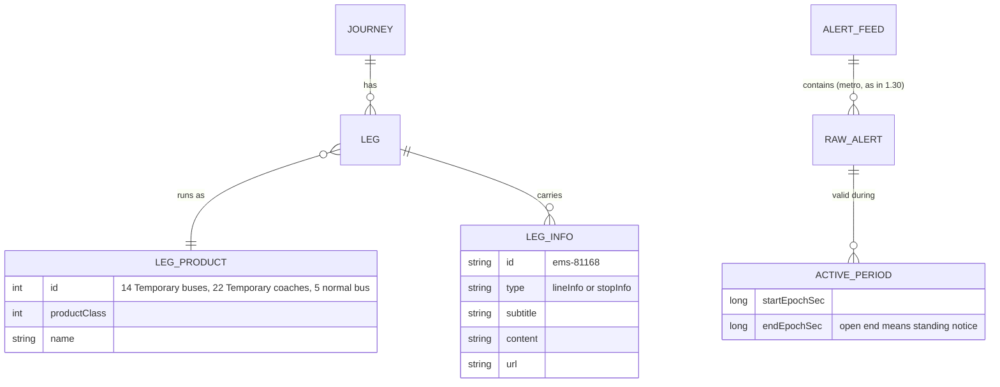
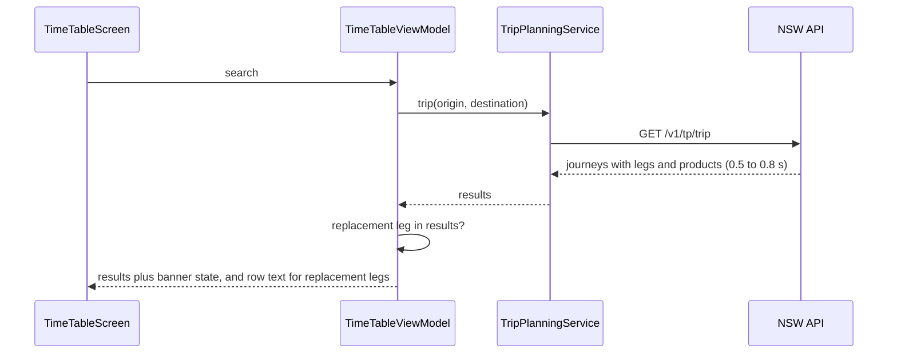

# Feature ERD: Service disruptions in trip results

Status: Locked 2026-11-21 (version 2, real API fields only). Version 1 is built for the metro
banner. PR 1 and PR 2 may start. Three rows (A7, A8, A9) are defaults the owner has not yet
confirmed, see section 9.
Owner: ksharma-xyz
Touches: `feature/trip-planner/state`, `feature/trip-planner/network`, `feature/trip-planner/ui`

Measurements below were taken from the live NSW APIs on 2026-11-20 and 2026-11-21 with
`curl --compressed` and real trip searches. They are point-in-time; re-run before relying on them.

---

## 1. Problem and scope

A rider searching a trip gets replacement buses or odd changes with no sign that their line is not
running. The trip planner silently routes around a closed line, and KRAIL only shows alerts attached
to the journeys the planner returned.

Version 1 (built in 1.30 RC1) only helps a rider whose origin and destination are both served by
metro, reads only the metro feed, and decides by headline wording. On 2026-11-21 it showed nothing
for any train rider, even with four train closures live.

Version 2 uses only fields the NSW APIs return as data, never text read from an alert:
- Recognise a replacement-bus leg in the trip results and say so on the banner and on the rows.
- Show nothing when the results hold no replacement-bus leg.
- Read every active period of an alert in the existing metro logic (version 1 read only the first).

It keeps the 1.30 banner: the info tile, the warning icon (now on a yellow circle), tap to expand,
bold times and places, the last-services board and the "More info" button.

Out of scope, decided 2026-11-21 (reasons in "Why the alert feeds are not used for trains" below):
- Reading the train alert feed, a closed stretch from headline text, a line order file, a route to
  line map, and the later-today heads-up.
- Lift and escalator outages, standing notices, station facility notices.
- Light rail, ferry and bus-network alerts, and regional coach alerts.
- Push notifications and any background polling.

## 2. Entities and relationships



| Entity | Layer | Source of truth | Identity key | Lifetime |
|---|---|---|---|---|
| JOURNEY, LEG, LEG_PRODUCT, LEG_INFO | network (existing `TripResponse`) | trip planner reply | journey + leg index | one results load |
| ALERT_FEED, RAW_ALERT, ACTIVE_PERIOD | network (existing, Wire-generated) | NSW GTFS-R metro alerts | position in feed | cache TTL, in memory only |

Collision check, from real data:
- A leg alert from the trip planner covers the whole route, not the stops. Central to Bondi
  Junction carried the Cronulla to Central closure on three journeys. A leg alert is never a trigger
  on its own.
- A leg alert and a feed alert share no id. The planner's id is `ems-81168`; the feed's is a UUID.
  They can only be paired by text, so they are not paired.

Relevance rule, version 2. A banner shows when a leg in the results is a replacement bus (product
id 14 or 22) and the rider has not filtered that mode out. No alert is needed. With no replacement
leg the version 2 logic shows nothing; the 1.30 metro alert logic is unchanged (A8).

## 3. Interfaces

```kotlin
// :feature:trip-planner:network, internal, pure, no I/O
internal fun isReplacementLeg(leg: Leg): Boolean                  // product id 14 or 22
internal fun hasReplacementLeg(journeys: List<Journey>): Boolean

// :feature:trip-planner:ui, internal
// Existing banner state is kept; REPLACEMENT_BUS_LEG is the new reason beside the 1.30 metro alert.
internal fun disruptionBanner(...): DisruptionBannerState
```

- No new service, no new HTTP call, no new bundled asset.
- The banner stays the shared `InfoTile` (CRITICAL_ALERT, collapsed, no dismiss). The leading icon
  becomes a yellow circle (`KrailTheme.colors.alert`) behind the warning triangle, centred on the
  first line of the title. Only the disruption banner passes this icon.
- One banner per results screen. When a replacement leg and a metro alert both apply, the
  replacement-bus words show (A8).
- Fakes: `FakeClock` exists in `:core:testing`. Test fixtures are real captured trip replies.

## 4. External contracts

| Call | Method and path | Key params | Auth | Format | Wire size | Latency |
|---|---|---|---|---|---|---|
| Trip (existing, nothing new) | GET `/v1/tp/trip` | `calcNumberOfTrips=6` | NSW key | JSON | 34 KB | 0.54 to 0.78 s |
| Metro alerts (existing, 1.30) | GET `/v2/gtfs/alerts/metro` | none | NSW key | protobuf | 3.2 KB | 0.19 to 0.31 s |

Trip fields read:
- `legs[].transportation.product` (`id`, `class`, `name`) decides a replacement leg.
- `legs[].infos` where `type` is `lineInfo`, for the detail text only (A7), never as a trigger.

Metro alert fields read (unchanged from 1.30): header text, description text, url, effect, every
active period, informed route ids.

## Why the alert feeds are not used for trains

Checked on 2026-11-21 against the live feeds (67 train alerts and 6 metro alerts):
- The alert's `stop_id` field is filled only on "Station Update" alerts. It is empty on every closure
  alert, so the closed stations are not in any field. Only headline text names them.
- Every train alert has effect `MODIFIED_SERVICE` and cause maintenance, including platform
  changes, timetable changes and extra stops. Only the wording says whether a line is closed.
- The wording list misses a closure in effect: "Trains run between Liverpool and Lidcombe only".
- Headlines vary: "A, B and C", "A or B", two stretches in one headline. "Cronulla, Waterfall and
  Central" names a station on the other branch, so "every named station is on the rider's trip"
  would miss a Cronulla to Central rider.
- Alert route lists are loose: one Inner West alert is attached to the Bankstown routes.

A banner from text is not evidence. Version 2 therefore shows a banner only when the trip reply
itself carries a replacement-bus leg.

| Decision | Source | Reliable |
|---|---|---|
| Replacement bus on the trip | `transportation.product.id` 14 or 22, a data field (observed, not in NSW docs) | Yes when present. The planner may not show buses far ahead. |
| Closure versus other alert | headline wording | No |
| Closed stretch | headline text | No |
| Active period | `active_period`, a data field | Yes |
| Rider moved to another mode | modes in the results, a data field | Yes |
| Pairing a leg alert with a feed alert | no shared id | No |

## 5. Data flow



The metro alert load from 1.30 runs beside the trip call and never gates it. It is unchanged.

## 6. Cost budget

| # | Question | Answer |
|---|---|---|
| 1 | API calls | **0 new.** The replacement-bus banner and row text read the trip reply that is already fetched. The metro alert call is the 1.30 call, unchanged. |
| 2 | Payload | **0 new.** Parse cost: one pass over the legs already in memory. |
| 3 | Timing | Unchanged. The banner arrives with the results. |
| 4 | UX | No spinner and no placeholder. Failed or offline: results unaffected, no banner. The banner is a list item with `animateItem`. |
| 5 | Network efficiency | No new requests, so nothing to cache or dedupe. |
| 6 | Battery | No timers and no background work. It rides `fetchTrip()`, which the screen already runs. |
| 7 | Shared limits | No change to NSW call volume. |

## 7. States and UX

| State | Behaviour | Reuse |
|---|---|---|
| Replacement buses in the results | Banner "Replacement buses on this trip". Each row with a replacement leg says "Replacement bus" in plain text beside the line badge, with no border. Tap the banner for the planner's line alert detail when one is attached (A7). | `InfoTile`, row text |
| No replacement leg | Nothing from version 2. | none |
| Rider moved to another working mode | Nothing, because no replacement leg exists. | none |
| Content, no disruption | Nothing. | none |
| Offline or failed trip | Nothing. | none |

Warning icon: a yellow circle (`KrailTheme.colors.alert`, `#FFBA27` light, `#F4B400` dark) behind a
near-black triangle, about 20 dp, centred on the first line of the title. The glyph stays near
black in both themes because the shared `onSurface` tint is white in dark mode and would not read on
yellow.

**Times.** NSW writes times three ways in one alert ("11:10PM", "4AM", "23:03"). The card rewrites all
of them the way the rest of the app does, in `normaliseTimes` and `to12Hour`. An alert in a format
the parser does not recognise is shown in full with no bold.

**Layouts to re-check** (snapshots, light, light at 2x font, dark): Pixel 6 (411dp), 320dp, the 480dp
dual pane list, a 540dp Surface Duo screen and a tablet, with a short and a long alert. Names,
badges and the new row text wrap as whole items; nothing is shrunk or clipped.

Copy and icons follow `.claude/skills/ui-mockups/SKILL.md`: no helper text beside headings, no
separator glyphs, vector icons only.

## Analytics

`disruption_status` and its params are unchanged. Check any new `reason` value against the
new-event checklist in `docs/ANALYTICS_EVENTS.md` in the PR that adds it. No alert text is sent.

## 8. Test plan

Built in version 1 and kept: `AlertClassifierTest`, `RealDisruptionRepositoryTest`,
`DisruptionRelevanceTest`, `DisruptionDetailTest`, `DisruptionAnalyticsTest`, banner snapshots.

New, from real captured trip replies (fixtures committed under the module's test resources):
- Replacement legs: Cronulla to Central (every leg product id 14), Bankstown to Sydenham at 11:30 pm
  (one metro journey, then product id 14 buses), a normal bus journey (id 5, no banner).
- No banner: Parramatta to Central (a T1 leg alert for Richmond to Blacktown, no replacement leg),
  Central to Bondi Junction (carries the Cronulla closure as a leg alert, no replacement leg).
- Rider moved to another mode: Sydenham to Central with metro only, no banner.
- Every active period read: an alert with two periods.
- Pure-logic tests run against the same fixtures.
- Configuration change and state survival: banner state is derived; tile expansion stays in
  `rememberSaveable`.
- A hanging metro alerts feed must not delay the trip result.

## 9. Open gaps and decisions

| Gap or decision | Status |
|---|---|
| No unplanned metro fault observed; every live alert is planned trackwork. The closure wording list is from planned alerts. | Open. Needs a captured real fault. |
| How far ahead the planner loads replacement buses. Loaded for Richmond to Blacktown the next morning, not for Ashfield to Central, not for Mon 30 Nov. Those riders see nothing from version 2. | Accepted by owner 2026-11-21. |
| Replacement legs for light rail and ferry. | Open, not yet seen. |
| `active_period` read as one field and only the first period used. | Fix in PR 1. |

### Assumptions for approval (mandatory, no code until signed off)

Each row decides who sees a banner, when, or which cases count. Sign-off line:
`Approved by ksharma-xyz, <date>`.

| # | Assumption | Evidence (real data, named cases) | What breaks if it is wrong | Decision |
|---|---|---|---|---|
| A1 | A replacement bus is a leg whose product id is 14 ("Temporary buses", class 5), or id 22 ("Temporary coaches", class 7) for regional. | 27 legs across Cronulla, Waterfall, Dapto, Olympic Park, Richmond and a metro closure, none on the 11 normal bus legs (id 5, "Sydney Buses Network"). Observed on 2026-11-21, not in NSW documentation. | A replacement of another type is invisible, and a renamed product silently removes the banner. | Approved by ksharma-xyz, 2026-11-21 |
| A2 | A banner shows only when the trip reply carries a replacement-bus leg. Alert text is never a trigger. A rider whose planner has not loaded the buses yet sees nothing. | Ashfield to Central Sun 22 Nov 7:00 am, closure from 6:20 am: trains, no buses. Richmond to Blacktown Sun 22 Nov: buses shown. | A rider days ahead of a closure is not warned. | Approved by ksharma-xyz, 2026-11-21 (option A) |
| A3 | An alert attached to a leg covers the whole route, so it is never a trigger by itself. | Central to Bondi Junction and Central to Coogee carried the Cronulla to Central closure. T1 trains from Parramatta carried the Richmond to Blacktown closure. | A banner for a rider far from the closed stretch. | Approved by ksharma-xyz, 2026-11-21 |
| A4 | A rider whose results moved to another working mode sees no banner. | Sydenham to Central Sat 21 Nov: train closure live, planner returned metro only. | The rider does not learn trains are replaced. | Approved by ksharma-xyz, 2026-11-21 |
| A5 | Banner title "Replacement buses on this trip" when replacement buses are in the results. | 1.30 shows the alert headline today, so this shortens the collapsed title. | The collapsed card says less than 1.30 does. | Approved by ksharma-xyz, 2026-11-21 |
| A6 | Rows with a replacement-bus leg say "Replacement bus" in plain text, no border. | Cronulla to Central, Bankstown to Sydenham at 11:30 pm. | None beyond a longer row. | Approved by ksharma-xyz, 2026-11-21 |
| A7 | The expanded banner shows the planner's own line alert (`type` `lineInfo`) attached to a leg in the results, as the planner gives it. With none, the banner is not expandable. | Cronulla to Central: the bus leg carried no alert, a train leg carried "Buses replace trains between Cronulla, Waterfall and Central" with its full HTML content and url. | A detail that does not explain the replacement, because leg alerts are route-wide (A3). | **Default, not yet seen by owner.** Confirm before PR 2. |
| A8 | The 1.30 metro alert banner is unchanged except it reads every active period. 1.30 rules kept: closure wording, hidden when the rider filtered that mode out, trains and metro only, delays never show a banner. One banner per results screen; when a replacement leg and a metro alert both apply, the replacement-bus words show. | The metro feed carries 6 alerts on 2026-11-21, all `MODIFIED_SERVICE`. | The metro banner stays wording-based, which the check in section 4 found unreliable for trains. | The 1.30 rules: Approved by ksharma-xyz, 2026-11-21. Leaving metro unchanged and the precedence rule: **default, not yet seen by owner.** |
| A9 | The later-today heads-up is deferred. It needs a closure's start time from alert text, which version 2 does not read for trains. | Metro closure from 11:20 pm Mon 23 Nov would be the only case. | A rider is not warned a closure starts later today. | **Default, not yet seen by owner.** Deferred, no code. |

Dropped on 2026-11-21 after the reliability check: closed stretch from headline, stretch rules,
route to line map, bundled station order, train alert feed. Each depended on reading text.

## 10. Build order

Each PR is under 500 lines with one concern and its own cost line.
1. Read every active period in the classifier, and the proto check. Bug fix, no behaviour change.
2. Replacement-bus signal from the trip reply: banner title (A1, A5), row text (A6), expanded
   detail (A7) and the yellow circle icon. No new calls. Needs A7 and A8 confirmed.
3. Deferred, each its own change: heads-up for closures later today (A9), light rail and ferry
   replacements, regional coaches, saved-trip chip, a train alert feed only if a data field that
   names the closed stations is found.
