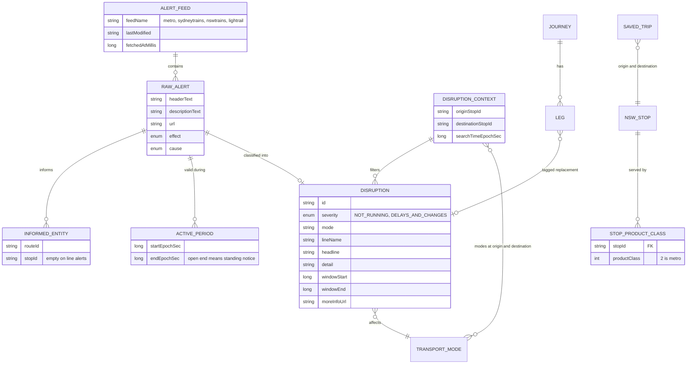
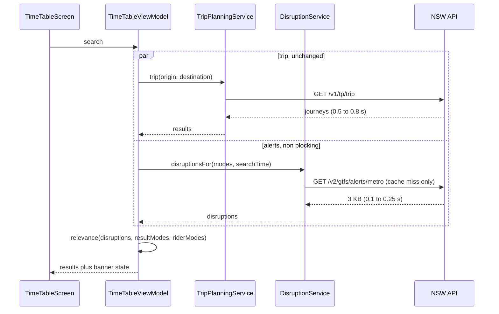

# Feature ERD: Service disruptions in trip results

Status: Draft
Touches: `feature/trip-planner/network`, `feature/trip-planner/ui`, `feature/track/network` (alerts feed type), `KRAIL-BFF` (parity route)

Measurements below were taken from the live NSW APIs on 2026-11-20 with `curl --compressed`.
They are point-in-time; re-run before relying on them.

---

## 1. Problem and scope

A rider searching a trip they normally make by metro gets replacement buses and odd changes,
with no sign that the metro is not running. The trip planner silently routes around a closed
line, and KRAIL only shows alerts attached to the journeys the planner returned.

In scope:
- Show a disruption banner above results when a service-impacting alert applies to a mode the
  rider would use and that mode is missing or replaced in the results.
- Label replacement-bus legs.
- Group alerts by severity in the existing alert sheet.
- A mode chip on saved trips.

Out of scope:
- Lift and escalator outages, standing notices, station facility notices (not service impact).
- Bus-network alerts in the first version.
- Push notifications.
- Any background polling.

## 2. Entities and relationships



| Entity | Layer | Source of truth | Identity key | Lifetime |
|---|---|---|---|---|
| ALERT_FEED | network | NSW GTFS-R alerts v2, one per mode | feedName | cache TTL, in memory only |
| RAW_ALERT, INFORMED_ENTITY, ACTIVE_PERIOD | network (Wire-generated) | same feed | position in feed | one parse |
| DISRUPTION | domain | classifier output | feedName + header + window start | cache TTL |
| DISRUPTION_CONTEXT | domain | search request | none, value object | one classification |
| STOP_PRODUCT_CLASS | db (existing `NswStopProductClass`) | bundled stop data | stopId + productClass | app data |
| LEG tag | ui | classifier plus journey legs | journeyId + leg index | screen state |

Collision check, from real data:
- One alert maps to many entities: the metro alerts carry 2 informed entities each, both
  `routeId = SMNW_M1` with an empty `stopId`. Line alerts name no stops, so matching by stop
  is impossible. Matching is by mode (feed) plus the rider's modes.
- One line maps to many alerts: M1 has four concurrent alerts for different stretches and
  windows. The identity key therefore includes the window start, not only the route.
- The route id `SMNW_M1` is a GTFS id; the trip API uses `nsw:...` line ids. They are not
  joined in v1. Mode comes from the feed name, which avoids the join.

Relevance rule (two signals):

| Alert on rider's mode, in window | Mode present in results | Result |
|---|---|---|
| yes | no, or replaced by bus | Red banner, replacement-bus chips |
| yes | yes, normal | No banner. Alert only in the sheet if the leg carries it |
| no | no | Neutral banner with timetable button, no cause claimed |
| no | yes | Nothing |

## 3. Interfaces

```kotlin
// module: :feature:trip-planner:network, caller: TimeTableViewModel, SavedTripsViewModel
interface DisruptionService {
    /** Rail and metro modes only in v1. Cached, deduped, silent on failure. */
    suspend fun disruptionsFor(
        modes: Set<TransportMode>,
        searchTime: Instant,
    ): List<Disruption>
}

// module: :feature:trip-planner:state, pure, no I/O, runs in app and BFF fixtures
fun classifyAlerts(
    feedName: String,
    alerts: List<RawAlert>,
    searchTime: Instant,
): List<Disruption>

// module: :feature:trip-planner:state, pure
fun relevance(
    disruptions: List<Disruption>,
    resultModes: Set<TransportMode>,
    riderModes: Set<TransportMode>,
): DisruptionBannerState

// module: :feature:track:network, extend existing
enum class GtfsFeedType { TRIP_UPDATES, VEHICLE_POSITIONS, ALERTS }
```

- `GtfsRealtimeService.fetchFeed(feedName, feedType = ALERTS, sinceLastModified)` already
  supports conditional requests and returns `Unchanged`. Reuse it. Do not add a client.
- Fakes: `FakeDisruptionService` in `:core:testing`.
- Rider modes come from `NswStopProductClass` for the origin and destination stops.

Classifier rules, which both repos run against the same fixtures:
- Keep: `effect` is MODIFIED_SERVICE, REDUCED_SERVICE, NO_SERVICE, SIGNIFICANT_DELAYS or DETOUR,
  with an informed route, and an active period that contains the search time.
- Drop: `UNKNOWN_EFFECT` (the live "Station Update" and "Opal sales" items), periods ending
  after year 2100 (standing notices), anything outside the search window.
- NOT_RUNNING when the header matches "do not run", "buses replace", "suspended" or "no service"
  or the effect is NO_SERVICE. Otherwise DELAYS_AND_CHANGES.

## 4. External contracts

| Call | Method and path | Key params | Auth | Format | Wire size | Latency (3 samples) |
|---|---|---|---|---|---|---|
| Metro alerts | GET `/v2/gtfs/alerts/metro` | none | NSW key | protobuf | 3.2 KB | 0.12 to 0.23 s |
| Train alerts | GET `/v2/gtfs/alerts/sydneytrains` | none | NSW key | protobuf | 20 KB | 0.13 s |
| Light rail alerts | GET `/v2/gtfs/alerts/lightrail` | none | NSW key | protobuf | 1.3 KB | 0.22 s |
| Regional train alerts | GET `/v2/gtfs/alerts/nswtrains` | none | NSW key | protobuf | 11.6 KB | 0.21 s |
| Bus alerts (not v1) | GET `/v2/gtfs/alerts/buses` | none | NSW key | protobuf | 35 KB | 0.55 s |
| add_info metro (rejected) | GET `/v1/tp/add_info` | `filterMOTType=2` | NSW key | JSON | 21 KB gzip, 217 KB decoded | 0.18 to 0.27 s |
| Trip (existing, for scale) | GET `/v1/tp/trip` | `calcNumberOfTrips=6` | NSW key | JSON | 34 KB | 0.54 to 0.78 s |

- Responses carry `cache-control: public, max-age=90`, so data is never fresher than 90 s.
- Fields read: header text, description text, url, effect, cause, active period, informed
  route id. Fields ignored: translations other than the first, informed stop ids.
- Why not add_info: 217 KB of JSON to decode for 7 metro items, against 3 KB of protobuf for
  the same alerts, because each item embeds full line objects.
- Parity: KRAIL-BFF gets `GET /v1/alerts/disruptions?modes=metro,trains&at=<epoch>` returning
  the classifier's output, run against the same fixtures. The app resolver
  (`BffEndpointResolver`, `ENABLE_PROTO_BFF`) chooses the base URL. Disarmed today.

## 5. Data flow



## 6. Cost budget

| # | Question | Answer |
|---|---|---|
| 1 | API calls | Per search: 0 to 2 extra small calls, one per rail or metro mode at the origin or destination, usually 1 (a metro-only trip) and at most 2. Zero when the cache is warm. While the results screen is visible: the existing trip refresh stays at 1 call per 30 s; alerts refresh only on that same tick and only when the cache is older than 3 minutes, so about 3 to 4 extra calls per mode per 10 minutes. Saved trips screen: one call per distinct rail mode among saved trips, at most 2, once per 3 minutes. Nothing runs at app start before first frame. |
| 2 | Payload | Metro 3.2 KB, trains 20 KB, light rail 1.3 KB. Against 34 KB for one trip call. Protobuf decode of a few KB, not 217 KB of JSON. Bus feed (35 KB) is excluded from v1. |
| 3 | Timing | Alerts run in parallel with the trip call and finish first (0.1 to 0.25 s against 0.5 to 0.8 s), so the banner is ready when results render and time to results is unchanged. The trip call never awaits alerts. Alert budget: 3 s timeout, no retry, silent on failure. |
| 4 | UX | Loading: nothing extra, results load as today. Slow or failed alerts: no banner, results unaffected. If alerts arrive after results, the banner animates in only while the list is at the top and never moves a card the rider is touching. Offline: no call, no banner. Empty: no banner. The neutral variant never claims a cause. |
| 5 | Network efficiency | In-memory cache per feed, TTL 3 minutes, aligned above the server's 90 s max-age. `sinceLastModified` makes refresh a 304-style `Unchanged` where NSW supports it (verify). In-flight dedupe so two screens asking for metro share one request. One cache shared by results and saved trips. |
| 6 | Battery | No timers and no background work. Foreground only, gated with `repeatOnLifecycle(STARTED)`. Alert refresh rides the existing 30 s trip tick so it shares that radio wake-up instead of adding one. Parse cost is a few KB. No new wake-ups per minute. |
| 7 | Shared limits | Adds roughly 15 to 20 percent more calls on a results screen held open for 10 minutes, about 3 percent more bytes for a metro-only trip. Rate-limit headroom unmeasured, listed in section 9. BFF parity collapses all riders into one upstream poll per feed per 90 s. |

| Flow | Calls before | Calls after | Bytes before | Bytes after | Time to results before | after |
|---|---|---|---|---|---|---|
| One search, metro-only, cold cache | 1 | 2 | 34 KB | 37 KB | 0.5 to 0.8 s | 0.5 to 0.8 s |
| One search, warm cache | 1 | 1 | 34 KB | 34 KB | same | same |
| Results held open 10 minutes | 20 | 20 + 3 to 4 | 680 KB | about 700 KB | n/a | n/a |
| Saved trips opened, metro and trains saved | 0 | 2 | 0 | 23 KB | n/a | no change to first frame |

The saved-trips row is the one real added cost on a path every user hits. It is gated behind
having saved metro or train trips, deferred until after first frame, and cached for 3 minutes.

## 7. States and UX

Mockups: https://claude.ai/artifact/BMoVoEixHaHPZGGQoGzton (private review page).

| State | Behaviour | Reuse |
|---|---|---|
| Content with disruption | Red banner, replacement-bus chips, grouped sheet | new `DisruptionBanner`, existing sheet |
| Content, metro missing, no alert | Neutral banner, timetable button | new variant of the same component |
| No disruption | Nothing | none |
| Alerts loading, slow, failed, offline | Nothing, results unaffected | none |

Copy and icons follow `.claude/skills/ui-mockups/SKILL.md`: no helper text beside headings, no
separator glyphs, vector icons only.

## 8. Test plan

- Fixtures captured from the live feeds on 2026-11-20 (metro, sydneytrains), including the
  UNKNOWN_EFFECT "Station Update" items and a standing notice, committed as binary protobuf plus
  expected classifier JSON.
- Pure tests for `classifyAlerts` and `relevance` over the 2x2 table above.
- Cache tests: TTL, in-flight dedupe, `Unchanged` path, failure leaves previous value.
- A test that the trip call result is delivered even when the alerts call hangs.
- Rotation and process-death cases from the checklist for banner state.
- The same fixture suite added to KRAIL-BFF.

## 9. Open gaps and decisions

| Gap or decision | Owner | Needed by |
|---|---|---|
| No unplanned metro fault observed; every live alert is planned trackwork. Capture over a couple of weeks before finalising the NOT_RUNNING rule. | | before classifier merge |
| How the trip API labels a replacement-bus leg; the red leg chip needs a reliable signal. | | before UI |
| Whether the app's Wire-generated proto includes `Alert` and `EntitySelector`; the proto submodule is not checked out here. The BFF proto does. | | before service |
| The BFF flagged a latent decode problem with `TripDescriptor.direction_id` as string in the app's proto. Alerts feeds had no trip entities, but confirm. | | before service |
| Whether `sinceLastModified` yields `Unchanged` on the alerts endpoints. | | before service |
| NSW rate-limit headroom for roughly 15 to 20 percent more calls. | | before rollout |
| Include bus alerts later, behind a measured cost. | | later |

## 10. Build order

1. Fixtures and the pure classifier plus `relevance`, with tests. No UI.
2. `GtfsFeedType.ALERTS` and `DisruptionService` with cache, dedupe and fake.
3. ViewModel wiring, banner and leg chips on the results screen.
4. Alert sheet grouping and `priority` carried into state.
5. Saved-trip mode chip.
6. BFF route, same fixtures.
