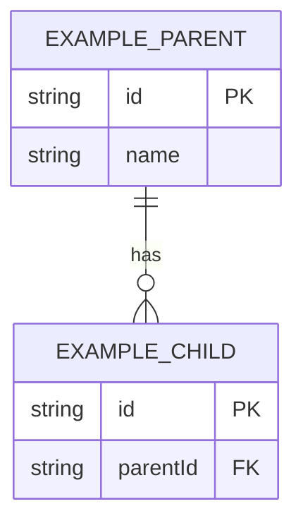
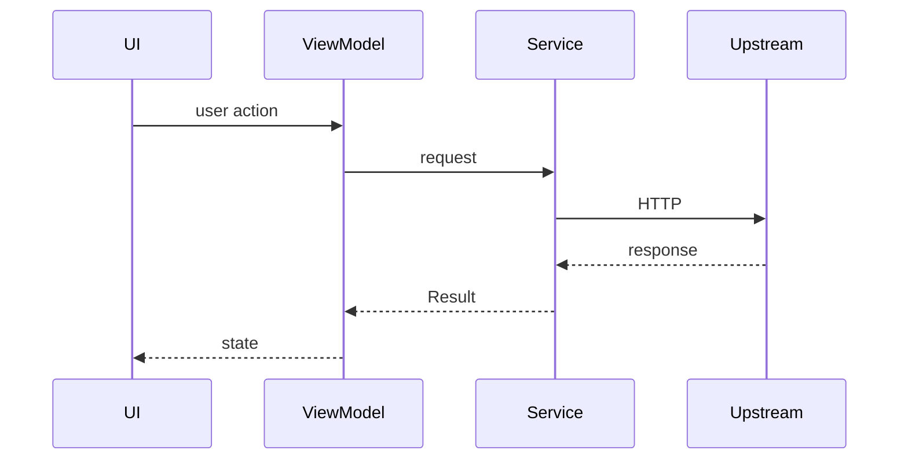

# Feature ERD: <feature name>

Copy this file to `docs/features/<feature-name>/ERD.md` and fill every section **before any
code is written**. Code is built from this document and the document is updated in the same
change whenever the code diverges. A section that does not apply says "None" and why; it is
never deleted.

Status: Draft | Agreed | Built
Owner: <github login>
Touches: <modules and repos, e.g. `feature/trip-planner/*`, `KRAIL-BFF`>

---

## 1. Problem and scope

- Who has the problem, in one sentence a rider would recognise.
- What this feature does.
- What it deliberately does not do.

## 2. Entities and relationships

One `erDiagram` block. Every entity the feature adds or changes, whether it is a persisted
row, a network DTO, a domain model or UI state. Mark the layer in the entity comment.



Then one table per entity, so nothing lives only in the diagram:

| Entity | Layer (network / domain / db / ui) | Source of truth | Identity key | Lifetime |
|---|---|---|---|---|

Collision check (see `FEATURE_QUALITY_CHECKLIST.md` section 2): can one A map to many B, can one
B map to many A, does the key survive both? Answer from real data, not from the schema.

## 3. Interfaces

Kotlin signatures only, no bodies. One block per interface, with the module it lives in and
who calls it. Every interface has a fake in `:core:testing`.

```kotlin
// module: :feature:<x>:network, caller: <ViewModel>
interface ExampleService {
    suspend fun fetch(request: ExampleRequest): Result<ExampleResponse>
}
```

- Failures are `Result<T>` with a typed `NetworkException`. Never a raw Ktor exception.
- Pure logic (classifiers, mappers, rules) is its own function with no I/O, so one fixture
  suite can run it in both the app and the BFF.

## 4. External contracts

Every upstream call and every BFF route the feature uses.

| Call | Method and path | Key params | Auth | Response format | Measured wire size | Measured latency |
|---|---|---|---|---|---|---|

- Fields the feature reads, fields it ignores.
- Parity: the same route and the same output shape exist in the app (direct to NSW) and in
  KRAIL-BFF, or the gap is listed in section 9 with an owner.

## 5. Data flow



## 6. Cost budget (mandatory, never "N/A")

Answer all seven with numbers. Measure with `curl --compressed -w` or a fixture; label a
guess as a guess. Reviewers reject a spec with a blank row.

| # | Question | Answer |
|---|---|---|
| 1 | **API calls.** How many per user action, on screen open, and per minute while the screen is visible? Which endpoints, called by whom, and what fan-out does this add? | |
| 2 | **Payload.** Bytes on the wire (gzip) and decoded; parse cost. Is there a smaller endpoint, a filter, or a field subset? | |
| 3 | **Timing.** Time to first useful content before and after. Does it run in parallel with existing calls or block them? What is its timeout, and does it fail silent? | |
| 4 | **UX.** What does the rider see while loading, empty, slow, failed and offline? Any layout shift? Does an optional call ever delay or degrade the core result? | |
| 5 | **Network efficiency.** Cache key and TTL (respect the server's `Cache-Control`), conditional requests (`Last-Modified`), in-flight dedupe, sharing across screens, retry policy. | |
| 6 | **Battery.** Radio wake-ups per minute in the foreground; any timer or work in the background (must be none); lifecycle gating (`repeatOnLifecycle(STARTED)`); CPU and memory for parsing. Can the calls ride an existing refresh tick to share one radio wake-up? | |
| 7 | **Shared limits.** Effect on NSW rate limits and the daily budget; what the BFF would collapse (one upstream poll serving all riders). | |

Before and after, for the main flow:

| Flow | Calls before | Calls after | Bytes before | Bytes after | Time to results before | after |
|---|---|---|---|---|---|---|

Decision rule: a feature may add calls only if it states what rider benefit pays for them. If
an added call is optional, it must be non-blocking, cached, lifecycle-gated and silent on
failure.

## 7. States and UX

All four of loading, empty, error, content, plus offline. Link the mockup or review page.
Which existing component and wording each state reuses.

## 8. Test plan

- Fixtures: real captured responses, committed under the module's test resources.
- Pure-logic tests that both the app and the BFF run against the same fixtures.
- Configuration-change and state-survival cases from the checklist.

## 9. Open gaps and decisions

| Gap or decision | Owner | Needed by |
|---|---|---|

## 10. Build order

Small PRs, each under 500 lines, each with one concern. List them in order here.
